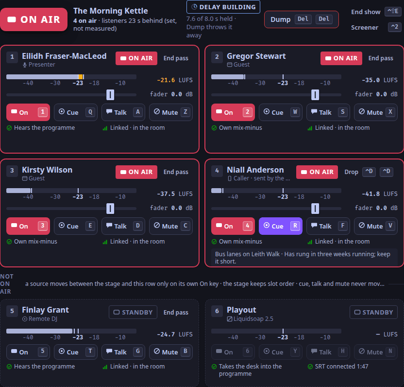

<!-- SPDX-License-Identifier: AGPL-3.0-only -->
<!-- SPDX-FileCopyrightText: 2026 The WeaveSignal contributors -->
# WeaveSignal

WeaveSignal is a studio for an internet radio or video station that you run yourself.
Presenters, guests and callers meet in a live room. A desk mixes them, with a mix-minus for each person so nobody hears
themselves back. Playout keeps the station on air between shows, and listeners hear it on an ordinary stream, a few
seconds behind. The studio app drives the desk, the screener, the cart wall and the schedule. A live chat, show cards,
podcast feeds and a public API come with it.



## Status

**Release one, 1.0.0.** It runs a station on a Linux server with the Compose bundle, or on Cloudron, with the studio
app on Linux or Windows. It has known limits, and some parts of the plan are left for later; both are listed on
[What release one does, and what it leaves out](https://weavesignal.top/docs/reference/release-one-status/).

## Install

The documentation is at **<https://weavesignal.top>**.

| To | Read |
|---|---|
| Run a first show, start to finish | [Run a first show](https://weavesignal.top/docs/tutorials/first-show/) |
| Install a station on a Linux server | [Install a station with weavesignal.sh](https://weavesignal.top/docs/how-to/install-with-weavesignal-sh/) |
| Put it on the internet with a certificate | [Publish a station from the Compose bundle](https://weavesignal.top/docs/how-to/publish-with-compose/) |
| Install it on Cloudron | [Install on Cloudron](https://weavesignal.top/docs/how-to/install-on-cloudron/) |
| Install the studio app | [On Linux](https://weavesignal.top/docs/how-to/install-studio-linux/), [on Windows](https://weavesignal.top/docs/how-to/install-studio-windows/) |
| See which ports it uses | [Ports](https://weavesignal.top/docs/reference/ports/) |

The install script pulls the published server image (`forgejo.weavesignal.top/weavesignal/weavesignal-server:1.0.3`); you can build your own from this
repository instead. The studio app's packages are at <https://weavesignal.top/updates/1.0.0/> and on the
repository's v1.0.0 release, with their signatures and checksums. What changed in each release is in
[`CHANGELOG.md`](CHANGELOG.md).

## Where the source lives

- The main repository: <https://forgejo.weavesignal.top/WeaveSignal/weavesignal>
- A mirror on GitHub: <https://github.com/OrcVole/WeaveSignal>

## What is here

| Path | What |
|---|---|
| `crates/control` | The control plane, an Axum service: settings, staff, room tokens, the schedule, retention, the public pages and the public API |
| `crates/desk` | The desk: finds people in the room by role, mixes the programme and a mix-minus for each, and serves the programme to playout over SRT |
| `crates/mixer` | Mixing code in plain Rust: compressor, leveller, limiter, the profanity delay, the telephone-line sound, loudness |
| `crates/chat` | The live chat service |
| `crates/model` | The data model and its migrations; every row carries a station identifier |
| `crates/proto` | What the processes share: roles, identity rules, LiveKit access tokens |
| `crates/media` | The media worker: parses untrusted audio in a restricted process, measures its loudness, writes clean FLAC |
| `crates/cards`, `crates/feeds` | Show cards, and podcast feeds |
| `playout/` | The fixed Liquidsoap 2.5 scripts; they read generated data, never generated code |
| `apps/studio` | The studio app: Tauri v2 and Svelte 5 (runes) |
| `apps/web` | The public pages: the player with call-in and the chat, the join page, the echo test |
| `packages/ui` | Design tokens, the lamp's states and the panel-name registry, shared by the interfaces |
| `deploy/compose` | The Compose bundle and `weavesignal.sh`, which installs it |
| `deploy/quadlets` | Quadlets for systemd, generated from the bundle |
| `deploy/images` | The server, desk and edge images |
| `deploy/desktop` | The studio app's Linux packages, Windows installer and update feed |
| `tests/` | The stack tests, the port scan, the install test and the browser runs |
| `docs/` | The documentation site (Astro Starlight) |
| `spike/` | The first live-room spike's harness and results: measurements, not product code |

## Build and test

You need Rust 1.98 or later, [`just`](https://just.systems/) and Podman; the interfaces also need pnpm 10 and
WebKitGTK 4.1. The desk needs GStreamer 1.28 with gst-plugins-rs. It is built and tested in its own container image,
so you do not need GStreamer's development files on your machine.

```sh
just --list           # every task, with a line each
just check            # build, test and lint the host crates
podman build -t localhost/weavesignal-desk-spike:dev spike/desk-image   # the desk's base image (once)
just desk-image       # the desk's build image, on that base (once)
just server-image     # the server image the Compose bundle runs
just studio-check     # the studio app: Svelte checks and tests, its build, the Tauri crate
just docs-build       # the documentation site (pnpm 10 first on PATH)
just ci               # every gate, in order
```

`just ci` is the whole gate: the host crates, the API description, licences, REUSE, the desk in its image, the
Liquidsoap scripts, the database tests, the documentation, the studio app and the public pages, then the stack tests
(the room, playout restarts, the video's sound, the carts, the edges, the Compose bundle with its port scan, and the
installer). There is no hosted CI. It needs Podman, cargo-deny, pnpm 10, WebKitGTK 4.1, ffmpeg, and the desk and server
images (`just desk-image server-image`).

## Licence

The code is AGPL-3.0-only (see [`LICENSE`](LICENSE)). The documentation's text and images are CC BY-SA 4.0, and
code samples in the documentation stay AGPL-3.0-only. Both texts are in [`LICENSES/`](LICENSES/), and
[`REUSE.toml`](REUSE.toml) covers files that cannot carry a header. Where anything not ours comes from, and under what
licence, is in [`NOTICES.md`](NOTICES.md).

## Security

Please do not report a security problem in a public issue. How to report one is in
[`SECURITY.md`](SECURITY.md); the contact is <info@weavesignal.top>.
