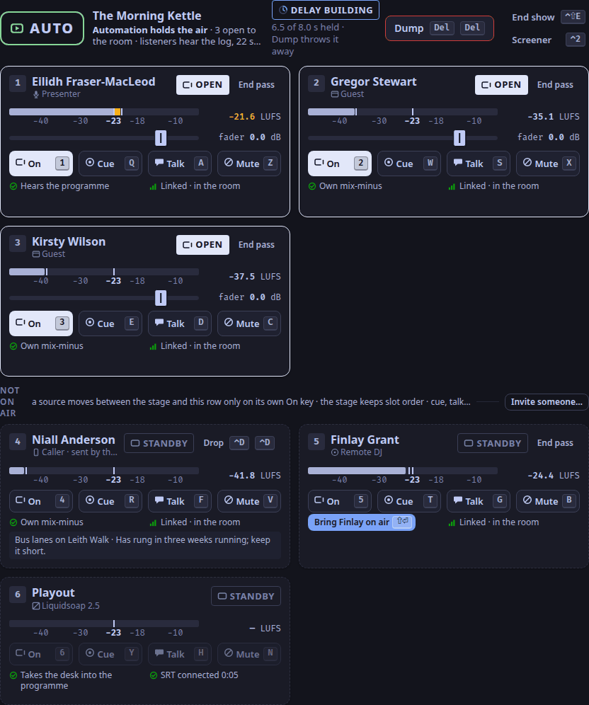

A presenter looks at the lamp to answer one question: can listeners hear me now?
So ON AIR means that and only that (ADR-0062).

## The room and the station are not the same thing

The room is the conversation: presenters, guests and callers in LiveKit, mixed at the desk.
The station is what listeners hear: the desk's programme, taken by playout and served by the listener process.

Most of the time they agree.
When playout stops, they do not: the room is alive and everyone in it still hears everyone else, but no listener hears any of it.
A desk that kept saying ON AIR then would be lying, and a presenter would talk on to nobody.

## OPEN

So a source that is live in the room while playout is down says **OPEN**, and the master lamp says **PLAYOUT DOWN**.
OPEN is not a lesser ON AIR: it tells the presenter that their microphone is live to everyone in the room, so a remark to a guest is still heard by that guest, but not by listeners.
When playout connects again, OPEN turns back to ON AIR by itself; in the studio app's driven test the lamp returned 714 ms after Liquidsoap started.

OPEN is the white lamp, drawn open on its right side (ADR-0079).
It needed a look unlike ON AIR's red fill and unlike CUE, TALK and the accent, in both themes and to colour-blind eyes.
Of the colours compared, white kept the widest margins.

## The lamp never says OPEN

The master lamp speaks for the station, not for one source.
It reads, in this order:

| The lamp says | When |
|---|---|
| FAULT | the desk does not answer, whatever else is known |
| AUTO | the station is in auto mode: automation holds the air (ADR-0183) |
| PLAYOUT DOWN | playout is not connected to the desk, whoever is open |
| ON AIR | playout is connected and at least one source is on air and not muted |
| STANDBY | playout is connected and nobody is on air |

While playout is down a toast says the same in words, *Playout down · room alive*, with how long the link has been down.

## AUTO

In auto mode automation holds the air, and the desk does not reach listeners at all.
By the same rule as playout down, a source that is on in the room says OPEN, never ON AIR, and the lamp says AUTO, a hollow lamp in the mode's colour.
To be heard, leave auto mode first.

## STANDBY

With playout connected and nobody on air, the lamp says STANDBY.
The desk still sends its silent bed and any carts; after the dead-air wait, playout plays automation, then the station's fallback files, then the default loop, then silence ([Playout](/docs/reference/playout/)).

For every word and when it shows, see [States](/docs/reference/states/).
For what to do, see [When the lamp says PLAYOUT DOWN](/docs/how-to/playout-down/).
