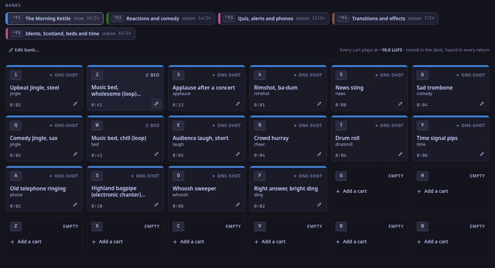
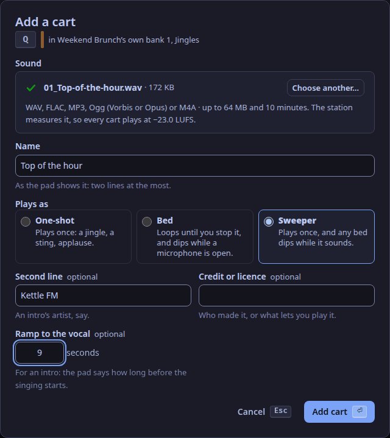
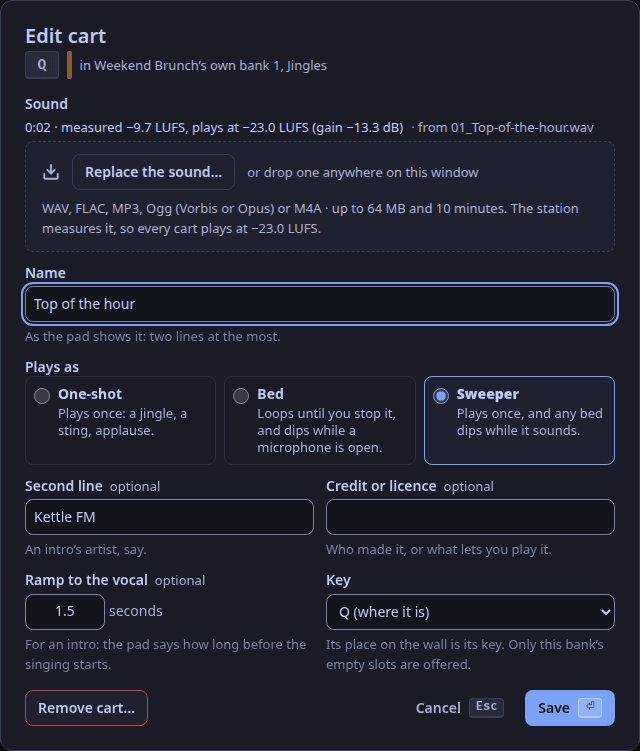
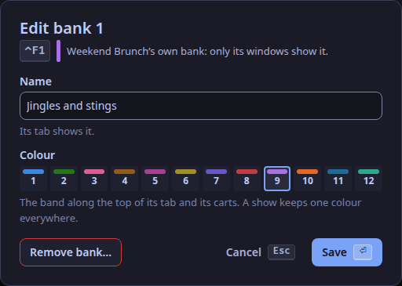
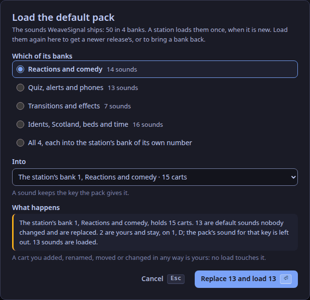

A cart is a sound on a key: a jingle, a sting, applause, a bed to talk over.
From 1.2.1 you add and change carts on the **Carts** tab (`⌃3`) of the studio app itself.
Before that a cart came with the demo banks or through the station's API.

Nothing here needs the show to stop.
A window that is **Preparing** fires nothing, and still adds and changes carts, so you can fill your own show's bank while someone else's show is on air ([Prepare your show while another is on air](/docs/how-to/prepare-your-show/)).

## What a slot takes

- **A sound file**: WAV, FLAC, MP3, Ogg (Vorbis or Opus) or M4A.
- **Up to 64 MB and 10 minutes**, unless your station is set otherwise (`carts.max_upload_mb` and `carts.max_seconds`, [Settings](/docs/reference/settings/)). The dialog prints your station's own figures.
- **At any loudness.** The station measures the sound and plays every cart at one loudness (`carts.loudness_lufs`, −23 LUFS unless set otherwise), so a quiet recording and a loud jingle come out level. Your file on your computer is not changed.

## Add a cart to an empty slot

An empty slot says **Add a cart**.

1. Go to the bank the cart belongs in (`⌃F1` to `⌃F5`).
2. Open the slot: press the pad, or **drop a sound on the pad**. While nothing is on air, or in a preparing window, **its key** (`1`–`6`, `Q`–`Y`, `A`–`H`, `Z`–`N`) opens it too; on air the key only says the slot is empty, so a stray key never puts a dialog over the wall you are firing from.
3. In **Add a cart**, press **Choose a sound…**, or drop the file anywhere on the window. The file's name is offered as the cart's name.
4. Set what the pad should say and how the cart plays:

   | Field | What it is |
   |---|---|
   | **Name** | what the pad shows; two lines at the most |
   | **Plays as** | **One-shot** plays once. **Bed** loops until you stop it and dips while a microphone is open. **Sweeper** plays once, and any bed dips while it sounds |
   | **Second line** | optional: an intro's artist, say |
   | **Credit or licence** | optional: who made it, or what lets you play it |
   | **Ramp to the vocal** | optional, in seconds, for an intro: the pad says how long before the singing starts |

5. Press **Add cart** (`⏎`).

The dialog says the file is on its way while the station reads it, measures it and levels it; a long sound takes a few seconds.
**Stop** (`Esc`) ends the wait at once, so the wall's keys are yours again if you need them on air.
When the cart is added the dialog closes, the wall says what was measured (*“Top of the hour” is on Q: 0:02 · measured −9.0 LUFS, plays at −23.0 LUFS (gain −14.0 dB)*), and the focus is on the new pad: its key fires it.

If the station refuses the file, the dialog shows the station's own sentence and keeps what you typed.
The common ones:

| The dialog says | Do |
|---|---|
| *“…” is 65.0 MB. This station takes sounds up to 64 MB.* | export a shorter or smaller file; nothing was sent |
| *the file was refused: not an audio file this worker reads…* | the file is not one of the formats above, whatever its name ends in |
| *the file was refused: the file is longer than 600 s* | a cart is a short sound; a whole programme belongs in the library |
| *the file was refused: the file is silent* | check the export |
| *the ramp is … ms and the cart … ms long…* | a ramp ends before its cart does |

## Change a cart

A cart that is not sounding has a small **Edit** button in the corner of its pad.
With the keyboard: move to the pad with the arrows, press `Tab` to reach its Edit, then `Space` or `⏎`.
On that button `Space` and `⏎` press it and nothing else: they neither stop a cart nor fire one.
A cart that is sounding is not offered for change: stop it first.

In **Edit cart** you can change:

- its **name**, **second line**, **credit**, **ramp** and how it **plays**, without sending the sound again;
- its **key**: pick another from the list, which holds this bank's empty slots. The cart moves there and its old slot is empty. A cart never lands on another cart;
- its **sound**: press **Replace the sound…**, or drop the new file on the pad or the window. The new sound replaces the old one **when you save**, not before; **Keep the old sound** undoes the choice.

Press **Save** (`⏎`). `Esc` first leaves the field you are typing in; a second `Esc` closes the dialog and changes nothing.

A cart marked **FILE MISSING** has lost its sound on the station: its key does nothing.
Edit it and choose the sound again to put it back.

## Remove a cart

In **Edit cart**, press **Remove cart…**.
The dialog asks first, with **Keep it** in focus, so a reflex `⏎` removes nothing.
**Remove cart** takes the cart off its key and deletes its sound from the station; this cannot be undone.

## Make or change a bank

A bank is the station's, which every show has on that tab, or one show's own, which only that show's windows show ([Cart wall](/docs/reference/surfaces/carts/#a-cart-wall-per-show)).
Each tab says which: **station** or **show**.

- **A tab with no bank** says *not made*. Press **Make bank…** beside the tabs, or just add a cart there: the app asks for the bank's name and colour first, then goes on to the cart.
  In a window that has a show you may change, it asks whose bank it is to be: the show's own, or the station's.
- **Edit bank…** changes the name and colour of the bank the tab shows.
  For a station bank in your show's window it also offers **Make *your show*'s own bank**, which takes that tab in your show's windows and leaves the station's bank as it is for everyone else.
- **Remove bank…** is offered for a show's own bank: its carts and their sounds go with it, and the station's bank of that number has the tab again. The station's banks are not removed; empty their slots instead.

Every dialog says whose bank it writes to.
That matters on a station tab: a station bank is the wall of the show on air as well, so changing it changes it for them.

## Load the default pack again

A new station loads the sounds WeaveSignal ships into its banks once, at its first start.
A station that already has banks never gets a later release's sounds by itself, and a bank you emptied stays empty.
**Default pack…**, beside the tabs, loads them when you ask.

1. Go to the tab of the bank you mean and press **Default pack…**.
2. Choose **which of the pack's banks** to load, or all of them, each into the station's bank of its own number.
3. Choose the station bank it goes **into**. A sound keeps the key the pack gives it.
4. Read **What happens**. The dialog works it out before anything is asked:
   - **An empty bank, or one nobody has made, is loaded directly.** A bank that is made for it takes the pack's name.
   - **In a bank that holds carts, only default sounds nobody changed are replaced.** Those the pack no longer has a sound for go.
   - **A cart you added, renamed, moved to another key or changed (its mode, second line, ramp or credit) is yours, and stays.** The pack's sound for its key is left out.
   - **A cart that is sounding is left to play.** Load again when it has stopped.
5. The button names what it will do: **Load 14 sounds**, or **Replace 12 and load 12**. Press it (`⏎`).

The sounds go through the media worker one by one; the strip beside the tabs counts them, and the wall says when they are loaded.
The pack always goes into the station's banks, which every show shares.
In a window whose show has a bank of its own on that tab, the station's bank is under it: the dialog says so.

A station with no pack (`carts.demo_pack` not set, [Settings](/docs/reference/settings/)) says so in the dialog. Cloudron, the Compose bundle and the Quadlets made from it set it.

## Who may

| Bank | Who may add to it and change it |
|---|---|
| the station's, and loading the default pack into it | any member of staff, and the station key |
| a show's own | an admin, a producer, the station key, and that show's presenter |

Where a bank is not yours to change, its empty slots say *No cart here yet* and its carts have no Edit.
The station is the authority: it refuses what the app should not have offered.

## In the desktop app, and in "Try the desk"

- The desktop app reads a dropped file itself (a webview is not handed dropped files): only a file whose name and first bytes are a sound's, no larger than the station takes.
- In the sandbox on the website the same dialogs work on the demo banks, but the sound stays in the page: nothing is sent, nothing is measured, and it is gone when the page is reloaded.

## See also

- [Cart wall](/docs/reference/surfaces/carts/): every panel, state and key.
- [Carts in the desk](/docs/reference/desk-carts/): the routes behind these dialogs, the media worker, and how a fired cart reaches every ear.
- [Present from the keyboard](/docs/how-to/present-from-the-keyboard/): firing, cueing and fading carts.
