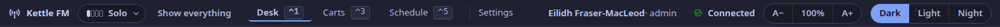
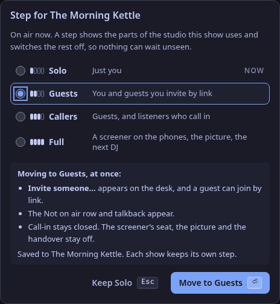
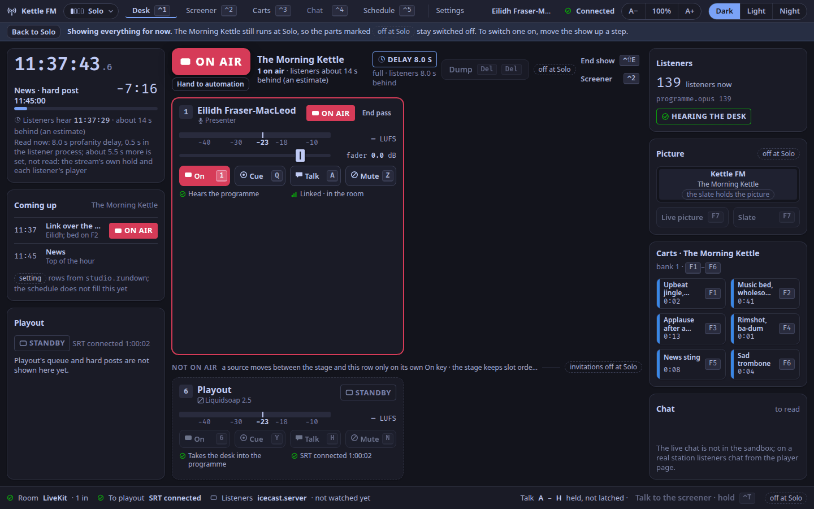
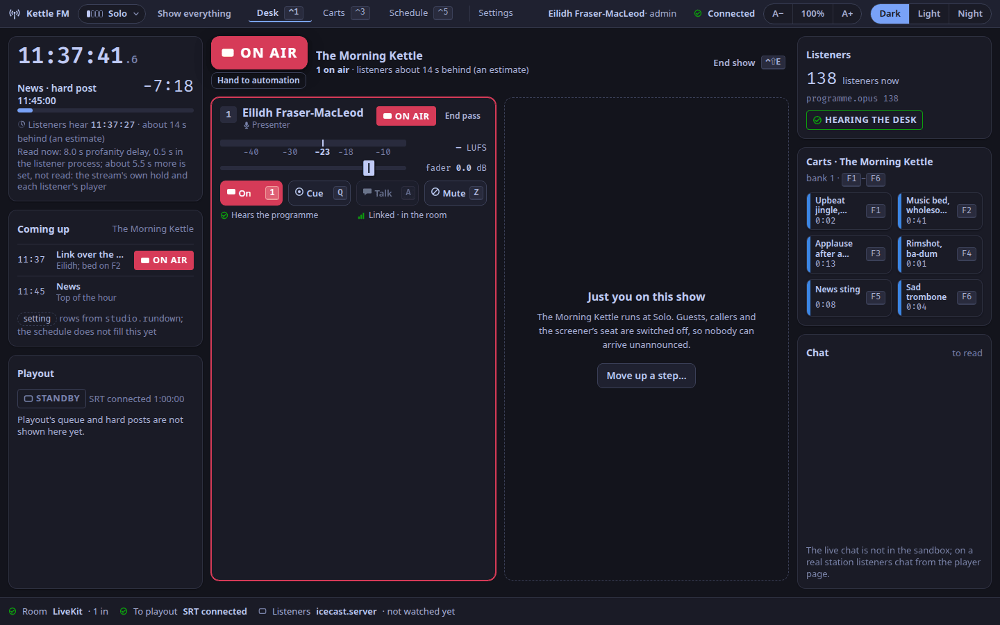
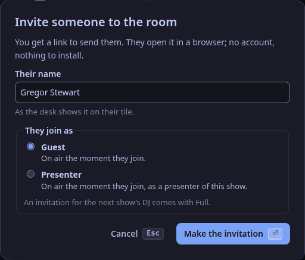
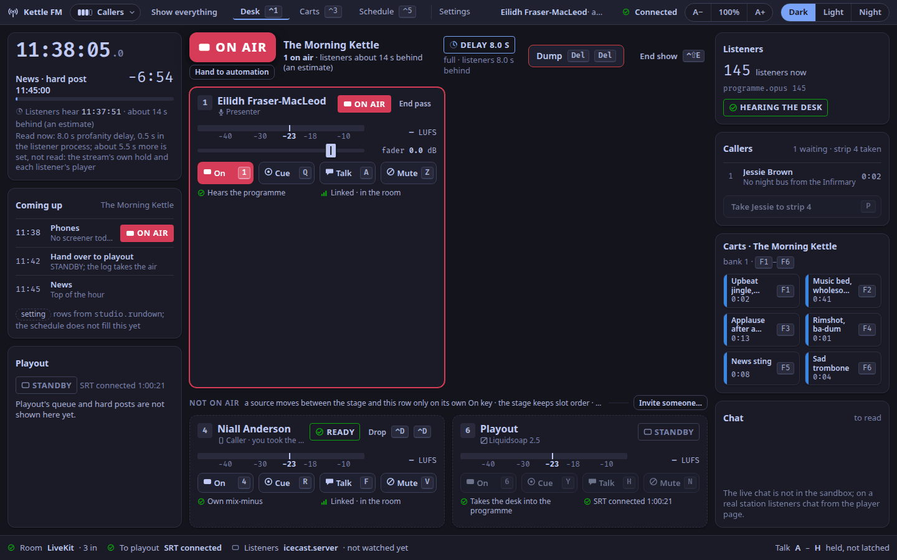
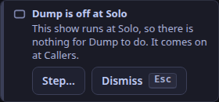

A show runs at one of four steps (ADR-0271).
Each step adds one kind of person to the studio, and whatever a step leaves out is **switched off** while that show is on air, so nothing can wait unseen: with the show at Solo nobody can call in, and nobody can join but the show's own presenter.

| Step | Adds | What is on |
|---|---|---|
| **Solo** | one DJ | the microphone, the music and carts, the listener count, the chat to read |
| **Guests** | guests, by invitation | an invitation for a guest or a second presenter |
| **Callers** | listeners who call in | call-in on the player page, one caller at a time on the desk's strip for callers, and Dump |
| **Full** | a screener, the picture, the next DJ | the screener's seat, the picture's modes, an invitation for the next DJ and the handover, moderating the chat |

Shows that existed before steps arrived stay at Full, so an upgrade hides nothing.
A show made afterwards starts at Solo.

Three rules hold at every step:

- **Nothing moves; things only appear.** Your tile, the clock and the carts sit in the same place at Solo as at Full, and every key keeps its meaning.
- **A step closes doors; it never hides people.** What goes away is a way in: the invitation button, the phone lines, a seat. Someone already in the room keeps their tile until they leave.
- **Full is the studio as it was in 1.0.1**, with the step control in the top bar and a chat to read on the desk.

## In the studio app

### The step, at the top

The show's step is beside the station's name, before the tabs: four pips, filled up to the step, and its word.



Press it for the four steps.
The one in force is marked **now**.
Picking another changes nothing yet: the dialog first says what will change at once (what appears, what stays off, and what happens to the people present), and the button then names the move.



- `↑` `↓` move between the steps, `⏎` confirms the move, `Esc` keeps the step. No key opens the dialog; it is a `Tab` away from the tabs.
- The change is the show's: it is the same field the show editor saves. On air it takes effect at once, in every studio window, and each is told who moved it.
- **Moving down with people present.** Callers who are only waiting are told the lines have closed. A caller on strip 4, a guest or a DJ already in the room stays, with their tile and its **Drop** or **End pass**, until they leave; nobody new can join.
- An admin, a producer or the show's own presenter may change it. Anyone else sees the list to read, with who can change it.
- **Between shows** the button has a dashed edge: the station keeps the step of the show last on air, and the dialog says when the next show starts and at what step. A change there changes the show last on air.

### Show everything

**Show everything**, beside the step, draws the whole studio in your window for the moment.
It is a look, not a switch (ADR-0274): the station stays at the show's step, and nothing is switched on.
A row under the top bar says so and holds **Back to Solo**; each part the step keeps off carries a dashed tag, *off at Solo*, and its controls are disabled.
To switch a part on, move the show up a step.



It lasts until you press Back, close the window, or the next show takes the air.
It is this window's alone, and is not remembered.
Below Full the chat's rules, held messages and reports keep working out of sight: when something waits for a moderator the desk's chat panel says so, and that person presses Show everything and uses the Screener tab.

### The desk at each step

| | Solo | Guests | Callers | Full |
|---|---|---|---|---|
| The clock, the rundown, playout, the lamp, **End show**, listeners, the carts, the chat to read | yes | yes | yes | yes |
| Your own tile | yes, **Talk** disabled | yes | yes | yes |
| Guests' tiles, **Not on air**, **Invite someone…**, talkback | | yes | yes | yes |
| The delay with **Dump**, a caller on strip 4, **Callers** on the desk | | | yes | the queue is the Screener tab's |
| The Screener tab, the picture, the next DJ and the handover | | | | yes |

**At Solo** the desk is one tile and a dashed seat beside it that says why the desk is quiet and offers **Move up a step…**.
Your tile stays on the stage whether you are on air or off; there is no Not on air row.



Before anyone holds the presenter's seat (no presenter in the room, and no DJ on air after a handover), the stage reads *You are not in the room yet* and offers **Join with my microphone…**: at Solo, and above it to an admin, a producer or the show's presenter, not to a screener.
It makes your own link, with no name to type and no role to choose, and shows it with **Open in browser** and **Copy link**: open it in a browser on the same computer, press **Join the studio**, and you are on air.

**At Guests**, **Invite someone…** arrives at the head of Not on air, for a guest or a second presenter.
The next show's DJ is not among the roles: that invitation comes with Full.



**At Callers** the queue comes to the desk, as **Callers**, in the place the Picture panel has at Full: who is waiting, what about and for how long.
**Take … to strip 4** (`P`) brings the caller who has waited longest to strip 4, off air; then the strip's own **Cue**, **Talk**, **On** and **Drop** are how you screen from the desk.
The strip holds one caller: put them on air or drop the call, then take the next.



### The keys of hidden parts

A tab keeps its number at every step: `⌃1` Desk, `⌃3` Carts, `⌃5` Schedule.
The key of a part the step keeps off does nothing, and its first press in a session says so in the desk's toast slot, with **Step…** to open the step dialog ([Keymap](/docs/reference/keymap/#keys-at-each-step)).



### In the show editor and the wizard

The show editor has **Step** under the show's name ([Schedule](/docs/reference/surfaces/calendar/#calendarshow-step)), with what each step adds.
The DJ's setup wizard asks *How much of the studio to start with*, with Solo picked ([Set up your show](/docs/how-to/set-up-your-show/)).

### In the sandbox

The [sandbox desk](https://demo.weavesignal.top/) has the same steps: **Learn**, at the start of its guide bar, is a ladder of the four, and each opens its scenarios.
The simulated station keeps the station's rules, so the top bar's step control works there too.

## The station's step

The station has one step at a time, and it is a show's:

- **While a show is on air** (its episode's air window holds now, the rule the consent words and the slate's picture already use), the station's step is that show's.
- **Between shows** it is the step of the show last on air, and it stays that across a restart.
- **If no show has ever been on air**, it is Full.

The studio's view (`GET /api/v1/studio`, and its events) carries it as `step`:

| Field | Meaning |
|---|---|
| `step.step` | the station's step: `solo`, `guests`, `callers` or `full` |
| `step.show` | the show it comes from (`slug`, `name`), or `null` when no show has been on air |
| `step.on_air` | that show is on air now; `false` means it is the show last on air |
| `step.next` | the next show to start by the schedule: `slug`, `name`, `start_ms` and its `step` |
| `step.may_change` | whether the account asking may change the step |

The chat's two counts for the desk's chat panel are `chat.held` (held messages) and `chat.open_reports` (open reports, notices and reviews); both are `null` while not counted.

## Change a show's step

The step is the show's, and there is one truth: the show editor's field and the step dialog write the same value.
An admin, a producer or the show's own presenter may change it.

```sh
curl -X PUT -H "Authorization: Bearer $TOKEN" -H "Content-Type: application/json" \
  -d '{"step": "guests"}' https://station.example/api/v1/shows/morning-kettle/step
```

The same value can be sent in a `PUT /api/v1/shows/{show}` with a `step` field; a save that leaves it out keeps it.
If the show is the one the station's step comes from, the change takes effect at once, in every studio window, which is told who moved it ("Eilidh moved The Morning Kettle to Guests.").
Every change is logged with who made it and when.
An API token may not change a step.

## What a step switches off

**Call-in.**
Below Callers the player's `call_in.open` is `false` and `call_in.why_not` is "The lines are closed for this show.", and the call-in request itself is refused with the same words, so a page opened earlier cannot queue a caller.
When the step falls below Callers, every caller who is only waiting is let go: their pass is ended and they are out of the queue, and their page learns why (`released`: `show_took_air` when a show that takes no calls took the air, `step_moved_down` when the step was moved down).
A call accepted a moment before the lines closed is let go at the next look, within a few seconds, for the same reason.
A caller on the desk's strip, in cue or on air stays until you drop them.
When the step rises to Callers, the lines open at once.

**Seats.**
The seats follow this table.
The check runs when an invitation is made (422, the field `role` named) and again when its pass is used to join (409, "The studio is not taking guests during this show. Your link still works later: ask whoever sent it when to join."; the pass stays good for later).

| Seat | Solo | Guests | Callers | Full |
|---|---|---|---|---|
| The show's presenter | yes | yes | yes | yes |
| A guest, a second presenter | no | yes | yes | yes |
| A caller | no | no | yes, one at a time | yes |
| The next DJ | no | no | no | yes |
| The screener's seat | no | no | no | yes |

**A person already in the room is never removed by a step.**
Their tile stays, with End pass or Drop, until they leave; nobody new can join into the closed seats.
The same check applies to room tokens made by hand (`POST /api/v1/room/tokens`) for a guest, a remote DJ, a screener or a caller, unless that person is in the room already.

**The Solo DJ's own link.**
A presenter's invitation for the signed-in account is allowed at every step, for the show's presenter, so a DJ at Solo can put their own microphone on: `POST /api/v1/invites` with `{"for_me": true}`.
It needs a staff session (the station key has no account to make it for), and while the show runs at Solo only the account named as the show's presenter may make it (403 otherwise; a show that names no presenter account lets any account).
The invitation's identity is the account's own, so the same link can be made again.

**Desk commands.**
These are refused with 409 and a sentence naming the step:

- `dump` below Callers;
- the handover (putting the next DJ on air) below Full;
- the picture's modes below Full: the picture is held on the slate (`{"op": "picture", "mode": "slate"}`), and the mode in force before returns when the step rises to Full.

**What a step does not touch.**
The profanity delay keeps running as the station set it (only Dump is off), and the chat's rules, held messages and reports keep working at every step.
When something waits for a moderator, `chat.held` and `chat.open_reports` say so, for someone to look at the Screener tab.

## See also

- [Roles](/docs/reference/roles/), for the seven roles and their seats.
- [Control plane routes](/docs/reference/control-api/) and the generated [API reference](/docs/reference/api/).
- [Take a caller](/docs/how-to/take-a-caller/) and [Hand over to the next DJ](/docs/how-to/hand-over-to-the-next-dj/), which a step switches off.
