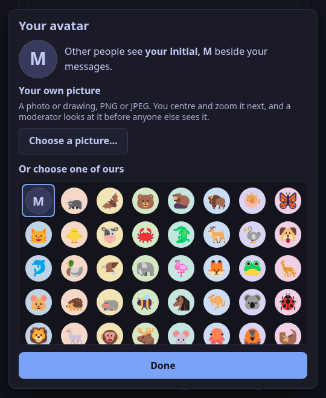
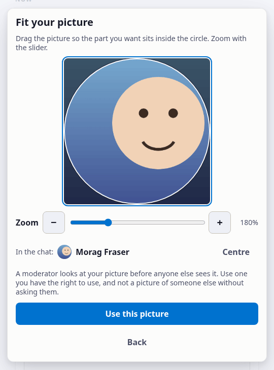

This is for a listener who chats on the station's player page.
Every message shows its sender's avatar. Until you choose one, yours is your initial.

## Choose one of the station's

1. Sign in to the chat, then press **Change avatar** beside your name.
2. Under **Or choose one of ours**, pick an animal or a monster. The first one, your initial, is none.

Your choice saves itself and everyone sees it at once, on the messages you have already written too.
A guest can choose from the set as well.

## Use a picture of your own

You need to be signed in with an email address; a guest cannot upload.
A station can turn uploads off, and the sheet then shows the set only.

1. Press **Change avatar**, then **Choose a picture…**, and pick a PNG or JPEG photo or drawing.
2. **Fit it.** Drag the picture so the part you want is inside the circle, and zoom with the slider. The circle is what the chat shows.
3. Press **Use this picture**.

| To | Mouse or touch | Keyboard, with the picture in focus |
|---|---|---|
| Move the picture | drag it | the arrow keys; with `⇧`, further |
| Zoom | the slider, the wheel, or pinch | `+` and `−` |
| Start again | **Centre** | `0` |

The picture is drawn again in your browser before it is sent, as a small square, so nothing the file carried with it (where and when it was taken, the camera) leaves your device.

## Until a moderator approves it

Nobody else sees your picture until one of the station's moderators has looked at it.
Until then:

- the sheet and the line under the chat say **Your picture is waiting for a moderator**;
- other people see the avatar you chose from the set, or your initial;
- only you, the station's staff and its moderators can see the picture.

If nobody decides on it within 30 days, the station deletes it and tells you so; that is not a judgement of the picture, and you can upload it again.

When it is approved it appears beside your messages, old and new.
If it is refused, or removed later, you get a notice that says why, as for any moderation decision, and you can ask for a review from it.
The picture is then deleted, and your messages show the avatar you chose from the set.
While your picture is waiting or showing, the station also keeps the file as you sent it, which nobody sees; it is deleted with the picture.
The one exception is a picture the station must keep as evidence of something unlawful: nobody but its staff can see it, and it is deleted when that hold ends.

## Change it or delete it

- **Choose another picture…** sends a new one to the moderators. Your approved picture stays in view until the new one is approved.
- **Delete my picture** (press it twice) deletes your picture from the station at once, waiting or approved. The one exception is a picture the station is holding a complaint about: it leaves the chat at once, but the station must keep it until the matter is settled.

Anyone reading the chat can report your picture from the actions on one of your messages (**Report this picture**); a moderator then looks at it.
You cannot change your avatar while you are timed out or banned; you can still delete your picture.
If you ask the station to erase your chat account, your pictures are deleted with it.
