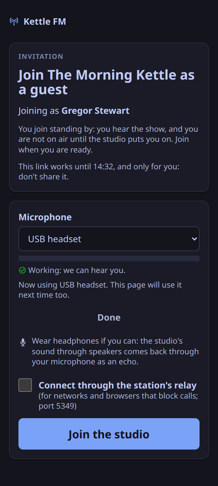
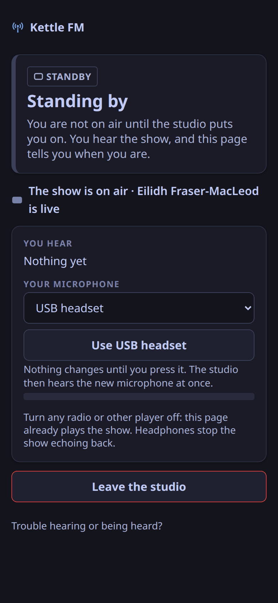
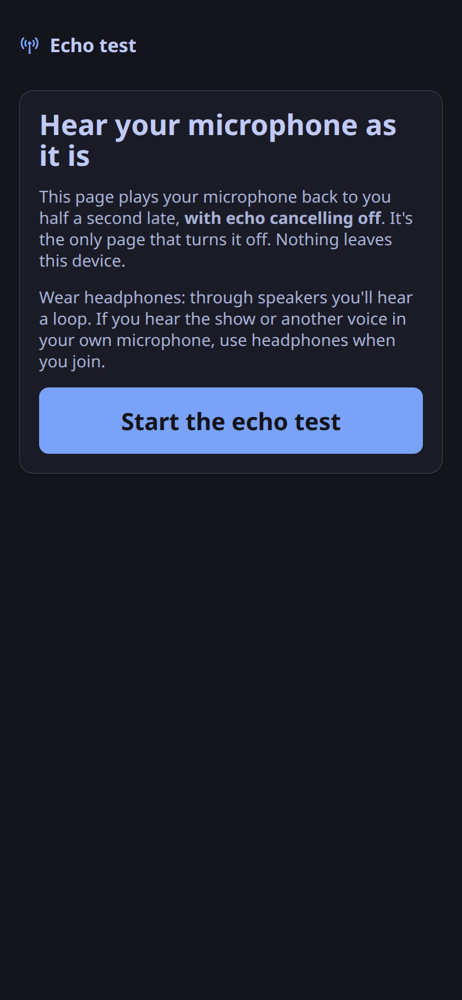

This page is about audio devices: which microphone you speak into, and which speakers or headphones you hear through.
**The microphone is chosen on the page you speak from** (from 1.3.3): an invitation, your microphone link and the player's call-in each name the microphone in use and list the others.
**The speakers or headphones are not**: every page plays through the output the browser uses, and the studio app plays nothing of the station, so you choose those in the browser and in Windows' sound settings, as below.

Wear headphones, never speakers, whenever your microphone is open: sound from speakers goes back into the microphone and on air as an echo ([why](/docs/explanation/echo-and-headphones/)).

## Where sound goes in and out

| What you use | Microphone | Speakers or headphones |
|---|---|---|
| **The studio app** (Windows, Linux) | none: it shows the desk and sends your keys | none, except **Settings › Phone line**, which plays its sample voices and can record the line's words |
| **Your microphone link or an invitation** (a browser tab) | your voice to the desk | the studio: everyone else, and the carts |
| **The player's call-in** (a browser tab) | a caller's voice | the programme while the caller waits; the studio once they are on air |
| **The player** (a browser tab) | none | the station, as listeners hear it |
| **The echo test**, `/echo-test/` (a browser tab) | your microphone, played back to you | your own voice, half a second late |
| **Your monitor link**, for a host in their own studio (a browser tab) | none | your monitor mix |
| **Your own software** through the bridge, Icecast, SRT or VBAN | chosen in that software (BUTT, OBS, Mixxx, Voicemeeter) | chosen in that software |

Every browser tab in the table plays through the browser's output, which is Windows' default unless you give the browser another.
The pages you speak from (an invitation, your microphone link, the call-in) start on the microphone the browser gives them and let you change it; the echo test takes whatever the browser gives it.

## Choose the microphone

### On the page (from 1.3.3)

A browser tells a page the names of its microphones only after you have allowed the page to use one.
So the list appears once you have pressed **Check your microphone**, or once you are in the call.

**Before you join.**

1. Press **Check your microphone**, and allow the microphone when the browser asks.
2. Under **Microphone** the page names the one it is using. With more than one, it is a list: choose yours, and the level bar beside it is that microphone's from then on.
3. Speak: the page says *Working: we can hear you.*
4. Press **Done**, then **Join the studio** (or **Call the studio**). The page joins with the microphone you chose.

The page says *Now using USB headset. This page will use it next time too.*: the choice is kept in that browser, on that device, and the next invitation or call there starts on it.
Nothing about your microphones is sent to the station.

**During a call or a show.**

1. Under **Your microphone**, choose another in the list. Nothing changes yet.
2. Press **Use** followed by its name, for example **Use USB headset**.
   The page says *Now using USB headset. The studio hears you through it.*

The change is heard at once, on air if you are on air, and you stay in the room: nothing rejoins.
The button is there on purpose, so that an arrow key or a scroll wheel over the list cannot change what listeners hear.
The list cannot be used while the page is connecting or reconnecting.

**What the page does by itself.**

| What happens | What the page does |
|---|---|
| The microphone you chose last time is not plugged in | It starts on the browser's own choice and says *The microphone you chose before, USB headset, is not connected. This page is using Built-in microphone instead.* Your choice is kept for when it is back |
| You plug a microphone in during a call | It appears in the list. The page does not switch to it: you choose |
| The microphone in use is unplugged during a call | The page moves to another and says which: *USB headset stopped, so this page is now using Built-in microphone.* |
| No microphone is left | *Your microphone has stopped, so the studio cannot hear you. Plug it back in, or choose another one here.* The first one you plug in is taken |
| The browser, or another program, will not give the microphone you picked | The one in use carries on, and the page says why: *The browser did not allow USB headset, so this page is still using Built-in microphone. Allow it when the browser asks, then choose it again.* |

With one microphone there is nothing to choose, and the page shows its name alone.
Whichever microphone it is, the page captures it the same way: echo cancelling and noise suppression on, automatic gain control off ([why](/docs/explanation/echo-and-headphones/)).

### In the browser's own question

The browser decides which microphone a page gets first, and it may ask again when you choose one you have not allowed before (Firefox is reported to allow microphones one at a time unless you tick its box to remember; its question cannot be driven by a test, so this was not checked).

**Firefox.**
When the page asks for the microphone, Firefox's question has a list of microphones.
Choose yours there, then **Allow**.
If you allowed the wrong one, choose the right one on the page (above); Firefox may then ask you to allow that one too.
The microphone you pick in Firefox's question during **Check your microphone** is the one the page asks for when it joins.

**Edge.**
Edge's question has a list of microphones too, with a level bar: it reads *Use available microphones (1)*, shows the microphone that is Windows' default, and has the buttons **Allow while visiting the site**, **Allow this time** and **Never allow**.
Choose the microphone in its list before you allow.
To change it later, open **Settings › Privacy, search, and services › Site permissions › Microphone** and choose it in the list at the top (the page also lists the sites you allowed, each with a bin to remove it), or click the icon at the left of the address bar, then **Reset to default** under **Microphone**, and reload the page.

**Chrome and Brave.**
These have been reported to ask only *allow or block*, and to use the microphone set in their own settings, which is Windows' default unless you change it (not checked on Windows in the run below):

- Chrome and Brave: **Settings › Privacy and security › Site settings › Microphone**, then choose the microphone in the list at the top.

Then reload the page, or press **Try again** if the page offers it.
On a WeaveSignal page it is quicker to choose in the page's own list, which names every microphone the browser has.

**Windows' default.**
In Windows 11, **Settings › System › Sound**, then under **Input** choose the microphone; in Windows 10, **Settings › System › Sound › Input**.
A browser that follows the default uses it from the next page it opens.

## Choose the speakers or headphones

No WeaveSignal page has its own output chooser: the browser plays through Windows' default output, or the output Windows gives that browser.

- **The default for everything**: Windows 11, **Settings › System › Sound**, then under **Output** choose your headphones; Windows 10, **Settings › System › Sound › Output**.
- **One browser to the headphones, the rest to the speakers**: Windows 11, **Settings › System › Sound › Volume mixer**, find the browser in the list, and set its **Output device**; Windows 10, **Settings › System › Sound › Advanced sound options** (*App volume and device preferences*). The browser appears in the list once it has played a sound; restart the browser if it keeps the old device.

On Linux, choose the devices in the desktop's sound settings, or per program in PulseAudio Volume Control (`pavucontrol`) on its **Playback** and **Recording** tabs.

## Check what you chose

- **The echo test**: open your station's public address followed by `/echo-test/`, press **Start the echo test** and speak. You hear yourself half a second late, with echo cancelling off, so you hear what the room would. It joins nothing.
- **Check your microphone** on an invitation page or the call-in: it names the microphone and its level bar moves when you speak, before you join.
- The echo test has no list: it uses the microphone the browser gives it, which is not always the one you chose on another page.

## When there is no device, or no sound

| What you see or hear | Do |
|---|---|
| The page says *Your microphone is blocked* (chip: **No microphone**) | Allow the microphone for the page: the lock or the site settings by the address. Then **Try again** |
| *No microphone was found. Plug one in or use a phone, then try again.* | The browser sees no microphone at all: see the next two rows |
| *Another app is using the microphone. Close it, then try again.* | Close the program that holds it (a call or a recorder), then **Try again** |
| *The microphone could not be started.* on an address that begins `http://` | Browsers give a page the microphone only over `https://`, or on `localhost`. Open the station's `https://` address instead |
| The browser never asks, and the page stays blocked | Windows refuses the browser: **Settings › Privacy & security › Microphone**, turn on **Microphone access**, **Let apps access your microphone** and **Let desktop apps access your microphone** |
| The browser lists no microphone, or not yours | Plug or pair it, check it under **Settings › System › Sound › Input** (its level moves when you speak), then restart the browser: some browsers read the list of devices only when they start |
| You joined with the wrong microphone | Under **Your microphone** on the page, choose the right one and press **Use** with its name. You stay in the room (from 1.3.3) |
| The page shows a microphone's name and no list | The browser has only that one. Plug yours in: the list appears without a reload |
| You hear nothing from any page | The browser plays to another output: choose your headphones as above, and check the browser tab is not muted (its speaker icon) |
| You hear the echo test but not the studio | Nobody is talking and no cart is playing, or nobody is on air yet: ask someone to speak, or fire a cart ([No sound?](/guides/no-sound/)) |
| A Bluetooth headset sounds thin once its microphone is in use | Bluetooth headsets switch to a low-quality mode while their microphone is open. Use a wired headset, or a separate microphone with the Bluetooth headphones |
| On a phone, the page stays blocked in Firefox | Allow Firefox's microphone in Android's settings too: Apps, Firefox, Permissions, Microphone |

Verified on Windows 11 (build 26100, en-GB) with Edge 158 · 2026-11-23, on a test page served from `localhost`: **Settings › System › Sound** (the output and input lists, each with **Volume**), **Volume mixer** (an **Output device** and an **Input device**, and the apps that have played sound: at first only *System sounds*, then *Microsoft Edge* once a test page had played a tone, with its own **Output device** and **Input device**, both *Default*), **Settings › Privacy & security › Microphone** (**Microphone access**, **Let apps access your microphone**, **Let desktop apps access your microphone**), and Edge's question, its site-information panel and its Site permissions page, as above.
Not run: Firefox, Chrome and Brave on Windows; a Bluetooth headset; Windows 10; a real WeaveSignal page.

The pages' own list was checked on Linux on 2026-11-27 in headless Chromium with its three test microphones, without a real one, against a stand-in room and against a real room and desk ([how](/docs/reference/public-pages/#the-microphone)); what was and was not tried in Firefox is said there.
Unplugging was simulated, and no real headset, no phone and no Windows browser has been tried with it yet.

## See also

- [Get your first sound out in ten minutes](/docs/tutorials/first-sound/): the whole road, from a silent studio app to your voice on air.
- [Get ready to present](/docs/how-to/get-ready/): headphones and the microphone's settings before a show.
- [Send through the bridge](/docs/how-to/send-through-the-bridge/): your own software, with its own device choices.
