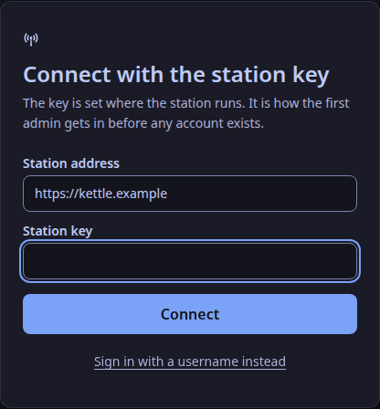

> **Package 1.0.0, amd64.** Listed on ca.cloudron.io, the community app catalogue: <https://ca.cloudron.io/app/top.weavesignal.cloudronapp>.
> The package's source is in the repository, in `deploy/cloudron/`.

> **New to this?** The [install wizard](/docs/install-wizard/) asks for the four names and gives you `weavesignal.env`, the DNS records (with the AAAA steps below worked out) and the commands (from 1.0.1).

One Cloudron app holds the whole server (ADR-0022): the control plane, the chat, the desk, Liquidsoap 2.5 for playout, the listener process with `icecast.server`, LiveKit with its built-in TURN, the public pages, and nginx in front of them.
PostgreSQL is Cloudron's addon (ADR-0082), and the chat's and staff's sign-in codes go out through Cloudron's mail (the `sendmail` addon).
The app's id is `top.weavesignal.cloudronapp`.

## Before you start

- A Cloudron at version 10.0 or later.
- **A server that is not overloaded.** On a heavily shared server the listener stream ran dry even with a 3 s cushion ([Memory and CPU](/docs/reference/resources/#what-this-means-for-a-host)). A busy Cloudron is fine for checking that the station works; a station on air gets a server of its own.
- If the server has IPv6, read [IPv6 and TURN](#ipv6-and-turn) first.
- **A free app slot.** Cloudron's free plan allows two apps, and an App Proxy counts as one, so a second station on a free Cloudron takes its second slot.
- **Not beside Cloudron on the same server.** The Compose bundle cannot run on a Cloudron server outside Cloudron in practice: Cloudron's nginx holds ports 80 and 443 on every address, and its firewall drops ports it did not open itself. Put a station that is not a Cloudron app on a server of its own ([Publish a station from the Compose bundle](/docs/how-to/publish-with-compose/)).

## Install

1. In your Cloudron's dashboard, open **App Store** and choose **Community apps**.
2. Paste the catalogue address:

   ```text
   https://forgejo.weavesignal.top/WeaveSignal/weavesignal/raw/branch/main/deploy/cloudron/CloudronVersions.json
   ```

3. Choose **Install**. Updates arrive through the same catalogue.

Or from the command line, with the Cloudron tool logged in:

```sh
cloudron install --versions-url https://forgejo.weavesignal.top/WeaveSignal/weavesignal/raw/branch/main/deploy/cloudron/CloudronVersions.json --location studio.example.com
```

Cloudron asks for four domains and the public ports:

| Cloudron asks for | Choose, for example | What it serves |
|---|---|---|
| The app's own domain | `studio.station.example` | the studio: `/health`, the studio's and the chat's admin routes; behind Cloudron's login when the app uses Cloudron's users |
| Listener stream | `listen.station.example` | `/programme.opus` only (and each MP3 stream that is on) |
| Live room signalling | `room.station.example` | LiveKit's WebSocket; guarded by short-lived room tokens (ADR-0085) |
| Public pages | `station.example` | the player with call-in and the live chat, the invite page, the echo test, podcast feeds, show cards and episode files, and only their public routes |
| Live room media (UDP) | 7882 | any free UDP port; **not** 50000–51000, Cloudron's own TURN relay range |
| TURN over TLS | 15349 | Cloudron's own TURN holds 5349 (ADR-0106); any free TCP port |
| TURN over UDP | off | Cloudron's own TURN holds 3478; 3479 if you turn it on |
| Live room media over TCP | off | 7881 if you turn it on; TURN over TLS reaches the same guests |

Every port stays a setting you can change later in the app's settings (ADR-0075).
Open the media port and the TURN port, and any optional port you turn on, in the server's firewall and in any cloud provider's firewall.

Install with Cloudron's user management to put the app's own domain behind Cloudron's login.
`/health` stays open without a login (ADR-0160), and a request with a staff session or the station key as its bearer still reaches the control plane's routes.
The login cannot be added to an app already installed, which is why the package declares it from the start.

### From your own build

To build the image yourself, from the repository's root:

```sh
podman build -t registry.station.example/weavesignal-cloudron:1.0.1 -f deploy/cloudron/Dockerfile .
podman push registry.station.example/weavesignal-cloudron:1.0.1
```

The Dockerfile needs the repository's root as its context and uses build caches, so it is built on your machine, not by Cloudron.
Push it to a registry the Cloudron can pull from (a private one needs a read-only token in Cloudron's private-registry settings), then install with `--image` and that name.

## Sign in

1. In the studio app, connect to `https://studio.station.example` (the app's own domain).
2. Choose **Use the station key instead** and give `CONTROL_ADMIN_TOKEN` from `secrets.env` (below).
3. Add yourself as an admin under **Settings → Staff**, then sign in as yourself ([The first admin](/docs/how-to/add-staff/#the-first-admin)).



Each member of staff then gets their own account there.

## Set it up

From package 1.0.1, open `https://studio.station.example/setup/` (the app's own domain) and sign in with the same key: the page takes the station's name, the takedown contact that opens call-in, the jurisdiction, the stream's password and the station's look, and keeps them in the database ([Set up the station and its look](/docs/how-to/set-up-the-station/)).
What it saves wins over `STATION_NAME` and `CONSENT_CONTACT` in `weavesignal.env`. The stream password's answer is kept in `/app/data/setup.env` and applies at the next restart.
The public pages' domain answers 404 for `/setup/`.

## The station's files

The app writes two files in `/app/data` on its first start; open them with Cloudron's File Manager, and restart the app after an edit.

| File | Holds |
|---|---|
| `weavesignal.env` | the station's settings: `STATION_NAME`, `ROOM_NAME`, `LISTENERS_AUTH`, `LISTENERS_MOUNT`, `NODE_IP`, `CONSENT_CONTACT`, `FEED_BUFFER_S`, `VIDEO`, `MAIL_MODE`, `PUBLISHING_URL`, `PUBLISHING_PLACE`, `PUBLISHING_ZONE`, `SEARCH_LISTING`, `DIRECTORY_LISTING`, the Opus stream's rate (`OPUS_BITRATE`, 96 kbit/s), the two MP3 streams (`COMPAT_STREAM`, `COMPAT_MOUNT`, `COMPAT_BITRATE` at 128 kbit/s, and `COMPAT_HIGH_STREAM`, `COMPAT_HIGH_MOUNT`, `COMPAT_HIGH_BITRATE` at 320; [Playout](/docs/reference/playout/#the-mp3-streams)), the chat's hours (`CHAT_HOURS`: `always` or `shows`; [The chat service](/docs/reference/chat/#hours)), sending the programme to another Icecast server (`ICECAST_OUT` and its host, port, mount, user, TLS and bit rate; [how-to](/docs/how-to/send-to-azuracast/)), RTMP out's picture and encoder (`VIDEO_CANVAS`, `RTMP_RUNG`, `RTMP_H264`, `RTMP_VIDEO_KBPS`; [RTMP out](/docs/reference/rtmp-out/#settings), which the package cannot run yet), playout's processing (`PROCESSING`, `PROCESSING_TARGET_LUFS`, `PROCESSING_MAX_GAIN_DB`), the internal ports and `LOG_LEVEL` |
| `secrets.env` | made once (`ICECAST_OUT_PASSWORD` is an empty line for you to fill if you send to another Icecast server): `STATION_ID`, LiveKit's key and secret, the listener source password, `CONTROL_ADMIN_TOKEN`, `LISTENERS_PASSWORD`, and the three keys `CHAT_EMAIL_KEY`, `CONTROL_EMAIL_KEY` and `CONTROL_TOKEN_KEY` |

On every start the package writes each service's own settings from these two files and from Cloudron's environment.
A later package adds any setting new to it to `weavesignal.env` with its default, and makes any new secret in `secrets.env`; it never changes a line you wrote.

Settings that differ from the Compose bundle:

- **`FEED_BUFFER_S` is 1.5 s**, against 0.5 s elsewhere: the listener process's cushion of playout's feed. Each second is a second more listener delay; on a quiet server 0.5 s holds.
- **`MAIL_MODE` is `cloudron`**: sign-in codes go out through Cloudron's mail, or into `/app/data/chat-outbox` as files if the addon gives no mail server. `outbox` and `off` are the other values.
- **`VIDEO` is `false`**: the desk's video path is off until you turn it on ([Video](#video)).

`STATION_ID` is the station's identity for its whole life (ADR-0047).
`/app/data` is in Cloudron's backups, so the three keys and the database are restored together; restore one without the other and chatters' and staff's accounts are not found, and API tokens are revoked ([The email key](/docs/reference/chat/#the-email-key)).

### Video

The package can run the desk's video path ([Video in the desk](/docs/reference/desk-video/)): guests' cameras, the vision mixer and the slate, AV1 into CMAF HLS behind the profanity delay, and the player's picture with its audio-only switch.
From package 1.0.1; 1.0.0's image has no HLS writer. It is off by default, as in the Compose bundle.

1. Set `VIDEO=true` in `weavesignal.env` and restart the app.
2. The join pages then offer a camera check, the player plays `https://station.example/hls/live.m3u8` (the public domain serves it), and while nobody is live the video's sound is playout's, so viewers hear what listeners hear ([Video in the desk](/docs/reference/desk-video/#the-sound)).
3. Set `VIDEO=false` and restart to turn it off again; nothing else changes. The HLS is written under `/run`, so it is not in Cloudron's backups.

What it costs, on the package's own memory gate with video on (`deploy/cloudron/memory-gate.sh`, a workstation, three tone publishers each with a 640 × 360, 20 fps camera, fifty listeners and the chat's load for 300 s, 2026-11-06):

| | Video off (package 0.8.0, 2026-11-02) | Video on |
|---|---|---|
| The container at rest, current | 526 MiB | 881 to 893 MiB |
| The container loaded, peak | 699 MiB | 1,221 to 1,256 MiB |
| The desk, resident, at rest / loaded | 62 MB loaded | 375 MB / 497 to 578 MB |
| The desk's CPU, share of one core | not measured in the gate | 22 to 26 % (three cameras, one 480p rung) |

- **The app has 2 GiB of memory** from package 1.0.1, up from 1.5 GiB, because the gate's rule (peak ÷ 0.7) asks for 1.7 GiB with video on; the figures above leave about 40 % of it free. An app installed earlier keeps the limit it was given: raise it in Cloudron's dashboard before turning video on.
- **Encoding is on the CPU**, with SVT-AV1 at one rung (480p at 20 fps, 600 kbit/s): a Cloudron app cannot use a GPU yet, so NVENC is not available (ADR-0228). The desk's share above is easy pictures; real cameras cost more, and each extra rung is another encoder ([Rungs](/docs/reference/desk-video/#rungs)).
- **A server for video is a server of its own.** The desk is a hidden room participant that encodes in real time; on a shared Cloudron that is already busy, the listener stream is the first to suffer ([Before you start](#before-you-start)).
- Not checked on a Cloudron itself: that a browser plays the HLS through Cloudron's proxy, and how many viewers the container serves. Send viewers through edges or a CDN ([Run edges](/docs/how-to/run-edges/)) rather than this container once there are more than a handful.

### Open call-in

Call-in stays closed until `CONSENT_CONTACT` is set (ADR-0124).
Set it in `weavesignal.env` to an email address or a link where callers ask for their call to be taken down, and restart the app; or, from 1.0.1, on the [setup page](#set-it-up), with no restart.

### If guests cannot connect

LiveKit may have found the wrong public address: set `NODE_IP` in `weavesignal.env` to the server's public IPv4 address, and restart the app.

## Keep the station private

Until the station should be found:

- **Unlisted.** The stream asks no directory to list it (`DIRECTORY_LISTING=false`), and every domain answers `noindex` (`SEARCH_LISTING=false`).
- **The stream's password.** With `LISTENERS_AUTH=on` (the default) the stream asks for the user `listener` and `LISTENERS_PASSWORD` from `secrets.env`. `off` leaves it open but unlisted.
- The listener domain serves only the mount: it refuses uploads, `icecast.server`'s admin pages and `/status.json`, and drops ICY metadata requests. Its bare address sends a visitor to the player on the public domain (from 1.0.1; 404 when no public domain is set).
- The room is guarded by short-lived room tokens (ADR-0085), and the public pages' domain serves only the public routes. Cloudron's login covers the app's own domain only.

**The player page cannot play a password-protected stream.**
With `LISTENERS_AUTH=on`, the player's stream is on the listener domain, and a browser does not ask for a password for audio from another domain, so the page stays silent; players and `curl` can still play it.
Set `LISTENERS_AUTH=off` when listeners should hear the station in the page.

## IPv6 and TURN

LiveKit's built-in TURN refuses a client that reaches it over IPv6 (an allocation error, 508).
TURN is reached at the app's own domain, and Cloudron gives an app's domains an AAAA record whenever the server has IPv6, so a guest who can join only through TURN (a network that blocks UDP, or GrapheneOS's browser) and reaches the server over IPv6 cannot join.
Guests whose media port works are unaffected.
There is no setting for it ([Known limits](/docs/reference/release-one-status/#known-limits)).

The way round it is DNS: give the TURN name an A record and no AAAA record (ADR-0217), so such guests reach TURN over IPv4.
On the Cloudron package the TURN name is **the app's own domain** (`studio.station.example` in the table above), not the live room's domain: LiveKit's TURN uses the app's own certificate.
That needs a Cloudron domain set to **manual DNS**; with a DNS provider set, Cloudron writes the AAAA record again itself.

On such a Cloudron the install itself needs the AAAA record:

1. Before you install, give every name the app will use an A record **and** an AAAA record. When the server has IPv6, Cloudron waits at install until every app name has both, and shows *Waiting for propagation of …* until then.
2. Install, and wait until the app is running.
3. Delete the AAAA record of the app's own domain. Keep the others.
4. Do the same again whenever Cloudron checks the names again: when you change the app's domains, or restore it.

Without its AAAA record the studio is reached over IPv4 only; the public pages, the room and the stream keep theirs.
Test a relay-only guest on an IPv6 network before relying on it.

## Check it

```sh
curl https://studio.station.example/health
curl -u "listener:$LISTENERS_PASSWORD" -o programme.opus https://listen.station.example/programme.opus
```

`/health` answers with `"database":"ok"`.
On an app installed with Cloudron's user management, a request to the app's own domain without a bearer is sent to Cloudron's login (a 302 redirect), not refused with 401.
Open `https://station.example/` for the player, then issue a room token ([Give someone a room token](/docs/how-to/issue-room-tokens/)) and join.

## Update

Install a newer image over the app:

```sh
cloudron update --app studio.station.example --image forgejo.weavesignal.top/weavesignal/weavesignal-cloudron:<version>
```

Back the app up first. The station's files and data stay; database migrations run at the next start.

## Memory

The package's memory limit is 2 GiB (1.5 GiB before 1.0.1).
Measured with the package's memory gate, it used about 527 MiB idle and peaked at 699 MiB under load, with the MP3 stream and the processing chain on ([Memory and CPU](/docs/reference/resources/#memory)).

## Open files and large audiences

Cloudron starts the app's container with a soft limit of 1,024 open files.
Each listener is an open socket, so in package 1.0.0 the listener stream takes **fewer than 1,024 listeners**.
From package 1.0.1 the package raises the limit to 65,536 for its services before they start.
For an audience of hundreds or more, update to 1.0.1 first, and read [A large audience on one server](/docs/reference/resources/#a-large-audience-on-one-server).
