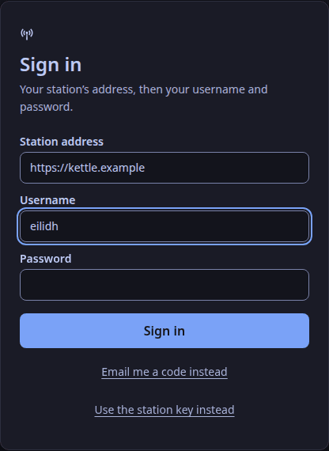

The studio app comes in three Linux packages for 64-bit Intel and AMD machines (ADR-0015).
They are built on Ubuntu 24.04 LTS, so they run on it and on anything newer. The `.deb` and `.rpm` use your system's own libraries, so on Ubuntu 26.04 they run on its newer ones.

| Your system | Package | Tested on |
|---|---|---|
| Debian, Ubuntu and their relatives | `WeaveSignal_<version>_amd64.deb` | Debian 13, Ubuntu 24.04 and 26.04 |
| Fedora and other RPM systems | `WeaveSignal-<version>-1.x86_64.rpm` | Fedora 43 and 44 |
| Any other desktop | `WeaveSignal_<version>_amd64.AppImage` | all five above |

The app drives the desk; it does not join the room itself, because WebKitGTK on Linux has no WebRTC. Presenters and guests join from a browser.

## Download it

Download the package for your system and the checksum file `SHA256SUMS-1.0.2` from the assets of [release v1.0.2 on the Forgejo](https://forgejo.weavesignal.top/WeaveSignal/weavesignal/releases/tag/v1.0.2); the updater reads the same files from `https://weavesignal.top/updates/`.

To build the packages yourself instead, run `just package-desktop` in the repository ([Packages and install files](/docs/reference/packages/)). They land in `dist/desktop/` with their checksum file.

## Check the download

Each release lists the packages' SHA-256 checksums in `SHA256SUMS-<version>`.
In the folder you saved both to, compare them:

```sh
sha256sum -c --ignore-missing SHA256SUMS-1.0.2
```

It prints `OK` beside the package. If it prints `FAILED`, delete the file and do not install it.

## Install the .deb

```sh
sudo apt install ./WeaveSignal_1.0.2_amd64.deb
```

`apt` installs WebKitGTK 4.1 and GTK 3 with it.

## Install the .rpm

```sh
sudo dnf install ./WeaveSignal-1.0.2-1.x86_64.rpm
```

## Run the AppImage

The AppImage carries WebKitGTK and its other libraries, and needs nothing installed:

```sh
chmod +x WeaveSignal_1.0.2_amd64.AppImage
./WeaveSignal_1.0.2_amd64.AppImage
```

It needs FUSE 2 to mount itself. Where FUSE is missing, run it with `--appimage-extract-and-run`.

## Start it

Choose **WeaveSignal** from your desktop's menu, or run `weavesignal-studio`.
The menu entry starts it with `WEBKIT_DISABLE_DMABUF_RENDERER=1`, because WebKitGTK's DMA-BUF renderer crashes the window on native Wayland; when you start it from a terminal on Wayland, set it yourself:

```sh
WEBKIT_DISABLE_DMABUF_RENDERER=1 weavesignal-studio
```

The AppImage always sets it: it starts the app through the same menu entry.

`weavesignal-studio --version` prints the version without opening a window.
Newer versions come through the app itself: [Update the studio app](/docs/how-to/update-studio-app/).

## Connect to your station



The first time the app opens, it asks for your station's address and who you are.
Type the address as you would in a browser, with no path: `https://radio.example.org`.
Then give your username and password, or choose "Use the station key instead" (the first admin does, before any account exists).

- **https works for any host and any port**, such as `https://radio.example.org:8443`.
- **Plain `http://` works only for this computer and private networks**: `localhost`, `127.0.0.1`, `192.168.x.x`, `10.x.x.x`, `172.16.x.x` to `172.31.x.x`, link-local addresses, IPv6 `fc00::/7`, and `100.64.x.x` to `100.127.x.x`, which Tailscale gives each machine on a tailnet.
  A host name other than `localhost` is never counted as nearby over plain http, because a name can point anywhere and the app does not look names up. Use https for it.
  The reason: your password or key goes with every request, and it must not cross the internet in clear.
- The key or session goes into your computer's keychain, and the window never holds it.
  Signing out keeps the address, so the next sign-in only asks for your name and password.

## Remove it

```sh
sudo apt remove weave-signal     # the .deb
sudo dnf remove weave-signal     # the .rpm
```

The package is called `weave-signal`, the Tauri bundler's spelling of WeaveSignal.
For the AppImage, delete the file.

Verified on a development workstation · 2026-11-01: packages built from the repository on Ubuntu 24.04; `just package-desktop-test` installed each package in a throwaway container of each system above and ran `--version`; the `.deb` on Debian 13, the `.rpm` on Fedora 44 and the AppImage on Ubuntu 24.04 opened the desk on a virtual X display (Xvfb, software rendering) and kept running; removing the `.deb` and the `.rpm` left no app files.
Wayland and a real GPU were not tried.
