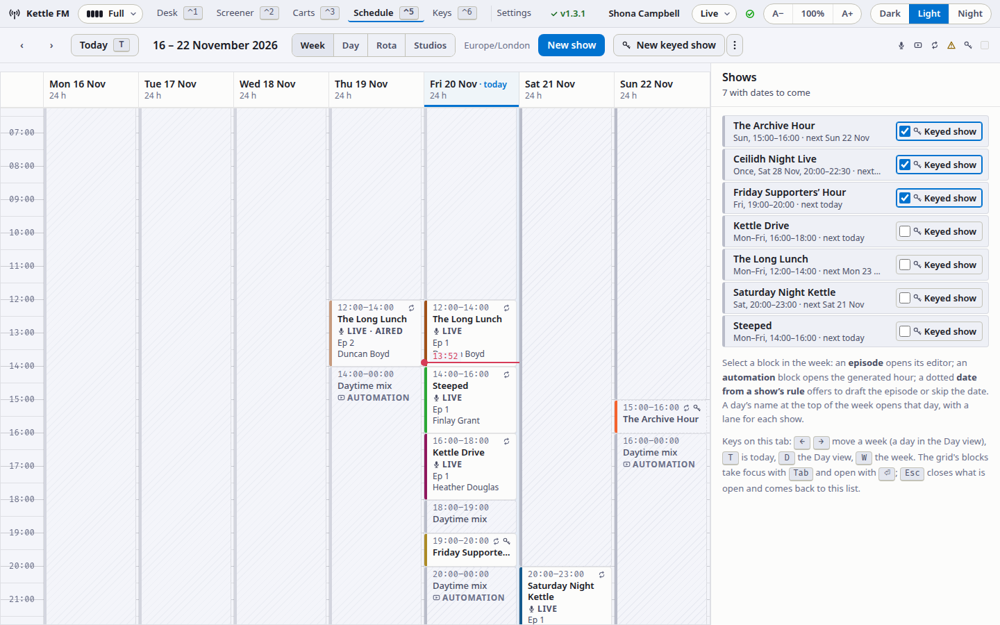
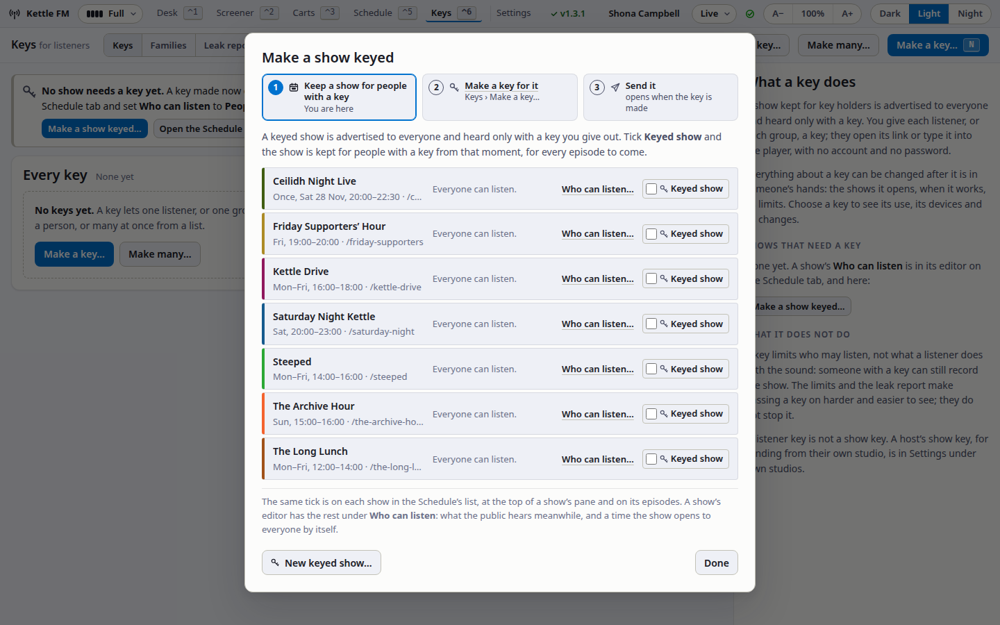
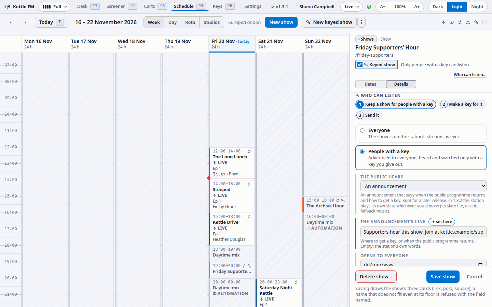
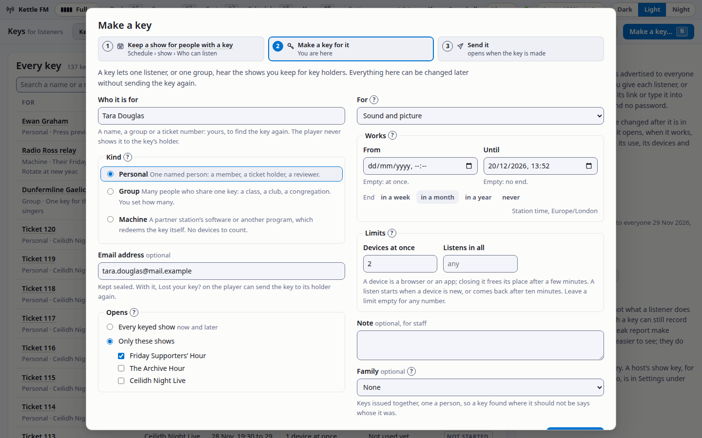
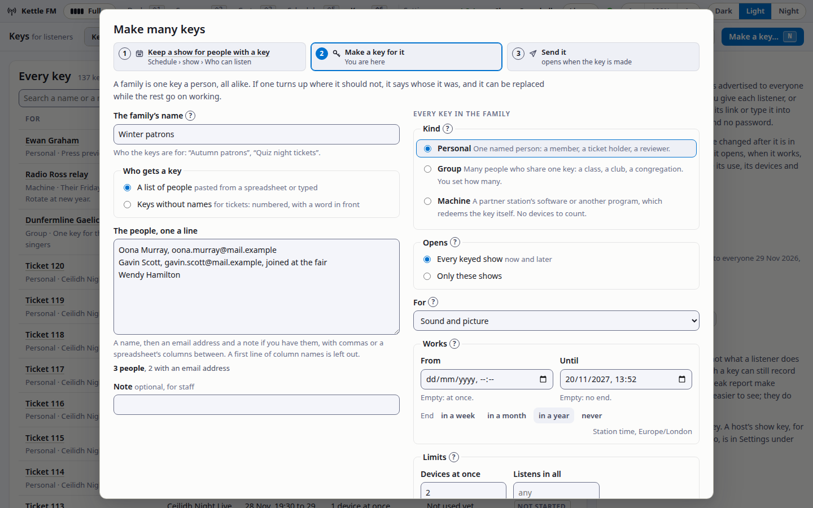
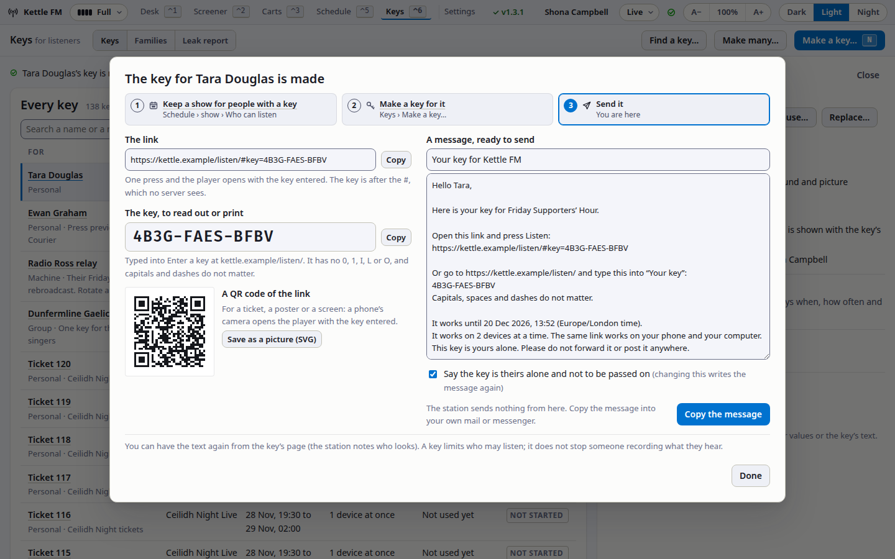
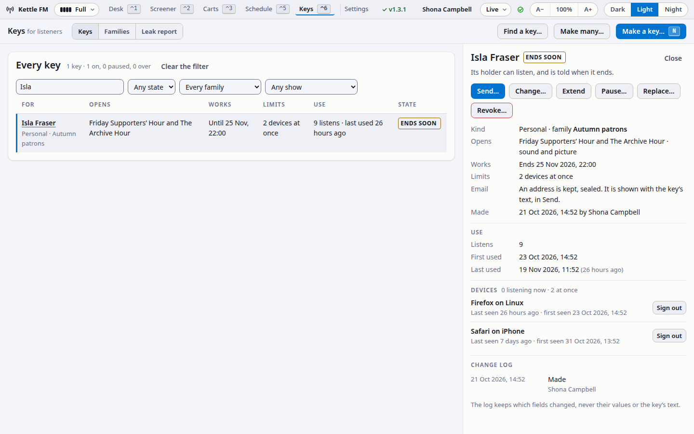
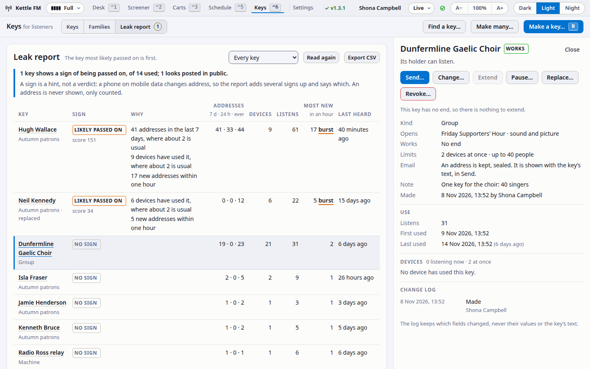

> **From 1.3.2.** A producer or an admin does this in the studio app, on the Schedule tab and the **Keys** tab (`⌃6`); every panel is in [the Keys tab's reference](/docs/reference/surfaces/keys/).
> A ticket shop or a membership system does the same through the API with an API token ([below](#the-same-through-the-api)); the routes are in [Keyed shows](/docs/reference/keyed-shows/).
>
> **Before the first keyed show:** set `WEAVESIGNAL_CONTROL_TOKEN_KEY` yourself (the Cloudron package does), so the public key your edges hold does not change when the station key does; and if the station has edges, give each the public key ([below](#give-your-edges-the-public-key)).
> What keeps the show from the public, and what is not covered yet (a show that overruns its slot, keyed sound at edges), is in [the reference](/docs/reference/keyed-shows/#how-a-keyed-show-is-kept-from-the-public).

You will have a show that only people with a key can hear or watch, and a key for each of them that you can change, limit and end.

The three steps are the same wherever you start, and the dialogs on the way carry them as a numbered line, each step a button: **1** keep a show for people with a key, **2** make a key for it, **3** send it.

## 1. Make the show keyed

Tick **Keyed show**, the tick box with a key beside it. It is the same control wherever a show is in sight:

- on the **Schedule** tab, at the end of each row of the list of shows;
- at the top of a show's pane, under its name, and on each of its episodes and dates not drafted yet;
- on the **Keys** tab, under **Make a show keyed…**, which lists the station's shows with the tick on each;
- in **New show**, in its first part. **New keyed show**, beside **New show**, opens the same dialog with it ticked.





The tick saves at once: the show is kept for people with a key from that moment, for every episode to come, and a line beside the tick says so.
A key keeps the whole show, not one episode: the tick on an episode is the show's, and on an episode that has aired it changes only the episodes to come.
Unticking a keyed show asks first, since it opens to everyone what was kept; its keys are kept.
If the station refuses (it keeps a show only where playout can keep it from the public), the tick goes back and the reason is beside it.

The rest of the choice is in the show's editor: **Who can listen…** beside the tick opens it, or choose the show in the list, then **Details**. **Who can listen** is right under the show's name, and **People with a key** there is the same as the tick.



- **The public hears**: what you would like everyone else to hear while the show is on: *an announcement* (with a line of your own), *the fallback music* or *a teaser*. In 1.3.2 the station plays the same whichever you choose: its slate file if its playout data names one (`keyed.slate`), else its fallback music, else the loop WeaveSignal ships (a station with nothing in its fallback folder plays the loop). The desk's Playout panel says which it is while the show is on. No package sets `keyed.slate` yet, so to give the public a spoken slate, put it in the fallback folder. Your choice is kept for a later release.
- **Opens to everyone**: leave it empty, or give a date and time (the station's) for early access: from that moment the show is public by itself.

Press **Save who can listen**.
It is saved apart from **Save show**, at once.
A keyed show's row in the list has its tick ticked, and its blocks in the week carry a key beside their time, with the word **Keyed** where the block has the room (always in the Day view).

From its next episode's start (a few seconds before) to its end (a few seconds after, and the profanity delay), the public stream plays the slate, the public picture and RTMP out are held back, and only a key opens the show.
The episodes' times are the schedule's: a keyed show needs its episodes on the schedule, and **it stays keyed until its slot ends** (or it opens to everyone, if that is sooner), even if the presenter finishes early or carries on: end on time, or lengthen the episode.
A key holder hears the show about 13 seconds after it is played, and is dropped about 14 seconds after the slot's end, when they have heard it out; the next keyed show's stream starts after that.
While it is on, what the station tells listeners is playing is only the show's name, never its tracks.
While a keyed show is on, the desk's Playout panel says what the public hears and whether the station is keeping the show from them.

## 2. Make a key

Open the **Keys** tab (`⌃6`) and press **Make a key…** (`N`).



Type who it is for and press **Make the key**: left as it is, the key is a personal one for every keyed show, sound and picture, on two devices at a time, with no end.
Who it is for is your own name for the key, to find it again: its holder never sees it, and the player greets them with *Welcome* alone.
Under **For**, **Sound only** keeps the picture back; a key for the picture always carries the show's sound, so **Picture, with its sound** opens what **Sound and picture** does.
Change what you need first: the shows it opens, when it starts and ends, how many devices, how many listens.
An email address is worth giving: with it the listener can ask the player for a lost key themselves.
Use **Group** for a class or a club that shares one key, with how many people may use it, and **Machine** for a partner station's software or another program, which redeems the key itself through the API (1.3.2 has no ready-made relay for it).

The less obvious fields (the kind, what it opens, sound or picture, the window, the limits, a family) each have a **?** beside their name: point at it, press it, or reach it with `Tab`, and it says what the field is for.

For many people press **Make many…**: a family, one key a person, so that every copy is its own key.



Paste the people, one a line, as a name, then an email address and a note if you have them; or choose **Keys without names** and say how many, for tickets.
Then **Save as CSV**: a row a key with its link, for a mail merge or a ticket platform. The desktop app asks where the file goes (**Save as CSV…**, from 1.3.2) and says where it went; a browser puts it with its downloads. **Copy as CSV** puts the same rows on the clipboard.

## 3. Send it

Making a key opens **Send**; for a key that exists, open it in the list and press **Send…**.



Send the **link**, or **the key itself** to read out or print, or the **QR code** on a ticket or a poster (**Save as a picture**; the desktop app asks where it goes, from 1.3.2).
The message on the right has all of it and says what to do if it fails: change its words if you like, press **Copy the message**, and paste it into your own mail or messenger.
The station sends nothing for you from here.
The link opens the player with the key entered; the key is in the part of the address after `#`, which is never sent to any server.
Someone who has the key but not its link (read out, printed, or a link that lost its end on the way) opens the station's `/listen/` page, which has a box to type or paste the key into: it is checked there exactly as on the player, and its show starts ([Listen with a key](/docs/how-to/listen-with-a-key/)).
A key does not stop a determined person recording what they hear; it limits who may listen.

## 4. Look after it

Choose a key in the list to open its page.



| To | Press |
|---|---|
| see its use, its devices and its changes | the key's name in the list |
| have its text, link and email address again | **Send…** (the station notes who looked) |
| change who it is for, its shows, window or limits | **Change…** |
| give it more time | **Extend**, then *+1 week*, *+1 month* or *To a date…* |
| switch it off for now, and back | **Pause…**, **Resume** |
| end it | **Revoke…** |
| sign a device out | **Sign out** beside the device |
| remove a person's key and its records for good (an admin) | **Erase…** |

The key's text stays the same through all of it, so nothing needs sending again.
**Pause**, **Revoke** and **Replace** stop someone already listening at once; the other changes reach them at their player's next renewal, about a minute later (the dialogs say the station's own figure).
What ends or interrupts someone's listening asks first, and says what they will see.

## 5. When a key leaks

Open **Leak report** on the Keys tab.



The key most likely passed on is first, with the signs that put it there.
It is a hint, not a verdict: a phone on mobile data changes address.
If you find a key where it should not be, **Find a key…** says whose it was: paste the key, or the link that carries it.
Open the key and press **Replace…**: that one key is ended and a new one made for the same person, which you send them; every other key goes on working.

## The same through the API

Use the station key or a staff session as the bearer, or an API token with the `keys:manage` scope (which cannot set a show's rule or erase a key).

### Make the show keyed

```sh
curl -X PUT https://station.example/api/v1/shows/friday-supporters/access \
  -H "Authorization: Bearer $KEY" -H 'content-type: application/json' \
  -d '{"rule": "key", "slate": "announcement", "slate_note": "Supporters hear this show. Join at station.example/join."}'
```

This makes the show keyed from its next episode, as in [step 1](#1-make-the-show-keyed); `slate` records what the public is to hear (in 1.3.2 the station plays its one slate whichever is named).
A station whose playout has keyed shows off is told so (409), and one whose playout does not answer is refused (503).
To open it to everyone from a time (early access), add `"opens_at_ms"`: the show becomes public by itself at that moment.

### Make a key

For one person:

```sh
curl -X POST https://station.example/api/v1/listener-keys \
  -H "Authorization: Bearer $KEY" -H 'content-type: application/json' \
  -d '{"label": "Isla Fraser", "email": "isla@example.org", "shows": ["friday-supporters"],
       "valid_until_ms": 1795000000000, "max_devices": 2}'
```

The answer holds the key's text (`KETM-7QMP-2D4X`) and its link, once; the station keeps the text sealed, so you can have it again (below).
Left out, a key opens every keyed show, for sound and video, on two devices at a time, with no end.
`"media": "sound"` is the sound alone; `"video"` opens what `"both"` does, since a key for the picture always carries the show's sound.
Use `"kind": "group"` with `"max_people"` for a class or a club, and `"kind": "machine"` for a partner station's software, which redeems the key itself (1.3.2 has no ready-made relay for it).

For many people, make a **family**, so that every copy is its own key:

```sh
curl -X POST https://station.example/api/v1/listener-keys/families \
  -H "Authorization: Bearer $KEY" -H 'content-type: application/json' \
  -d '{"label": "Autumn patrons", "template": {"shows": ["friday-supporters"]},
       "recipients": [{"label": "Isla Fraser", "email": "isla@example.org"}, {"label": "Callum Reid"}]}'
```

or `"count": 200, "prefix": "Ticket"` for anonymous keys.
`GET /api/v1/listener-keys/families/{id}/export` gives a CSV of names, keys and links for a mail merge or a ticket platform.

### Send it

Send the link, or the text to read out or print.
The link opens the player with the key entered; the key is in the part of the address after `#`, which is never sent to any server.
Say in your message that the key is the person's own and is not to be passed on.
A key does not stop a determined person recording what they hear; it limits who may listen.

### Look after it

| To | Call |
|---|---|
| see its use | `GET /api/v1/listener-keys/{id}`, `/devices`, `/log` |
| have its text and link again | `POST /api/v1/listener-keys/{id}/text` (logged) |
| change who it is for, its shows, window or limits | `PATCH /api/v1/listener-keys/{id}` |
| give it more time | `POST …/extend` with `{"by_days": 30}` or `{"until_ms": …}` |
| switch it off for now, and back | `POST …/pause`, `POST …/resume` |
| end it | `POST …/revoke` |
| sign a device out | `DELETE …/devices/{device}` |

Pausing, revoking and replacing stop someone already listening at once; the other changes take effect at their player's next renewal, about a minute later.
A shop can do all of this with an API token with the `keys:manage` scope, and be told when a key is first used or ends by a [webhook](/docs/how-to/connect-an-integration/#be-told-when-something-happens) for `key.first_used` and `key.ended`.

### When a key leaks

`GET /api/v1/listener-keys/leaks` (for a family: `?family=…`) lists the keys most likely to have been passed on first, with the signs that put them there.
If you find a key where it should not be, `POST /api/v1/listener-keys/find` with its text says whose it was.
`POST …/replace` revokes that one key and issues a new one to the same person in one call; every other key goes on working.

## Give your edges the public key

If the station has edges (a self-run pool), each one checks keyed HLS itself.
`GET /api/v1/listener-keys/signing` gives `public_key`; set it as the edge's `EDGE_KEYED_PUBLIC_KEY`, and `EDGE_KEYED_REVOKED_URL` to `https://station.example/api/v1/keyed/revoked`, then restart the edge.
Keyed sound is served by the station itself, not the edges' relays: never name the keyed mounts in a relay's `RELAY_MOUNTS`.

## If it does not work

| You see | What to do |
|---|---|
| no Keys tab in the studio app | you are signed in as a presenter or a screener: keys are a producer's and an admin's |
| *This station has no keys yet* on the Keys tab | the station is older than 1.3.2: update it |
| *Keys are not set up at this station* | the line under it is the station's own: it has no database, or no station key to seal keys under (the 503s below) |
| Send says the key's text can no longer be read | the station's token key changed after the key was made: **Replace the key…** and send the new one |
| 403 "Only a producer or an admin can manage keys" | sign in as one, or use the station key or a token with `keys:manage` |
| 503 "Keys need a station key to seal them under" | set `WEAVESIGNAL_CONTROL_TOKEN_KEY` or the station key |
| 409 on the text of a key | the station's token key changed after the key was made: [replace the key](/docs/reference/keyed-shows/#the-token-key) |
| 422 naming a field | the sentence says what to change |
| 409 when setting the rule to `key` | playout has keyed shows off (`KEYED_SHOWS=false` in the Compose bundle's `.env`): turn them on and restart playout |
| a listener is told none of their key's shows is on the schedule | the show has no episode in the next fortnight: schedule one |
| the desk says *Keyed show not kept from the public* | playout refused to shut its gate: restart playout, and see its log |
