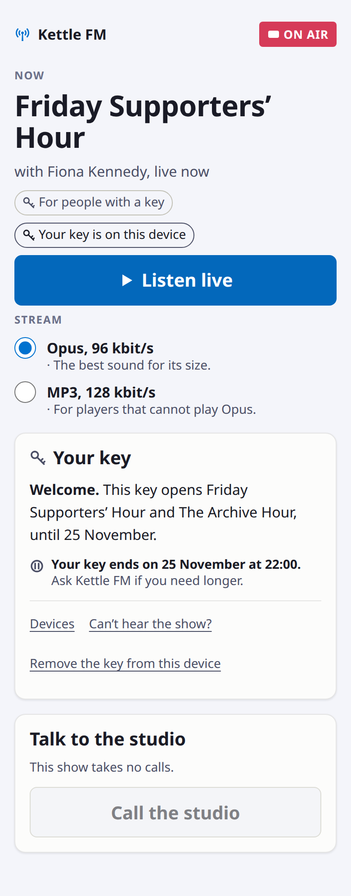
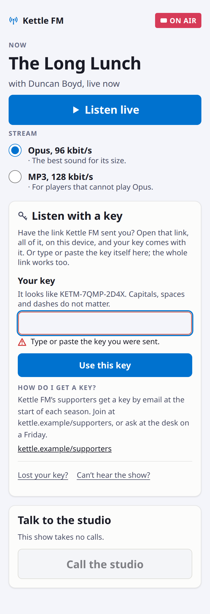
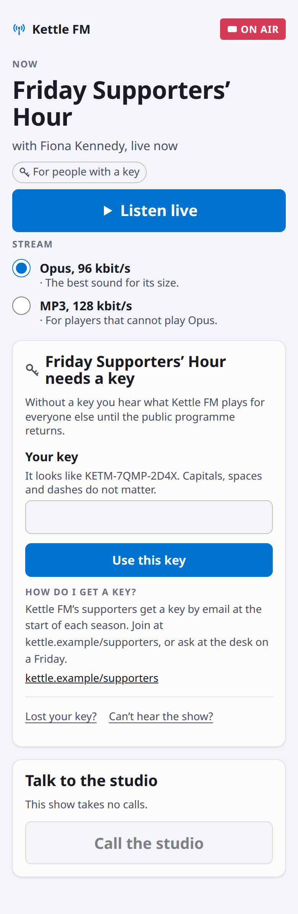
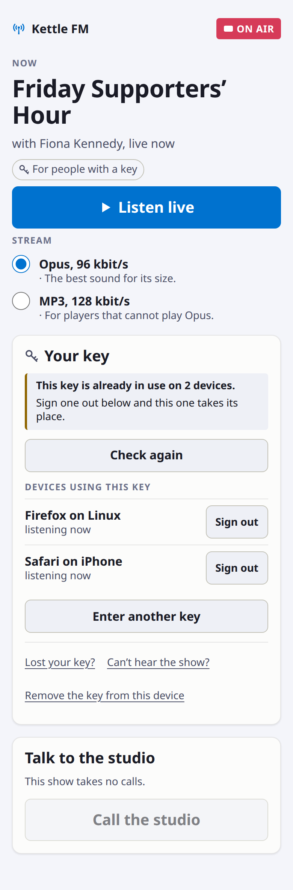
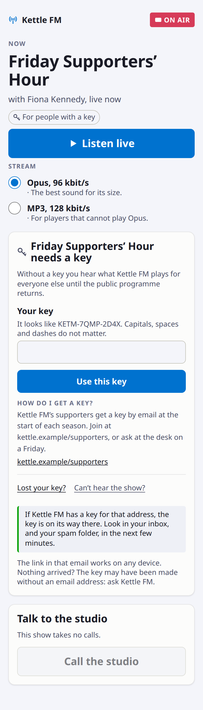
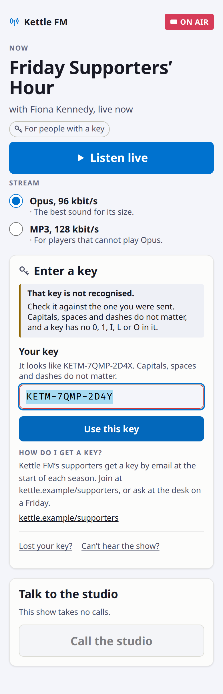
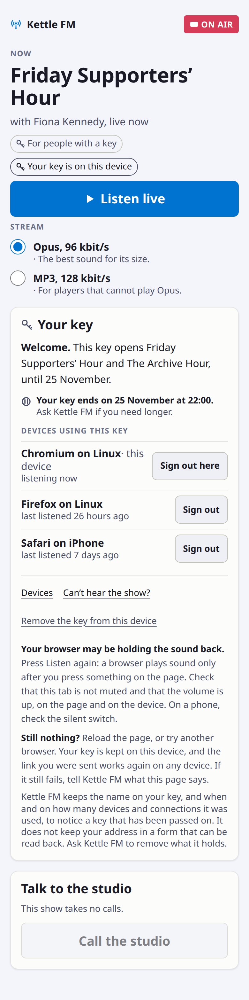

> **From 1.3.2.** This page describes the station's own player.
> A radio app or a smart speaker cannot take a key yet: it has no address of its own for a keyed show ([Keyed shows](/docs/reference/keyed-shows/#how-a-keyed-show-is-kept-from-the-public)).

You will have a key's show playing on your phone or your computer.
You need no account and no password: the key is all there is.

## 1. Open the link

You were sent a link, or a key written like `KETM-7QMP-2D4X`.
Open the link: the station's player opens with your key entered and says **Welcome**, then which shows the key opens and until when.

Have the key but not its link, or a link that arrived without its end?
Open the station's `/listen/` page (the link's address up to `/listen/`): under **Listen with a key** there is a box, **Your key**.
Type or paste the key there, or the whole link, and press **Use this key** or `Enter`: if its show is on, it starts playing.

Or open the station's player yourself.
While a show that needs a key is on, the player says so and shows **Enter a key**; at other times choose **Enter a key** under **Have a key?**.
Type or paste your key and press **Use this key**: capitals, spaces and dashes do not matter, and a pasted link works too.

Your key is kept in this browser, so next time the player has it already.
The address is cleaned as the page opens, so copying it from the address bar does not pass your key on.

## 2. Listen

Press **Listen live**.
Beside the show the player says **Your key is on this device**.
A key for the picture plays the show's sound with it; a key for the sound alone says so in the welcome.
In the key's last days it says when it ends: *Your key ends on 30 November at 22:00.*
A key that has not started yet says when it opens.
While nothing that needs a key is on, the player says so, keeps your key ready, and plays the station's public programme.
When the show ends, the player goes back to the public programme by itself, and your key waits for the next show it opens.

Without a key you hear what the station plays for everyone else while the show is on: its announcement or its music.

## 3. Use another device

Open the same link on the other device, or type the key there.
If the key is already in use on as many devices as it allows, the player lists them by name: press **Sign out** beside one and this device takes its place.
**Devices**, under your key, shows the list at any time.

**Remove the key from this device** forgets it in this browser; the key itself still works elsewhere.

## Lost your key?

Choose **Lost your key?**, give the email address the station has for you, and press **Send my key again** (at a station that sends no email the button reads **Ask for my key again**, and the words under the field say so before you type).
If a key was made with that address, the station sends its link there. A station that has no mail set up says so in the answer ("this station does not send email itself"), and its staff, who can see the request, send the key themselves: if you hear nothing, ask them.
The player says the same thing whether it found one or not, so that nobody can use it to find out who has a key.
If nothing arrives, the key may have been made without an email address: ask the station.

## If it does not work

The player says what is wrong and what to do.

| The player says | What it means |
|---|---|
| That key is not recognised | check it against the one you were sent; a key has no 0, 1, I, L or O |
| This key opens on (a date) | it has not started; it is kept on this device, so come back then |
| Your key ended on (a date) | ask the station for a new one |
| This key is switched off for now | the station has paused it and can switch it back on; ask them |
| This key was ended by (the station) | it will not work again; ask for a new one |
| This key does not open (the show) | it is for other shows; ask the station if it should open this one |
| This key is already in use on (a number of) devices | sign one out in the list below it |
| This key has reached the number of people it is for | it is shared by a group, and the group is full; ask the station |
| This key's listens are used up | it was for a set number of listens; ask the station for more |
| This key works, but none of its shows is on the schedule yet | come back when the station says the show is on |
| This device was signed out of the key | press **Use the key here again** |
| Too many tries from this connection | wait as long as it says, then try again |
| The show has stopped here because your key stopped working | the reason is under it, one of the lines above |

**Can't hear the show?** under the key box goes through the likely reasons, the likeliest first: your key needs attention; the show that needs a key is not on now; the station is not on air yet; your key is for another show; or your browser is holding the sound back, in which case press **Listen live** again and check that the tab and the device are not muted.

## What the station keeps

The name it gave your key (its own, to find the key again: the player does not show it), and when and on how many devices and connections it was used, to notice a key that has been passed on.
It does not keep your address in a form that can be read back.
Ask the station to remove what it holds about you.
