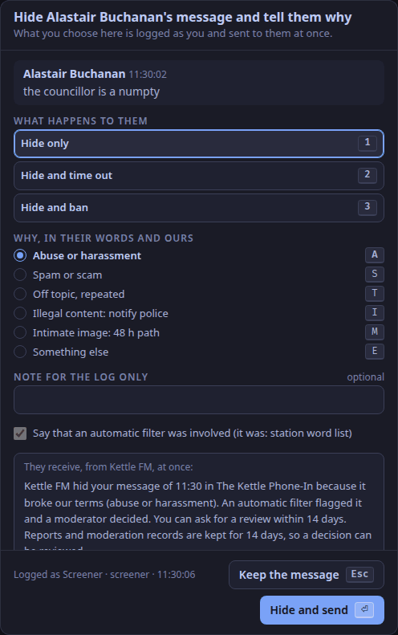
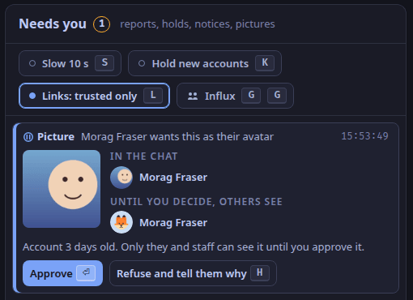

This is for the screener, on the studio app's second tab (`⌃2`), beside the callers.
Listeners chat on the player page; reading needs no account, posting needs a light account (ADR-0034).
Nothing here makes a station compliant with any law: the station decides how it uses these tools.

## What the chat does first

Before anyone sees a message, the chat applies the station's rules (ADR-0036):

- a word filter (rustrict only, ADR-0037): a flagged message waits for you, however long;
- a rate limit, and accounts must be 10 minutes old to post;
- links only from trusted chatters;
- with **Hold new accounts** (`K`) on, messages from accounts under a day old wait 5 s for you, then go to the room by themselves; a guest's always do.

## Needs you

`screener.needs` lists reports, held messages, notices from people without an account, requests for a review, and [chatters' pictures waiting for approval](#chatters-pictures).
An intimate-image report comes first, with its 48-hour clock.

| Key | Does |
|---|---|
| `H` | Hide, and open the statement of reasons; for a picture, refuse it |
| `O` | Time out for 10 minutes |
| `⇧B` `⇧B` | Ban: the account cannot post, and its past messages leave the room |
| `D` | Leave a reported message as it is |
| `⏎` | Release a held message now; approve a picture |
| `⇧U`, `⇧X` | Release all held, hide all held |
| `A` | Acknowledge a notice |
| `⇧E` | Preserve the evidence and escalate: a hold stops it being deleted |

## Tell them why

`H` opens `screener.statement`.
Choose what happens (`1` hide, `2` hide and time out, `3` hide and ban) and why (`A` `S` `T` `I` `M` `E`; for a picture also `C`, [below](#chatters-pictures)), add a note for the log if you like, and press `⏎`.
The chatter receives a statement of reasons at once: what was done, why, whether the word filter was involved, and that they may ask for a review within 14 days.
Every act is logged with your name, the reason and the time.

## Chatters' pictures

A chatter can choose one of the 72 avatars that come with WeaveSignal, which needs nothing from you, or upload a picture of their own ([Choose your avatar in the chat](/docs/how-to/choose-your-avatar/)).
An uploaded picture is held: nobody sees it but its owner, the station's staff and its moderators until one of you approves it. Meanwhile everyone else sees the avatar the chatter chose from the set, or their initial.

Each one waits in Needs you as **Picture**, oldest first, with the picture as it was sent, how it will sit in the chat, and what others see until you decide.

| Key | Does |
|---|---|
| `⏎` | **Approve**: it shows beside the chatter's messages at once, old and new |
| `H` | **Refuse and tell them why**: the statement of reasons opens; choose the reason and send |

- **Refusing** deletes the picture (but see *Intimate image* below), and the chatter receives a statement with the reason and 14 days to ask for a review. Nobody else ever saw it.
- **Reported by a listener.** Anyone signed in can open the actions on a message whose sender has a picture of their own and press **Report this picture** (ADR-0260). It arrives in Needs you as **Picture reported**, with the picture, as one item with any other reports about the same chatter. **Remove the reported picture** takes it down with a reason and closes the report; if the chatter has uploaded another since, it tells you, and you look at the new one first.
- **Removing one later.** Select a message of theirs in the room and press **Remove picture**, or use **Remove their picture** on a report about them. It asks for a reason in the same way, comes down from every message at once, and their messages show the avatar they chose from the set.
- **Intimate image** as the reason keeps the picture as evidence instead of deleting it: it is withheld from everyone but staff under an evidence hold, as a message is, until an admin releases the hold.
- **Suspected child sexual abuse** (`C`, for a picture only) keeps the picture instead of deleting it, with the upload as it arrived (if it was still waiting) and the uploader's details, for at least a year, and only the one person named in Settings can see it. Read [Handle a picture you suspect is child sexual abuse material](/docs/how-to/handle-suspected-child-abuse-images/) first; the dialog says so too. Do not forward or copy the picture.
- **Rubbish you do not need to keep.** A picture kept under an evidence hold (an intimate image, a threat to life, child safety) can be deleted at once: Settings > Chat pictures lists what the station is keeping, and **Delete now…** deletes one from the server, asks why, and records who deleted it and why. For a suspected-child-abuse picture only the person named to see the evidence, or an admin, can delete it; the dialog stops to say that the law asks for a report and then keeping it, and asks for a confirmation; the station decides.
- **Uploads can be switched off.** Settings > Chat pictures has a switch that turns chatters' uploads on and off at once, over the install setting `AVATAR_UPLOADS`, which is its default until the switch is used.
- A picture nobody decides on within 30 days is deleted for you, and its owner is told it was not a judgement of the picture and that they can upload it again (ADR-0254). The line is in the moderation record as "the chat (automatic)".
- The queue is the moderators' as well as the staff's (ADR-0255): a chatter the station made a moderator sees the waiting pictures, approves and refuses them and removes an approved one, with the same reasons, and each decision is in the moderation record under their name.
- Every approval, refusal and removal is in the moderation log under your name.

Pictures and documents that trusted chatters post in the chat wait in the same queue: [Review pictures and documents posted in the chat](/docs/how-to/review-pictures-and-documents/).

## The private lane

`screener.studio` holds messages listeners sent to the studio; only you and the presenter see them (ADR-0040).
`R` replies privately, `⇧M` passes the message to the presenter, `I` invites the chatter to call in from the player page.

## The room

`screener.room` is the chat in real time; listeners are about 23 s behind: the `studio.listener_delay_ms` setting (15 s by default) plus what the profanity delay holds (8 s by default) (ADR-0103, ADR-0165).
The 15 s is a setting, not a measurement ([What release one does](/docs/reference/release-one-status/)).
Select a line for its actions: `F` features it on the player page, `⇧P` pins it, `I` invites, `H` hides, `O` times out; **Remove picture** shows where the sender has a picture of their own.
Post as the station with `⌃⏎`.

## A busy night

Press `G` twice within 3 s: influx mode turns on accounts only, a 24-hour account age, slow mode (one message every 10 s), the hold for new chatters and trusted-only links (ADR-0068).
Press `G` twice again to put every setting back as it was.
`S`, `K` and `L` switch slow mode, the hold and trusted-only links one at a time.
