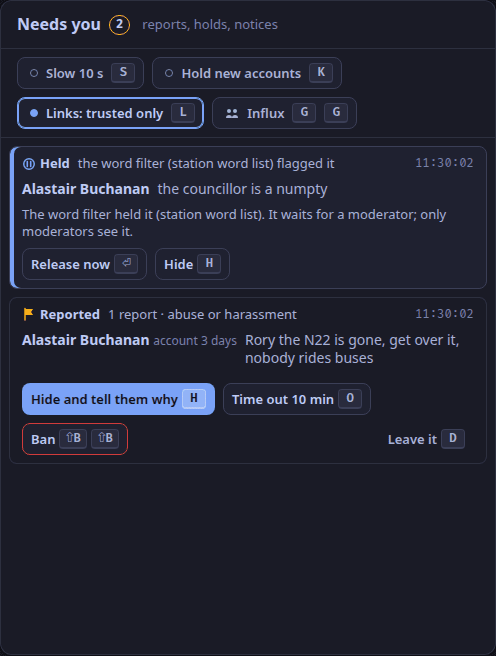

This is for the screener, on the studio app's second tab (`⌃2`), beside the callers.
Listeners chat on the player page; reading needs no account, posting needs a light account (ADR-0034).
Nothing here makes a station compliant with any law: the station decides how it uses these tools.

## What the chat does first

Before anyone sees a message, the chat applies the station's rules (ADR-0036):

- a word filter (rustrict only, ADR-0037): a flagged message waits for you, however long;
- a rate limit, and accounts must be 10 minutes old to post;
- links only from trusted chatters;
- with **Hold new accounts** (`K`) on, messages from accounts under a day old wait 5 s for you, then go to the room by themselves; a guest's always do.

## Needs you

`screener.needs` lists reports, held messages, notices from people without an account, and requests for a review.
An intimate-image report comes first, with its 48-hour clock.

| Key | Does |
|---|---|
| `H` | Hide, and open the statement of reasons |
| `O` | Time out for 10 minutes |
| `⇧B` `⇧B` | Ban: the account cannot post, and its past messages leave the room |
| `D` | Leave a reported message as it is |
| `⏎` | Release a held message now |
| `⇧U`, `⇧X` | Release all held, hide all held |
| `A` | Acknowledge a notice |
| `⇧E` | Preserve the evidence and escalate: a hold stops it being deleted |

## Tell them why

`H` opens `screener.statement`.
Choose what happens (`1` hide, `2` hide and time out, `3` hide and ban) and why (`A` `S` `T` `I` `M` `E`), add a note for the log if you like, and press `⏎`.
The chatter receives a statement of reasons at once: what was done, why, whether the word filter was involved, and that they may ask for a review within 14 days.
Every act is logged with your name, the reason and the time.

## The private lane

`screener.studio` holds messages listeners sent to the studio; only you and the presenter see them (ADR-0040).
`R` replies privately, `⇧M` passes the message to the presenter, `I` invites the chatter to call in from the player page.

## The room

`screener.room` is the chat in real time; listeners are about 23 s behind: the `studio.listener_delay_ms` setting (15 s by default) plus what the profanity delay holds (8 s by default) (ADR-0103, ADR-0165).
The 15 s is a setting, not a measurement ([What release one does](/docs/reference/release-one-status/)).
Select a line for its actions: `F` features it on the player page, `⇧P` pins it, `I` invites, `H` hides, `O` times out.
Post as the station with `⌃⏎`.

## A busy night

Press `G` twice within 3 s: influx mode turns on accounts only, a 24-hour account age, slow mode (one message every 10 s), the hold for new chatters and trusted-only links (ADR-0068).
Press `G` twice again to put every setting back as it was.
`S`, `K` and `L` switch slow mode, the hold and trusted-only links one at a time.
