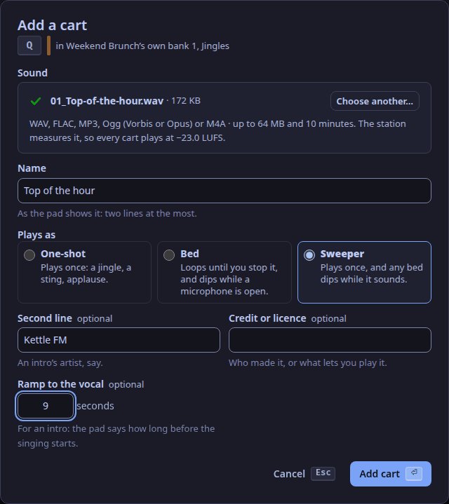

To play a sound file whenever you like, upload it as a **cart**: a sound on a key of the cart wall, in the studio app.
An MP3 works, and so do WAV, FLAC, Ogg and M4A, up to 64 MB and 10 minutes unless your station is set otherwise.
For music that should play by itself between shows, see [Put a sound file in the schedule](/docs/how-to/put-a-file-in-the-schedule/) instead.

## Upload the file

1. In the studio app, press `⌃3` for the Carts tab.
2. Drop the file on a pad that says **Add a cart**, or press that pad and then **Choose a sound…**.
3. Give it a name, and choose how it plays: **One-shot** plays once; **Bed** loops until you stop it, which is handy for a test.
4. Press **Add cart** (`⏎`).

The station measures the file and plays every cart at one loudness, so a quiet file and a loud one come out level; the wall says what it measured.
Every field and refusal is in [Add your own cart](/docs/how-to/add-your-own-cart/).

## Play it

- **On the Carts tab**: press the cart's key, or the pad. Press it again to fade it out.
- **From any tab**: `F1` to `F6` play the top row of the bank the wall shows.
- **In your headphones only**: `⇧` and the key cues it, for presenters and DJs in the room; nobody else hears it. `⇧` and the key again takes it out.
- **Stop everything**: `⇧Space` twice within 3 seconds fades all that sounds.

## Hear it

The studio app plays nothing itself: a cart sounds in the desk, and you hear the desk from a browser tab.

| Where you listen | You hear the cart |
|---|---|
| **The player** (the station's public address, **Listen live**) | as listeners do, after the delay the desk's clock shows (*about 24 s behind*; 23 to 24 seconds measured at the stream) |
| **Your microphone link** or an invitation page, joined to the studio | at once, in your headphones; everyone in the room hears it too |
| **Cued** (`⇧` and the key) | at once, in presenters' and DJs' headphones only; never on the air |
| **The rehearsal studio** (from 1.3.0) | in the rehearsal only; never on the air, and never in the station's play log |

So to test a cart on your own: open the player and press **Listen live**, fire the cart, and wait for the delay; or join with your microphone link and hear it at once ([Get your first sound out in ten minutes](/docs/tutorials/first-sound/)).

While a cart plays and nobody is on air, the desk's lamp stays **STANDBY** although listeners hear the cart; the playout panel keeps its chip at **ON AIR**, which means only that listeners can hear this, and says *a cart is playing* beside it (from 1.3.1; before, it kept saying *Default loop*). When a cart ends on its own, listeners hear nothing for about nine seconds before the loop (or your fallback music) comes back.

A cart played on the air goes into the station's play log, with the listeners connected as it started.
To try a file where no listener can hear it, cue it, or play it in the rehearsal studio ([Rehearse before your show](/docs/how-to/rehearse-before-your-show/)).

## If you hear nothing

| What happens | Why, and what to do |
|---|---|
| The key does nothing, and the window says **Preparing** | A window preparing a show fires nothing. Use a window that is not preparing ([Prepare your show](/docs/how-to/prepare-your-show/)) |
| The cart plays at the desk but not on the player | The lamp says **AUTO**: automation holds the air and the desk does not reach listeners. Press **Take the air back** on the Desk tab. Or the lamp says **PLAYOUT DOWN**: listeners hear the fallback until playout is back ([When the lamp says PLAYOUT DOWN](/docs/how-to/playout-down/)) |
| *“…” is in another show's own bank* | A cart in a show's own bank plays only while that show is on air. Put test sounds in a bank marked **station** |
| The pad says **FILE MISSING** | Its sound is gone from the station. Edit the cart and choose the sound again |
| The file is refused as too long | A cart is up to 10 minutes. Put a longer file in the schedule instead ([Put a sound file in the schedule](/docs/how-to/put-a-file-in-the-schedule/)) |
| You hear nothing in any tab | The browser plays to another output: [Choose your microphone and speakers](/docs/how-to/choose-your-microphone-and-speakers/) |

## Without a station

[Try the desk](/try/) on the website takes the same dialogs: drop your MP3 on an empty pad there and play it.
The sound stays in the page and plays in the browser tab; nothing is sent, and it is gone when the page is reloaded.

## See also

- [Add your own cart](/docs/how-to/add-your-own-cart/): every field, banks of your own, and the default pack.
- [Cart wall](/docs/reference/surfaces/carts/): every panel, state and key.
