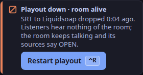

PLAYOUT DOWN means the desk is working but playout is not connected to it, so listeners hear nothing of the room.
Everyone in the room still hears everyone else.
Your on-air sources say OPEN instead of ON AIR ([What ON AIR promises](/docs/explanation/on-air/)).

The toast says *Playout down · room alive*, with how long ago the link dropped, and `desk.status` says *To playout no link*.

1. **Keep the room calm.**
   Guests hear you; listeners do not.
   Tell guests plainly, or hold a talk key to say it to one of them only.
2. **Restart playout on the server.**
   The desk's **Restart playout** button and `⌃R` only show a note in 1.0.0 ([planned](/docs/reference/release-one-status/#not-in-release-one)).
   On Cloudron, restart the app.
   With the Compose bundle, restart the `playout` service, from the folder that holds `compose.yaml`: `docker compose -p weavesignal restart playout`, or `podman compose -p weavesignal restart playout`.
3. **Wait for ON AIR.**
   When playout connects again, OPEN turns to ON AIR by itself and the lamp says ON AIR.
   Listeners stay connected throughout and hear the station's fallback meanwhile; in the restart test the programme reached them about 5.5 s after playout stopped, 5 s of it the stop.
4. **Pick up where listeners left you.**
   Anything said while the lamp said PLAYOUT DOWN was not heard on air.

If playout then restarts again and again, look at the owner of its socket volume first: a restart of playout or the listener process has, rarely, left the volume owned by root, and Liquidsoap then cannot make its socket.
On Podman, `podman unshare chown 999:999` on the volume's `_data` folder puts it right; `podman volume inspect weavesignal_playout-control` (or `weavesignal_listeners-control` for the listener process) shows where it is.

If the lamp says FAULT instead, the desk itself is not answering the control plane.
If the desk has stopped, Compose and the Cloudron package start it again; playout connects again within about a second of the desk coming back.
If it keeps failing, its log on the server says why.

Listeners' players do not need to reconnect: the listener process holds the stream, not playout ([Playout](/docs/reference/playout/)).
