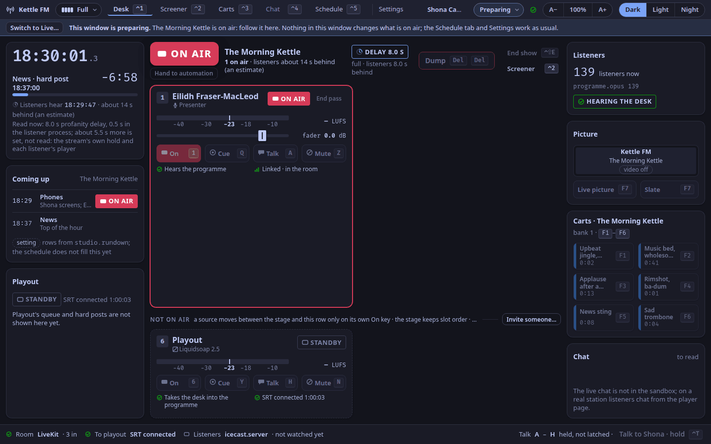
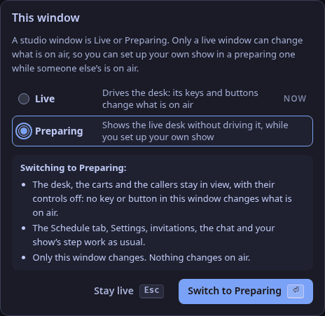
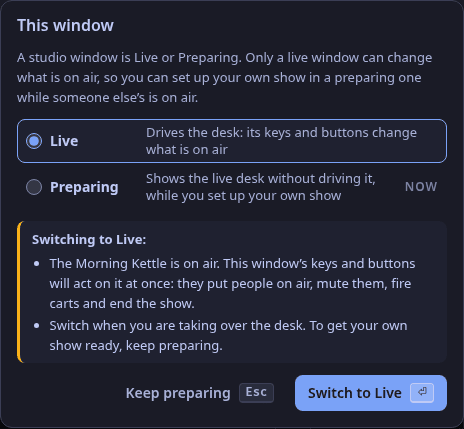

This is for the next DJ: Eilidh presents The Morning Kettle until ten, and you are getting your own show ready in your own studio app while she is on air.
Every signed-in studio window shows the same live desk, so without care a stray key in your window would mute her guest or fire a cart on her show.

A studio window is therefore **Live** or **Preparing** (ADR-0276).
A preparing window shows the live desk, so you can follow the show, but nothing in it changes what is on air: its controls are off, its keys do nothing, and the station refuses its commands.
Everything about your own show stays open.

## Live or Preparing, in the top bar

The word after your name at the top of the studio app says which your window is: **Live** or **Preparing**.
Press it for the two choices; the one in force is marked **now**.
Picking the other changes nothing yet: the dialog first says what the switch changes, and the button then names it.
`↑` `↓` move between the two, `⏎` confirms, `Esc` keeps what is.

- It is **this window's alone**. Nobody else's window changes, and nothing changes on air.
- A member of staff signed in as themselves has the control. A window signed in with the station key is always live and has none.
- An admin preparing their own show prepares like anyone else.

### Who starts preparing

- **The presenter of a show that is not on air now starts Preparing.** Your show is the one tied to your account ([Set up your show](/docs/how-to/set-up-your-show/)), and "on air" is the schedule's word ([Schedule the week](/docs/how-to/schedule-the-week/)).
  So if you open the studio before your slot, or your show has no slot yet, your window starts Preparing, and one press makes it live.
- **Everyone else starts Live**, as before: staff with no show of their own, and the presenter whose show is on air.
- The window settles this once, when it opens.
  It never switches to Live by itself, not even when your show's slot begins: taking the desk is yours to do.
  A reload of the window keeps what you chose.

## While you prepare

What stays open, in a preparing window:

| | |
|---|---|
| **The Schedule tab** | your show, its episodes and its cards ([Schedule the week](/docs/how-to/schedule-the-week/)) |
| **Settings** | **Your show**: your on-air name, the takedown contact, your links and the usual time ([Set up your show](/docs/how-to/set-up-your-show/)) |
| **The step** | how much of the studio your show uses, in the show editor ([Choose how much of the studio a show uses](/docs/how-to/choose-a-step/)) |
| **The live desk, to follow** | the lamp, who is on air, the clock and the rundown, the listener count, the chat to read |
| **Invitations** | **Invite someone…** still makes a link. It brings the person into the live room, and an invitation with the role presenter puts them on air as they join, so agree it with whoever is on air |
| **The chat** | moderating on the Screener tab works as usual |
| **The cart banks** | `⌃F1` to `⌃F5` still turn the wall to another bank in your window. The wall shows the station's banks and your show's own; your show's are yours to set up (below) |

What is off:

- **On the Desk tab**: On, Cue, Talk and Mute on every tile, **End pass** and **Drop**, the handover, **Dump**, **End show**, **Hand to automation**, the picture's buttons and the slate picture, the carts' glance, taking a caller, and Talk to the screener.
  Each is dimmed, with *Off while this window is preparing. Switch it to Live first.* in its tooltip.
  A lit **On** still says who is on air.
- **On the Carts tab**: every cart and **Fade all**. The wall still shows what is sounding.
- **On the Screener tab**: Talk, a caller's notes, **Send to desk**, **To queue** and **Drop**. The queue is there to read.
- **The keys of all of these** do nothing, on every tab: `1` to `6`, the cue, talk and mute rows, `F1` to `F7`, `Del Del`, `⌃D ⌃D`, `⇧⏎`, `⌃⇧E`, `⌃T`.
  The band under the top bar deepens for a moment to answer the press.
- At Solo, if nobody is presenting in the room, the desk does not offer **Join with my microphone…**: that link joins on air.

The band is on the Desk, Screener and Carts tabs.
The Schedule tab and Settings have none, because nothing on them is off.

Two things Prepare mode does not give you (they belong to a rehearsal studio, which is designed next):

- **There is no private room.** You cannot try your microphone with your guests or hear a mix of your own; the echo test on the join page is yours to use ([Get ready to present](/docs/how-to/get-ready/)).
One thing it does give you: **your show's own cart banks** (from 1.0.2).
A preparing window's cart wall is the station's banks and your show's own, and the live window's is the station's and the show on air's, so the dog woofs you set up in your bank 2 never land in the bank 2 the show on air is firing from ([Cart wall](/docs/reference/surfaces/carts/#a-cart-wall-per-show)).
Your show's carts fire once your show holds the air and your window is live.
The station's banks are still shared: a cart you change in one of them changes for the show on air too.

## Switch to Live when the desk is yours

1. **At the handover**, once the DJ on air has handed you the air ([Hand over to the next DJ](/docs/how-to/hand-over-to-the-next-dj/)), press **Switch to Live…** in the band, or the word in the top bar.
2. **While someone else's show is on air the window asks once**: it names the show, and says that your keys and buttons will act on it at once.
   `⏎` switches, `Esc` keeps preparing.

   

3. **When your own show is on air** by the schedule, the band says so (*Steeped is on air, and this window is still preparing.*) and **Switch to Live** acts at once, with nothing to confirm.
   The same when no show is on air.

After the show, switch back to **Preparing** from the top bar if you are staying to plan the next one.

## If the station refuses anyway

The station keeps the last word.
If a window that thinks it is live sends a command while its sign-in is held as preparing (the same sign-in was switched in another window), the station answers:

> This window is preparing a show, so it cannot change what is on air. Switch it to Live first.

The studio app shows that sentence as a note, and the top bar then follows the station to **Preparing**.

A program that signs in as staff meets the same answer, with status 409, from the desk's, the carts' and the screener's commands, ending a pass or the show, and the station's mode; `PUT /api/v1/sessions/me/mode` switches its own session ([Control plane API](/docs/reference/api/#put-apiv1sessionsmemode)).
The station key and API tokens are never preparing.

## See also

- [Studio app top bar](/docs/reference/surfaces/studio/#studioprepare): the control, its dialog and the band, by name.
- [Hand over to the next DJ](/docs/how-to/hand-over-to-the-next-dj/): bringing the next DJ into the room, and the overlap on air.
