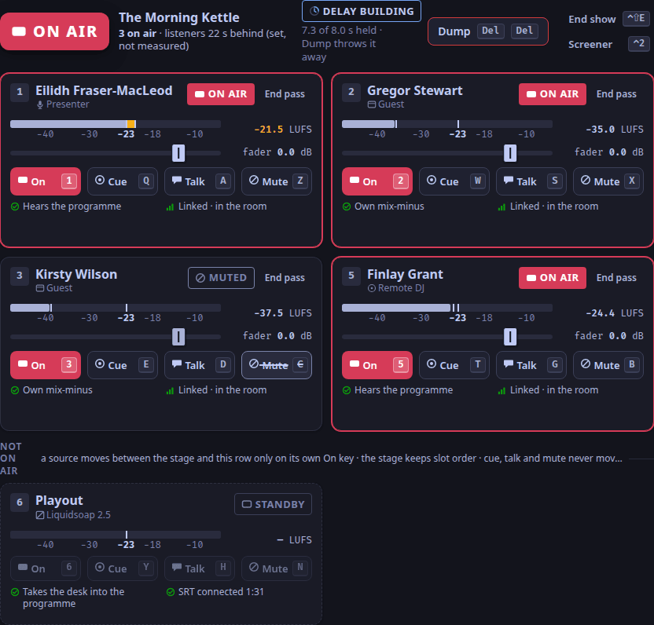
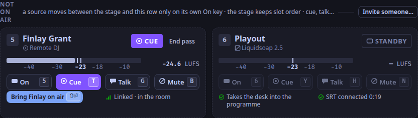
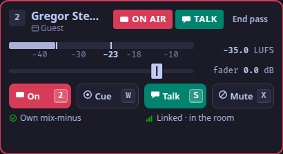

The desk is the studio app's first tab (`⌃1`).
Every action has a key, printed on its button; the full list is the [Keymap](/docs/reference/keymap/).

## Read the desk

- **The lamp** (`desk.lamp`) answers "can listeners hear the room?": ON AIR, STANDBY, PLAYOUT DOWN, FAULT, or AUTO while automation holds the air ([The state vocabulary](/docs/reference/states/)).
- **The stage** (`desk.stage`) holds every source on air, as tiles, in slot order.
- **Not on air** (`desk.waiting`) holds the sources in the room that are cued or standing by.
- **The clock** (`desk.clock`) back-times to the next hard post in the rundown.

Each source keeps its slot, and its keys, while it is in the room (ADR-0096): you in slot 1, guests in 2 and 3, a caller in 4, a DJ in 5, or the first free slot.

## Put someone on air, or take them off

Press their slot's digit: `1` to `5`.
They move onto the stage, and their word is ON AIR (OPEN while playout is down or the station is in auto mode).
The same key takes them off.
Guests are on air from the moment they join; a DJ or a caller joins off air and waits for you.

## Hear someone before they go on air

Press their slot's cue key: `Q` `W` `E` `R` `T` for slots 1 to 5.
Their word is CUE: they are in your headphones only (and any DJ's), never on air.
Press it again to stop.

When the screener sends you a caller, a toast says they are ready, with their slot: press their cue key (`R` in slot 4) to take them, or `Esc` for *Not now* ([Take a caller](/docs/how-to/take-a-caller/)).

## Mute someone

Press their slot's mute key: `Z` `X` `C` `V` `B`.
A muted source stays on the stage, says MUTED, and is off every mix it was on air in.
Press it again to bring them back.

## Talk to one person off air

Hold their slot's talk key: `S` `D` `F` `G` for slots 2 to 5.
Their tile shows TALK, only that person hears you, and you are off the programme (ADR-0099).
Let go, and you are back on air as you were.

To talk to the screener, hold `⌃T`, or hold **Talk to** in the status line.

Talk keys are held, never latched: nothing stays open because you forgot it, and if the app's window loses focus everything held is let go.

## Typing

While a text field has focus, the desk's letter keys, the function keys, `Del Del` and `⌃D ⌃D` do nothing (ADR-0104).
Press `Esc` to leave the field; chords such as `⌃1` and `⌃T` still work in it.

## Dump the delay, fire a cart, switch the picture

- `Del Del` dumps the profanity delay: it throws away what the delay holds, and listeners jump to the live programme.
  The first press arms the key for 3 s; the same key again fires it.
  The `desk.delay` panel shows how much is held and, after a dump, that it is rebuilding.
- `F1` to `F6` fire the current bank's top row of carts from any tab; the cart wall is the Carts tab (`⌃3`, [Cart wall](/docs/reference/surfaces/carts/)).
- `F7` switches the programme picture between live and the slate; with video off it says so.

## Hand over to the next DJ

`⇧⏎` on the Desk tab hands over to a DJ waiting under **Not on air**: the first press puts them on air with you, the second takes you off ([Hand over to the next DJ](/docs/how-to/hand-over-to-the-next-dj/)).

## Keys that only show a note

From 1.0.2 `⌃⇧E` ends the show, with a confirmation ([End the show](/docs/how-to/end-the-show/)).
These keys answer with a note in the toast slot; nothing happens to the room ([planned](/docs/reference/release-one-status/#not-in-release-one)):

- `⌃R`, restart playout: restart Liquidsoap on the server ([When the lamp says PLAYOUT DOWN](/docs/how-to/playout-down/)).
- `6`, `Y` and `N`, playout as a desk source in slot 6.

The keyboard-only run `tests/m2/drive.mjs` drives these steps against a real desk.
