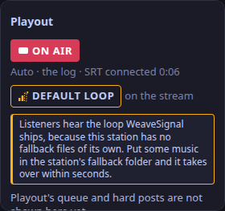

This page is for uploading an MP3, or any sound file, so that the station plays it by itself: between shows, or in the hours you choose.
Read the first section before you look for a button: some of what you may expect is not built yet.

## What the studio app does not do yet

- **There is no upload into the schedule.** The Schedule tab plans shows and episodes and shows the hours automation fills, but it does not take a sound file.
- **An episode holds no file.** An episode's **Kind** can say **Pre-recorded**, but that is a label for the schedule and the cards: playout does not play a recording for it, and **Open the recording** in the episode editor is not built.
- **The music library has no screen.** Automation's library and its hour clocks are reached through the station's API only. The Schedule tab shows their result: select an automation block to see the tracks planned for those hours, and **Another track…** swaps one for another track already in the library.

What does exist:

| Way | Plays | You need |
|---|---|---|
| [The fallback folder](#the-fallback-folder) | whenever nothing else is on: no show, and no automation; the files shuffled | the station's files (Cloudron's File Manager, or the server) |
| [The library and an hour clock](#the-library-and-an-hour-clock) | in the hours you give the clock, while nobody is live at the desk | the station key or an admin, and a command line |
| [A cart](/docs/how-to/play-a-sound-file/) | when you press its key | the studio app |

## The fallback folder

The fallback folder is the simplest way to put your own music on the air: whatever is in it plays, in shuffled order, whenever the desk is silent and automation has nothing to play.
On a new station that is all the time between shows, and it replaces the soft loop WeaveSignal ships.
Files added to the folder take over within seconds; nothing needs a restart.
Put MP3, FLAC, Ogg or WAV files in it; it is music for listeners, so use only files you may broadcast.

### On Cloudron

1. In Cloudron, open the WeaveSignal app's **File Manager**.
2. Open the folder `/app/data/fallback/`.
3. Upload your files there.

### On the Compose bundle

The folder is the volume `weavesignal_fallback-media` on the server.
On Podman, copy a file into it from the server:

```sh
podman unshare cp song.mp3 "$(podman volume inspect weavesignal_fallback-media --format '{{.Mountpoint}}')/"
```

### Check it

On the studio app's Desk tab, the playout panel's **Default loop** chip goes away, and the player plays your files between shows.



## The library and an hour clock

Automation plays tracks from the station's **library** in the hours its **clocks** cover.
A clock is an hour's pattern (a category of tracks, a cart), repeated until the hour is full; the week says which clock runs in each hour, and every hour the week leaves empty runs the **default clock**.
Automation is on the air in those hours whenever nobody is live at the desk: the desk is silent for 10 seconds, or the station is in auto mode.

There is no screen for this yet, so you use the station's API from a command line: four requests with `curl`.
`curl` is in Windows 10 and 11: in PowerShell, type `curl.exe` where the commands below say `curl`.

### Before you start

- **The station's own address**, where the studio app signs in: `https://radio.example.org`.
  On Cloudron, the app's own domain, not the public pages' domain.
- **The station key** (on Cloudron, `CONTROL_ADMIN_TOKEN` in `/app/data/secrets.env`): changing the default clock needs an admin.
  Keep it secret: it opens the whole station.

Set both once, in the same window as the commands:

| Shell | Set them |
|---|---|
| PowerShell | `$STATION = 'https://radio.example.org'` and `$KEY = 'the station key'` |
| Linux and macOS | `STATION='https://radio.example.org'` and `KEY='the station key'` |

Each command below is one line.

### 1. Upload the file to the library

```sh
curl -X PUT -H "Authorization: Bearer $KEY" -H "Content-Type: application/octet-stream" --data-binary "@song.mp3" "$STATION/api/v1/library/tracks?title=My%20song&artist=Me&category=music"
```

The station measures the file and keeps it at one loudness; the answer is the track.
A track needs a title and an artist; the category is 1 to 32 of `a`–`z`, `0`–`9`, `_` and `-`, and groups tracks for a clock.
The library takes WAV, FLAC, MP3, Ogg and M4A, up to 200 MB and 30 minutes unless your station is set otherwise.
Repeat it for each file.

### 2. Make a clock that plays the category

Save this as `clock.json` (Notepad will do):

```json
{"name": "Music", "slots": [{"category": "music"}]}
```

A clock needs an id you make: `uuidgen` on Linux, `[guid]::NewGuid()` in PowerShell.
Put it in the address:

```sh
curl -X PUT -H "Authorization: Bearer $KEY" -H "Content-Type: application/json" --data-binary "@clock.json" "$STATION/api/v1/schedule/clocks/5b0a6f2e-1c3d-4e5f-8a9b-0c1d2e3f4a5b"
```

### 3. Make it the default clock

Fetch the station's playout settings into a file:

```sh
curl -H "Authorization: Bearer $KEY" -o settings.json "$STATION/api/v1/playout/settings"
```

Open `settings.json`, change the value of `default_clock` to your clock's id in quotes (`"default_clock": "5b0a6f2e-1c3d-4e5f-8a9b-0c1d2e3f4a5b"`), leave everything else as it is, and send it back:

```sh
curl -X PUT -H "Authorization: Bearer $KEY" -H "Content-Type: application/json" --data-binary "@settings.json" "$STATION/api/v1/playout/settings"
```

To give the clock only some hours instead, set the week's grid with `PUT /api/v1/schedule/week`; that replaces the whole grid ([the API](/docs/reference/api/#put-apiv1scheduleweek)).

### 4. Plan the hours

```sh
curl -X POST -H "Authorization: Bearer $KEY" "$STATION/api/v1/schedule/generate"
```

This plans the next week at once; the station also keeps the next 26 hours planned by itself.

### Check it

On the Schedule tab, select an automation block: its log lists your tracks.
With nobody live at the desk, the desk shows a **Dead air** notice after 10 seconds and automation plays your tracks; the player carries them after the delay.

A library with only a few tracks repeats them.
The station spaces an artist, an album and a title apart (60, 60 and 180 minutes by default) and breaks that only when nothing else fits; the log says when it does.

## See also

- [Playout](/docs/reference/playout/): what plays when, the fallback order, the library and clocks.
- [The API](/docs/reference/api/#routes-library): every library, clock and schedule route.
- [Connect an integration](/docs/how-to/connect-an-integration/): an API token with `library:write` and `schedule:write` uploads tracks, makes clocks, sets the week and plans the hours, for a program that does this instead of the station key; the default clock stays an admin's.
