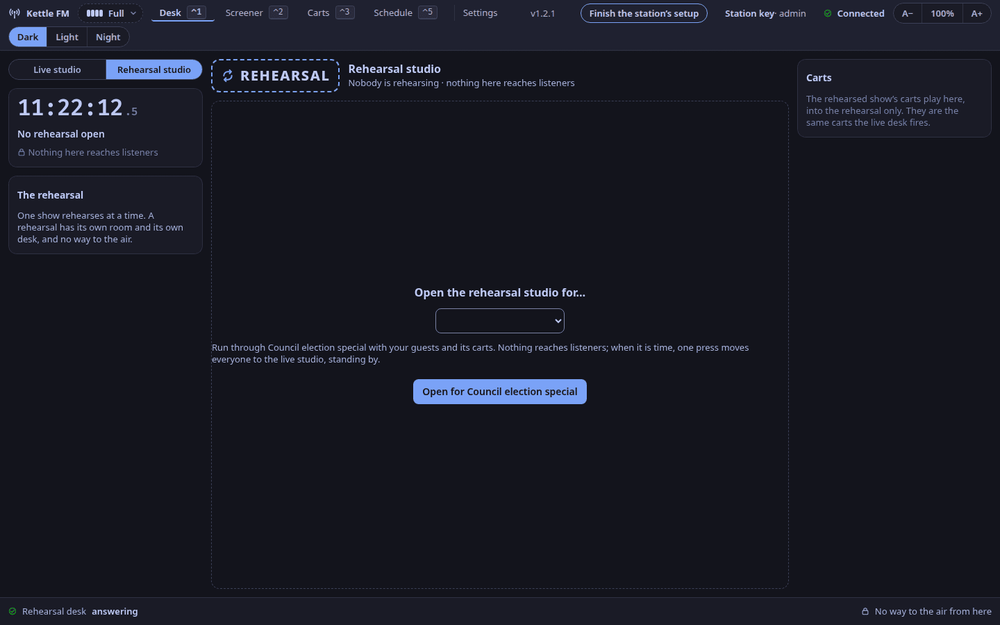
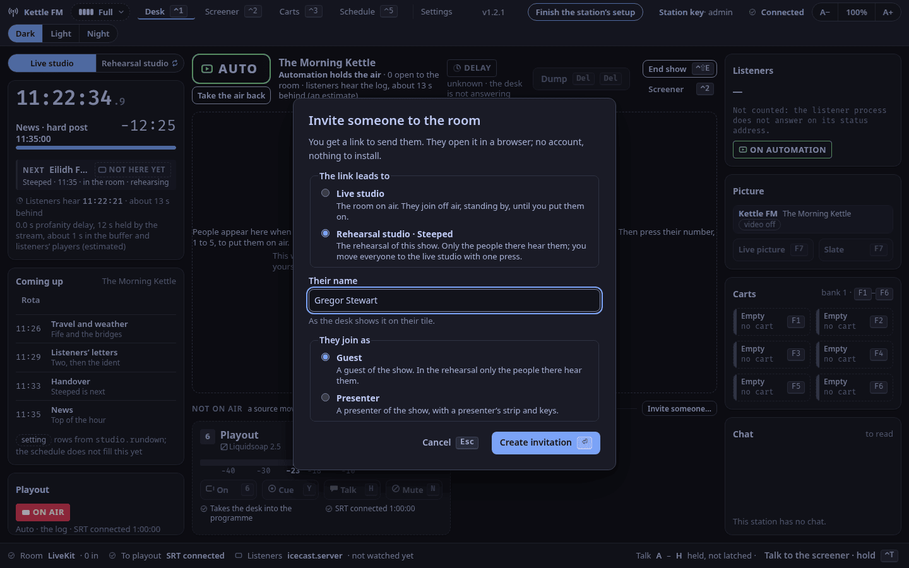
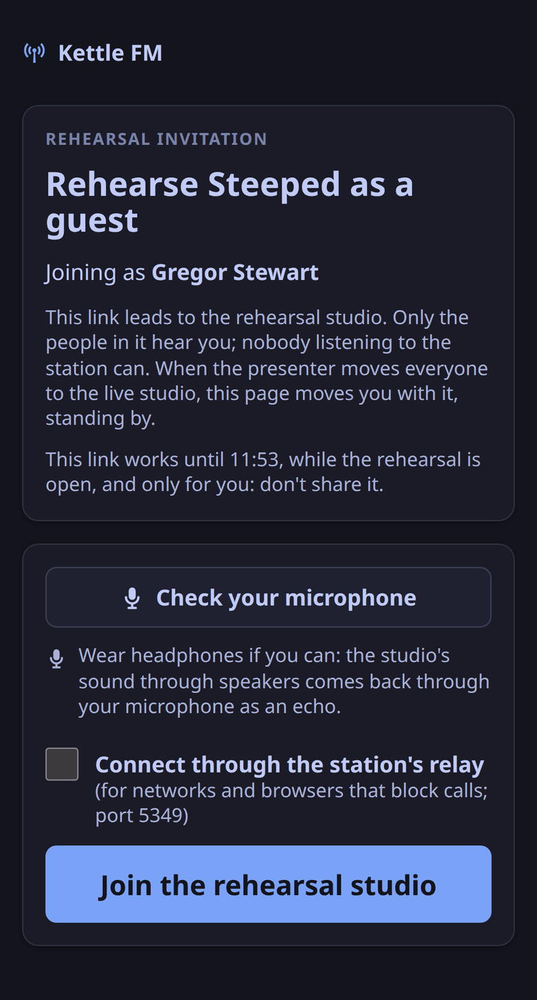
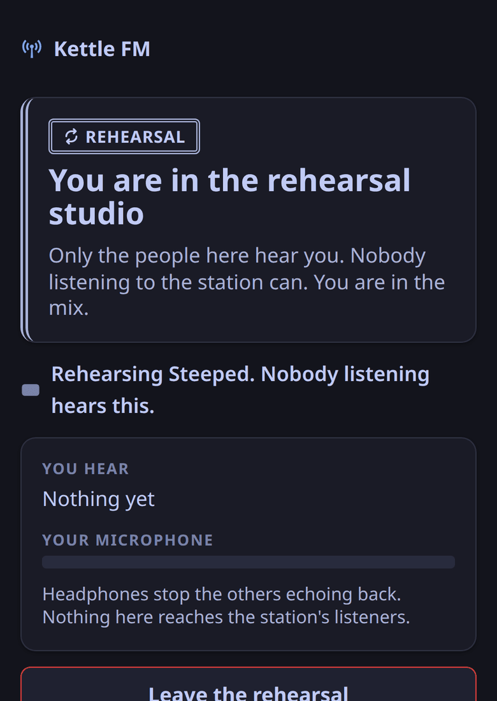
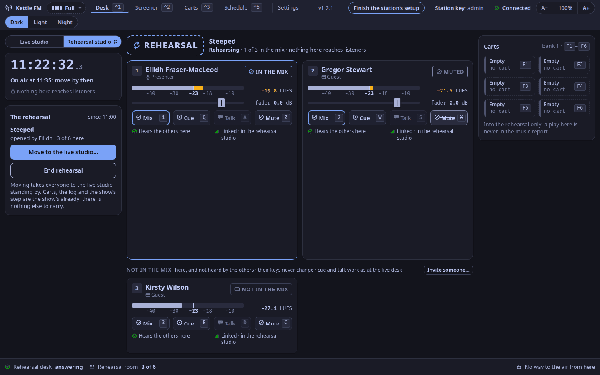
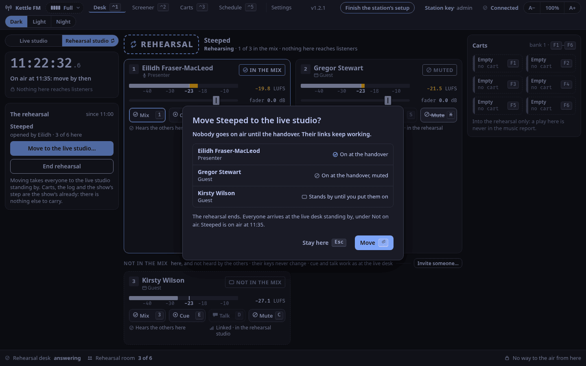
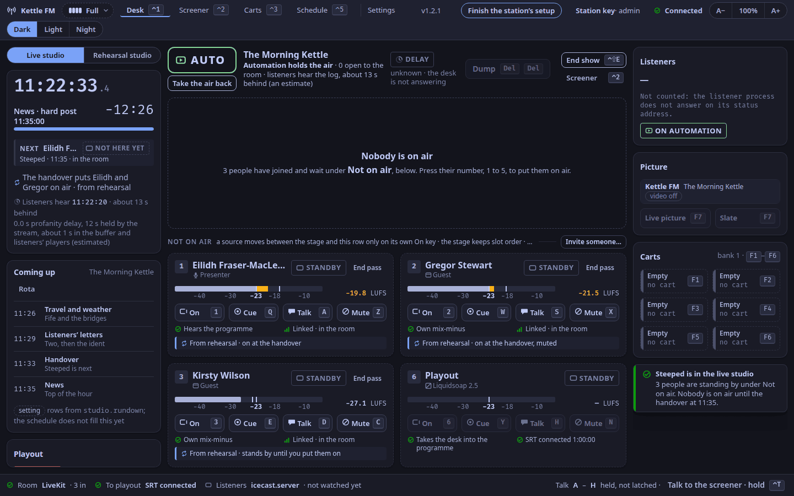
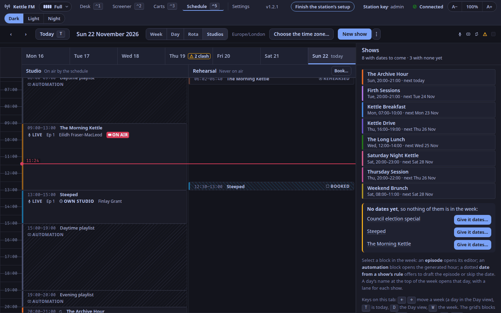
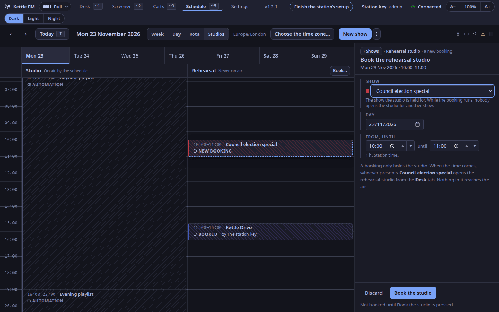
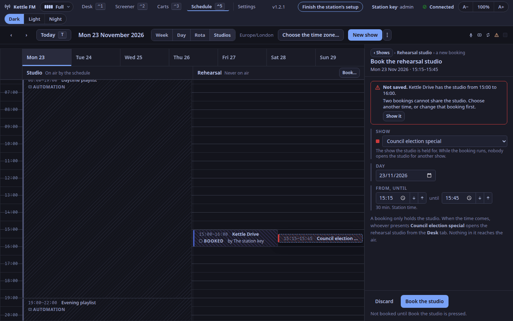

> **From 1.3.0.**

This is for a presenter or DJ whose show is coming up: Finlay Grant presents *Steeped* at 14:05, Eilidh Fraser-MacLeod is on air until then, and he wants his guests, Gregor Stewart and Kirsty Wilson, to try the microphones, the carts and the order of things without anyone hearing.
The rehearsal studio is a second desk with no way to the air.
Nothing said or played in it reaches listeners, the recordings, the per-play log or the live studio.

When you have finished, you **move** everyone to the live studio with one press, on the links they already have.
Nobody opens a new link, and nobody goes on air until the handover.

What the move carries, and why: [What moves to the live studio](/docs/explanation/what-moves-to-the-live-studio/).

## Before you start

- **The station has a rehearsal studio.** It is off unless an administrator turned it on with the `REHEARSAL` setting ([The rehearsal studio](/docs/reference/rehearsal-studio/)).
  When it is off, the studio choice on the Desk tab says so and says how to turn it on.
- **You may run the show's rehearsal.** That is the show's presenter, a producer or an admin, the same people who may change the show's step ([Choose how much of the studio a show uses](/docs/how-to/choose-a-step/)).
  A window that is preparing may do it, so you can rehearse while Eilidh is on air ([Prepare your show while another is on air](/docs/how-to/prepare-your-show/)).
- **The show is on the schedule.** To move, the show needs an airing under way or within the next twelve hours.
  You can rehearse without one, but the move is refused until there is.
- **The studio is free.** It takes one show at a time.
  If someone else is rehearsing, or a booking holds the studio for another show now, **Open** says who has it, and a booking says until when.

## 1. Open the rehearsal studio

1. On the **Desk** tab, in the head of the desk, choose **Rehearsal studio** instead of **Live studio**.
2. With no session open the desk says **Open the rehearsal studio for…** and offers a choice of show.
   Choose *Steeped* and press **Open for Steeped**.

The desk changes to the **rehearsal desk**.
Its lamp always says **REHEARSAL**, in its own shape: never red, and never **ON AIR** or **OPEN** (ADR-0062).
Choosing the live studio again takes you back to the live desk; the rehearsal stays open meanwhile.

If the studio says someone else has it, as in *Kirsty is rehearsing The Morning Kettle*, it is free once they move or end their rehearsal.

## 2. Bring people in

1. Press **Invite someone…**, as for a live invitation, and choose the **Rehearsal studio** in the dialog.
   The show is the one you opened.
2. Choose their role, a guest, a remote DJ or a presenter, give a name and press **Create invitation**, then **Copy link**.
3. For your own microphone, make your own link in the same way.

A rehearsal invitation follows the rehearsed show's step, not the step of the show on air.
So at Solo, only the show's presenter may join its rehearsal; at Guests, a guest may.
The room takes six people at once, unless the administrator has changed the limit.
More than that is refused with a sentence that says the studio is full.

On the join page the person reads *You are in the rehearsal studio. Only the people here hear you.*

The rehearsal studio carries voices and carts only.
It has no picture: a camera is checked on the join page, as before, and is not shown in the rehearsal.

## 3. Rehearse

The rehearsal desk is the live desk's keys on a small desk.

- **Each person's tile says *In the mix* or *Not in the mix*.**
  *In the mix* means the others in the rehearsal hear them.
  It never means on air, because nothing here is.
- **The keys are the desk's own**: `1` to `6` for a person's mix, and the cue and talk rows.
  Presenters and guests arrive *In the mix*, and a remote DJ *Not in the mix*, as each role's desk default is.
  (In the live studio everyone invited now stands by; the rehearsal, which reaches no air, uses the role's own default.)
- **Carts fire here.** The glance shows the rehearsed show's banks and the station's.
  Another show's own bank does not fire, whatever is on air.
  What you fire is heard in the rehearsal only, and is never written to the per-play log ([Carts in the desk](/docs/reference/desk-carts/)).
- **The window line** reads, for example, *On air at 14:05: move by then.*
  It is the handover window of your show.
  When the studio is open for a show that is next, the live desk's post line says *… rehearsing* beside it.

The mix you set here is what the move carries: who is *In the mix* and who is muted (below).
There are no levels to set.
The desk has no faders in 1.3.0, and its automatic leveller learns a moved person's level while they stand by in the live studio.

The rehearsal ends by itself after 30 minutes with nobody in it.
It does not end because the clock reaches your show: **nobody is moved automatically**.
A DJ still rehearsing at the post meets the usual rule: the late count, then the grace, then automation covers ([Follow the rota](/docs/how-to/follow-the-rota/)).

## 4. Move to the live studio

When you are ready, with your show's airing within twelve hours:

1. Press **Move to the live studio**.
2. The dialog lists who moves, each with their opening: **on** or **muted**.
   It says *Nobody goes on air until the handover. Their links keep working.*
3. Press **Move** (`⏎`), or **Stay here** (`Esc`) to go on rehearsing.
   The move has no chord of its own, so a stray key cannot do it.

What happens, in this order:

1. The station writes the move, with the opening, before it does anything else.
   A restart in the middle loses nothing.
2. Each person's page is given a live link on the link they already have.
   It leaves the rehearsal room, keeping their microphone, and joins the live room.
   Their page reads *Moving you to the live studio…* and then *Standing by*, saying they are not on air until the handover.
3. The rehearsal session ends, so its links buy nothing more.
   Opening the rehearsal again makes a new session.

The move is refused (409), with the reason in a sentence, when:

- nobody is in the rehearsal studio to move;
- the show has no airing under way or in the next twelve hours;
- the session has already ended.

If you have rehearsed enough but are not ready to move, press **End rehearsal** instead.
Everyone leaves the rehearsal room, and their rehearsal links stop working.

## 5. At the handover

In the live studio the moved people are in **Not on air**, each marked as coming from the rehearsal and *on at the handover*.
They are heard on cue and by talk, as everyone is who stands by.
The post line names who the opening puts on.

When the show's host is put on air at the live desk, by any of these, the opening is applied:

- the schedule's bring-on at the post;
- the first press of `⇧⏎`, the handover;
- taking the air back from automation;
- their own **On** key.

The people who were muted are muted first, and then the others who were in the mix go on air, with the station's fade, the same as the post's.
It is applied once.
A person who has not arrived in the live room is left out; nobody is put on air who is not there.

The opening is kept until the airing's start plus the grace, the last moment the post can still hand over ([Set up a host in their own studio](/docs/how-to/set-up-a-host-in-their-own-studio/)), so that a live desk that restarts in between puts the moved people back.
Moved people stand by until a press puts them on, as every invited person does.

## Book the rehearsal studio ahead

The studio is first come.
To hold it for a show at a time, open the **Schedule** tab and press **Studios**.
It shows one day with a column for each studio: **Studio**, where every show on air is, and **Rehearsal**, where bookings and past sessions are.

- **Book**: drag across empty time in the **Rehearsal** column.
  The editor shows the show, the times and **Delete**.
  A booking starts from now on, lasts at least five minutes and at most a day.
- **Change**: drag or resize a booking that is not over.
- **Clashes**: two bookings never share time, and the editor says which one is in the way.
  A booking that starts as another ends does not clash.
- **While a booking holds the studio**, **Open** for another show is refused, with the show and the time.
- **Rights**: whoever may change a show's step may book for it.
  Anyone else sees the column read-only.
- **A rehearsal under way** is a block in the **Rehearsal** column that runs to now. Select it and its pane says who opened it and when, with **Go to the rehearsal desk** (from 1.3.2): the Desk tab opens on the rehearsal studio, as choosing **Rehearsal studio** at the head of that tab does. Going there opens, moves and airs nothing; **Live studio** is the way back. Where the rehearsal studio cannot be chosen from this window, the button says why.

The week view does not show rehearsals, and the calendar file never lists them ([Calendar files](/docs/reference/calendar-files/)).
A booking is a promise to other people, not a lock on your own time: the studio is also free outside bookings, to whoever opens it first.

## If it does not work

- **The choice says the rehearsal studio is off at this station.** An administrator turns it on with `REHEARSAL` in the installation's settings, and restarts ([The rehearsal studio](/docs/reference/rehearsal-studio/#turning-it-on)).
- **The desk says the rehearsal desk is not answering.** Its process has stopped, or is starting again.
  It is the first thing the host stops under memory pressure, so that the live desk is kept: wait a moment, and look at the memory of the server if it keeps happening.
  The live studio is not affected.
- **A guest's page says the rehearsal studio is not open.** The session ended, by **End rehearsal**, by the idle end, or by a move.
  Open it again and make a new invitation: links to an ended session never come back.
- **A guest's page says the rehearsal studio is full.** The room takes six people.
- **After the move a guest is not in *Not on air*.** Their page has not reached the live room yet: a page that missed the move is offered it again when it reconnects, until the airing ends.
  If the page was closed, they open the same link again.
- **Someone is on air who should not be.** They were *In the mix* when you moved, and the host went on air: that is the opening.
  Take them off with their slot's key, as for anyone, and mute people before the move next time.
- **Move says there is no airing.** Put the show on the schedule, or its next airing within twelve hours ([Schedule the week](/docs/how-to/schedule-the-week/)).

## See also

- [What moves to the live studio](/docs/explanation/what-moves-to-the-live-studio/): why a button, what is carried and what is not.
- [The rehearsal studio](/docs/reference/rehearsal-studio/): the setting, the sections of the settings files and the rules.
- [The rehearsal studio's data](/docs/reference/studio-rehearsal-data/): the routes and the studio app's store.
- [Hand over to the next DJ](/docs/how-to/hand-over-to-the-next-dj/): the overlap on air.
