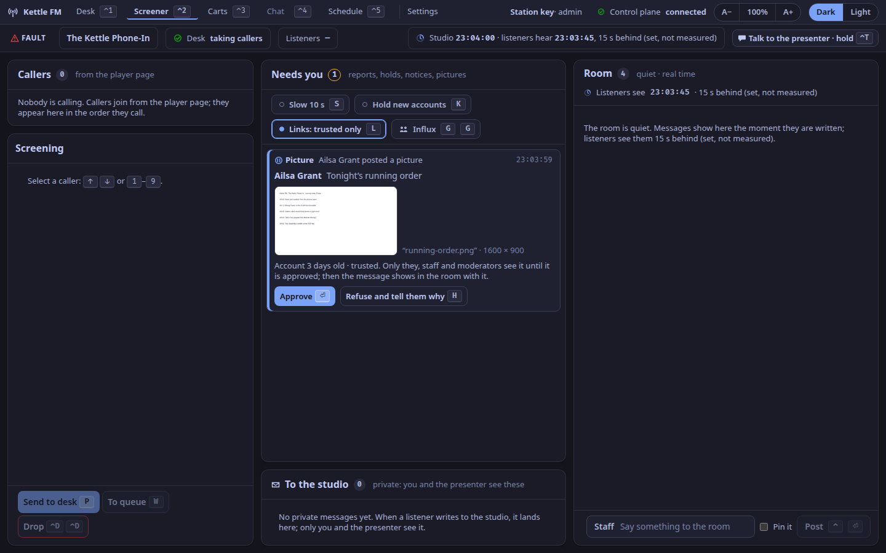

This is for the station's staff and its moderators.
A trusted chatter can attach a picture or a document to a message where the station allows it (ADR-0262); every one waits for one of you before anyone else sees it.

## Before you turn it on

- **You will see every picture and document posted.** Whoever works the queue meets whatever a trusted account sends, a compromised one included. Tell your moderators what to do with something unlawful ([the runbook](/docs/how-to/handle-suspected-child-abuse-images/)) and that they may stop.
- **Add a line to your risk assessment.** In the UK, turning on uploads is a significant change to the service: write a short update to your illegal-content risk assessment before you do (Online Safety Act, section 9(4)). The studio's chat admin has a template (`GET /api/v1/chat/admin/risk-assessment`).
- **Say it in your terms**: no pornography, and no sexual imagery of anyone under 18.
- **Documents are not scanned.** A PDF or an OpenDocument file is passed on unchanged and can carry scripts or macros. Readers are told so; check one before approving if you are unsure.

## Turn it on

In the studio, **Settings > Chat pictures > Let trusted chatters post pictures and documents** (an admin's switch). It takes effect at once on every open player page, and the moderation record has a line with who switched it.
It is off as installed (`CHAT_ATTACHMENTS`); after the switch is used, the switch decides. Turning it off stops new ones; those already posted stay.
Only chatters you make **trusted** (the standing that may post links) can attach.

## Approve or refuse

Each one waits in **Needs you** as **Picture** or **Document**, oldest first, beside avatars waiting for approval, with the chatter, their words and the file.

- **Look at a picture full size**: press its thumbnail. It opens as the room would see it (about 1,600 pixels on its long side), so the text in a screenshot can be read. `Esc` closes it.
- **Check a document**: **Save to check** saves it under the station's name for it; it is never opened in the studio.
- **Approve** (`⏎`): the message appears in the room with it, for everyone. Nobody approves their own.
- **Refuse** (`H`, then a reason, then `⏎`): it is deleted, its message is never shown, and the chatter is told why, with 14 days to ask for a review. For something unlawful choose the reason as [Moderate the chat](/docs/how-to/moderate-the-chat/#chatters-pictures) says for pictures: **Intimate image** keeps it under an evidence hold, **Suspected child sexual abuse** (`C`) keeps it for a year for a report.

One nobody decides on within 30 days is deleted with its message, and the chatter is told it was not a judgement of it.

## Take one down after it was shown

- Select the message in **The room** and press **Remove picture** or **Remove document**; or, when a listener has reported it, use **Remove the reported picture** (or **document**) on the report in Needs you, which closes the report too.
- Give a reason as for a refusal. The attachment and its message leave every page at once, and the chatter is told why.
- Hiding the message (`H`) takes its attachment with it.

Pictures and documents kept as evidence are listed in **Settings > Chat pictures** with the avatars kept, and are deleted from there in the same way.
