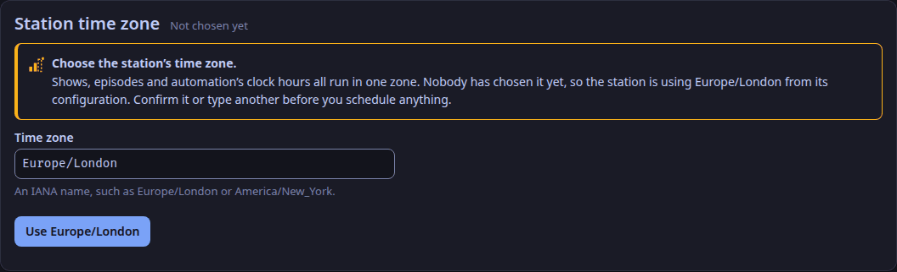
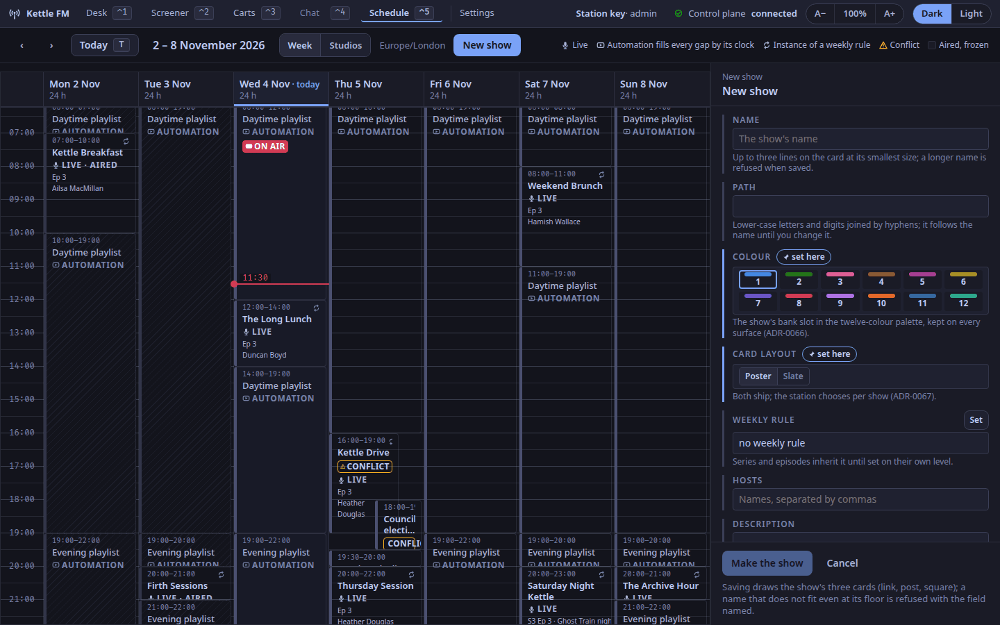
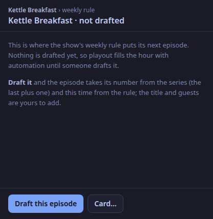
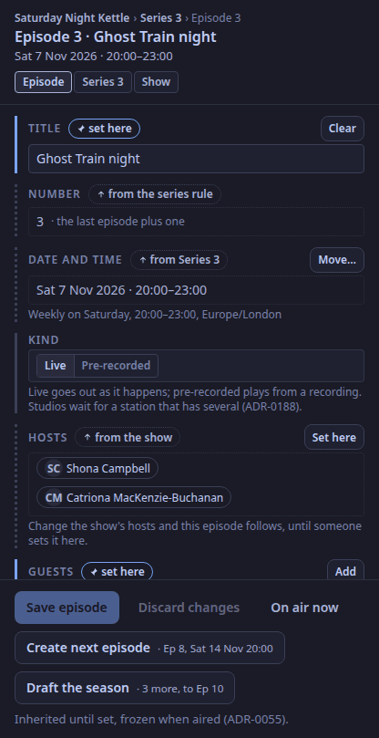
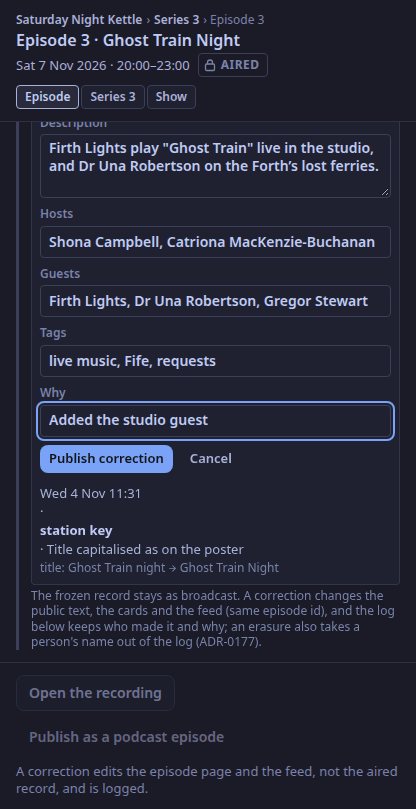
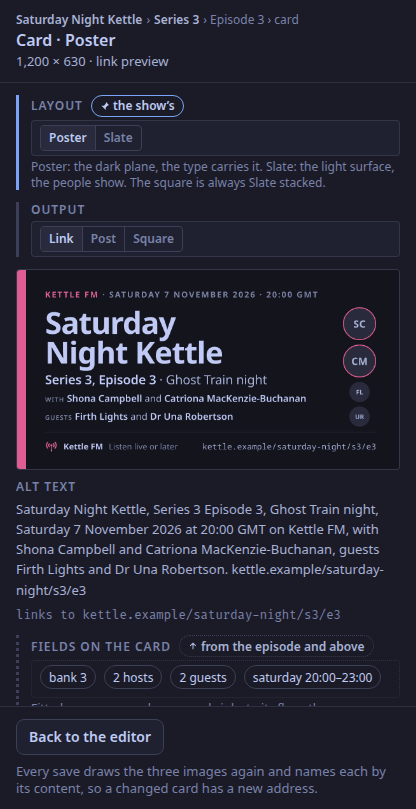

This is for the station manager, on the studio app's Schedule tab (`⌃5`).

## Choose the station's time zone first

Everything on the tab is in the station's own time zone, kept in the station's database and chosen once in **Settings**, under **Station time zone**.
Until someone chooses it, the station offers `publishing.zone` from `control.toml` (Europe/London unless you changed it), and the toolbar shows **Choose the time zone…** to an admin.

1. Select **Choose the time zone…** in the toolbar, or open **Settings**.
2. Under **Station time zone**, keep the zone offered or type another IANA name in **Time zone**, such as `Europe/London` or `America/New_York`.
3. Select **Use Europe/London** (the button names the zone offered), or **Use this time zone** for one you typed. The toolbar's prompt goes.

Automation's clock hours use the same zone. The grid shows it in the toolbar, and a clocks-change Sunday shows its 23 or 25 hours.

Change the zone later only if you must. Shows and clock hours are stored as a weekday and an hour with no zone, so after a change each airs at the same hour in the new zone, which is a different moment. Settings warns you before you select **Change time zone**.

## Make a show

1. Select **New show** in the toolbar.
2. Give it a **Name**. Its **Path** follows the name until you change it.
3. Pick its **Colour**, a bank slot: the same colour on the cart wall and the cards (ADR-0066).
4. Pick its **Card layout**, Poster or Slate (ADR-0067).
5. Under **Weekly rule**, select **Set**, then give a weekday, a start and a length in minutes, and **Set**.
6. Hosts, a description, tags and **Explicit** (for the podcast feed) are optional; a series and its episodes inherit them until set lower down (ADR-0055).
7. Select **Make the show**. The control plane draws the show's three cards first. A name that does not fit the card even at its smallest size, or that holds characters the card fonts cannot draw, is refused, with the field named.

The rule's instances appear on the grid as dotted *Not drafted* blocks from now on.

## Draft the episodes

- Select a dotted block and **Draft this episode**: the episode takes its number (the last plus one) and the time from the rule.
- Or open any episode of the show, switch to **Series n**, set **Starts on** and **Planned episodes**, **Save series**, and **Draft the season**: every planned episode not yet drafted, each on its instance of the rule, across the clock change.
- **Create next episode** on either level drafts one more.

Drafting never touches an aired episode.

## Mark an episode as aired

When the show goes out, select its episode and **On air now**: the episode is frozen as broadcast and its cards are drawn once more.
Nothing does this by itself yet; the desk going on air does not.

## Change an episode

Select its block.
Each field says where its value comes from:

| Marker | Means | Actions |
|---|---|---|
| **from Series 3**, **from the show**, **from the series rule** (dotted) | the field follows the level above; change the series' hosts and this episode follows | **Set here** copies the value down and makes it the episode's own |
| **set here** (accent) | the episode's own | **Clear**, or **Reset to series** to inherit again |
| **as aired** (a lock) | the episode has aired and is frozen; what was broadcast is not rewritten | none |

Guests are always the episode's own.
**Kind** is **Live** or **Pre-recorded** (ADR-0188); it is the episode's own, and every episode is live until you mark it. It is kept in the schedule and frozen with the episode when it airs.
**Save episode** sends only what changed.
A title, guest or host name that holds characters the card fonts cannot draw is refused with the field named, and nothing is saved (ADR-0176).

To move an episode, drag its block to another time or pull its end, or **Move…** on the date field and set the time and length by hand; a moved instance says MOVED · was 07:00 on the grid, and **Back to the rule** undoes it.
If the control plane refuses a move, the block snaps back and the toast says why.

Two episodes that overlap both say CONFLICT.
Automation never conflicts: it fills whatever the shows leave.

## Correct an aired episode

An aired episode is frozen so the archive stays true to what was broadcast, but a misspelt title or guest can be put right.
On the aired episode, **Correct the public text…** under **Corrections**: change the title, description, hosts, guests or tags, say **Why** in a sentence, and **Publish correction**.
An admin can, and so can the member of staff who made the episode (ADR-0198); anyone else is told to ask one of them. An episode made before WeaveSignal recorded makers (November 2026), or made with the station key or an API token, is an admin's to correct. The log names who did it.
The cards are drawn again from the corrected text, the podcast feed shows the new text under the same episode id (so apps do not list it twice), and the published audio files are tagged again with the new title and card.
Nothing is changed if the cards cannot be drawn: the correction is refused with the field named.

The frozen record is not rewritten: each correction is a line in the episode's log with who made it, when, why, and the fields as they were and as they became.
The air time, the length and the kind are not text and cannot be corrected.
If a person asks to be erased ([Set retention](/docs/how-to/set-retention/)), their name leaves the log as well: the line stays, marked as redacted, with the name taken out of its old and new values and its reason.

## Check the card

**Card…** on the artwork field (or on the show level) opens the card editor: switch Poster and Slate, the link card, the post image and the podcast square, and read the alt text that travels with the card and the page it links to.
A field that does not fit, or that holds characters the card fonts cannot draw (they cover Latin, Greek, Cyrillic and Arabic; Chinese, Japanese, Korean, Hebrew and Devanagari names are not covered), is named there before you save, and the save is refused (ADR-0176).
**Keep for the show** saves a tried layout.

## Read the generated hours

Select an automation block: the log for those hours, each track with the rule it breaks, if any, in the scheduler's words.
**Another track…** picks a replacement from the library, and **Use it** puts it in.
If the control plane refuses it, the reason is shown: the station's own separations can be accepted with **Accept the break**, a break of the US statutory licence never.
**Remove** takes an item out.
An empty future hour offers **Generate these hours**; the control plane also keeps the log generated 26 hours ahead by itself.

## Keys

`←` `→` move a week, `T` is today, `Tab` reaches the blocks and `⏎` opens one; the global keys (`⌃1` to `⌃5`, `F1` to `F6`, `⌃T`) work as on every tab.
