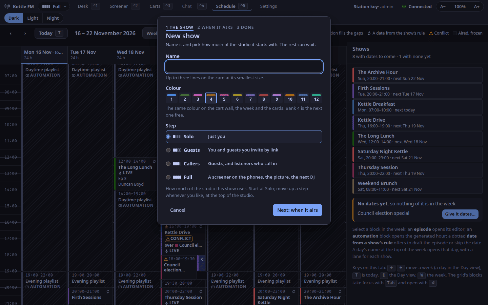
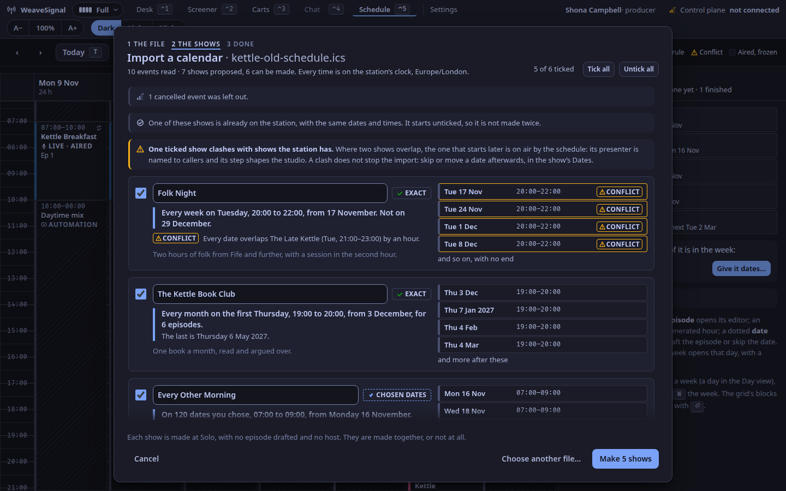
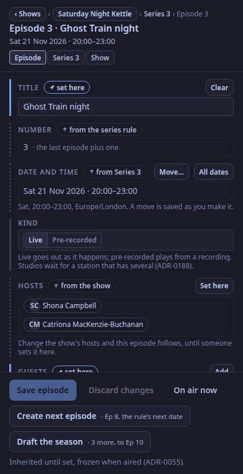
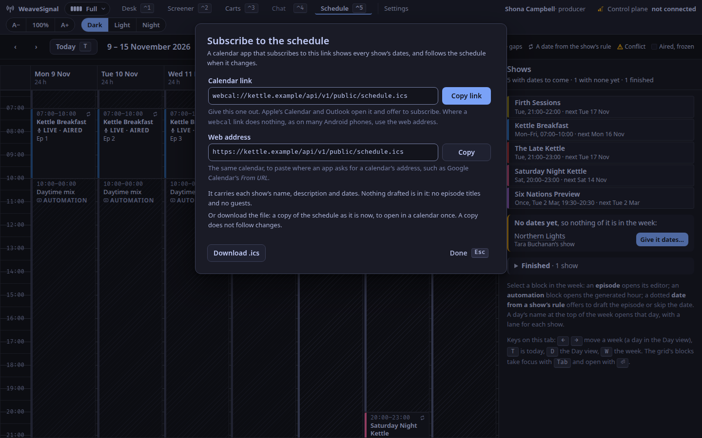
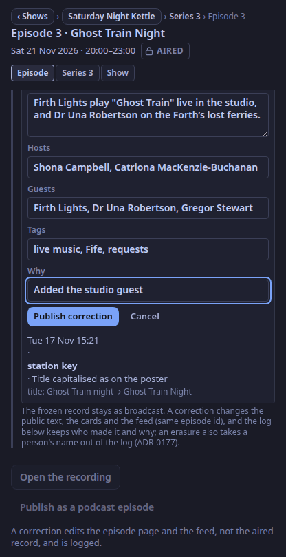

This is for the station manager, on the studio app's Schedule tab (`⌃5`).

## Choose the station's time zone first

Everything on the tab is in the station's own time zone, kept in the station's database and chosen once in **Settings**, under **Station time zone**.
Until someone chooses it, the station offers `publishing.zone` from `control.toml` (Europe/London unless you changed it), and the toolbar shows **Choose the time zone…** to an admin.

1. Select **Choose the time zone…** in the toolbar, or open **Settings**.
2. Under **Station time zone**, keep the zone offered or type another IANA name in **Time zone**, such as `Europe/London` or `America/New_York`.
3. Select **Use Europe/London** (the button names the zone offered), or **Use this time zone** for one you typed. The toolbar's prompt goes.

Automation's clock hours use the same zone. The grid shows it in the toolbar, and a clocks-change Sunday shows its 23 or 25 hours.

Change the zone later only if you must. Shows' rules and clock hours are stored on the wall clock with no zone, so after a change each airs at the same hour in the new zone, which is a different moment. Settings warns you before you select **Change time zone**.

## Make a show

1. Select **New show** in the toolbar. If a block was selected, the date and time start from it; change them if that is not what you want.
2. **The show**: give it a **Name**, pick its **Colour** (a bank slot: the same colour on the cart wall and the cards, ADR-0066) and its step, then **Next: when it airs**.
3. **When it airs**: give **First on** and the times **from** and **until**, in the station's zone. Type a time, or press the two arrows beside it: each press moves it to the quarter-hour before or after. A show that runs past midnight is asked about once.
4. Under **Repeats**, pick the sentence that fits: *Once only*, *Every week on Tuesday*, *Every month on the third Tuesday*, *Every year on 17 November*, or **On dates I choose…** (click the dates in the small months; **Remove** takes one out). **More choices…** gives every other week, several weekdays, the last Friday of the month, a day of the month, and the rest.
5. Under **Ends**, pick **Never**, **On** a date, or **After** a number of episodes.
6. Read the right-hand side: the rule in words with its last date, and the next dates with their episode numbers. **Skip** a date the show does not air (a skipped date does not count towards the episodes), or **Move…** one to another day or time.
7. If a date clashes with another show, its row says CONFLICT with the other show and the overlap. When every date clashes, the station offers the nearest clear time, such as **Try 21:00 to 22:00**.
8. Select **Make the show** (**Make the show anyway** while something clashes). The station draws the show's cards first; a name that does not fit the card, or holds characters its fonts cannot draw, is refused with the field named.
9. **Done** says which episode is drafted. **Draft all 10** drafts the rest of a rule with an end; **Open episode 1** selects it; **See its dates** opens the show's dates as a list.

The other dates appear on the grid as dashed *Not drafted* blocks. **No dates yet** in step 7 makes the show without a rule, to give it dates later.

Hosts, a description, the card layout and the presenter's details are in the show editor; a series and its episodes inherit them until set lower down (ADR-0055).

A show made by mistake, or a test show, can be removed again while none of its episodes has aired: [Delete a show](/docs/how-to/delete-a-show/).

## Bring shows in from a calendar file

A station that kept its schedule in a calendar (Google Calendar, Outlook, another station system) can bring its shows in from an `.ics` file, without typing each rule.
An admin or a producer can; it makes new shows only, and changes none you have.

1. Export the calendar from the other system as iCalendar (`.ics`). The file may be up to 1 MB and hold up to 200 events; for more, export a shorter range of dates or one calendar at a time.
2. Select **Import a calendar…** in the toolbar. In a narrower window it is in the **⋮** menu beside **New show**.
3. **Choose a file…** and pick the file, or drop the file onto the dialog. In the studio app you can paste the file's path instead, as your file manager copies it, and select **Read the file**. The station reads it and makes nothing yet.
4. Read the list. An event that repeats is one show with the same rule, marked **EXACT**. Events that share a name are one show on chosen dates. A rule a show cannot have (every other day, the fifth Friday) is offered as its dates for the next twelve months, marked **CHOSEN DATES**, with the reason. What cannot be a show (an all-day event) is marked **NOT A SHOW**, with the reason, and cannot be ticked.
5. Each show says when it airs in a sentence and lists its next dates. **CONFLICT** marks a date that clashes with a show you have. A clash does not stop the import.
   A show you already have, under the same name at the same dates and times, says **ALREADY ON THE STATION** and starts unticked, so reading a station's own calendar file back makes nothing twice.
6. Untick what you do not want, and change any name. Two shows may share a name; the second says how they are told apart. Every time is on the station's clock; an event from another time zone says so.
7. Select **Make 4 shows** (the button counts them). They are made together, or not at all: if the station refuses one, such as a name that does not fit the card, it says so under that show and nothing is made.
8. **Done** lists the shows made and which of them overlap other shows. **Open** on one goes to its dates.

Each show is made at **Solo**, with no host and no episode drafted. Its dates wait in the week as dashed *Not drafted* blocks; draft them as for any show.

## Find a show and read its dates

With nothing selected, the right-hand column lists the station's shows by name, each with its rule in short and its next date. From anywhere else in the column, **‹ Shows** at the start of its path comes back to the list, in the same week.

1. Select the show's row. It opens at **Dates**: when it airs in a sentence, its last date, how many are to come, and a row for each date.
2. Press a row to see it in the week: the week moves to that date and its block is selected. The list stays beside it. **Open** on the row opens the episode, or the date that is not drafted.
3. **Draft** on the next date that is not drafted makes its episode. **Draft the next** at the foot does the same, and **Draft all 27** drafts every date left of a rule that ends.
4. **Skip** takes a date out; the row stays, struck through, with **Put back**. **Move…** sets one date to another day or time (the arrows beside the time step it a quarter of an hour, and past midnight the date goes with it), and a moved date offers **Back to the rule**.
5. Each change is saved as you make it. The line above the week says what was done, with **Undo** for a few seconds.
6. **Show more dates** lists ten more; **Aired**, under the rows, lists what has gone out.

**Details**, beside **Dates**, is the show editor: its name, step, colour, hosts and the rest.
A show with no dates, or one that has finished, is at the foot of the list of shows; its name opens it the same way, with **Give it dates…**.

## Change when a show airs

Open the show (its row in the list of shows, or one of its blocks and then **Show**), and at **When it airs** select **Change…**. The same questions open with the show's rule. **Save…** lists the drafted episodes with their old and new dates: **Move them to the new dates** (the default) or **Leave them where they are**. Aired episodes never move. Every window is told who changed it.

## Draft the episodes

- Select a dashed block and **Draft this episode**: the episode takes its number (the last plus one) and the time from the rule. **Skip this date** takes that date out instead (**Undo** puts it back, and so does **Put back** in the show's dates). **All its dates** opens the list.
- Or draft from the show's dates, as above.
- Or open any episode of the show, switch to **Series n**, set **Starts on** and **Planned episodes**, **Save series**, and **Draft the season**: every planned episode not yet drafted, each on its instance of the rule, across the clock change.
- **Create next episode** on either level drafts one more.

Drafting never touches an aired episode.

## Mark an episode as aired

When the show goes out, select its episode and **On air now**: the episode is frozen as broadcast and its cards are drawn once more.
Nothing does this by itself yet; the desk going on air does not.

## Change an episode

Select its block.
Each field says where its value comes from:

| Marker | Means | Actions |
|---|---|---|
| **from Series 3**, **from the show**, **from the series rule** (dotted) | the field follows the level above; change the series' hosts and this episode follows | **Set here** copies the value down and makes it the episode's own |
| **set here** (accent) | the episode's own | **Clear**, or **Reset to series** to inherit again |
| **as aired** (a lock) | the episode has aired and is frozen; what was broadcast is not rewritten | none |

Guests are always the episode's own.
**Kind** is **Live** or **Pre-recorded** (ADR-0188); it is the episode's own, and every episode is live until you mark it. It is kept in the schedule and frozen with the episode when it airs.
**Save episode** sends only what changed.
The date and time are the one field it does not save: a move is saved as you make it.
A title, guest or host name that holds characters the card fonts cannot draw is refused with the field named, and nothing is saved (ADR-0176).

To move an episode, drag its block to another time or pull its end, or use **Move…** on the date field:

1. Select **Move…**. The field opens as a date, a time and a length in minutes.
2. Set them. The two arrows beside the time step it to the quarter-hour before or after; past midnight the date goes with it.
3. Select **Move** (or press `⏎` in a field). The move is saved at once: the week shows the episode at its new time, and follows it to another week if that is where it went. **Cancel** or `Esc` leaves it where it was.
4. The line above the week says where the episode is now, and any show it now clashes with, with **Undo** for a few seconds.

Only the time is saved, and the length if you changed it. Anything else you have typed in the editor (a title, guests) is still a draft, and still waits for **Save episode**.
A moved episode says MOVED · was 07:00 on the grid, and **Back to the rule** puts it back on the rule's own time and length; that is saved at once too, with **Undo**.
If the control plane refuses a move, it says why: a dragged block snaps back and the line above the week says it, and **Move…** stays open with what you typed and the reason under it.
An aired episode cannot be moved.

## See what clashes, and put it right

Two shows that share time clash, whether their episodes are drafted or not. Automation never clashes: it fills whatever the shows leave.

- **In the week**, one of them is open and readable, with a warning triangle before its time, and says what it is over (*over The Long Lunch*); each of the others shows beside it as a tab at the day's right edge, in its own colour, with a chevron and its name where there is room. Point at a tab to read which show it is; press it and that show comes forward. The day's header counts the shows that clash on it: *2 clash*.
- **Select a block in a clash** and the editor begins with **Clashes with**: each other show with its times and the overlap, **Show it** to turn to that one, and who is on air where two episodes overlap (the one that starts later).
- **Open the day** there, or press the day's header, or **Day** in the toolbar: one day, with a lane for each show, so every name and time is in full. The strip above the grid moves between the days of the week. **Week** goes back.
- To end a clash, move one of them (**Move…** on an episode's date, or drag its block) or take the date out (**Skip this date** on a date that is not drafted).

The week never changes to the Day view by itself.

## Give out the schedule as a calendar

Listeners and presenters can have the schedule in their own calendar app, where it follows the schedule as you change it.

1. Select **Subscribe…** in the toolbar (in a narrower window, in the **⋮** menu beside **New show**). For one show, open the show, select **Details**, and select **Subscribe…** beside **When it airs**.
2. **Copy link** copies the **Calendar link**, which starts `webcal://`. Put it on your website or send it. Apple's Calendar and Outlook open it and offer to subscribe.
3. For a calendar that asks for an address, such as Google Calendar's *From URL*, **Copy** the **Web address** instead. Give both where you can: on many Android phones a `webcal` link does nothing.
4. **Download .ics** saves the schedule as a file to open in a calendar once. A file is a copy and does not follow changes. The studio app says where it saved it, in your Downloads folder.

The calendar carries each show's name, its description and its dates, with skipped and moved dates as they are. Nothing drafted is in it: no episode titles and no guests.
The link is on the station's public address, so it works for people who cannot sign in. If the dialog says the station has no public address, an admin sets `publishing.public_url` in the station's settings file first ([Calendar files](/docs/reference/calendar-files/#subscribe)).

## Correct an aired episode

An aired episode is frozen so the archive stays true to what was broadcast, but a misspelt title or guest can be put right.
On the aired episode, **Correct the public text…** under **Corrections**: change the title, description, hosts, guests or tags, say **Why** in a sentence, and **Publish correction**.
An admin can, and so can the member of staff who made the episode (ADR-0198); anyone else is told to ask one of them. An episode made before WeaveSignal recorded makers (November 2026), or made with the station key or an API token, is an admin's to correct. The log names who did it.
The cards are drawn again from the corrected text, the podcast feed shows the new text under the same episode id (so apps do not list it twice), and the published audio files are tagged again with the new title and card.
Nothing is changed if the cards cannot be drawn: the correction is refused with the field named.

The frozen record is not rewritten: each correction is a line in the episode's log with who made it, when, why, and the fields as they were and as they became.
The air time, the length and the kind are not text and cannot be corrected.
If a person asks to be erased ([Set retention](/docs/how-to/set-retention/)), their name leaves the log as well: the line stays, marked as redacted, with the name taken out of its old and new values and its reason.

## Check the card

**Card…** on the artwork field (or on the show level) opens the card editor: switch Poster and Slate, the link card, the post image and the podcast square, and read the alt text that travels with the card and the page it links to.
A field that does not fit, or that holds characters the card fonts cannot draw (they cover Latin, Greek, Cyrillic and Arabic; Chinese, Japanese, Korean, Hebrew and Devanagari names are not covered), is named there before you save, and the save is refused (ADR-0176).
**Keep for the show** saves a tried layout.

## Read the generated hours

Select an automation block: the log for those hours, each track with the rule it breaks, if any, in the scheduler's words.
**Another track…** picks a replacement from the library, and **Use it** puts it in.
If the control plane refuses it, the reason is shown: the station's own separations can be accepted with **Accept the break**, a break of the US statutory licence never.
**Remove** takes an item out.
An empty future hour offers **Generate these hours**; the control plane also keeps the log generated 26 hours ahead by itself.

## Keys

`←` `→` move a week (a day in the Day view), `T` is today, `D` opens the Day view and `W` the week, `Tab` reaches the day headers and the blocks, and `⏎` opens one (a folded block comes forward). `Esc` closes what the editor column holds and clears the selection, as **‹ Shows** does; it closes nothing over changes that are not saved. In the list of shows and a show's dates, `↑` `↓`, `Home` and `End` move between the rows; `⏎` opens a row, and `Space` on a date shows it in the week. The global keys (`⌃1` to `⌃5`, `F1` to `F6`, `⌃T`) work as on every tab.
