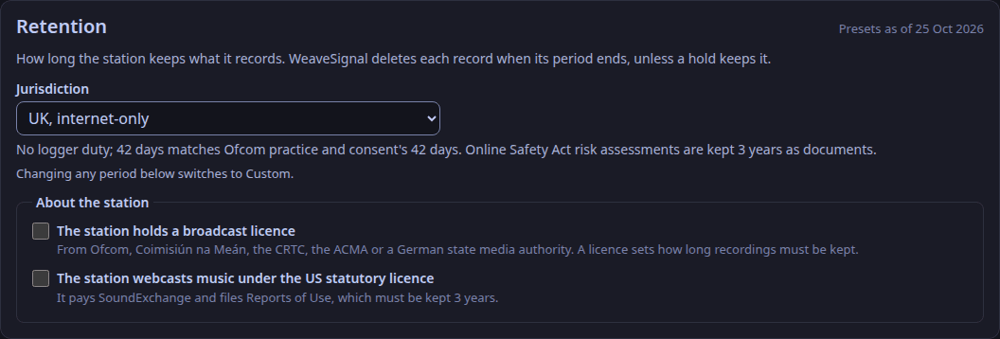
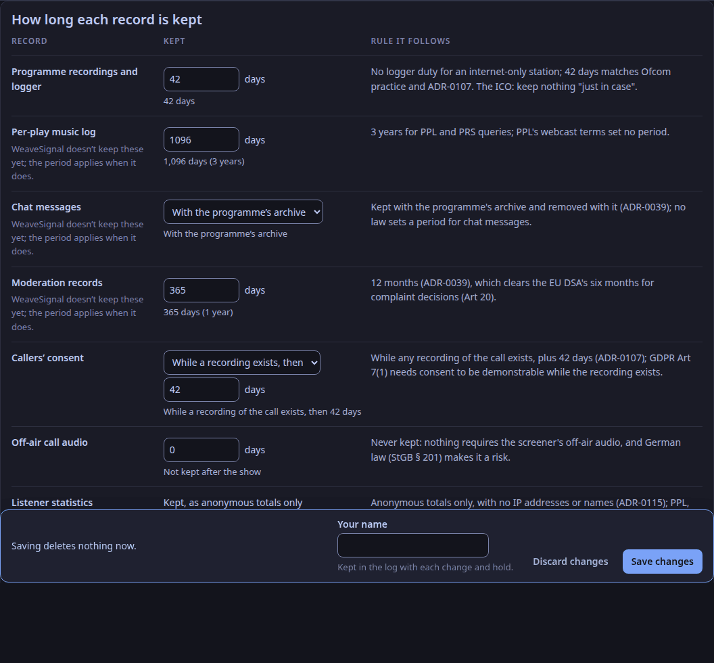
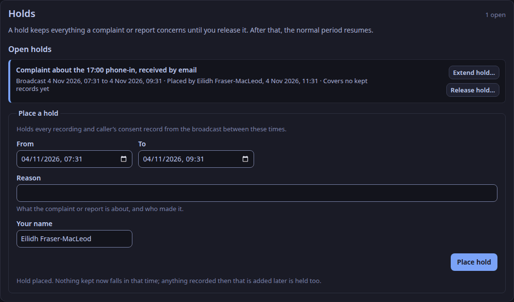

A new station keeps nothing after a show except anonymous listening totals: its retention setting is **No retention** (ADR-0113).
The one other thing No retention keeps is the record of a released hold, for 14 days (ADR-0199): who placed and released it, when and why, with no recording or message in it, so the station can show that a hold existed and was released.
A licensed broadcaster, or a US webcaster under the statutory licence, must choose its jurisdiction, or it breaks its licence.

## Choose the jurisdiction

1. In the studio app, select **Settings** in the top bar at the top. Retention is an admin's to change.
2. Under **About the station**, tick what applies: **The station holds a broadcast licence**, and **The station webcasts music under the US statutory licence**.
3. Choose the station's **Jurisdiction**. Each row of the table below it, **How long each record is kept**, shows how long that kind of record is kept and the rule the period follows, with the least the rule allows.
4. Select **Save changes**. The log names you by your username; only with the station key do you type the name to keep. If the new periods would delete records at the next sweep, the app says how many and asks first.

Changing any period turns the drop-down to **Custom**. Under Custom, a period shorter than the last preset's rule is a warning, never a refusal.

Two of those minimums apply only in some cases, and the warning says which: the United States' 365 days for moderation records, where the station has made a report to the CyberTipline, and the European Union's 183 days, where the platform is larger than a small enterprise.
The Australian presets keep moderation records 365 days. eSafety expects reports to be kept 5 years; that is an expectation, not a duty, so a station that wants to meet it chooses Custom and sets the period itself.
Anonymous listening totals are kept under every setting (ADR-0115), and the screener's off-air call audio under none.
A caller's consent is kept while any recording of the call exists, then 42 days (ADR-0107); under No retention it goes when the call ends.
A programme recording counts as covering a call only if the caller was put on air during it (ADR-0153). WeaveSignal notes when each caller goes on air and comes off: the moment the studio puts them on air, and from the desk's state after that. A caller who only waited in the lobby or was screened is not in the recording, so their consent follows the logger period from the end of their call instead. Where it cannot be sure, it keeps the consent: if the desk stops answering, a caller on air is counted as on air until it answers again or the call ends.
The words a caller agrees to say how long their call is kept, from this setting ("for two years", "only until the show ends"). Changing the setting changes the words, and the next caller agrees to the new ones.

## Hold what a complaint concerns

When a complaint or report arrives, place a hold under **Holds**: the start and end of the broadcast it concerns and the reason. The hold names you by your username (with the station key, by the name you type).
Every recording and caller's consent from that time is kept until you release the hold, with a reason; then its normal period resumes.
Where the rules fix a longer period on complaint (Canada 56 days, Australia 60), the hold shows the date to keep it until.
A hold never releases itself. Once that date has passed, Settings marks the hold **Past its date**, and the control plane names it in its log each time it starts, until you release it or extend it.
To keep it longer, choose **Extend hold…** on the hold, give a later date and the reason. The hold keeps its records until the new date, the flag clears until then, and it shows who extended it and why; extend it again when that date passes. Only an admin can extend a hold, as only an admin can place or release one.
A released hold's own record, with its reason, is deleted by the sweeper once the moderation-records period has passed since the release (365 days on most presets; 14 days under No retention).

## The sweeper

The control plane deletes what has expired and no hold keeps, a minute after it starts and then every `retention.sweep_every_s` seconds (an hour by default).
Recordings' files are deleted from `retention.recordings_dir`; nothing outside it can be named.
The last sweep is shown under the table: what it deleted, and what holds kept.

The routes behind the screen are `/api/v1/retention` and those under it; each needs an admin's sign-in or the station key.
