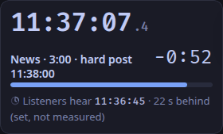
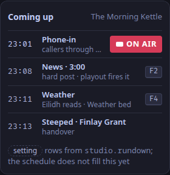

Three things the desk shows come from the control plane's settings (ADR-0102): the show's heading, the rundown and the callers banned before.
The [Schedule tab](/docs/reference/surfaces/calendar/) and the chat's moderation log do not fill them yet ([planned](/docs/reference/release-one-status/#not-in-release-one)), so they are settings.
The schedule does choose the slate's picture for the show on air ([Video in the desk](/docs/reference/desk-video/#the-slates-picture)).

## Set them

1. Open the control plane's settings file, `control.toml` ([Settings](/docs/reference/settings/)).
2. Add a `[studio]` table:

   ```toml
   [studio]
   show = "The Morning Kettle"

   [[studio.rundown]]
   at = "10:00"
   title = "News"
   detail = "hard post"
   hard_post = true
   key = "F2"

   [[studio.rundown]]
   at = "10:06"
   title = "Weather"
   detail = "Eilidh reads"

   [[studio.banned]]
   identity = "tavish"
   date = "2026-09-12"
   reason = "Abuse on air"
   ```

3. Restart the control plane.

The desk now heads the stage with the show, lists what is coming up and back-times to the next hard post.

| Key | What it does |
|---|---|
| `show` | heads the stage (`desk.stage`), the rundown and the screener's status line; empty, they say *No show set* |
| `[[studio.rundown]]` | one row each in `desk.rundown`, at its time: `at` as `HH:MM` or `HH:MM:SS`, today; `title`, and `detail` under it |
| `hard_post = true` | the clock (`desk.clock`) back-times to the first such row ahead |
| `key` | the cart key the row needs, shown beside it |
| `[[studio.banned]]` | a caller who joins with that `identity` shows BANNED BEFORE on the screener, with the `date` (`YYYY-MM-DD`) and the `reason` |
| `listener_delay_ms` | how far behind the studio listeners hear, not counting the profanity delay: 15000 (15 s) by default, shown under the clock as set, not measured (ADR-0103) |





The rundown's times are read on the station's clock, in the time zone of the computer that runs the studio app.

## With the Compose bundle, Quadlets or Cloudron

The packages write `control.toml` themselves, and none of them takes `[studio]` from its settings file:

- **Compose** (`weavesignal.sh`) writes it from the `control` settings in `compose.yaml` whenever the station starts; `.env` has no key for the show.
- **Quadlets** (`deploy/quadlets/generate.sh`) write it as a file, `config/control` under the output folder. Add `[studio]` there and restart the control plane's unit; generating the units again overwrites it.
- **Cloudron** writes it on every start, and `weavesignal.env` has no key for the show.

So on Compose and Cloudron the desk shows *No show set*, an empty rundown and no banned list in 1.0.0.
