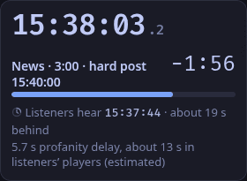
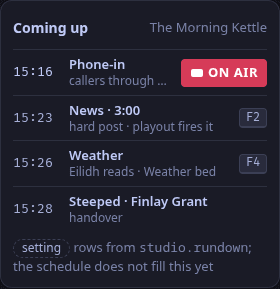

Three things the desk shows come from the control plane's settings (ADR-0102): the show's heading, the rundown and the callers banned before.
The [Schedule tab](/docs/reference/surfaces/calendar/) and the chat's moderation log do not fill them yet ([planned](/docs/reference/release-one-status/#not-in-release-one)), so they are settings.
The schedule does choose the slate's picture for the show on air ([Video in the desk](/docs/reference/desk-video/#the-slates-picture)).
From 1.3.2 the schedule also names the show on air on the desk's heading and on the join and player pages; the `show` setting is what they say between shows.

## Set them

1. Choose where to set them:
   - **With the Compose bundle** (from 1.1): the `STUDIO_*` lines in `.env` ([below](#with-the-compose-bundle-and-the-quadlets)).
   - **On Cloudron** (from 1.1): the `STUDIO_*` lines in `/app/data/weavesignal.env` ([below](#on-cloudron)). Before 1.1, or for anything those lines cannot say, create `/app/data/station.toml` with Cloudron's file manager (from 1.0.1); the control plane adds it to the settings the package writes, and its `[studio]` replaces the package's whole. It may hold only `[studio]` and `[steering]`; anything else stops the control plane with a message naming the file.
   - **With the Quadlets**: the same `STUDIO_*` lines in the settings file you generate them from.
   - **Your own settings file**: the control plane's `control.toml` ([Settings](/docs/reference/settings/)).
   - **Any install**: the environment variable `WEAVESIGNAL_CONTROL_EXTRA` names a file like `station.toml` for the control plane to add, if it exists.
2. In `control.toml` or `station.toml`, add a `[studio]` table (the `STUDIO_*` lines below say the same in one line each):

   ```toml
   [studio]
   show = "The Morning Kettle"

   [[studio.rundown]]
   at = "10:00"
   title = "News"
   detail = "hard post"
   hard_post = true
   key = "F2"

   [[studio.rundown]]
   at = "10:06"
   title = "Weather"
   detail = "Eilidh reads"

   [[studio.banned]]
   identity = "tavish"
   date = "2026-09-12"
   reason = "Abuse on air"
   ```

3. Restart the control plane (on Cloudron, restart the app).

The desk now heads the stage with the show, lists what is coming up and back-times to the next hard post.

| Key | What it does |
|---|---|
| `show` | heads the stage (`desk.stage`), the rundown and the screener's status line; empty, they name the show the schedule has on air, or say *No show on air* |
| `[[studio.rundown]]` | one row each in `desk.rundown`, at its time: `at` as `HH:MM` or `HH:MM:SS`, today; `title`, and `detail` under it |
| `hard_post = true` | the clock (`desk.clock`) back-times to the first such row ahead |
| `key` | the cart key the row needs, shown beside it; `⇧⏎` marks the row as the DJ handover, and while a DJ is in the room it carries the handover button ([Hand over to the next DJ](/docs/how-to/hand-over-to-the-next-dj/)) |
| `[[studio.banned]]` | a caller who joins with that `identity` shows BANNED BEFORE on the screener, with the `date` (`YYYY-MM-DD`) and the `reason` |
| `player_allowance_ms` | the part of how far behind the studio listeners hear that nothing reads, besides the listener mount's own hold of the stream (fixed at 12 s, not a setting): what a listener's player adds (3000, 3 s; 500 before 1.3.1). The desk reads the profanity delay and the listener process's buffer live and adds them, so a default station shows about 24 s (23.5 s), where a cart pressed on a Compose station measured 23 to 24 s at the stream (the demo station measured 21.2 s in 1.1, with the old 0.5 s), and the total is an estimate (ADR-0103, ADR-0272, ADR-0289) |
| `listener_delay_ms` | the older way to give those two as one figure, 13000 by default (the buffer's 0.5 s is inside it). A station that sets only this one keeps the figure it had, except that 13000 itself is read as the default and so follows `player_allowance_ms`'s new default (15.5 s with the buffer); set `player_allowance_ms` and this one is ignored |





The rundown's times are read on the station's clock, in the station's time zone (the one chosen in the Schedule tab), from the studio app 1.0.1; the app 1.0.0 read them in the time zone of the computer that runs it.

## With the Compose bundle and the Quadlets

From 1.1 `.env` holds the same settings as lines. Leave them empty for the defaults.

| Line | What it sets |
|---|---|
| `STUDIO_SHOW` | `show`: plain text, with no quote or backslash (`weavesignal.sh` refuses them) |
| `STUDIO_PLAYER_ALLOWANCE_MS` | `player_allowance_ms`, `3000` unless set |
| `STUDIO_LISTENER_DELAY_MS` | `listener_delay_ms`, `13000` unless set; used only while the line above is empty (the setting before 1.1.1, which keeps working) |
| `STUDIO_RUNDOWN` | the `[[studio.rundown]]` rows, as TOML inline tables, comma-separated, in single quotes |
| `STUDIO_BANNED` | the `[[studio.banned]]` rows, written the same way |

```sh
STUDIO_SHOW=The Morning Kettle
STUDIO_RUNDOWN='{ at = "10:00", title = "News", detail = "hard post", hard_post = true, key = "F2" }, { at = "10:06", title = "Weather", detail = "Eilidh reads" }'
STUDIO_BANNED='{ identity = "tavish", date = "2026-09-12", reason = "Abuse on air" }'
```

Restart the station (`weavesignal.sh` again, or `docker compose up -d`) for the control plane to read them.
A mistake in a row stops the control plane, and its log names the setting's line in `control.toml`.
The Quadlets take the lines from the same file when you generate the units again; the generated `config/control` then holds them.
Content steering has the same kind of lines (`STEERING_*`; [Steer viewers to the edges](/docs/how-to/run-edges/#steer-viewers-to-the-edges)).

## On Cloudron

From 1.1 `/app/data/weavesignal.env` has the same lines (`STUDIO_SHOW`, `STUDIO_LISTENER_DELAY_MS`, `STUDIO_RUNDOWN`, `STUDIO_BANNED`; from 1.1.1 also `STUDIO_PLAYER_ALLOWANCE_MS`), added empty to a station that updates, with the example beside each.
Write the lists exactly as above, in single quotes, restart the app, and read the log if the app does not come up: a wrong row is named there.
An empty line leaves the control plane's own default in force, so a station that sets nothing is unchanged.
If `/app/data/station.toml` also has a `[studio]`, that one wins, whole: the package's lines are not merged into it.

Before 1.1 neither the Compose bundle nor Cloudron had a place for the show in their settings, and the desk said *No show set* unless you wrote `station.toml` (Cloudron, from 1.0.1) or edited `compose.yaml`.
