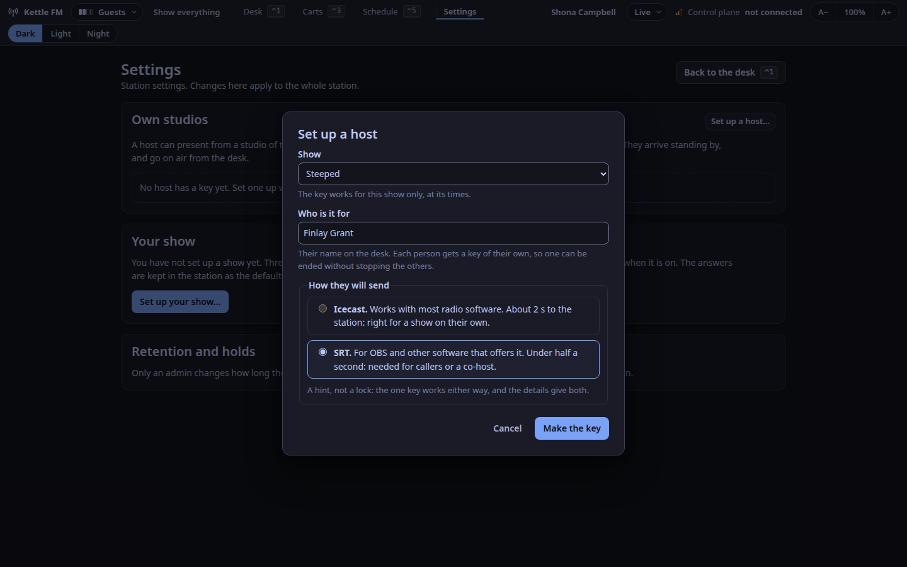
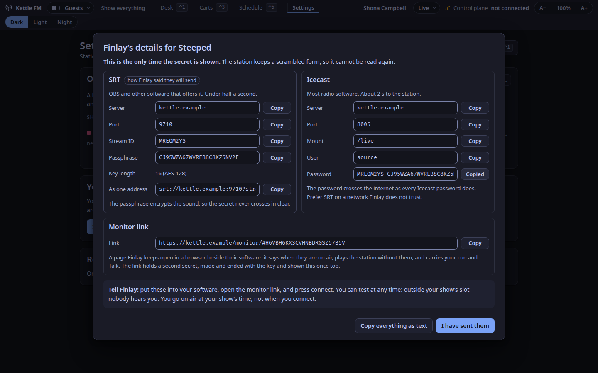
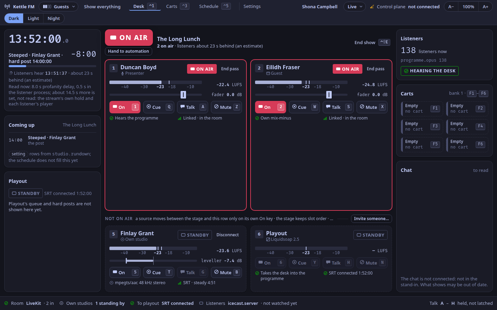

A host may present a show from a studio of their own, with software such as BUTT, Mixxx,
RadioDJ or OBS (ADR-0280).
Their software sends to the station with a **show key**: it belongs to one show and is named
for one person (ADR-0284).
The host's source arrives on the desk **standing by** (STANDBY): the station hears it and
listeners do not, until someone at the desk puts it on air.

## What you need

- A WeaveSignal station you run yourself, with the ingest running beside the desk. Settings says
  **The station is not listening for hosts** when it is not.
- The station's two ports for sources, turned on where the station is installed and open to
  the internet: **8005** (TCP) for Icecast and **9710** (UDP) for SRT, or others you choose.
  With `weavesignal.sh` set `SOURCE_ICECAST_PORT` and `SOURCE_SRT_PORT`
  ([Install a station with weavesignal.sh](/docs/how-to/install-with-weavesignal-sh/#hosts-own-studios));
  on Cloudron turn on the two *Hosts' own studios* ports in the app's Location settings
  ([Install on Cloudron](/docs/how-to/install-on-cloudron/)). Both are off until you do, and even then
  nothing listens on them until the station has a key.
- An admin, a producer or the show's own presenter to make the key. An API token cannot.
- A show with episodes in the schedule: a key works only around the show's times.

## 1. Choose the way in

| | Icecast | SRT |
|---|---|---|
| Software | anything that sends to an Icecast server | OBS, vMix, ffmpeg, hardware encoders |
| Delay to the station | about 1 to 3 s | under half a second |
| For | a host on their own: their music and their voice | the same, and a show with callers or a co-host |

Callers and co-hosts would hear an Icecast host seconds late, so use SRT for a show with callers.
A host with OBS 30 or later can also send over **WHIP**, sound only, with the same key, where the
station has turned its WHIP port on ([Send from OBS over WHIP](/docs/how-to/send-from-obs-over-whip/)).
Over SRT the key is also the passphrase that encrypts the sound; over Icecast it crosses the
internet as every Icecast password does, so prefer SRT on a network the host does not trust.

The station reads MP3, AAC, Opus, Vorbis and FLAC over Icecast, and AAC or MPEG audio inside
MPEG-TS over SRT. A picture sent over SRT is ignored for now; the sound is used.

## 2. Set up the host

1. Open **Settings** and find **Own studios** (`settings.hosts`), after **Staff**.
2. Press **Set up a host…**. Choose the **Show**, say **Who is it for** (their name as the desk
   will show it), and pick **How they will send**: *Icecast* or *SRT*.
   The choice is a hint, not a lock: the one key works either way.
3. Press **Make the key**.



A co-host or a stand-in gets a key of their own for the same show, so you can end one without
stopping the other.
A presenter can do the same for their own show from **Settings** › **Your show** ›
**Broadcast from your own software…**; and the show editor's **Comes from** offers the same
setup (`calendar.show-source`). So does **New show**: pick **The host's own studio** under
**Comes from** on its first part, and **Done** offers **Set up a host…** for the show you have made.

## 3. Send the host their details

The dialog turns into the host's **details**: what their software asks for, for Icecast and
for SRT, with **Copy** on each field.
**This is the only time the secret is shown.** The station keeps a scrambled form, so it
cannot be read again.



- **Copy everything as text** gives one block to paste into a message, with the way they said
  they would send first.
- **Icecast:** the server and port, the mount (`/live`; any is taken), the user (`source`; any is
  taken), and the password, which is the key id, a hyphen and the secret.
- **SRT:** the server and port, the stream ID (the key id), the passphrase (the secret) and the
  key length, 16; or all of it as one address,
  `srt://<server>:9710?streamid=<key id>&passphrase=<secret>&pbkeylen=16`.
- The **monitor link** is in the details and in the copied text, with **Copy**. Its secret is
  made with the key and shown this once too, so keep it with the rest. The link is your
  station's public address, then `/monitor/#`, then that secret
  (`https://kettle.example/monitor/#<secret>`): send it with the details
  ([Use your monitor link](/docs/how-to/use-your-monitor-link/)).
- **I have sent them** is the only way out. Until you press it, `Esc` does not close the dialog.

If the host loses their details, press **New key…** on their row. It ends the old key; if they
are connected, you choose **When they disconnect** or **Now**.

## 4. The host tests, then stands by

- **Outside their slot**, the host's connection is a **private test**: nobody hears it, it never
  reaches the desk, and it ends after 15 minutes. Their row in **Own studios** says TEST, with
  the format the station reads, its level and what their software says is playing.
- **From 30 minutes before the show**, the same connection **stands by**: the source takes a
  tile on the desk under **Not on air** (slot 5, the DJ's, when it is free; else 1, 2 or 3) with
  that slot's keys. A toast says *Finlay is standing by*, with **Cue** on the tile's own key.
  A test still connected when that time comes stands by without reconnecting.
- **When the slot's door closes** (when the show after theirs takes the air, or two hours after
  their show ends, whichever is first), a source that is standing by and **not on air** becomes a
  private test again: it leaves the desk, its connection stays open, and its 15 minutes start
  then. The log of the key says *test* and *the slot's door closed*. A source that is **on air**
  is never touched; when it comes off the air, the next look finds the door shut and makes it a
  test. With tests outside the slot turned off there is no test to become, so the connection is
  closed.
- A host who is due and has not connected says NOT CONNECTED on their row.



## 5. Put them on air

The source's tile is a tile like any other ([`desk.tile.1` to `desk.tile.5`](/docs/reference/surfaces/desk/#a-hosts-own-studio-as-a-tile)).

- **On** (the slot's number) puts it on air, and takes it off. **Cue** puts it in the presenters'
  and DJs' headphones first.
- The **leveller** is the station's: it brings the source to the desk's level, within 12 dB
  either way, slowly, and leaves it alone while it is silent. The tile says when a source is
  too quiet or too loud for it to reach.
- **Talk** reaches the host through their monitor link, and is drawn off while that link is not open.
- **Disconnect**, two presses, closes the connection and turns that key away for the rest of
  today's show, because most software reconnects by itself. **Let back in** is on the key's row
  in **Own studios**.

## What the station does at the show's post

The station works this out every second from the schedule, so a restart changes nothing. It
only ever brings on a source whose key belongs to the show on air, or to the show that is next.

- **Automation holds the air** (the station is in automation, or nobody is presenting) **and the
  host is standing by** (steady for 5 seconds): they go on air at the post, to the second.
- **A host who arrives after the post** goes on air after the **late count** (20 seconds, from
  when they stood by). **Go on air now** skips the count and **Not yet** stops it for that
  show; then they go on air by their own press. The count off (0) waits for a press.
- **A DJ is on air** at the post: they keep it. The **grace** (two minutes by default; Off, 1, 2
  or 5 minutes in the studio) starts when the next host is standing by, and at its end the
  schedule hands over: the host goes on air and the DJ comes off. A producer or an admin can
  **Hold** the handover (`POST /api/v1/air/post/hold`), and then it happens by a press only. A
  hold is for one handover.
- **Nobody is standing by**: nothing happens, and the show on air carries on.
- **A host's link drops** while they are on air: after 4 seconds, with nobody else on air,
  automation covers. Their place is kept for 5 minutes; if they reconnect and are steady for
  5 seconds (30 after three drops in ten minutes) they go back on air. A drop during a grace
  hands over to the next host at once.
- **End show** with the next host standing by passes the air to them instead of to automation.

Every act is in the key's log, marked as the schedule's.
The schedule never puts back on air someone who was on air and has been taken off since the post.

From 1.2, five minutes before the post (the rules' `window_s`) the station names the next host, says whether they are ready, and gives them one heads-up; it changes none of the above ([Follow the rota and the handover window](/docs/how-to/follow-the-rota/)).

## If something goes wrong

- **The software says it was refused.** The key's row in **Own studios** gives the last
  refusal in words: *the key is wrong*, *the key has ended*, *it was not the show's slot, and
  tests are off*, *another connection was using the key*, *too many wrong keys came from that
  address* (five in a minute: a public address waits ten minutes; see below), *the station could not read
  what the software sent*, or *the software sent more than 2 Mbit/s*.
- **Wrong keys.** Five wrong keys from one public address in a minute turn that address away
  for ten minutes. An address that is not public (private ranges such as 10.x, 172.16 to
  172.31 and 192.168.x, loopback, link-local, unique-local IPv6 and carrier-grade NAT) is
  counted and logged but never turned away. Behind Docker or a home router every host can
  arrive from one such address, and blocking it would shut them all out. The ingest listens
  on IPv4 only unless it is told otherwise.
- **The key is lost, or may have leaked.** **New key…** on its row.
- **To end a key for good**, **End key…** on its row. Their software is refused from then on.
  When it was the show's last key, the show comes from the station's room again.

## What the station keeps

Each connection to a host's port is written to the key's log: when, the way (Icecast or SRT),
what happened (admitted, test, refused, ended), and the **address** it came from.
These addresses are kept **30 days**, outside the retention setting, so that the station can see
repeated wrong keys. They are not shown in Settings, and the key's row shows only the last
refusal, without the address.

## The rules, for an admin

Under the table, **The rules** (`settings.hosts.rules`): how early a host may connect (30
minutes), whether a connection outside the slot is taken as a private test and for how long,
and the two ports.
The grace at the post and a late host's count are what the schedule acts on
([the desk's schedule line](/docs/reference/surfaces/desk/#the-schedules-line)).

## With the API instead

Everything above is a route of the [control API](/docs/reference/api/):

```sh
curl -X POST https://station.example/api/v1/shows/steeped/keys \
  -H "Authorization: Bearer $SESSION" -H 'Content-Type: application/json' \
  -d '{"label": "Finlay Grant", "hint": "srt"}'
```

The reply holds the key's secret, the monitor link's secret and the details for both ways in,
once. `POST …/keys/{key}/renew` makes a new key in place of one, and `DELETE …/keys/{key}` ends
one. `GET /api/v1/sources` lists what is connected or due; `POST` and `DELETE` on
`/api/v1/sources/{key}/disconnect` are Disconnect and Let back in; the rules are at
`/api/v1/settings/sources`. A source goes on air with the desk's own command,
`{"op": "on_air", "identity": "source-<key id>", "on": true}`.
The two ports are the installation's: the rules show them and cannot change them, and 0 means
that way is off.
