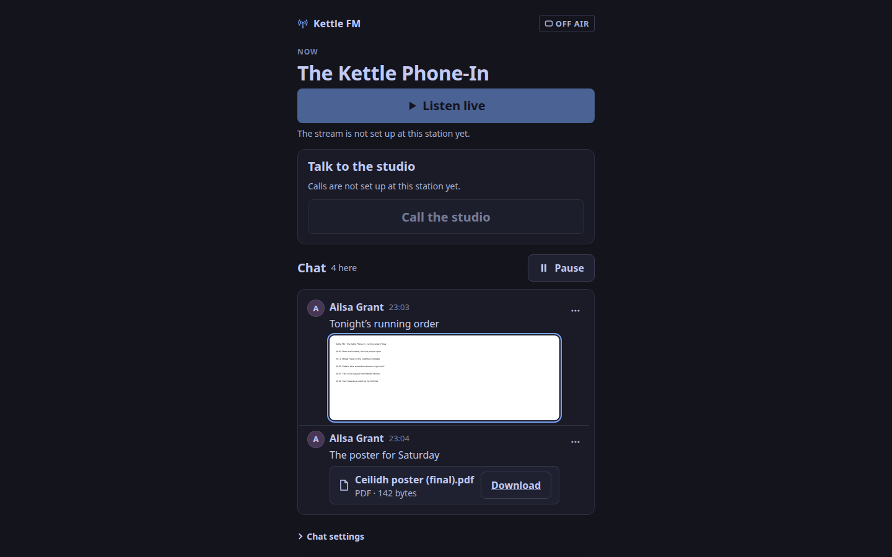

This is for a listener who chats on the station's player page.
Some stations let their **trusted** chatters attach a picture or a document to a message: a screenshot of a running order, a photo from a gig, a poster as a PDF.
It is off unless the station turns it on, and only a chatter the station has made trusted, signed in with an email address, can attach.
If you see no **Attach a picture or document** button under the message box, your station has not turned it on, or has not made you trusted yet.

## Attach one

1. Sign in to the chat, and choose **Chat** above the message box.
2. Press **Attach a picture or document** and choose the file. It shows under the box with its name and size; **Remove** takes it away again.
3. Type a few words with it if you like (you can leave them out), and press **Send with the file**.

Your message shows in the chat with **Waiting for the station**.
Nobody else sees it until the station's staff or a moderator approve it; then it appears for everyone, at the time they approved it.
If they refuse it, it disappears and you receive a notice that says why, with 14 days to ask for a review.

## What you can send

- **Pictures**: PNG, JPEG or WebP, up to the station's limit (10 MB unless it set another). The station redraws every picture at about 1,600 pixels on its long side, so text in a screenshot stays readable, and keeps nothing but the picture: the camera's details and any location in the file are not kept in what others see. A picture that moves is not taken.
- **Documents**: PDF, OpenDocument text (`.odt`) or spreadsheet (`.ods`), Markdown (`.md`) or plain text (`.txt`), up to the station's limit (5 MB unless it set another).

The station checks what a file is from its contents, not its name: a PDF renamed `.png` is still a PDF, and an SVG or a web page is refused even when it is called `.txt`.
A Word file, a presentation and other archives are refused; save it as a PDF or an OpenDocument file first.

## What others see

A picture shows as a small copy under your words; pressing it opens it full size.
A document shows as its name, its type and its size, with **Download**: it is never opened inside the page, and it is saved under a name the station gives it, with your file's name shown beside it.

## Before you open someone else's document

The station passes documents on exactly as they were sent.
A PDF can carry scripts and an OpenDocument file can carry macros, and **the station does not scan them**.
Open a document only from someone you trust, and keep your PDF reader and office programs up to date.
If a picture or a document should not be there, open the message's actions and press **Report this posted picture** or **Report this document**.
