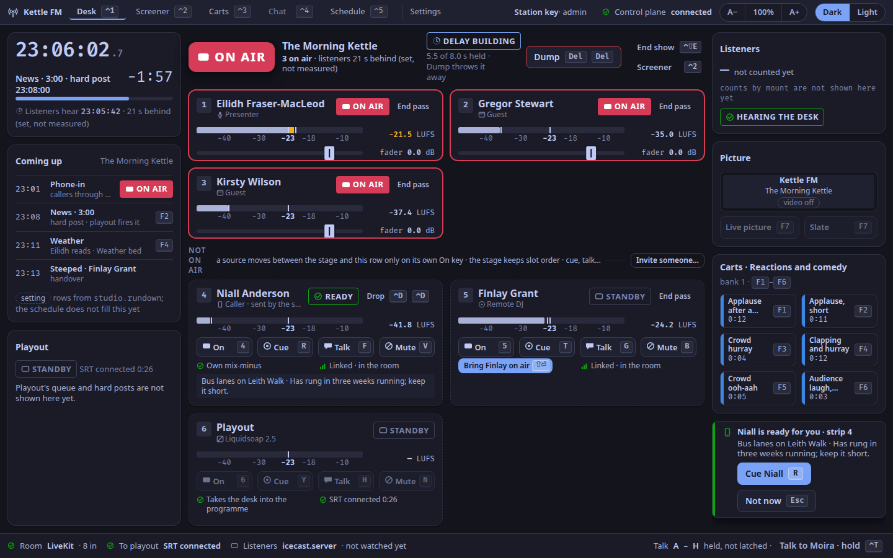
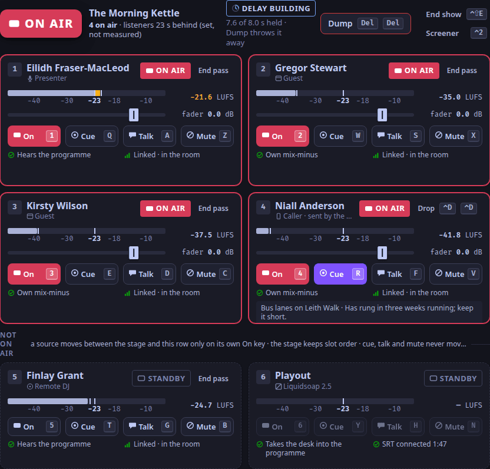
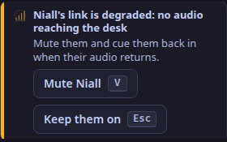

A caller rings in from the station's player page (ADR-0006), agrees to be recorded, and waits in the screener's queue.
The screener talks to each caller first, then sends one to you ([Screen callers](/docs/how-to/screen-callers/)).
A caller sent to the desk takes slot 4.
A caller without consent to record cannot be sent to you.

**With no screener, at the Callers step,** the callers wait on your desk instead, in **Callers** on the right ([Choose how much of the studio a show uses](/docs/how-to/choose-a-step/#the-desk-at-each-step)).
Press `P`, or **Take … to strip 4**: the caller who has waited longest joins slot 4, off air, and the rest below is the same, with you in the screener's place.
The strip holds one caller at a time.
Below the Callers step the lines are closed, and nobody can call.

## When a caller is sent to you

The toast slot (`desk.toast`) says *⟨name⟩ is ready for you · strip 4*, with the screener's one line and note under it.
The caller's tile says READY.

1. Press `R`, the cue key of slot 4, to accept them (ADR-0098).
   They are cued: you hear them in your headphones, and listeners do not.
2. Talk to them off air if you need to: hold `F`, slot 4's talk key.
3. Press `4` to put them on air.
4. Press `4` again to take them off air at the end of the call.

## When you cannot take them now

Press `Esc` (*Not now*) while the toast is showing.
The caller stays ready, now with DESK BUSY, and the screener is told you declined (ADR-0069, ADR-0098).
The screener can send them again when you are free.

## Drop a caller

Press `⌃D` twice within 3 s.
The first press arms the key and counts down; any other key, or `Esc`, disarms it.
On the desk, `⌃D ⌃D` drops the caller in slot 4: off air, out of the room and out of the queue.
A deliberate drop leaves no held place (ADR-0101).

## If a caller's link drops

A caller whose connection is lost keeps their place in the queue for 5 minutes, marked DROPPED, so they can rejoin where they were (ADR-0101).
If they were on air, the toast says their link is degraded, or that they left the room, and offers *Mute ⟨name⟩* (`V`) or *Keep them on* (`Esc`).
The desk keeps their strip for 30 s (the desk's `room.leave_grace_ms`); if they rejoin within it, they are mixed again.

## If a caller says the studio is too quiet

A caller hears the studio at about −23 LUFS, a usual level for a call; listeners hear the stream lifted to −16 LUFS (ADR-0205, ADR-0044).
On a phone, a call has its own volume, apart from music's: ask them to press volume up during the call.
The call page says the same under *Trouble hearing or being heard?*: "Studio too quiet? On a phone, press volume up once the call has started: a call has its own volume, apart from music's."

## If a caller says the studio breaks up

The desk sends each caller's return evenly timed: measured with WebRTC `getStats` on the receiver, 0.0 % of it was concealed, locally and over the internet ([What release one does](/docs/reference/release-one-status/#measured)).
Gaps a caller still hears come from their network.
The desk sends without congestion control (a known limit: its image lacks GStreamer's `rtpgccbwe`), so a caller on a poor link may hear more loss than a browser-to-browser call would give.

If a caller cannot get through at all (a blocked microphone, a phone on an IPv6-only network), see [When a call does not work](/docs/reference/public-pages/#when-a-call-does-not-work).

Verified by the control plane's tests (the screener sends a caller, the desk declines, the screener drops) and a keyboard-only run of the studio app against the real desk, 2026-10-25; checked against the code on 2026-11-04.
