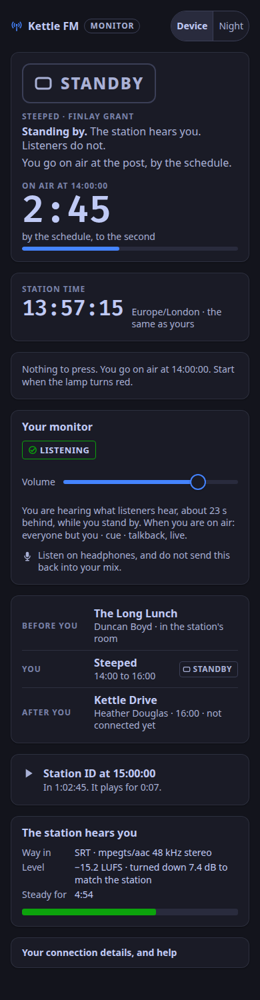
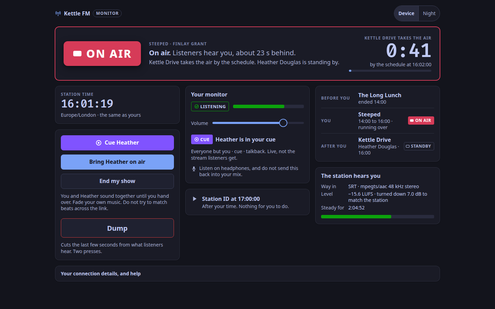

:::note[What has been tried, and what is not there yet]
The page has been driven in Chromium against a stand-in station, and used once by a host on a real station from a desktop browser; it has not yet been used on a phone, or in Firefox or Safari.
Not there yet: the name of whoever is talking to you (you hear them all the same), **Hear yourself** in a test, a plain audio address for a hardware player, and your connection details on the page.
:::

You present your show from a studio of your own, and your software sends it to the station
([Set up a host in their own studio](/docs/how-to/set-up-a-host-in-their-own-studio/)).
Your software can only tell you *connected* or *failed*.
The **monitor link** is a page of the station that you keep open beside it.
It tells you whether listeners hear you, counts down to the moment they will, plays you the station without yourself, and gives you the few buttons you need.

## What you need

- **Your link.** It is the station's public address, then `/monitor/#`, then the monitor link's secret from the details the station sent you:

  ```text
  https://kettle.example/monitor/#<the monitor link's secret>
  ```

  The secret comes after the `#`, so it is never part of an address your browser asks a server for.
  The link is yours alone: whoever has it can end your show.
  It stops working when the station ends your key or makes you a new one.
- **A browser** on the computer you present from, or on a phone propped beside your mixer.
- **Headphones.** The page plays everyone but you; through loudspeakers it would go back into your microphone and round again.

## 1. Open the link and start listening

1. Open the link. The page shows your show and your name, the station's time, and a lamp.
2. Press **Start listening**. A browser plays nothing until you press.
   The button is dimmed, with the reason beside it, while nothing can play: before you are standing by (not connected, or a test), while the station has lost your stream, and while this page has lost the station. It works again by itself.
   The chip turns to LISTENING, the bar beside it moves with the sound, and **Volume** sets how loud it is for you.

What you hear is **your own return**: the programme without you, anyone the station has put in cue, and anyone at the station talking to you.
It is live, not the stream listeners get, which runs some seconds behind.

**While you stand by and nobody is on air at the station's desk**, automation holds the air, and automation does not pass through the desk, so your return would be silent.
The page then plays the stream listeners hear instead, and says so, with how far behind it is: *You are hearing what listeners hear, about 24 s behind, while you stand by.*
It stops the moment you are on air, or when someone else goes on air at the desk (their voice is in your return, live), or when the page loses the station, and your return takes over.
Cue and anything said to you still come through your return as before.

**While you are OPEN**, the station hears you and the room hears you, but listeners do not, because automation or the fallback holds the air.
The page plays the station's output then too, and says plainly what it is: *You are hearing the station's output, about 24 s behind. The room's voices are not in it.*
It is the station's own sound, a few seconds late, so you hear what listeners hear and not the people in the room.
Before you press **Start listening** it says *You will hear*, because nothing plays yet.
The page draws no level bar beside the stream, since the bar shows your live return, which has no programme in it then.
It stops the moment you are on air.

The stream is the one on the station's player, so a station that has none set up leaves you the silence it always did.
Nothing plays during a test, or before you are standing by.



## 2. Read the lamp

The lamp is your own state, in the same words and shapes as the station's desk ([the states](/docs/reference/states/)).
The sentence beside it is the station's, and says who hears you and what happens next.

| The lamp | What it means |
|---|---|
| **STANDBY** (an empty lamp) | The station hears you. Listeners do not. You are connected in your show's slot and waiting for the air |
| **ON AIR** (the red lamp) | Listeners hear you |
| **OPEN** (the white lamp) | The station hears you and listeners do not, because automation or the fallback holds the air |
| **LINK LOST** | The station has lost your stream. Your place is kept for a few minutes |
| **TEST** (a dashed lamp) | You connected outside your slot. The station hears you and nobody else does; nothing here can put you on air |
| **NOT CONNECTED** (a dashed lamp) | Your software has not reached the station |

- **The count** beside the lamp runs to whatever is next: *On air at 14:00:00*, a late start, the end of a handover's grace, how long your place is kept.
- **A count turns amber in its last 30 seconds and red in its last 10**, and says *Last 30 seconds* or *Last 10 seconds* under the figure, so you do not need the colour to know. It does this for every count: the post, a late start, the handover's grace and your place kept.
- **Every time and every count is the station's**, not your device's. Under the station's time the page gives your own, when your device keeps a different one.
- **If the page says *This page has lost the station*,** it shows no lamp at all until it is back. It will not leave an old ON AIR on the screen. Your software is on a connection of its own and carries on.

## 3. Go on air

You do not press anything to go on air at your show's time.

- **Automation holds the air** before you: you go on air at your show's start, to the second. Start when the lamp turns red.
- **Another DJ is still on air:** they keep the air until they hand over. Once you are standing by, the station counts a short grace and then hands over by the schedule. The lamp's sentence names them and the count shows when.
- **You are late**, and automation is covering: the station counts down and then puts you on air. **Go on air now** skips the count. **Not yet** stops it; then you go on air when you press **Go on air now**.

## 4. Hand over, or end your show



The controls show only what you may do at that moment.

- **Cue [the next host]** puts them in your headphones, and takes them out again. Listeners hear nothing of it.
- **Bring [the next host] on air**, then **Hand over to [them]**: the handover's two presses, for a show that runs at the Full step ([Hand over to the next DJ](/docs/how-to/hand-over-to-the-next-dj/)).
  After the first you both sound together, each as loud as your own software sends. Fade your own music, and do not try to match beats across the link: the two of you arrive with different delays.
  After the second you are off air.
- **End my show** asks once, and says what follows: the next host takes the air if they are standing by, otherwise automation does.
  Ending your show here is kinder to listeners than disconnecting your software, which leaves them a few seconds of silence first.

## 5. Dump

**Dump** cuts the last seconds from what listeners hear, when something was said that must not go out.
Press it **twice within three seconds**; one press alone does nothing and lapses.
The page then says DUMPED and how many seconds listeners lost. Carry on, and do not repeat the words.

Dump is there from the Callers step up ([Choose how much of the studio a show uses](/docs/how-to/choose-a-step/)).
Below that the button is drawn off and says so: *Dump is off at Solo. It comes on at Callers.*

No single key on the keyboard does anything on this page.
A stray key in a browser tab cannot dump the delay or end your show.

## If something goes wrong

- **Your software says it failed.** **The station hears you** gives the station's reason in words: the key is wrong, the key has ended, it is not your slot, another connection is using the key.
- ***The station has lost your stream.*** Reconnect your software. Within the time the count shows you go back on air a few seconds after the stream is steady; after it, you come back standing by.
- ***This page has lost the station.*** The page tries again by itself. Check this device's connection. Your software is not affected.
- ***This link no longer works.*** The station has ended your key or made a new one. Ask for new details.
- **No sound from your monitor.** Raise **Volume** on the page and on the device. Nothing plays before you are standing by.
- ***Two browsers are listening already.*** Two can listen on one link; close one. After a reload, wait a few seconds and press **Start listening** again.
- **Your monitor will not connect.** The page tries the station's relay by itself when a direct connection fails. **Your connection details, and help** at the foot of the page has **Reconnect through the relay**.
- **A press is refused.** The page prints the station's reason under the buttons. If it says *The station did not answer*, look at the lamp before you press again.

## Night

The page follows your device's light or dark setting.
**Night**, at the top right, is a warm dark look with no blue in it, for a late show; the choice is remembered on that device.

## For the station

The page is `monitor/` in the public pages' build and needs nothing set up beyond them ([The public pages](/docs/reference/public-pages/#the-monitor-link)).
It uses the monitor routes of the [control API](/docs/reference/api/), with the link's secret as the bearer: `GET /api/v1/monitor/events` for the view every second, `POST /api/v1/monitor/token` for the room, and `POST /api/v1/monitor/go`, `/not-yet`, `/cue`, `/handover`, `/end-show` and `/dump`.
Each press is asked of the station again when it is made; the page only shows what the station says may be pressed.
