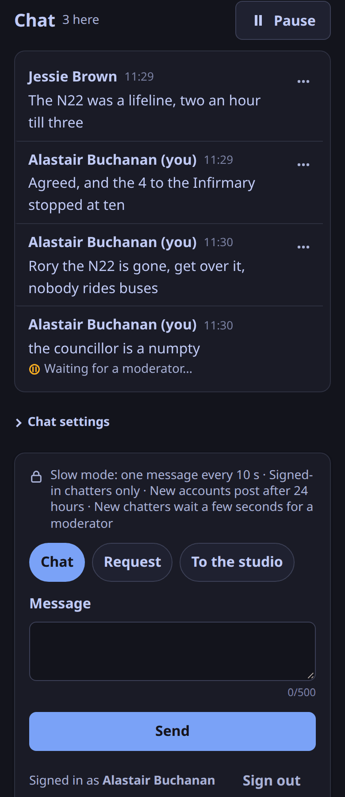

`weavesignal-chat` is the live chat, its own process beside the control plane (ADR-0031).
It listens on `ports.chat` (7311) on loopback; the station's proxy sends everything under `/api/v1/chat/` to it, websockets included, never through the CDN.

## Settings

`weavesignal-chat sample-config` prints `chat.toml`: the station's identifier and name (the control plane's), the listen address and port, the control plane's URL, the chat's [hours](#hours), and how sign-in codes are mailed (`off`, `command` for a sendmail-compatible program, or `outbox` for files).
Secrets come from the environment: `WEAVESIGNAL_DATABASE_URL` (the station's database) and `WEAVESIGNAL_CONTROL_ADMIN_TOKEN` (the studio's bearer).

The room's modes (slow, hold new accounts, trusted-only links, influx) live in the control plane; the chat follows its studio view.
The screener's switches reach the chat at `POST /api/v1/chat/modes`, and the chat passes them on to the control plane with the caller's own bearer, so the control plane's log names who switched a mode.
The station's own chat settings (terms, the accountable person, the contact point, the minimum age, comments only, guests, whether chatters may upload pictures, whether trusted chatters may post pictures and documents, who sees evidence, blocked words, forbidden names) are kept in the database: `GET` and `PUT /api/v1/chat/admin/settings`.
A `PUT` that leaves out `avatar_uploads`, `attachments` or `evidence_viewer` keeps what is stored for it; sending `null` clears it.
In comments-only mode a chatter cannot reply, and an @mention is plain text: the name stays in the message, but the player page does not highlight it or announce it to the person named (ADR-0147).

## Hours

A station chooses when listeners may post (ADR-0234): `always`, the default and 1.0.0's behaviour, or `shows`.
It is `[hours] open` in `chat.toml`, called `CHAT_HOURS` in the Compose bundle's `.env` and in the Cloudron package's `weavesignal.env`; the chat reads it at start.

With `shows`, posting is open while a scheduled episode is on air, and the station's staff (signed in from the studio) and the chatters it made moderators may post at any time (ADR-0253).
"On air" is the schedule's, by the same rule as the slate's picture and the consent words: an episode from its air time for its length (its own, else its series' or show's slot, else an hour).
The desk does not open the chat: a show put on air by hand with no scheduled episode leaves it read-only.
Between shows:

- a chatter's message, reply, private message to the studio and reaction are refused with the code `closed` and the words "The chat is read-only between shows. You can post again when the next show starts.";
- a chatter the station made a moderator may post, reply, request and react, as the staff may; the private lane to the studio stays the staff's, so a moderator's message to the studio is refused with `closed` and the player hides that choice;
- reading, signing in, reports, notices and requests for review stay open;
- the player shows the chat read-only, in words, with when the next show starts in the station's own time zone (for example "at 19:00 GMT on Friday 13 November"), or that none is scheduled yet.

The chat reads the schedule's air windows for the next two weeks, and the station's time zone, from the database every `hours.check_every_s` (30 s): the windows ahead are kept, so a show opens the chat on the second it starts and every page is told at once.
A reading that fails keeps the last schedule read; until the first reading, the chat stays read-only.
`GET /api/v1/chat/info` and the socket's rules carry the hours as `rules.hours`: `shows_only`, `open`, `opens_at_ms` (epoch ms, or `null`) and `zone`.

## The minimum age

Signing up, a chatter ticks "I am *N* or older"; without the tick the chat refuses the account, and a guest's name, and says why.
Only that declaration and when it was made are kept, never a date of birth.

*N* follows the station's jurisdiction, the retention preset chosen in Settings (ADR-0148): 13 under No retention, Custom and the UK, US and Canadian presets; 15 under the Australian ones; 16 under Ireland's, Germany's and the EU preset.
A change of jurisdiction applies from the next sign-up.
A station sets its own age, 13 to 21, with `min_age` in its chat settings; leaving it out (or `null`) follows the jurisdiction again, and so does 13.
A station in Quebec sets 14.

## Routes

| Route | Who | What |
|---|---|---|
| `GET /api/v1/chat/info` | anyone | the station's terms and contacts, the rules now, report reasons, retention in words |
| `GET /api/v1/chat/socket` | anyone | the WebSocket; the session goes in the first frame |
| `POST /api/v1/chat/signin/start`, `/signin/finish` | anyone | sign in by an emailed six-digit code |
| `POST /api/v1/chat/guest` | anyone | a guest name, where the station allows guests |
| `POST /api/v1/chat/notices` | anyone | a notice from someone without an account |
| `GET /api/v1/chat/avatars/{id}` | anyone | a chatter's own picture once staff approved it; 404 for one held, refused or removed |
| `GET /api/v1/chat/pictures/{id}`, `/pictures/{id}/thumb`, `/files/{id}` | anyone, once approved and while its message shows; its author, staff and moderators with a bearer | a picture posted in the chat (inline) and its thumbnail, or a document (always a download) |
| `GET /api/v1/chat/me`, `POST /signout`, `/reports`, `/statements/{id}/review` | a chatter | themselves, reports, a review |
| `POST /api/v1/chat/attachments` | a trusted chatter | a message with a picture or document, held for staff |
| `PUT /api/v1/chat/me/avatar/stock`; `GET`, `PUT` and `DELETE /api/v1/chat/me/avatar` | a chatter | choose a shipped avatar; see, upload or delete their own picture |
| `POST /api/v1/chat/staff/session` | the studio | the studio's own chat session |
| `POST /api/v1/chat/mod`; `GET /mod/log`, `/mod/accounts/{id}` | the studio, or a chatter the station made a moderator | moderation |
| `GET /api/v1/chat/mod/avatars/{id}` | the studio, or a moderator | an uploaded picture, a held one included; the studio's people also get one withheld, but never one kept as evidence |
| `GET /api/v1/chat/mod/kept-pictures` | the studio | the pictures the station keeps out of view, and who sees the evidence |
| `GET /api/v1/chat/evidence`, `/evidence/{id}/picture`, `/evidence/{id}/export` | one named staff member | a picture kept as evidence, and its ZIP for a report |
| `POST /api/v1/chat/modes` | the studio, or an API token with `chat:moderate` | a room mode, passed on to the control plane, which checks a token as on its own routes |
| `GET` and `PUT /api/v1/chat/admin/settings`; `GET /admin/accounts/{id}/export`, `POST …/erase`, `GET /admin/holds`, `/admin/risk-assessment` | an admin | the station's chat settings, export, erasure, evidence holds, a risk-assessment template |

*The studio* is a staff session (`rss_…`) or the station key; *an admin* is a staff session with the `admin` role, or the station key.
An API token (`rsa_…`) opens none of the chat's own routes; it reaches only `POST /api/v1/chat/modes`, which is the control plane's.
These routes are not in the control plane's [API reference](/docs/reference/api/).

The frames and shapes are in `packages/ui/chat.ts` and `crates/chat/src/wire.rs`.
Every message carries the server's time and the sender's playhead (ADR-0038).
A reconnecting page sends its epoch and offset and gets what it missed; a page that falls behind is closed with 4008 and recovers.

## Avatars

Every message carries its sender's avatar (`author.avatar`): one of the set WeaveSignal ships, a picture of the chatter's own, or none, which the pages draw as their initial (ADR-0235).

**The shipped set.** Seventy-two animals and monsters, about 1 KB each (83 KB in all), from Fluent Emoji's Flat style under the MIT licence; `NOTICES.md` has the notice.
They are part of the pages' build, so they cost the station no storage.
`PUT /api/v1/chat/me/avatar/stock` with `{"id": "fox"}` chooses one, `{"id": null}` none; the chat accepts exactly the ids in `packages/ui/avatars/manifest.json`.
A guest can choose one too.

**A picture of their own.** `PUT /api/v1/chat/me/avatar` takes a PNG or JPEG as the body, from a chatter signed in by email (not a guest).

- **Never the upload itself.** The chat does not parse it: the media worker (`weavesignal-chat media-worker avatar`, restricted before it reads a byte, as for carts) decodes it, flattens transparency, cuts the middle square and writes a PNG of at most `side` pixels (128) holding nothing but pixels, so EXIF, a location or a comment cannot survive. Only that PNG is ever served; the upload as it arrived is kept beside it, unread and never shown, while the picture waits, and deleted when it is approved: an approved picture keeps only its clean copy. A page's own crop is redrawn in the browser first, so it carries no metadata either; a client that sends the file raw has its metadata kept in that original. SVG and every other format are refused.
- **Caps.** The body is at most `max_upload_kb` (2 MiB; larger answers 413); the picture at most 4,096 pixels a side and 16 megapixels, at least 32 a side, checked from its header before anything is decoded; five uploads a chatter in ten minutes (429); and at most `max_waiting` (500) pictures waiting at once.
- **Held.** The picture waits for staff or a moderator, who all see the queue (`moderation.avatars` in the socket's opening frame, and a `mod_avatar` frame for each one that arrives). Until one approves it, `GET /api/v1/chat/avatars/{id}` answers 404 for everyone, its owner included; the owner sees it at `GET /api/v1/chat/me/avatar` and the studio's people and moderators at `GET /api/v1/chat/mod/avatars/{id}`, both with a bearer. Whether a picture may be fetched is read from its record on every request, not from its address being hard to guess. Everyone else sees the shipped avatar the chatter chose, or their initial.
- **Approved** (`{"op": "avatar_approve", "avatar": id}` to `POST /api/v1/chat/mod`, staff or a moderator, ADR-0255): the picture is public and every open page repaints that chatter's messages (the `avatar` frame, which carries an offset and is recovered after a reconnect). It is served `no-cache` with an `ETag`, so a browser asks again each time and a removed picture stops showing at once.
- **Refused** (`avatar_refuse`) **or removed later** (`avatar_remove`), by staff or a moderator, each with a reason: the picture is deleted, row and file, the decision is logged, and the chatter receives a statement of reasons with the 14-day review, as for a message.
- **Reported by a reader** (ADR-0260). A signed-in chatter can report the picture of their own beside someone's messages: `POST /api/v1/chat/reports` with `{"account_id": id, "avatar_id": picture, "reason": …}` (and no `message_id`). The picture must be the one showing, and not the reporter's own. The report joins the screener's other reports about that account, and the item carries `picture`, the picture's id while it is still the one showing (a new upload since clears it); `avatar_remove` with that report removes the picture and closes the report, and answers 409 if another picture is showing now. A reader with no account sends a notice that names the picture.
- **Evidence.** Where the reason is one that preserves evidence at once (an intimate image, a threat to life, child safety), or an open evidence hold already names the account, the picture is not deleted but withheld: only staff can fetch it, and the sweep deletes it once the hold is released. Staff can also delete a withheld picture at once (`{"op": "avatar_delete", "avatar": id, "why": "…"}`, staff only), which removes the row and the files and writes `avatar_delete` with the reason and the why to the moderation record.
- **Suspected child sexual abuse material** (ADR-0257). A moderator's reason for a picture only, `suspected_csam`: it is not on the report form, a notice or a report refuses it, and no message or person can be refused for it. It takes the same evidence hold and `withheld` state, and also keeps the upload as it arrived (when it was refused while waiting; an approved picture has only its clean copy) and a snapshot of the uploader and the decision, at least `avatars.evidence_days` (366) whatever happens to the hold, an erasure or the moderation record's retention. Only the one staff account named by `evidence_viewer` in the chat's settings (the first admin until it is set; a staff session, never the station key) can fetch the picture and the ZIP; every view and export is a line in the record. Only that named person or an admin may delete one; deleting asks for `confirm_evidence: true` after the station's words about reporting and keeping, and is recorded. The uploader's statement says only that it was removed for breaking the station's rules on illegal content, and how to ask for a review: nothing about keeping or reporting it. The runbook is [Handle a picture you suspect is child sexual abuse material](/docs/how-to/handle-suspected-child-abuse-images/).
- **Nobody decides.** A picture still waiting after `avatars.wait_days` (30) is deleted by the retention task (every ten minutes), with its file, and its owner receives a notice that says so and that it was not a judgement of the picture: they can upload it again. The notice is kept like a statement of reasons, so someone who is away reads it when they sign in again; the moderation record has the line `avatar_expire` by "the chat (automatic)", and the queue loses the entry in every open screener. If an evidence hold names the account, the picture is withheld instead, as a refusal would (ADR-0254).
- A new upload replaces one still waiting; an approved picture stays in view until the new one is approved. `DELETE /api/v1/chat/me/avatar` deletes the chatter's own, waiting or approved, under an evidence hold too.

**The switch.** Settings > Chat pictures in the studio turns uploads on and off at once (ADR-0259), for an admin. It is `avatar_uploads` in the chat's settings in the database (`GET` and `PUT /api/v1/chat/admin/settings`): `null` until it is used, so the install setting below decides; `true` or `false` after, and then the install setting is ignored. A change reaches every open page in the rules (`rules.avatar_uploads`), a new upload is refused with 403 from that moment, pictures already waiting or showing stay as they are, and the moderation record has a line `avatar_uploads_on` or `avatar_uploads_off` with who made it.

**Settings**, in `chat.toml`:

| Setting | Default | What |
|---|---|---|
| `avatars.uploads` | `true` | chatters may upload a picture; `false` leaves the shipped set. This is the default until the studio's switch is used (below) |
| `avatars.dir` | `/var/lib/weavesignal/chat-avatars` | where the PNGs are kept, `<id>.png`: writable by the chat, and in the station's backups |
| `avatars.max_upload_kb` | 2048 | the largest upload taken, 64 to 8192 |
| `avatars.side` | 128 | the side of the PNG written, 64 to 256 |
| `avatars.uploads_per_chatter` | 5 | uploads a chatter may make in ten minutes; 0 is off |
| `avatars.max_waiting` | 500 | pictures that may wait for staff at once |
| `avatars.evidence_days` | 366 | how long a picture (or a posted picture or document) refused as suspected child sexual abuse material is kept, with the uploader's details, 366 to 3650 |
| `avatars.wait_days` | 30 | a waiting picture, posted picture or document nobody has decided on after this many days is deleted, 1 to 365 |

A PNG is about 10 to 40 KB, and the original a page sends is a small cropped JPEG, so a thousand chatters' pictures are tens of megabytes; the cap on a raw upload (`max_upload_kb`) bounds each original, and `max_waiting` the waiting ones.
On each install route the first two are `AVATAR_UPLOADS` and the place below ([Settings](/docs/reference/settings/#chat-avatars)).

## Pictures and documents

A **trusted** chatter (the standing that may post links) signed in by email may attach one picture or one document to a chat message, where the station has turned it on (ADR-0262, ADR-0258). It is off unless the station turns it on, and every one is held until staff or a moderator approve it: the station's people will see every picture and document posted. Recce 31 found no duty to scan or hash-match for a station of this size; the one new paper step in the UK is a line in the station's risk assessment (Online Safety Act s.9(4)) before turning it on.

**Posting.** `POST /api/v1/chat/attachments?name=…&body=…&nonce=…` with the file as the body and the chatter's bearer; `reply_to` and `playhead_ms` may follow. `name` is the file's own name, shown beside it as text only (no path, no control characters, at most 120 characters), never used to name a file. `body` is the message's words, which may be empty. The message goes through the room's rules first (closed hours, slow mode, pace, length), then the file is checked; the answer is `202 {id, state: "held", attachment}`. A guest, a member who is not trusted, a restricted account and a station with the switch off get 403; a file that is not taken, too large or unreadable 422; too many in ten minutes 429.

**What is taken is decided by the bytes, never the name.** The first bytes decide, and the type found is the only `Content-Type` the station ever sends for the file; a polyglot is what its first bytes say.

- **Pictures**: PNG, JPEG and WebP (an animated WebP is refused). The media worker (`weavesignal-chat media-worker picture`, sandboxed as for avatars) decodes it, flattens transparency onto white, and writes it at a long side of about `long_side` (1,600) pixels, never enlarged; a long strip, more than twice as long as it is wide, keeps 800 pixels across, up to 4,096 long, so a phone's screenshot of a page stays legible. It is written as a lossless PNG, which keeps text sharp; when that PNG is over 1 MiB (a photograph) a JPEG at quality 90 with full colour resolution is written too and the smaller kept. A thumbnail fits `thumb_side` (480) the same way. Nothing but pixels survives: no EXIF, location, comment or colour profile.
- **Documents**: PDF (`%PDF-`), OpenDocument text and spreadsheet (a ZIP whose first entry is the stored `mimetype` with exactly `application/vnd.oasis.opendocument.text` or `.spreadsheet`), and Markdown or plain text (UTF-8 with no control characters; `text/markdown` when its name ends `.md`, else `text/plain`). Anything that opens with `<` is refused as markup, so an SVG or an HTML page is never taken as text; any other ZIP (a Word file, a presentation) is refused.
- **Documents are passed on unchanged.** A PDF can carry scripts and an OpenDocument file macros; the station does not scan them and does not change them. A document is never opened in the page: `GET /api/v1/chat/files/{id}` answers with `Content-Disposition: attachment; filename="chat-document-<8 hex>.<ext>"` (the station's name for it), `X-Content-Type-Options: nosniff` and `Content-Security-Policy: default-src 'none'; sandbox`. A picture is served inline from `/pictures/{id}` with the same two headers.
- **Caps**: a picture at most `max_picture_kb` (10 MiB), 8,192 pixels a side and 36 megapixels, at least 16 a side; a document at most `max_document_kb` (5 MiB); `per_chatter` (10) in ten minutes; `max_waiting` (200) waiting at once.

**Held, in the avatars' queue.** The file is a row in the same table as uploaded avatars, `kind` `picture` or `document`, and its message carries it (`attachment` on the message; migrations 0031 and 0032). The message is stored held, but not in the hold for new chatters: Release, Release all and a restart never show it. Its author sees it waiting (a `mine` frame, at once and in each later welcome); nobody else does, and the file answers 404 to them. The queue entry (`moderation.avatars`, `mod_avatar`) has `kind`, the `attachment` and the `message`; staff and moderators fetch its files with a bearer.

- **Approved** with `avatar_approve`, as an avatar (nobody approves their own): the message is shown to everyone with the attachment, stamped with the time it was approved, and a picture's original is deleted: only the clean copy is kept. The station's retention runs from that time; while it waits, retention leaves it to the 30-day wait.
- **Refused** with `avatar_refuse`: the file is deleted with its row, the message is never shown (`rejected` to its author), and the author gets a statement of reasons.
- **Removed after it was shown** with `{"op": "attachment_remove", "attachment": id, "reason": …, "report"?: id}`: the attachment and its message come down for everyone, the author is told, and the report, if any, is closed. Hiding the message with `hide` takes its attachment with it.
- **Report this**: `POST /api/v1/chat/reports` with `{"message_id": m, "attachment_id": a, "reason": …}` (the one the message carries, while it shows). The item carries `attachment`, its id while it still shows.
- **Evidence, the wait and deletion** are the avatars': the evidence reasons withhold it, `suspected_csam` keeps it a year with its original (if it was still waiting) and the message's words in the snapshot, and the export has `original-upload.<ext>` and, for a picture, `picture-as-shown.<png|jpg>`; nobody deciding in `avatars.wait_days` deletes it with its message; `avatar_delete` deletes a kept one at once.

**The switch** is `attachments` in the chat's settings, Settings > Chat pictures in the studio, as for avatars: `null` until used, so `attachments.uploads` decides; each change is `attachments_on` or `attachments_off` in the moderation record, and reaches open pages as `rules.attachments`. `GET /api/v1/chat/info` has `attachments`: `uploads`, the two caps, and `accept` (what the file chooser offers; the station checks the bytes).

**Settings**, in `chat.toml`:

| Setting | Default | What |
|---|---|---|
| `attachments.uploads` | `false` | trusted chatters may attach; the default until the studio's switch is used |
| `attachments.dir` | `/var/lib/weavesignal/chat-attachments` | where they are kept: writable by the chat, and in the station's backups |
| `attachments.max_picture_kb` | 10240 | the largest picture taken, 256 to 32768 |
| `attachments.max_document_kb` | 5120 | the largest document taken, 64 to 20480 |
| `attachments.long_side` | 1600 | a picture's long side as shown, 640 to 4096 |
| `attachments.thumb_side` | 480 | the thumbnail's square, 64 to 1024 |
| `attachments.per_chatter` | 10 | attachments a chatter may post in ten minutes; 0 is off |
| `attachments.max_waiting` | 200 | attachments that may wait for staff at once |

On each install route the first two are `CHAT_ATTACHMENTS` and the place below ([Settings](/docs/reference/settings/#chat-pictures-and-documents)).

## What it keeps

Email addresses are kept only as a keyed hash (HMAC-SHA-256 under [the email key](#the-email-key)), never the address itself.
A sign-in code is kept as a keyed hash too, for ten minutes at most.
Chat messages and moderation records follow the station's Jurisdiction setting (ADR-0113); under No retention, the default, messages go when the scheduled episode they were written in ends (6 hours after they were written, where no episode is scheduled; an episode's length is its own, or its series' or show's slot), moderation records when their 14-day review window closes, and IP addresses are not stored.
A retention hold or an escalation keeps what it names until it is released (ADR-0116); an open report stays until it is decided.

A chatter's uploaded picture is kept for as long as it is their avatar, or is waiting to be, with the upload as it arrived (`<id>.orig`, never served) only while it waits: it is deleted when they delete or replace it, when staff refuse or remove it, and when their account is erased, which also forgets the shipped avatar they chose.
A picture or document posted in the chat goes when its message goes, under the station's retention, at an erasure, or at once when it is refused or removed; a picture's original goes when it is approved. A picture withheld as evidence goes when its hold is released; one kept as evidence of suspected child sexual abuse material goes only after its year, and only if no hold names the account. The address a picture was uploaded from is kept with it only where the station's retention keeps addresses, and goes by the same rule. After each sweep the chat removes any file in `avatars.dir` and `attachments.dir` that has no record left.

## The email key

The chat needs one secret to start: `WEAVESIGNAL_CHAT_EMAIL_KEY`, at least 32 characters (`openssl rand -hex 32` makes one).
It keys the hash an address is kept under (ADR-0125).
Someone who copies the database cannot test it against a list of addresses without the key, which a plain SHA-256 would allow.
The key stays outside the database: in the environment of the chat process, never in `chat.toml`.

- **Where it comes from.** `weavesignal.sh` makes `CHAT_EMAIL_KEY` in the settings file on its first run and keeps it on later runs; the Compose bundle passes it to the chat as `WEAVESIGNAL_CHAT_EMAIL_KEY`; the Quadlets store it as the Podman secret `<project>-chat-email-key`. Run by hand, export it before `weavesignal-chat serve`.
- **Without it.** The chat exits with code 2 and says which variable to set. There is no fallback to an unkeyed hash.
- **Keep it with the backups.** An account is found by the hash of its owner's address. With a different key nobody's address finds their account: they would sign in as new chatters, and their old names would stay taken. The chat does not rotate the key.
- **Accounts from before the keyed hash.** A station that made chat accounts under the old plain hash keeps them. The chat cannot convert a hash without the address, so it re-keys each account at its owner's next sign-in, once they have entered a correct emailed code. Until then the chat's start-up log says how many accounts still hold the old hash. Pending sign-in codes were dropped when the chat was upgraded; a chatter asks for a new one.

## Load

Measured on 2026-10-26 on one machine (`just test-chat-load`): 4,000 sockets, 40 that never read and 200 that reconnect, at 7, 20 and 60 messages a second.

| Rate | p50 | p99 | Server CPU (one core) | Resident memory |
|---|---|---|---|---|
| 7 a second | 16 ms | 29 ms | 23 % | 95 MiB |
| 20 a second | 8 ms | 21 ms | 53 % | 97 MiB |
| 60 a second | 8 ms | 24 ms | 108 % | 97 MiB |

All 200 reconnects recovered.
In a longer run (1,000 sockets, 15,000 messages) all 20 sockets that never read were closed with 4008 while the others' p99 stayed under 60 ms.
