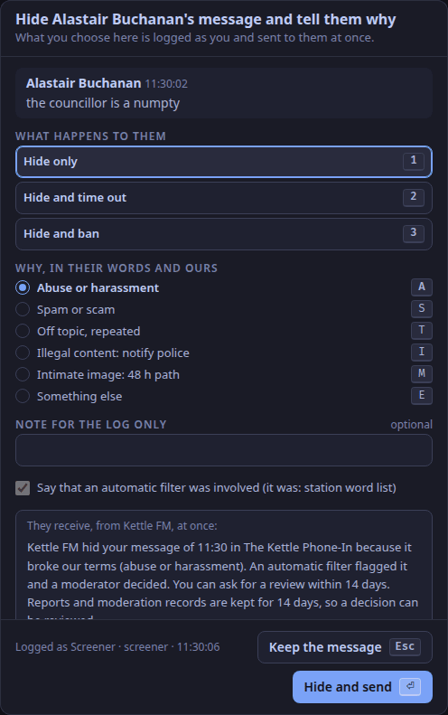

The studio app has one keymap for every tab (ADR-0063, refined by ADR-0098 and ADR-0104).
Keys are read by their place on the keyboard, not their letter, so the rows stay rows on any layout: `1`–`6` over `Q`–`Y` over `A`–`H` over `Z`–`N`.
`⌃` is Ctrl (Cmd on a Mac), `⇧` is Shift, `⌥` is Alt.
A key printed twice, such as `Del Del`, means the same key twice within 3 s.

A key whose feature is not in 1.0.0 still answers: it shows a note in the toast slot saying so, and nothing happens to the room.
Those keys say **note only** below, and link to [what is planned](/docs/reference/release-one-status/#not-in-release-one).

## The rules

1. **Two layers.**
   Global keys (`⌃` chords, `F1` to `F7`, `Del Del`, `Esc`) fire on every tab.
   Unmodified letters, digits, arrows and `⇧` with a letter fire only on their own tab.
2. **Text fields own the unmodified keys.**
   While a text field has focus, single keys, `⇧` letters, the function keys and two-press keys never fire, and nor do `⌃D ⌃D` and `⌃F1`–`⌃F5`.
   `Esc` leaves the field; the other `⌃` chords (`⌃1`–`⌃5`, `⌃T`, `⌃R`, `⌃⇧R`, `⌃⇧B`, `⌃⇧E`, `⌃⏎`) still fire (ADR-0104).
   Settings, the account dialog and the sign-in-ended dialog are forms: only `⌃` chords reach the keymap there, as from a text field.
3. **Two presses for anything that changes the room or a person's standing.**
   The first press arms the key for 3 s, and its button shows it is armed (*Press again*); the same key again fires it; any other key, or `Esc`, disarms it.
   The two-press keys are `Del Del`, `⌃D ⌃D`, `G G`, `⇧B ⇧B` and `⇧Space ⇧Space`.
4. **Held, not latched.**
   Talk keys act while held, and a key's repeat is never a new press.
   Releasing the key ends the talk, and so does the window losing focus or being hidden.
5. **A dialog owns the keyboard.**
   While the statement of reasons is open on the Screener tab, only its own keys work, and `⌃T` still talks ([below](#the-statement-of-reasons)).
   The step dialog has `↑` `↓` to move between the steps, `⏎` to confirm the move and `Esc` to keep the step; no key opens it.
6. **A step switches keys off with their parts.**
   The key of a part the show's step keeps off does nothing, not even arm, and its first press in a session says so in the desk's toast slot ([below](#keys-at-each-step)).

## Global keys

| Key | Does | In 1.0.0 |
|---|---|---|
| `⌃1` `⌃2` `⌃3` `⌃5` | the Desk, Screener, Carts and Schedule tabs; from Settings, back to that tab | works |
| `⌃4` | the Chat tab | note only: the chat is on the Screener tab ([planned](/docs/reference/release-one-status/#not-in-release-one)) |
| `⌃T` (held) | on the Screener tab, the screener's talkback to the presenters and DJs; on any other tab, the presenter talks to the screener only | works |
| `⌃D ⌃D` | drop the caller: on the Screener tab the selected caller; on the Desk tab the caller in slot 4, else the caller on air; on other tabs the caller on air | works |
| `Esc` | in order: disarm an armed key; leave a text field; dismiss a note in the toast slot; on the Desk tab, decline a caller sent to you (*Not now*, ADR-0098); on the Carts tab, take every cued cart out of the headphones; else dismiss the tab's latest notice | works |
| `Del Del` | dump the profanity delay: it throws away what the delay holds, so listeners jump to the live programme | works |
| `F1` to `F6` | fire carts 1 to 6 of the current bank (its top row); again, fade the cart out (ADR-0020) | works |
| `⌃F1` to `⌃F5` | switch to cart bank 1 to 5: the show's own bank of that number if it has one, else the station's (from 1.0.2); what sounds keeps sounding | works |
| `F7` | the picture: the live picture or the slate; with video off it says so | works |
| `⌃+` `⌃−` `⌃0` | text size larger, smaller, back to 100 % (also the top bar's `A−` and `A+`); remembered on this machine | works |
| `⌃R` | restart playout | note only: it says to restart Liquidsoap on the server ([When the lamp says PLAYOUT DOWN](/docs/how-to/playout-down/)) |
| `⌃⇧R` | restart the encoder | note only: restart the listener process on the server |
| `⌃⇧B` | switch listeners to the backup stream | note only ([planned](/docs/reference/release-one-status/#not-in-release-one)) |
| `⌃⇧E` | end the show (also the stage's **End show** button): a dialog, `⏎` to confirm and `Esc` to keep going; everyone off air, carts faded, then automation ([End the show](/docs/how-to/end-the-show/)) | from 1.0.2 (a note only before) |
| `F8` to `F12` | reserved: the app does nothing with them | — |

## Desk tab

| Action | Slot 1 | 2 | 3 | 4 | 5 | 6 |
|---|---|---|---|---|---|---|
| On air | `1` | `2` | `3` | `4` | `5` | `6` |
| Cue | `Q` | `W` | `E` | `R` | `T` | `Y` |
| Talk (held) | `A` | `S` | `D` | `F` | `G` | `H` |
| Mute | `Z` | `X` | `C` | `V` | `B` | `N` |

On air, cue and mute toggle.
Talk speaks from the presenter's seat to that one person while held, and takes the presenter off the programme meanwhile (ADR-0099); slot 1's talk key does nothing, because slot 1 is normally the presenter.
Slots 1 to 5 work.
Slot 6 is playout, which is not a desk source in 1.0.0: its on-air, cue and mute keys show a note, and its talk key does nothing ([planned](/docs/reference/release-one-status/#not-in-release-one)).

A source keeps its slot, and so its keys, while it is in the room (ADR-0096): slot 1 a presenter, 2 and 3 guests, 4 a caller, 5 a DJ, or the first free slot.

| Key | Does | In 1.0.0 |
|---|---|---|
| the caller's cue key (`R` in slot 4) on a caller sent to you | takes the caller: they are cued in your headphones (ADR-0098); the toast prints the key | works |
| `Esc` on a caller sent to you | *Not now*: declines them, and the screener sees DESK BUSY | works |
| **Drop** on a caller's tile | the same as `⌃D ⌃D`: two presses | works |
| **End pass** on a presenter's, DJ's or guest's tile | ends their pass (ADR-0119): off air, out of the room, and their link stops working; two presses, a button with no key | works |
| `P` | at the Callers step, take the caller who has waited longest to strip 4, off air (P for *put through*, as on the Screener tab); the button is **Take … to strip 4** on `desk.callers`. The Screener tab's key for the same action (ADR-0275). At the other steps it does nothing | works from 1.0.2 |
| `⇧⏎` | hand over to the next DJ (ADR-0074): the first press puts a DJ waiting under **Not on air** on air beside you, the second takes everyone presenting off but that DJ; guests and callers stay on. Desk tab only | works from 1.0.1; in 1.0.0 a note only |
| arrows on a tile | the fader | not in 1.0.0: the desk has no fader, and the arrows do nothing on the Desk tab ([planned](/docs/reference/release-one-status/#not-in-release-one)) |

## Keys at each step

A show runs at one of four steps ([Choose how much of the studio a show uses](/docs/how-to/choose-a-step/)), and a step switches a part's key off with the part (ADR-0271).
A tab's key keeps its number at every step.

| Key | Solo | Guests | Callers | Full |
|---|---|---|---|---|
| `⌃1` `⌃3` `⌃5`, `F1`–`F6`, `⌃R`, `⌃⇧E`, `Esc` | as above | as above | as above | as above |
| `1` `Q` `Z` (your own strip) | as above | as above | as above | as above |
| `A` (talk on your own strip) | nothing | as above | as above | as above |
| the other strips' keys | nothing: the slots are empty | slots 2 and 3 | and slot 4 | and slot 5 |
| `⌃2` Screener, `⌃4` Chat | nothing | nothing | nothing | as above |
| `Del Del` Dump | nothing | nothing | as above | as above |
| `⌃D ⌃D` Drop the caller | nothing | nothing | as above | as above |
| `P` (Desk tab) | nothing | nothing | take the next caller | nothing |
| `⌃T` Talk to the screener | nothing | nothing | nothing | as above |
| `⇧⏎` Handover | nothing | nothing | nothing | as above |
| `F7` Picture | nothing | nothing | nothing | as above |

- **The first press says so.** A key that does nothing because of the step shows one note in the desk's toast slot, without a tone colour: *Dump is off at Solo. This show runs at Solo, so there is nothing for Dump to do. It comes on at Callers.*, with **Step…** and **Dismiss**. Later presses of that key in the session are silent.
- **A person still in the room keeps their keys.** A key that acts on someone left from an earlier step (Drop on strip 4 after the step moved down, a guest's strip at Solo) works until that person has left.
- **While everything is shown**, `⌃2` and `⌃4` reach their tabs again; the keys of parts that are off stay off.
- `F1` to `F6` are volume keys on many laptops without `Fn`: every one of them has its cart on screen to click.

## Screener tab

| Key | Does |
|---|---|
| `↑` `↓`, `1`–`9` | move in the queue, jump to a caller; with a chat panel focused, `↑` `↓` move in that panel |
| `T` (held) | talk to the selected caller, off air; the first `T` on a waiting caller starts screening (ADR-0100) |
| `P` | put the caller through to the desk (P for *put through*, the switchboard phrase), or again after a decline |
| `W` | back to the queue |
| `N` | the name-on-air field (`Esc` leaves it) |
| `⇧C` | let a dropped caller's held place go |
| `S` · `K` · `L` | slow mode · hold new accounts · links for trusted chatters only |
| `G G` | influx: five settings at once; the same keys undo it (ADR-0068) |
| `H` · `O` · `⇧B ⇧B` | hide · time out · ban, for the selected message or report; on a message each opens the statement of reasons |
| `D` · `⏎` | leave a reported message as it is, or keep a review's decision · release a held message |
| `⇧U` · `⇧X` | release all held messages · hide all held messages |
| `A` · `⇧E` | acknowledge a notice · preserve the evidence and escalate |
| `F` · `⇧P` · `I` | feature a message on the player page · pin it, or unpin · invite its author to call in |
| `R` · `⇧M` | reply privately to a message to the studio · pass it to the presenter |
| `End` · `⌃⏎` | jump to the newest message · post as staff from the composer |

Every key on this tab works in 1.0.0; [Moderate the chat](/docs/how-to/moderate-the-chat/) explains the chat's keys, and [Screen callers](/docs/how-to/screen-callers/) the queue's.

### The statement of reasons

| Key | Does |
|---|---|
| `1` · `2` · `3` | hide only · hide and time out · hide and ban |
| `A` · `S` · `T` · `I` · `M` · `E` | the reason: abuse or harassment · spam or scam · off topic, repeated · illegal content · intimate image · something else |
| `C` | for a picture only: suspected child sexual abuse, kept as evidence ([the runbook](/docs/how-to/handle-suspected-child-abuse-images/)) |
| `⏎` | hide and send (a focused button takes its own `⏎`) |
| `Esc` | close it and keep the message; in the note field, the first `Esc` leaves the field |
| `Tab`, `Space`, arrows | the dialog's own buttons and choices |
| `⌃T` (held) | talk to the presenter, as on the tab |

## Schedule tab

| Key | Does |
|---|---|
| `←` `→` | the week before, the week after |
| `T` | today's week |
| `Tab`, `⏎` on a block | reach a block, open it in the editor (the browser's own keys) |

Nothing on the schedule is live, so no key here is two-press; the global keys fire as on every tab, and a text field in the editor owns the unmodified keys.

## Carts tab

| Key | Does |
|---|---|
| a cart's key (`1`–`6`, `Q`–`Y`, `A`–`H`, `Z`–`N`) | fires it; again, fades it out |
| `⇧` and a cart's key | cues it in the presenters' and DJs' headphones only; again, takes it out |
| `Space` | fades the cart started last on air |
| `⇧Space ⇧Space` | fades everything sounding |
| arrows, then `⏎` | move between carts without firing, then fire the one reached (`⏎` on any other control is that control's own) |
| `Esc` | takes every cued cart out of the headphones |

See [Cart wall](/docs/reference/surfaces/carts/).
The presenter kit, with presets on `⌥1` to `⌥4`, is planned for release two (ADR-0207, [Presenter kit](/docs/reference/surfaces/kit/)).
