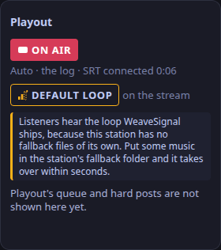

Playout is the one fixed Liquidsoap script between the desk and listeners (ADR-0048); the control plane drives it over a Unix socket and never generates code for it.
This page covers what ADR-0044 asks of playout, as release one does it.

## Who holds the listener mount

Listeners connect to the **listener process** (`listeners.liq`), not to playout.
Playout sends its programme there over loopback (the `playout_feed` port, 7315), and the listener process encodes the Ogg Opus stream listeners hear (and the MP3 streams, when they are on).
When playout or the desk stops, the listener process plays the station's fallback (the files in its fallback directory, else the default loop, else silence) and listeners stay connected; when playout returns, they hear the programme again without reconnecting.
With video on, playout sends the same programme back to the desk too (the `desk_feed` port, 7317), for the video stream's sound while nobody is live ([Video in the desk](/docs/reference/desk-video/#the-sound), ADR-0172): from a buffer on a clock of its own, so a desk that stops reading never holds up what listeners hear.
Metadata never travels in the stream: a new track would start a chained Ogg stream, which `icecast.server` 2.5.0-rc1 answers by dropping every listener.

## The feed's cushion

Playout sends its programme to the listener process over loopback, and the listener process keeps a short cushion of it before it plays: `listeners.feed_buffer_s` in the playout data, 0.5 s unless set, called `FEED_BUFFER_S` in the Compose bundle's `.env` and in the Cloudron package's `weavesignal.env`.
The cushion can grow to 10 s at most; whatever it holds is listener delay.

| Server | Set | What the cushion held |
|---|---|---|
| A dedicated 4-vCPU public server | 0.5 s | 0.20–0.38 s over 24 hours, no container restarted and no error |
| A workstation running the Compose stack | 0.5 s | 2 hours with no underrun (ADR-0182) |
| A heavily shared server (load 9–22 on 12 cores) | 3 s | median 8.5 s, and up to its 10 s cap |

So run a station on a server that is not overloaded: there the default holds, and no cushion saves a starved one.
On a busy server the listener process falls behind for moments, and a thin cushion then runs dry: listeners hear the fallback briefly, and the cushion comes back bigger each time, which adds to their delay.
If the log shows `listener_programme` switching to the fallback while playout is on air, the server is short of time; raising the cushion (1 to 2 s) hides short stalls, and each second added is a second more listener delay.
The Cloudron package sets 1.5 s, because the server it was tested on is shared.

## The Opus stream's rate

The Opus stream is constant bit rate, so a player that buffers by bytes never waits on a quiet programme: 96 kbit/s unless the station sets another (ADR-0233), from 64 to 256.
The setting is `listeners.bitrate` in the playout data, called `OPUS_BITRATE` in the Compose bundle's `.env` and in the Cloudron package's `weavesignal.env`.
A rate outside 64 to 256 stops the listener process at start, with the setting named in its log.
Each listener costs the rate in bandwidth: 2,000 listeners at 96 kbit/s are about 192 Mbit/s, at 128 about 256 Mbit/s.
The player names the rate beside the MP3 streams; the control plane learns it from `join.stream_kbps`, which the install routes set from the same setting.

## Directory listing

The stream does not ask internet radio directories to list it (ADR-0129).
The setting is `listeners.directory` in the playout data, `false` unless set; the Compose bundle and `weavesignal.sh` call it `DIRECTORY_LISTING` in `.env`.
Set it to `true` when the station goes public.
It is separate from search-engine listing of the public pages (`web.listed`, [The public pages](/docs/reference/public-pages/#search-engines)) and from whether the stream needs a password.

## The MP3 streams

Opus is the listener stream. Directories such as TuneIn, smart speakers and players that do not take Opus need MP3, so a station may turn on MP3 beside it, at two rates (ADR-0002, ADR-0232): 128 kbit/s, enough for speech, and 320 kbit/s for music.
Each is off until turned on, each by itself.
The first is 1.0.0's one MP3 stream, with its settings unchanged, so a station upgraded from 1.0.0 keeps its mount and its rate; the second is new in 1.0.1.

| Playout data | Compose and Cloudron | Default | Does |
|---|---|---|---|
| `listeners.compat.enabled` | `COMPAT_STREAM` | `false` | turns the first MP3 stream on |
| `listeners.compat.mount` | `COMPAT_MOUNT` | `programme.mp3` | its mount on the listener port |
| `listeners.compat.bitrate` | `COMPAT_BITRATE` | `128` | its constant bit rate in kbit/s, at 44.1 kHz stereo |
| `listeners.compat_high.enabled` | `COMPAT_HIGH_STREAM` | `false` | turns the second MP3 stream on |
| `listeners.compat_high.mount` | `COMPAT_HIGH_MOUNT` | `programme-high.mp3` | its mount on the listener port |
| `listeners.compat_high.bitrate` | `COMPAT_HIGH_BITRATE` | `320` | its constant bit rate in kbit/s, at 44.1 kHz stereo |

No two streams may share a mount: a second MP3 mount that repeats the first or the Opus one stops the listener process at start, with the setting named.
The listener process encodes each with LAME, from the same programme as the Opus stream (never AAC: Ubuntu's Liquidsoap links fdk-aac, whose licence keeps the package out of app stores); each output has its own encoder, all on the listener process's one clock.
They share the listener port, so they need no port of their own, and they carry no metadata, like the Opus mount (now playing comes from `GET /api/v1/now-playing`); MP3 has no chained stream to start.
The directory-listing setting above applies to them as to the Opus mount.
A listener on any mount stays connected through a playout or desk restart, as on the Opus one (`test-bundle` holds one on each mount through playout's restart).

The player page offers the Opus stream and each MP3 stream that is on, labelled with its codec and rate, and keeps the listener's choice on their device; a browser that cannot play Ogg Opus starts on the first MP3 stream.
It learns them from `join.stream_kbps` and `join.mp3` in the control plane's settings, each MP3 stream at `join.stream_url`'s address with its own mount; the install routes write both.

Bandwidth: 320 kbit/s is 2.5 times 128 for each listener on it, so 2,000 listeners on the 320 mount would need about 640 Mbit/s.
The Compose bundle's public route and the Cloudron package publish each MP3 mount that is on.
A local edge relays only the mounts named in its `RELAY_MOUNTS` (`/programme.opus` by default), so add `/programme.mp3` and `/programme-high.mp3` there if the edge should serve them.
Listeners on every mount count in the audience figures.

## The outgoing Icecast source

The listener process can send the programme to another Icecast server as a source, for a DJ's AzuraCast (ADR-0226).
It is off unless the playout data says `icecast_out.enabled` and the environment gives `WEAVESIGNAL_ICECAST_OUT_PASSWORD`.
[Send your programme to AzuraCast or another Icecast server](/docs/how-to/send-to-azuracast/) is the how-to.

| Setting | Default | Does |
|---|---|---|
| `icecast_out.enabled` | `false` | turns it on |
| `icecast_out.host`, `port`, `mount` | none | the server's address, source port and mount |
| `icecast_out.user` | `source` | the user name |
| `icecast_out.tls` | `false` | connects over TLS |
| `icecast_out.bitrate` | `128` | constant MP3 bit rate in kbit/s, 44.1 kHz stereo |
| `icecast_out.name` | none | the stream's name on the other server |
| `WEAVESIGNAL_ICECAST_OUT_PASSWORD` | none | the password; never in the data file |

The Compose bundle, the Quadlets and the Cloudron package call them `ICECAST_OUT`, `ICECAST_OUT_HOST`, `ICECAST_OUT_PORT`, `ICECAST_OUT_MOUNT`, `ICECAST_OUT_USER`, `ICECAST_OUT_PASSWORD`, `ICECAST_OUT_TLS` and `ICECAST_OUT_BITRATE`.

How it works:

- It reads the same programme as the Opus mount, after metadata and track marks are dropped and behind `clip`, and encodes MP3 with LAME.
  There is no Ogg: a chained Ogg stream makes Icecast-type servers drop the source.
- It runs on a clock of its own behind a buffer, so a remote that stalls a connection holds up only the outgoing stream. Listeners and playout's clock do not wait for it.
- The control plane decides when it sends. It asks the listener process to send for ten seconds at a time (`icecast_out.send`), repeating every two seconds while it wants the programme sent, and says `icecast_out.stop` when it does not. If the control plane dies, the source is let go within ten seconds.
- The choice is `auto`, `on` or `off`, kept in the database. `auto` sends while playout reports live mode with the desk on air (`on_air` is `desk`): not on dead air, not on automation, not while playout is away.
- A failed connection is tried again after 5, 10, 20 and then 30 seconds, from 5 again once one holds. Stopping cancels a try that is waiting.
- The listener process's status (`icecast_out.status`) and the control plane's `GET /api/v1/icecast-out` say whether the connection holds, the last error and its time, the failures in a row, and the bytes sent, counted from the constant bit rate. The password is in neither.

## The default loop

A new station has no fallback files, and silence would greet the first person to open the stream.
Until the station puts its own files in the fallback folder, both Liquidsoap processes play a short loop that WeaveSignal ships (`assets/default-loop/default-loop.flac`, 32 seconds of a soft synthesised pad with a few quiet bells, at −23 LUFS; the script that makes it is beside it, and it is CC0).
The data names the file (`fallback.default_file`); without it, or if it is missing, an empty folder is silence as before.

What plays, in order, whenever the desk and automation have nothing:

1. the station's fallback files, in rotation;
2. the default loop, only while the folder holds nothing it can play;
3. silence.

Files added to the folder take over within seconds, so a station replaces the loop by adding its own fallback and does nothing else.
While the loop is on the stream, the studio app says so: the playout panel on the desk (`desk.playout`) shows a **Default loop** chip and a line saying why, and a notice appears when it begins and ends.
The loop is not entered in the per-play log (it repeats every half minute), and listeners are told `fallback` as what is on air.
The control plane reports it as `default_fallback` in the studio view and in `GET /api/v1/playout`.

## The processing chain

Playout runs one chain on everything listeners hear, after the programme is chosen and before it goes to the listener process (ADR-0044):

1. a guard that turns not-a-number into silence (a moment of it once left the limiter silent for good);
2. a slow **gain control** towards the station's loudness target, −16 LUFS by default, a level common for internet streams (the library is normalised to −23 LUFS at import, so the gain control lifts it by up to 6 dB);
3. the guard again;
4. a peak limiter 1.5 dB under full scale, with no lookahead, then a clip.

The limiter has no lookahead on purpose: in Liquidsoap 2.5 `compress` with a lookahead reads uninitialised memory on its first frame and, in some starts, goes silent until playout restarts.
The gain control is deliberately gentle: it can add or take away at most 6 dB, rises over about 15 seconds and falls over about 2, and holds still under −50 dB so a quiet room or the desk's silent bed is not pumped up.
A programme already at the target gets no gain.
It evens out what nothing else processes: the library, the fallback files and the default loop.
`processing.status` on playout's control socket says whether it runs, its target and limit, and the gain it applies now.

| Setting | Default | Does |
|---|---|---|
| `processing.enabled` | `true` | `false` takes the gain control out; the guards and the limiter stay |
| `processing.target_lufs` | `-16` | the loudness it works towards, −40 to −5 (`-23`, EBU R128, for a quieter, broadcast-style level) |
| `processing.max_gain_db` | `6` | the most gain it adds or takes away, 0 to 12 |

The Compose bundle calls them `PROCESSING`, `PROCESSING_TARGET_LUFS` and `PROCESSING_MAX_GAIN_DB`.
There is no multiband stage.

## What is on air

| Mode | On air, in order of preference |
|---|---|
| `live` (default) | the desk; automation when the desk is away or silent too long; the fallback files; the default loop; silence |
| `auto` | automation; the fallback files; the default loop; silence |

The desk always sends, even with nobody talking, so it counts as away after `dead_air_s` (10 s by default) under `dead_air_db` (−50 dB), set in playout's data.
That is the dead-air fallback: automation takes over, the desk shows a **Dead air** notice, and when the desk sounds again it is back on air with a **Back on air** notice.

## The schedule

| Part | What it is |
|---|---|
| Library | tracks imported through the media worker, each with a category (`a`, `gold`, ...), title, artist, album, label and ISRC, brought to the loudness target by a stored gain |
| Clock | an hour's slots in order: a category, or a cart from the wall (an ident); repeated until the hour is full |
| Week | which clock runs each local hour (Monday 0), in the station's time zone; empty hours run the default clock |
| Rotation | the track rested longest that breaks no rule |
| Separation | artist 60, song 180 and album 60 minutes by default, start to start; relaxed only when nothing else fits, and the log says so |
| US statutory licence | 17 U.S.C. 114(j)(13): in any 3 hours at most 3 tracks from one album (2 in a row) and 4 by one artist (3 in a row); never relaxed |

The control plane keeps the log generated a day ahead and playout's queue two items ahead.
The log editor replaces a planned track only when the change breaks no rule, or the station's own rule with `force`; a US statutory breach is always refused.
Items a live show ran over are skipped, so automation resumes in the current hour.

## What the station keeps

| Record | Kept |
|---|---|
| Per-play log | every track, cart and fallback file that reached listeners, with start, end, title, artist, album, label, ISRC, duration and the listeners connected as it started; for retention's per-play period, holds respected (an hour when the period is 0 days) |
| Listener counts | listener seconds, sessions of at least a minute and the peak, per hour; anonymous, so kept under every preset (ADR-0115) |
| Legal logger | what listeners heard, fallback included, in hourly Ogg Opus files, while the Jurisdiction keeps programme recordings; each hour is registered with [retention](/docs/how-to/set-retention/), which deletes it at the end of its period |

Carts sound in the desk; they reach the per-play log timed when listeners hear them (after the profanity delay), and a cart a dump threw away is marked as not aired and left out of reports.

## Now playing

`GET /api/v1/now-playing` (and `/api/v1/now-playing/events`, server-sent events) say what is on air, the track, and the next two items, changing when listeners hear the change (the listener delay).
For a US statutory webcaster the next items are never sent (17 U.S.C. 114(d)(2)(C)(ii)).

## Routes

| Route | Does |
|---|---|
| `GET /api/v1/playout` | the mode, what is on air, dead air, whether the default loop plays, automation's queue, listeners, the logger |
| `GET`, `PUT /api/v1/playout/settings` | time zone, separations, mode, default clock |
| `GET /api/v1/playout/zone` | the station's zone and whether anyone has chosen it yet (`zone`, `set`) |
| `GET`, `PUT /api/v1/library/tracks` | the library; an upload with `title`, `artist`, `category` and optionally `album`, `label`, `isrc` |
| `DELETE /api/v1/library/tracks/{id}` | remove a track |
| `GET /api/v1/schedule/clocks`, `PUT`, `DELETE /api/v1/schedule/clocks/{id}` | clocks |
| `GET`, `PUT /api/v1/schedule/week` | the week's grid |
| `POST /api/v1/schedule/generate` | generate the log again for a range (a week by default) |
| `GET /api/v1/schedule/log` | the log, with each item's words and any rule it breaks |
| `PUT`, `DELETE /api/v1/schedule/log/{id}` | the log editor |
| `GET /api/v1/reports/plays` | the per-play log as JSON, CSV, or SoundExchange's Report of Use columns (`format=soundexchange`) |
| `GET /api/v1/reports/audience` | listener hours, sessions, peak and tracks per hour (PPL's webcast report) |
| `GET /api/v1/logger` | the logger's recordings and any hour missing in the last day |
| `GET /api/v1/now-playing`, `/events` | now playing, public |

Now playing is public. Every other route needs a staff session or the station key; changing playout's settings (`PUT /api/v1/playout/settings`) needs an admin.
