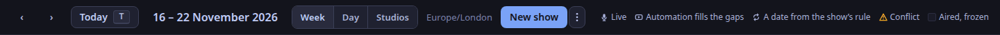
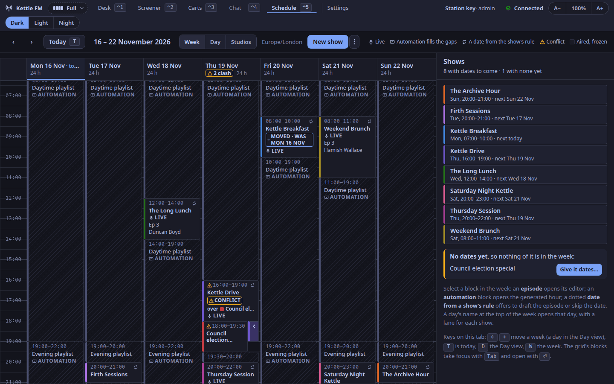
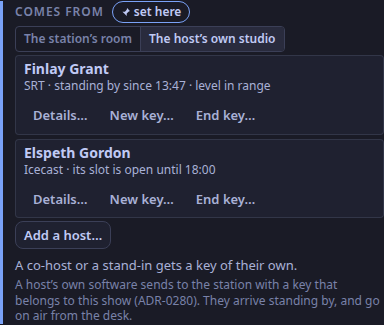
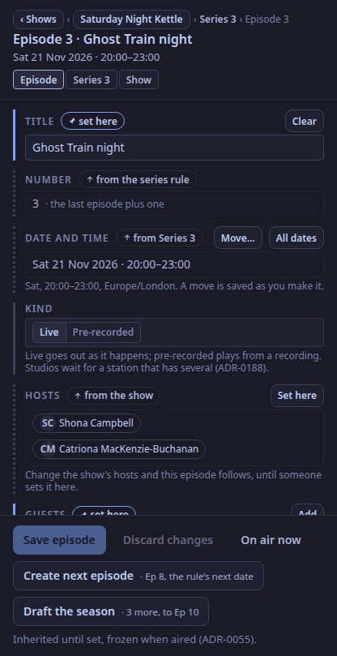
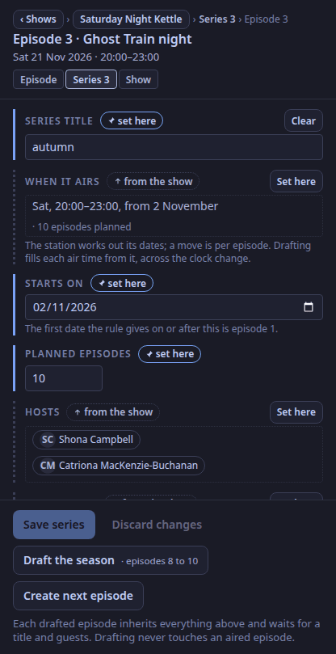
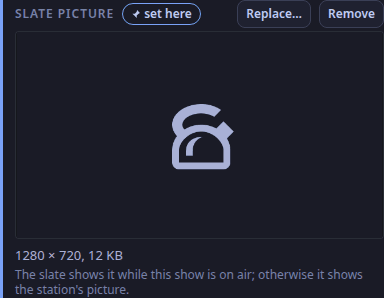
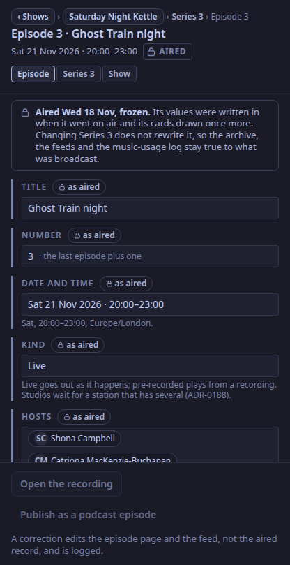
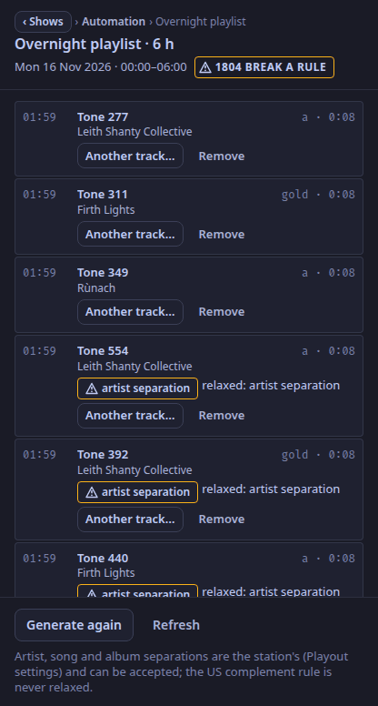
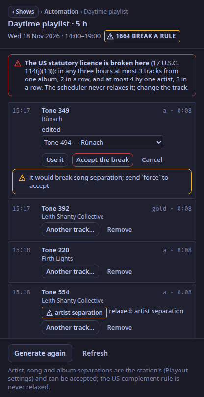
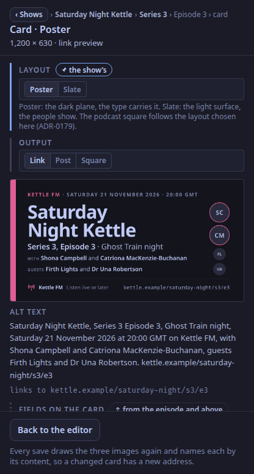

The Schedule tab (`⌃5`): the toolbar, the week grid on the left and the editor column on the right (ADR-0021, ADR-0045, ADR-0055).
Each panel is a heading below, named as it is on screen (ADR-0070).
The grid is drawn by a calendar library behind a small adapter, so another library could drop in without the rest of the tab changing; it is drawn with Event Calendar (ADR-0185).

Times on the grid are the station's wall clock in its own zone (chosen once in **Settings**; until then the station offers `publishing.zone` and asks an admin to confirm it), whatever the machine's zone: a clocks-back Sunday has 25 hours and says so in its header; a clocks-forward one has 23.

## `calendar.frame`

Not drawn on the tab: the app’s top bar, `studio.frame`, is above every tab.

## `calendar.toolbar`

| Part | What it does |
|---|---|
| `‹` `›` (`←` `→`) | the previous and next week; in the Day view the previous and next day |
| **Today** (`T`) | back to this week, or to today in the Day view |
| the range | the week's dates, or the day's: *Wed 18 November 2026* |
| **Week** (`W`), **Day** (`D`), **Rota** (`R`), **Studios** | the view. **Rota** (from 1.2) is the next twelve hours as a list (`calendar.rota`, below). **Day** opens one day (`calendar.day`): the selected block's day, else today when it is in the week shown, else the week's Monday. The tab opens on **Week** every time. **Studios** is **[planned](/docs/reference/release-one-status/)** and says it is not in this build: studios as columns wait for a studio on each show |
| the zone | the station's time zone, and its clock change if one falls this week |
| **Choose the time zone…** | shown to an admin until someone has chosen the station's zone; opens Settings |
| **New show** | opens New show (`calendar.new-show`) |
| **Import a calendar…** | for an admin or a producer: reads an `.ics` file into new shows (`calendar.import`) |
| **Subscribe…** | the link to the schedule's calendar file (`calendar.subscribe`) |
| the legend | Live, automation, a date from the show's rule, conflict (its tooltip says how a clash is drawn), aired |

**Import a calendar…** and **Subscribe…** are two buttons where the window has room for their words beside the legend (a toolbar 118 rem wide or more: a 1920 by 1080 window at the usual text size).
In a narrower window they are the two entries of one menu, on the narrow **⋮** button that stands against **New show**, so the toolbar stays on one line at 1440 by 900.
The menu owns the keys while it is open: `↑` `↓` move between its entries, `⏎` opens one, and `Esc` closes it.
A station older than 1.0.5 has no calendar files, and the toolbar offers neither.

The picture below was taken before release 1.0.5: the toolbar now has **Day** between **Week** and **Studios**, and the calendar files after **New show**.

## `calendar.week`

A time axis and seven days; every block is placed by its start and length, in station time.
Each day's header is a button that opens that day in the Day view. A day on which shows clash counts them before its length: *2 clash*, *3 clash*.

| A block says | When |
|---|---|
| the show's name, its times, a left band in its colour (ADR-0066), LIVE, `Ep 212` or `S3 Ep 7 · its title`, the hosts | an episode |
| the repeat glyph by the time | the date comes from the show's rule ([When a show airs: the rule](/docs/reference/show-rules/)) |
| MOVED · was 07:00 (or · was Mon 07:00, moved to another day) | an instance moved off its rule's time this week |
| a warning triangle before its time, and CONFLICT with *over* and the other show's name where the block is tall enough | it shares time with another show: an episode or a date nobody has drafted, alike. An hour's block has room for the triangle only; its tooltip says the rest |
| ON AIR | the block the station's clock is inside now |
| LIVE · AIRED on a dimmed surface | it has gone out: aired episodes are frozen (ADR-0055) |
| NOT DRAFTED and *Ep 4 · Select it to draft or skip*, dashed | a date the show's rule gives where no episode is drafted yet; select it to **Draft this episode** or **Skip this date** (the toast offers **Undo**) |
| AUTOMATION, hatched, named by its clock | every gap, filled by the clock that runs each local hour (ADR-0045); it never conflicts, it yields |

A block says LIVE or PRE-RECORDED, by its episode's kind.
A block takes focus with `Tab` and opens with `⏎`; a future episode can be dragged or resized with the pointer, and snaps back with the reason if the control plane refuses.

### Where shows clash

The model has no studios yet, so any two shows that share time clash.
The week folds them, so that one name is always readable and nothing is drawn through anything else:

| What is drawn | When |
|---|---|
| one block **open**, at the day's width less a strip at the day's right edge | always one in a clash: the selected block; else the one on air; else the drafted episode that starts last (by the schedule it is the one on air where they overlap); else the first date not drafted |
| a **folded** block: no words of its own, only a **tab** in the strip, and its name in any half hour or more left clear | the open block covers its first hour. Press the tab, or `⏎` on it, and it opens and the other folds. Hover and focus alone move nothing |
| a block with its words above the cover, a tab in the strip beside the cover, and its name again where it comes out below | the open block covers it later than its first hour. The tab brings it forward in the same way |
| a count in the strip, *+2* | two or more are hidden at one time; press it to open the day |
| the blocks side by side, nothing folded | each would have 10 rem or more of its own (a very wide window) |

The **tab** is how a covered block shows: as wide as the strip (1.5 rem, the 24 px target size at the usual text size), on a ground filled with the show's colour with the colour itself as a band on its left, with a chevron pointing at the open block, and the show's name written down it where the tab is an hour and a half or taller.
Its tooltip says the rest: *Schools Hour, not drafted, 15:00 to 16:00, clashes with The Tea Break. Folded: press to bring it forward.*
Pointed at, it is ringed.
A count stands on its shows' colours side by side, and where a count stands on the strip a tab gives way to it for that time.
Three shows in a chain (a long show with a shorter one at each end) each have their tab in the same strip: the long show's stands beside the block over it, though the long show is itself the open block's width.
The week's own scrollbar has room of its own at the grid's right edge, so it does not lie over Sunday's strip.

The open block says what it is over, with a square of that show's colour (the colour of its tab): *over ▪ The Long Lunch*, or *over 2 shows*.
A block an hour tall says it too, on a third line under its time and name; there the CONFLICT chip gives way to the warning triangle before the time. A block shorter than an hour has its time and name alone, and the tooltip.

A folded block does not drag: the first press brings it forward, the next drags it.
A block dropped onto another show's time is moved, and the tab's line says *It now clashes with Kettle Drive on Thursday.* with **Undo**; the station refuses a presenter's.
A clash that runs past midnight folds on each day by itself, and a part of such a block is moved from its editor, not dragged.

## `calendar.day`

One day at the week's own scale, opened only when asked: **Day** in the toolbar, a day's header in the week, **Open the day** in `calendar.clash`, or the count on a fold.
Clashing shows stand in lanes of equal width, side by side, and nothing folds.
With the width, a block puts its name beside its time and the rest of its words along a second line; a block in a clash begins that line with CONFLICT and *over*, the other show and the overlap: *over Kettle Drive · 1 h*.
The day is at most 80 rem wide. Dragging, resizing, selecting, the now line, ON AIR and MOVED are as in the week, and the editor column is unchanged beside it.
The editor column shows the selected block while its day is the one open. On another day nothing is selected, and the column lists the shows (`calendar.shows`), as it does in a week that does not hold the selected block.
**Week** returns to the week that holds the day, with the same block selected.

## `calendar.rota`

From 1.2, the Schedule tab's fourth view (`R` on the tab, or **Rota** beside Coming up on the desk): every show of the next twelve hours from `GET /api/v1/rota`, who is down for it, where they come from (the room or their own studio) and whether they are ready; the one on air is marked.
`D` or `W` goes back to the calendar.
A station older than 1.2 has no rota, and the view says so ([Follow the rota and the handover window](/docs/how-to/follow-the-rota/)).

## `calendar.day.strip`

Above the Day view's grid, the week's seven days as buttons: *Mon 16*, *Tue 17*, and so on, the open day pressed, today marked, and each day's clashes counted.
One press moves between the days of a week, which is how several clashes are worked through.

## `calendar.clash`

With a block in a clash selected, the first thing under the editor's head: **Clashes with**, and a row for each other show with its episode or *not drafted*, its times and the overlap.

| Part | What it does |
|---|---|
| **Show it** | selects that block: it opens in the week and the editor turns to it. This is the keyboard's way to a folded block |
| the sentence | who is on air where two episodes overlap: the one that starts later, named with its time. Two that start together are said to. For a date not drafted: nothing of it airs yet, and what drafting it would clash with |
| **Open the day** | the Day view on that day, the block still selected |

The ways out of a clash are the editor's own: **Move…** on an episode's date, **Skip this date** on a date not drafted.
What a presenter would be refused is the station's to say, and it says it when a draft is asked for and in a show's dates.

## `calendar.shows`

The editor column with nothing open: every show with a date to come, by name (a leading *The* set aside), each with its rule in short and its next date: *The Bothy Sessions · Wed and Fri, 21:00–23:00 · next Wed 18 Nov*.
A row opens that show at its **Dates**. Above twelve shows a field, **Find a show**, narrows the list.
At its foot are the two groups of `calendar.unscheduled`.
Every other pane of the column begins its crumbs with **‹ Shows**, which closes what is open, clears the selection and comes back here, in the same week.
`Esc` does the same from anywhere on the tab, once no text field, menu or dialog has the key; it closes nothing while the column holds changes that are not saved, and the tab says so.
So does a press on the grid where no block is. There is little of that, because automation fills every gap in time and a press on those hours opens their log: only the narrow gap beside a day's blocks, and in a wide window the plane beside the Day view's column.
The rows are one stop for `Tab`: `↑` `↓`, `Home` and `End` move between them, and `⏎` opens the show.

## `calendar.show-dates`

The show level has two tabs under the show's name, **Dates** and **Details**. Details is the show editor; Dates is where the show opens.
It is reached from a row of `calendar.shows`, from **Show** on an episode's level switch, from the show's name in any crumbs, from **All dates** on an episode's date field and **All its dates** on a date not drafted, from **See its dates** when New show is done, and from **See them** after **Give it dates…**.

The head says **When it airs** in the station's sentence, with **Change…** (`calendar.rule`), the last date when the rule ends, and a line of counts: *30 to come: 3 drafted, 27 not drafted. 1 skipped.*
Under **Coming up** are the dates still to come, ten at a time (**Show more dates**, sixty at most):

| A row says | When |
|---|---|
| `Ep 7` · **Wed 25 Nov** · `21:00–23:00` | always; the year on the first row of a new year |
| *drafted*, and the episode's title | an episode fills the date |
| *not drafted* | the rule gives the date and nobody has drafted it |
| *made by hand* | an episode no rule date made |
| CONFLICT and, on a line of its own, *St Andrew's Weekend, 22:00 to 23:30 · overlaps 1 h* | another show is in its way. A drafted episode's clash is known while its block is in the week on screen. Where the station would refuse this session the draft, the line begins with its words: **St Andrew's Weekend has that time.** |
| MOVED · was Fri 4 Dec | it airs at another time than the rule's |
| Skipped, struck through | the date is taken out; it stays listed |
| ON AIR, CLOCKS FORWARD, CLOCKS BACK | as the week and the rule dialog say them |

| Action | On | What it does |
|---|---|---|
| pressing the row (or `Space`) | any | shows it in the week: the week, or the Day view, moves to that date and its block is selected there, open if it is in a clash. The list stays |
| **Open** (or `⏎`) | any but a skipped date | the episode's editor, or the pane of the date not drafted |
| **Draft** | the next date to draft | drafts the episode; drafting stays in date order, so **Draft** is on one row at a time |
| **Skip**, **Put back** | a date not drafted | takes the date out, or puts it back; the row stays |
| **Move…** | a date not drafted, or a drafted episode | a date and a time (with its two arrows, a quarter-hour a press), with **Move** (`⏎`) and **Cancel** (`Esc`); a moved date offers **Back to the rule** |

Each change is saved as it is made: the rule is read from the station first, changed and saved with the drafted episodes left where they are, and the tab's line says what was done with **Undo** for 12 seconds. Every other window is told.
A drafted episode has no **Skip**: an episode is not a date.
**Aired** is a closed group under the rows with its count; open, it lists what has aired, newest first, and a row shows it in its week.
The foot has **Draft the next** and, when the rule ends, **Draft all 27**.
A show with no rule says *No dates yet* with **Give it dates…**; a finished one says why, with **Give it new dates…**.
On a station older than 1.0.4, which keeps a weekly time only, the list holds the drafted episodes and says so.
The rows are one stop for `Tab`: `↑` `↓`, `Home` and `End` move between them, and `Tab` goes on to the row's own buttons. No letter acts on a row.

## `calendar.new-show`

**New show** opens a dialog in three parts (ADR-0278; [Schedule a new show](/docs/how-to/schedule-the-week/)):

1. **The show**: its name, its colour and its step. On a station of 1.1, an admin or a producer is also asked **Comes from** (a field of `calendar.new-show`, with no panel of its own): **The station's room** (picked) or **The host's own studio**. A show's source follows from its keys and the show does not exist yet, so the pick is only an intention: when the show is made, **Done** says it comes from the host's own studio once a key is made, with **Set up a host…**, which opens the same setup as the show editor's (SRT offered for a show at Callers or Full, Icecast otherwise). New show stays open while the key's details are shown, and then says the host has a key.
2. **When it airs**: `calendar.rule`, below. With a block selected, the date and time start from that block.
3. **Done**: the show is made and its first episode drafted; **Draft all 10** drafts the rest of a rule with an end, and **Open episode 1** selects it.

**No dates yet** makes the show without a rule; it is then listed under *No dates yet* (`calendar.unscheduled`) with **Give it dates…**.

## `calendar.rule`

The questions on the left and, on the right, what they make, as the station says it back (`calendar.rule.preview`). The same panel is New show's second part, the rule dialog that **Change…** opens, and the presenter's *When it is on*.

| Part | What it does |
|---|---|
| **First on**, **from**, **until** | the first date and the times, in the station's zone; each time has two arrows beside it, which move it to the quarter-hour before or after (the field is still typed in for an odd minute, and `↑` `↓` in it step a part of the time as the system does); a show that runs past midnight is asked about once |
| **Repeats** | the sentences the date makes (*Every week on Tuesday*, *Every month on the third Tuesday*, *Every year on 17 November*, **On dates I choose…**); **More choices…** gives Once, Weekly (every n weeks, several weekdays), Monthly (the nth or last weekday, or a day of the month), Yearly and Chosen dates |
| **Ends** | Never, **On** a date, or **After** n episodes; a skipped date does not count |
| the sentence (`calendar.rule.summary`) | the rule in words and its last date |
| the clash line | how many of the dates shown clash with another show; when every date does, the show is named and the station offers the nearest clear time within three hours, **Try 16:00 to 17:00** |
| the small months | each date that airs, clashes or is skipped; for chosen dates, a click or `Space` adds or removes a date |
| the rows | each date with its episode number and times, CONFLICT with the other show and the overlap, CLOCKS FORWARD or CLOCKS BACK where the clocks change; **Skip** (or **Put back**), **Move…** (or **Back to the rule**), and **Remove** for a chosen date |

On a show that has episodes, **Save…** shows *Before you save* (`calendar.rule.change`): the drafted episodes with their old and new dates, **Move them to the new dates** or **Leave them where they are**, and any skipped or moved date the new rule no longer gives. Every window is told *Moira changed when The Folk Club airs.* A rule dialog already open on that show in another window says it too, above its buttons, with *Saving puts this rule in its place.*

## `calendar.show-rule`

**When it airs** on the show's **Details**: the rule in words and **Change…**, which opens `calendar.rule`. The show's **Dates** say the same rule in full and list its dates (`calendar.show-dates`). **Subscribe…** opens the link to this show's calendar file (`calendar.subscribe`).

## `calendar.show-source`

**Comes from** on the show's **Details** (ADR-0280): **The station's room**, or **The host's own studio**.
Under the second, each host with a key: their name, the way in, how it stands now, and **Details…**, **New key…** and **End key…**; **Add a host…** makes a key for a co-host or a stand-in.

The station decides where a show comes from by its keys: the host's own studio once a key is made, the room again when the last key ends. So the field is apart from **Save show**. Picking **The host's own studio** on a show with no key says *No key yet* and offers **Set up a host…** (`settings.hosts.setup`, with the show given); picking **The station's room** on a show with keys says they are to end, and ends none.
It is not drawn for someone who may not read the show's keys, or on a station older than 1.1.

## `calendar.subscribe`

**Subscribe…** opens a dialog with the link to the schedule's calendar file, or to one show's when it is opened from that show (ADR-0281; [Calendar files](/docs/reference/calendar-files/#subscribe)).

| Part | What it does |
|---|---|
| **Calendar link**, **Copy link** | the `webcal://` link on the station's public address, and its copy |
| **Web address**, **Copy** | the same file as `https://` |
| **Download .ics** | saves the file; the studio app says where, in the Downloads folder |
| **Done** (`Esc`) | closes it |

With no public address set, the links give way to a line that says so and who sets one; **Download .ics** stays.
A show with no dates says its calendar is empty until it has.

## `calendar.import`

**Import a calendar…** opens a dialog in three parts, for an admin or a producer (ADR-0281; [Calendar files](/docs/reference/calendar-files/#import-a-calendar)):

1. **The file**: **Choose a file…**, with the limits (1 MB, 200 events), and the reason when a file is refused. A file may also be dropped anywhere on the dialog; and in the studio app its path may be pasted into **Or paste the file's path** (quotes and `~` are fine), which reads only a calendar file.
2. **The shows**: a row for each proposed show, with its tick, its name to change, how it was read (**EXACT**, **CHOSEN DATES**, **NOT A SHOW**), its sentence, its clashes and its next dates. A show the station already has (the same name, the same dates and times) says **ALREADY ON THE STATION** in place of a clash with itself and starts unticked. **Tick all**, **Untick all** and the count stay above the list; **Cancel**, **Choose another file…** and **Make 4 shows** stay below it, in the window at every size.
3. **Done**: the shows made, **Open** on each, and the ones that overlap other shows.

`Esc` leaves a name's field first and then closes the dialog, which asks before it throws away ticks and names you changed. `⏎` in a name does not make the shows.

## `calendar.unscheduled`

At the foot of the list of shows (`calendar.shows`): the shows that draw nothing in the week. *No dates yet* lists the shows without a rule, each with **Give it dates…**; *Finished* lists those whose rule has ended. A show's name opens it at its Dates.

## `calendar.episode-editor`

The selected episode: its path (**‹ Shows** › the show › series › episode), its date and a TONIGHT, ON AIR or AIRED chip, and a level switch (Episode, Series n, Show). **Show**, and the show's name in the path, open the show's pane at its Dates (`calendar.show-dates`).
The same column, under the same name, holds a dashed rule date's **Draft this episode**, **Skip this date** and **All its dates**, and the show editor (the show pane's **Details**). With nothing open the column is the list of shows (`calendar.shows`).
Every field carries one of three markers:

- **inherited** (dotted; "from Series 3", "from the show", "from the series rule"): the field follows the level above by reference until **Set here**;
- **set here** (an accent border): this episode's own, with **Clear** or **Reset to series**;
- **as aired** (a lock): read-only, the value as broadcast.

Fields: title, number (from the rule, the last plus one), date and time (**Move…** is the keyboard alternative to dragging: a date, a time with its two arrows and a length, with **Move** (`⏎`) and **Cancel** (`Esc`); **Back to the rule** puts a moved instance back on the rule's time and length; both are saved as they are pressed, the time alone and the length if it changed, with **Undo** in the tab's line for 12 seconds, and the week follows the episode; a move the station refuses, a presenter's onto another show, leaves **Move…** open with the reason; **All dates** opens the show's dates), kind (**Live** or **Pre-recorded**, ADR-0188; every episode is live until marked, and playout does not yet treat a pre-recorded one differently), hosts, guests (always per episode), description, tags, artwork and card layout (**Card…** opens the card editor), and **Up next on the player**, the station setting that is off for a US statutory webcaster.
The foot: **Save episode** (only what changed; never the date and time, which **Move…** has saved already) and **Discard changes**, **Create next episode** (its number and time from the rule, across the clock change) and **Draft the season** (every planned episode not yet drafted).
**On air now** freezes the episode as broadcast and draws its cards once more. Nothing freezes an episode by itself yet: the desk going on air does not, so someone presses it when the show goes out.

## `calendar.series-editor`

The series level: the title, the rule (the show's until the series has its own; **Change…** opens the rule dialog, **Reset to show** inherits the show's again), the start date, the planned count, the hosts, the description and the tags, each inherited from the show until set; which episodes have aired, are drafted, or wait; **Save series**, **Discard changes**, **Draft the season** and **Create next episode**.

## `calendar.show-still`

The **Slate picture** field on the show level of a saved show (ADR-0200): a preview of the picture the video slate shows while this show is on air, its size, **Choose…** or **Replace…** a PNG or JPEG, and **Remove**.
The station reads the picture in its sandbox and says why when it refuses one.
A show without a picture of its own gets the station's on the slate.

## `calendar.show-step`

The show's step, under its name in the show editor: Solo, Guests, Callers or Full, each with what it adds (ADR-0271).
Whatever a step leaves out is switched off while the show is on air; under Solo and Guests the call-in page says the lines are closed.
It is the same value the top bar's step dialog changes; on air a change takes effect at once.
A new show starts at Solo; an admin, a producer or the show's presenter may change it ([Choose how much of the studio a show uses](/docs/how-to/choose-a-step/)).

## `calendar.show-delete`

**Delete show…**, at the foot of the show editor and left of **Save show**, offered only to an admin or a producer on a station of 1.0.4 or later (ADR-0279).
It opens a dialog headed with the show's name, which says what goes with the show, with the counts of its series and drafted episodes, and that it cannot be undone.
**Keep it** is the default; **Delete show** goes on.
The station refuses a show that has aired or is on air, and the dialog shows its sentence and keeps the show.
After a delete the editor closes, the week is read again, and the tab says *The Folk Club is deleted.* with no Undo ([Delete a show](/docs/how-to/delete-a-show/)).

## `calendar.show-presenter`

The **Presenter** fields on the show level (ADR-0214, ADR-0219): the **on-air name** and **takedown contact** the consent words name while this show is on air (the contact first, then the station's own as the host; empty, the station's alone), the **channel links**, one per line, and whether the show plays **commercial music** (a reminder that a UK webcast of it needs PPL and PRS for Music licences; it blocks nothing).
They are the same answers a presenter gives in their own setup ([Set up your show](/docs/how-to/set-up-your-show/)), and the show's rule is the *When it is on* that setup asks for.
A save that leaves these fields out keeps them, so an older studio build or an integration never wipes a presenter's details.

The group's first field is **Staff account**: the member of staff who presents the show (`presenter_account`, ADR-0218), or *No account: just a name*.
The schedule brings an account's owner on air at the show's time when they are in the room signed in as themselves, and they may change the show's step, its presenter details and its keys.
An admin is offered everyone on the team, by name and role. Anyone else is offered themselves, marked *(you)*, and the account the show has now, which they cannot pick again once they change it; the station allows no one but an admin to name another member of staff, and the sentence under the field says so.
Picking an account fills an empty **On-air name** with the account's name and never changes one that is typed. A save that leaves the account as it was does not send it. An account that has been turned off is named as such.
The field is not drawn on a station older than 1.1 for anyone but an admin, who reads the staff list instead.

## `calendar.aired-episode`

An aired episode, frozen: every field as broadcast, with the lock, and the note that changing the series does not rewrite it.
**Correct the public text…** on the **Corrections** field opens a form with the title, description, hosts, guests and tags as aired and a required **Why**; **Publish correction** sends only what you changed (ADR-0177).
Under it, the corrections log: when, who, why, and each field as it was and as it became.
The **Music used** line points at the per-play log for its hours.
**Open the recording** and **Publish as a podcast episode** are shown but greyed out: both are **[planned](/docs/reference/release-one-status/)**.

## `calendar.log-editor`

Select an automation block: the generated hours it stands for, item by item, with the rule each breaks in the scheduler's words.
**Another track…** offers the library by category, and **Use it** puts the choice in; the control plane checks it against the rules and refuses with the reason.
The station's own separations can be accepted with **Accept the break**; a break of the US statutory licence (17 U.S.C. 114(j)(13)) is never accepted.
**Remove** takes an item out; **Generate these hours** fills an empty future hour (**Generate again** once it has items), and **Refresh** reads the log again.
The control plane keeps the log generated 26 hours ahead by itself.

## `calendar.card-editor`

The card for the selected episode or show: Poster or Slate (ADR-0067), the output (link, post, square), the preview drawn by the control plane from the same fields a save would use, the alt text in its fixed order, and the page the card links to (ADR-0056).
A field the renderer refuses, such as a show name that does not fit even at its floor, is shown with the field named; the save would be refused the same way.
**Keep for the show** saves a tried layout as the show's.
