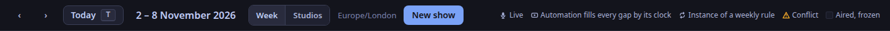
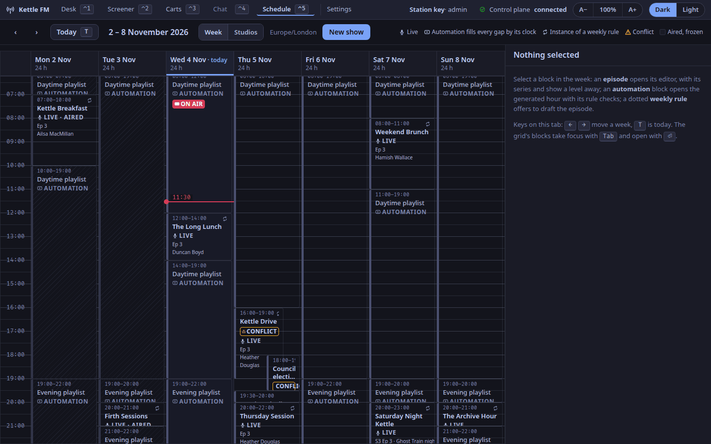
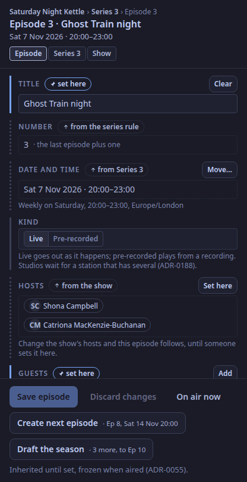
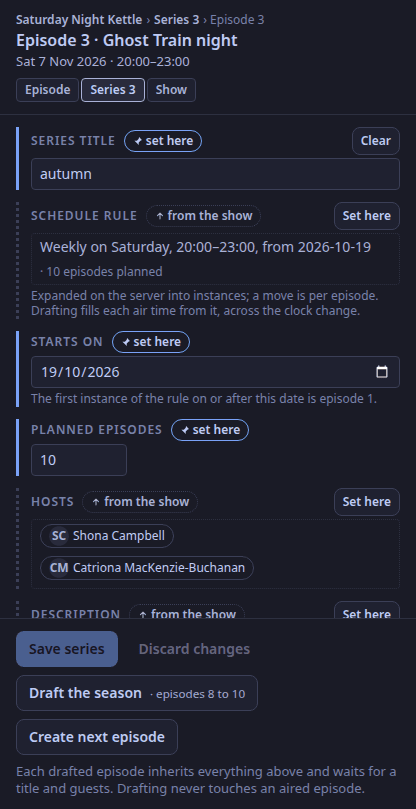
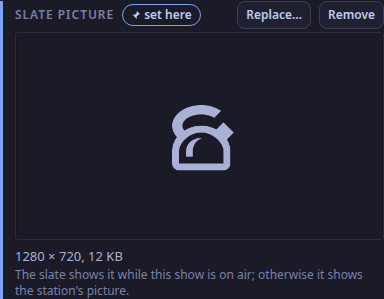
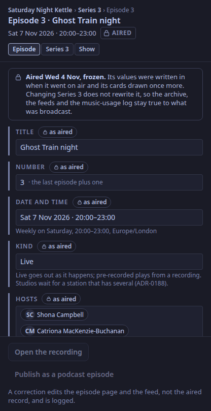
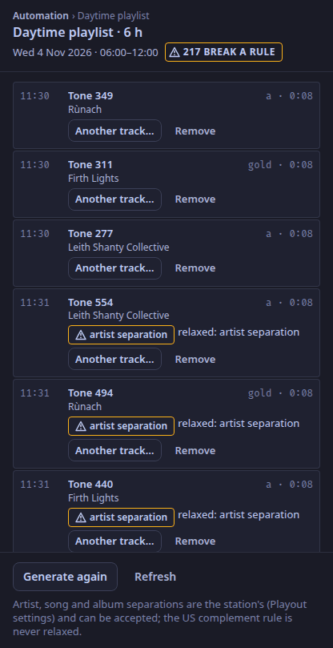
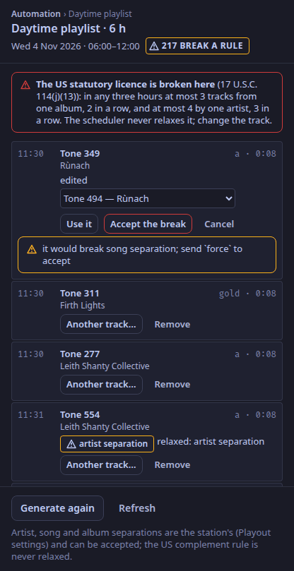
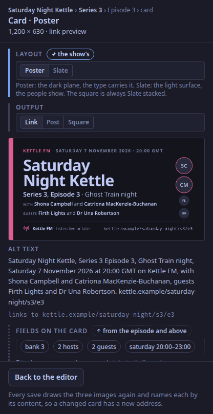

The Schedule tab (`⌃5`): the toolbar, the week grid on the left and the editor column on the right (ADR-0021, ADR-0045, ADR-0055).
Each panel is a heading below, named as it is on screen (ADR-0070).
The grid is drawn by a calendar library behind a small adapter, so another library could drop in without the rest of the tab changing; it is drawn with Event Calendar (ADR-0185).

Times on the grid are the station's wall clock in its own zone (chosen once in **Settings**; until then the station offers `publishing.zone` and asks an admin to confirm it), whatever the machine's zone: a clocks-back Sunday has 25 hours and says so in its header; a clocks-forward one has 23.

## `calendar.frame`

Not drawn on the tab: the app's own frame, `studio.frame`, is above every tab.

## `calendar.toolbar`

| Part | What it does |
|---|---|
| `‹` `›` (`←` `→`) | the previous and next week |
| **Today** (`T`) | back to this week |
| the range | the week's dates |
| **Week**, **Studios** | the view; **Studios** is **[planned](/docs/reference/release-one-status/)** and says it is not in this build: studios as columns wait for a studio on each show |
| the zone | the station's time zone, and its clock change if one falls this week |
| **Choose the time zone…** | shown to an admin until someone has chosen the station's zone; opens Settings |
| **New show** | the new-show form in the editor column |
| the legend | Live, automation, an instance of a weekly rule, conflict, aired |

## `calendar.week`

A time axis and seven days; every block is placed by its start and length, in station time.

| A block says | When |
|---|---|
| the show's name, its times, a left band in its colour (ADR-0066), LIVE, `Ep 212` or `S3 Ep 7 · its title`, the hosts | an episode |
| the repeat glyph by the time | the show has a weekly rule and this is one of its instances |
| MOVED · was 07:00 (or · was Mon 07:00, moved to another day) | an instance moved off its rule's time this week |
| CONFLICT, on both | two episodes overlap in time |
| ON AIR | the block the station's clock is inside now |
| LIVE · AIRED on a dimmed surface | it has gone out: aired episodes are frozen (ADR-0055) |
| NOT DRAFTED and *Weekly rule · draft it*, dotted | a show's weekly rule where no episode is drafted yet; select it to draft the episode |
| AUTOMATION, hatched, named by its clock | every gap, filled by the clock that runs each local hour (ADR-0045); it never conflicts, it yields |

Every episode's block says LIVE, whatever its kind: the grid does not yet show a pre-recorded episode differently.
A block takes focus with `Tab` and opens with `⏎`; a future episode can be dragged or resized with the pointer, and snaps back with the reason if the control plane refuses.

## `calendar.episode-editor`

The selected episode: its path (show › series › episode), its date and a TONIGHT, ON AIR or AIRED chip, and a level switch (Episode, Series n, Show).
The same column, under the same name, holds the new-show form, a dotted weekly rule's **Draft this episode**, and *Nothing selected*.
Every field carries one of three markers:

- **inherited** (dotted; "from Series 3", "from the show", "from the series rule"): the field follows the level above by reference until **Set here**;
- **set here** (an accent border): this episode's own, with **Clear** or **Reset to series**;
- **as aired** (a lock): read-only, the value as broadcast.

Fields: title, number (from the rule, the last plus one), date and time (**Move…** is the keyboard alternative to dragging; **Back to the rule** puts a moved instance back), kind (**Live** or **Pre-recorded**, ADR-0188; every episode is live until marked, and playout does not yet treat a pre-recorded one differently), hosts, guests (always per episode), description, tags, artwork and card layout (**Card…** opens the card editor), and **Up next on the player**, the station setting that is off for a US statutory webcaster.
The foot: **Save episode** (only what changed) and **Discard changes**, **Create next episode** (its number and time from the rule, across the clock change) and **Draft the season** (every planned episode not yet drafted).
**On air now** freezes the episode as broadcast and draws its cards once more. Nothing freezes an episode by itself yet: the desk going on air does not, so someone presses it when the show goes out.

## `calendar.series-editor`

The series level: the title, the schedule rule (weekly on a day, a start, a length; **Reset to show** inherits the show's again), the start date, the planned count, the hosts, the description and the tags, each inherited from the show until set; which episodes have aired, are drafted, or wait; **Save series**, **Discard changes**, **Draft the season** and **Create next episode**.

## `calendar.show-still`

The **Slate picture** field on the show level of a saved show (ADR-0200): a preview of the picture the video slate shows while this show is on air, its size, **Choose…** or **Replace…** a PNG or JPEG, and **Remove**.
The station reads the picture in its sandbox and says why when it refuses one.
A show without a picture of its own gets the station's on the slate.

## `calendar.aired-episode`

An aired episode, frozen: every field as broadcast, with the lock, and the note that changing the series does not rewrite it.
**Correct the public text…** on the **Corrections** field opens a form with the title, description, hosts, guests and tags as aired and a required **Why**; **Publish correction** sends only what you changed (ADR-0177).
Under it, the corrections log: when, who, why, and each field as it was and as it became.
The **Music used** line points at the per-play log for its hours.
**Open the recording** and **Publish as a podcast episode** are shown but greyed out: both are **[planned](/docs/reference/release-one-status/)**.

## `calendar.log-editor`

Select an automation block: the generated hours it stands for, item by item, with the rule each breaks in the scheduler's words.
**Another track…** offers the library by category, and **Use it** puts the choice in; the control plane checks it against the rules and refuses with the reason.
The station's own separations can be accepted with **Accept the break**; a break of the US statutory licence (17 U.S.C. 114(j)(13)) is never accepted.
**Remove** takes an item out; **Generate these hours** fills an empty future hour (**Generate again** once it has items), and **Refresh** reads the log again.
The control plane keeps the log generated 26 hours ahead by itself.

## `calendar.card-editor`

The card for the selected episode or show: Poster or Slate (ADR-0067), the output (link, post, square), the preview drawn by the control plane from the same fields a save would use, the alt text in its fixed order, and the page the card links to (ADR-0056).
A field the renderer refuses, such as a show name that does not fit even at its floor, is shown with the field named; the save would be refused the same way.
**Keep for the show** saves a tried layout as the show's.
