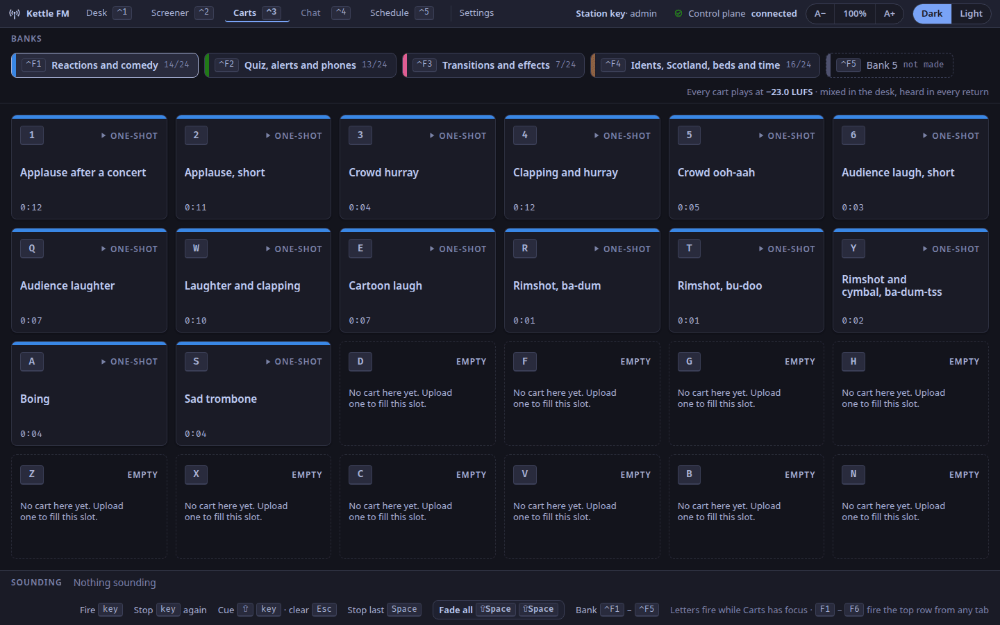
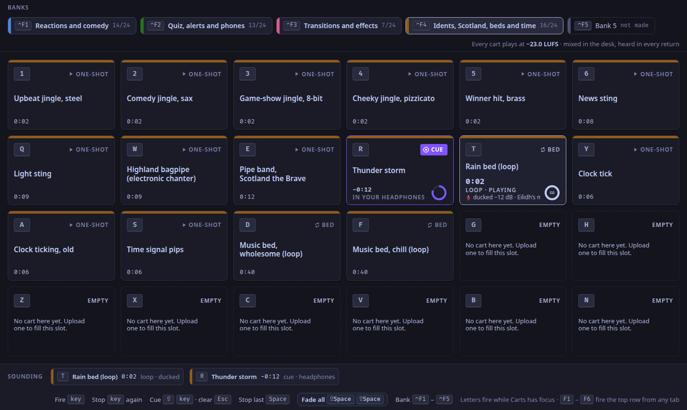

The Carts tab (`⌃3`): a strip of banks, 24 carts under the left hand of the keyboard, and what is sounding.

Each panel is a heading below, named as it is on screen (ADR-0070).
Carts sound in the desk (ADR-0117): listeners, the presenter and the guests all hear them, the profanity delay holds them, and `⇧` with a key cues one into the presenters' and DJs' headphones only (see [Carts in the desk](/docs/reference/desk-carts/)).
The demo banks are the repository's demo pack, `assets/carts-demo/`: 50 openly licensed sounds (CC0, public domain or CC BY) in four suggested banks, with their credits in `CREDITS.md` and `NOTICES.md`. The files were cut to about −16 LUFS; like every cart, each is brought to the station's cart loudness (`carts.loudness_lufs`, −23 LUFS by default) when it is loaded ([The media worker](/docs/reference/desk-carts/#the-media-worker)).

## A cart wall per show

From 1.0.2 a show can have banks of its own beside the station's, so the next DJ can set up their carts while another show is on air without touching it.
The station's banks are shared by every show; a show's own are its alone.
Both are numbered 1 to 5, apart from each other.

A studio window works with the station's banks and one show's own:

- **a live window**, the show on air; between shows, the show last on air (the show the step comes from);
- **a preparing window**, the show it prepares: your show that comes on next, else your first ([Prepare your show while another is on air](/docs/how-to/prepare-your-show/)).
  A window with no show of its own (an admin preparing, say) has the station's banks alone.

The wall keeps its five tabs, `⌃F1` to `⌃F5`.
Tab *N* is the show's own bank *N* when the show has made one, and the station's bank *N* otherwise.
Each tab says whose it is, **station** or **show**, beside its name and its count; its tooltip says the same in words, and for a show's bank which station bank it takes the place of in that show's windows (the station's bank stays as it was for every other show).
`F1` to `F6` fire the top row of the tab the window shows, whoever's it is; turning to another tab never stops a cart.

A cart in a show's own bank fires only while that show is the show the step comes from.
Anything sounding can be stopped from any live window, and **Sounding** names a cart from another show's bank too, without a key.
A show's banks are made and filled through the station's API for now ([Carts in the desk](/docs/reference/desk-carts/#the-control-planes-cart-routes)): the station key, an admin, a producer or the show's presenter may.

## `carts.frame`

Not drawn on the tab: the app's own frame, `studio.frame`, is above every tab.

## `carts.wall`

The bank strip over six by four carts. A cart's place is its key: `1`–`6`, `Q`–`Y`, `A`–`H`, `Z`–`N`.

| A cart says | When |
|---|---|
| its key, its mode (one-shot, bed, sweeper), its name and its length, and its ramp to the vocal if it has one | idle |
| the time left in bold, *playing*, and a ring that empties | playing once |
| the same in amber, *ending* | under 5 s left |
| how long it has run, *loop · playing*, an ∞ ring | a bed, which loops until stopped |
| *ducked −12 dB*, and why | a bed on air while a microphone is open or a sweeper plays |
| CUE in violet, the time left, *in your headphones* | cued: the presenters and DJs hear it, nobody else does |
| *fading* | stopped, during its 300 ms fade |
| FILE MISSING and "Re-link it in the library. The key does nothing." | its file is gone |
| *empty* and "No cart here yet. Upload one to fill this slot." | an empty slot |

| Key | Does |
|---|---|
| a cart's key | fires it; again, fades it out over 300 ms |
| `Space` | fades the cart started last on air (a cue is `Esc`'s) |
| `⇧Space` twice within 3 s | fades everything sounding |
| `⌃F1`–`⌃F5` | switches bank (the show's own or the station's, as the tab says), on any tab but not from a text field (ADR-0104); what sounds keeps sounding |
| `F1`–`F6` | fires the current bank's top row, on any tab (the desk's glance) |
| arrows, then `⏎` | moves between carts without firing, then fires |
| `⇧` and a key | cues it in the presenter's headphones (presenters' and DJs' only); again, takes it out |
| `Esc` | takes every cued cart out of the headphones |

Letters fire only while the Carts tab has focus; no cart key, `Space` or `⌃F1`–`⌃F5` fires from a text field (ADR-0104).

## `carts.bank.1`

Bank 1 (`⌃F1`): the show's own bank 1 if it has made one, else the station's; the tab says **show** or **station**. A bank's colour is its slot in the cart palette, and its show keeps that colour everywhere (ADR-0066); the same for `carts.bank.2` to `carts.bank.5`.

## `carts.bank.2`

Bank 2 (`⌃F2`).

## `carts.bank.3`

Bank 3 (`⌃F3`).

## `carts.bank.4`

Bank 4 (`⌃F4`).

## `carts.bank.5`

Bank 5 (`⌃F5`).

## `carts.sounding`

Everything sounding, from any bank, with time left; the keys; and **Fade all** (`⇧Space ⇧Space`), which arms on the first press and says *Fade all?* with its countdown.
