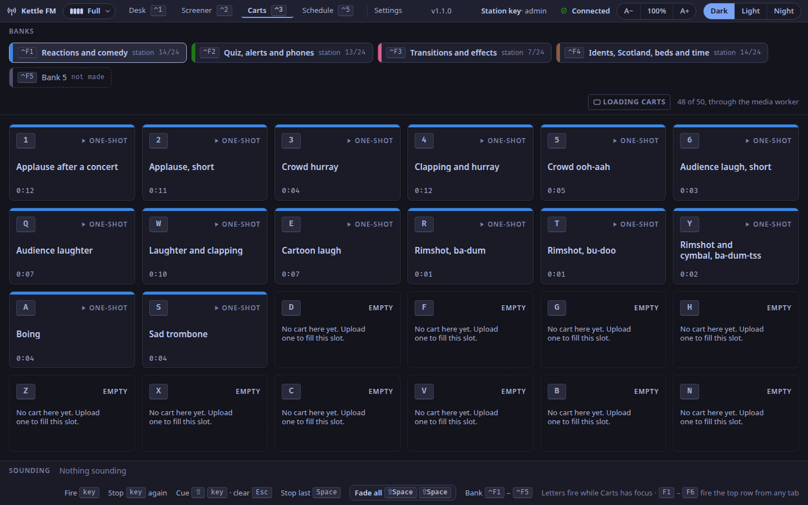
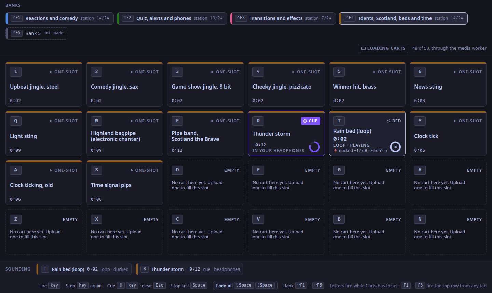

The Carts tab (`⌃3`): a strip of banks, 24 carts under the left hand of the keyboard, and what is sounding.

Each panel is a heading below, named as it is on screen (ADR-0070).
Carts sound in the desk (ADR-0117): listeners, the presenter and the guests all hear them, the profanity delay holds them, and `⇧` with a key cues one into the presenters' and DJs' headphones only (see [Carts in the desk](/docs/reference/desk-carts/)).
The demo banks are the repository's demo pack, `assets/carts-demo/`: 50 openly licensed sounds (CC0, public domain or CC BY) in four suggested banks, with their credits in `CREDITS.md` and `NOTICES.md`. The files were cut to about −16 LUFS; like every cart, each is brought to the station's cart loudness (−16 LUFS on a station installed with 1.3.3 or later, −23 on one from before: [The carts' loudness](/docs/reference/desk-carts/#the-carts-loudness)) when it is loaded ([The media worker](/docs/reference/desk-carts/#the-media-worker)).

## A cart wall per show

From 1.0.2 a show can have banks of its own beside the station's, so the next DJ can set up their carts while another show is on air without touching it.
The station's banks are shared by every show; a show's own are its alone.
Both are numbered 1 to 5, apart from each other.

A studio window works with the station's banks and one show's own:

- **a live window**, the show on air; between shows, the show last on air (the show the step comes from);
- **a preparing window**, the show it prepares: your show that comes on next, else your first ([Prepare your show while another is on air](/docs/how-to/prepare-your-show/)).
  A window with no show of its own (an admin preparing, say) has the station's banks alone.

The wall keeps its five tabs, `⌃F1` to `⌃F5`.
Tab *N* is the show's own bank *N* when the show has made one, and the station's bank *N* otherwise.
Each tab says whose it is, **station** or **show**, beside its name and its count; its tooltip says the same in words, and for a show's bank which station bank it takes the place of in that show's windows (the station's bank stays as it was for every other show).
`F1` to `F6` fire the top row of the tab the window shows, whoever's it is; turning to another tab never stops a cart.

A cart in a show's own bank fires only while that show is the show the step comes from.
Anything sounding can be stopped from any live window, and **Sounding** names a cart from another show's bank too, without a key.
A show's banks are made and filled from the wall itself from 1.2.1 ([Add your own cart](/docs/how-to/add-your-own-cart/)), or through the station's API ([Carts in the desk](/docs/reference/desk-carts/#the-control-planes-cart-routes)): the station key, an admin, a producer or the show's presenter may.

## `carts.frame`

Not drawn on the tab: the app's own frame, `studio.frame`, is above every tab.

## `carts.wall`

The bank strip over six by four carts. A cart's place is its key: `1`–`6`, `Q`–`Y`, `A`–`H`, `Z`–`N`.

| A cart says | When |
|---|---|
| its key, its mode (one-shot, bed, sweeper), its name and its length, and its ramp to the vocal if it has one | idle |
| the time left in bold, *playing*, and a ring that empties | playing once |
| the same in amber, *ending* | under 5 s left |
| how long it has run, *loop · playing*, an ∞ ring | a bed, which loops until stopped |
| *ducked −12 dB*, and why | a bed on air while a microphone is open or a sweeper plays |
| CUE in violet, the time left, *in your headphones* | cued: the presenters and DJs hear it, nobody else does |
| *fading* | stopped, during its 300 ms fade |
| FILE MISSING and "Its sound is gone. Edit this cart to put it back. The key does nothing." | its file is gone from the station |
| *empty* and **Add a cart** (with the pointer or the focus on it, "Press *its key*, or drop a sound here."; on air, "Press this pad, or drop a sound here.") | an empty slot of a bank this window may change: the pad opens [`carts.edit`](#cartsedit) |
| *empty* and "No cart here yet." | an empty slot of a show's own bank that is not this window's to change |

From 1.2.1 a cart that is not sounding has a small **Edit** button in the corner of its pad, where the ring is while it sounds; a sounding cart is not offered for change.
The button is one tab stop after its pad, and only for the pad the focus is on, so the wall stays 24 stops long.
A sound dragged over the window marks every pad as a place to drop it; dropped on a pad it opens `carts.edit` on that slot with the sound in hand, and adds, replaces or fires nothing by itself.

| Key | Does |
|---|---|
| a cart's key | fires it; again, fades it out over 300 ms |
| `Space` | fades the cart started last on air (a cue is `Esc`'s) |
| `⇧Space` twice within 3 s | fades everything sounding |
| `⌃F1`–`⌃F5` | switches bank (the show's own or the station's, as the tab says), on any tab but not from a text field (ADR-0104); what sounds keeps sounding |
| `F1`–`F6` | fires the current bank's top row, on any tab (the desk's glance) |
| arrows, then `⏎` | moves between carts without firing, then fires |
| an empty slot's key, or `⏎` on it | opens **Add a cart** on that slot (from 1.2.1) while nothing is on air, and in a preparing window; on air it only says the slot is empty, and the pad's own press or a dropped sound adds; `F1`–`F6` from another tab only say the slot is empty |
| `Tab` from a cart's pad, then `Space` or `⏎` | its **Edit** (from 1.2.1); on that button the two keys press it and neither stop nor fire a cart |
| `⇧` and a key | cues it in the presenter's headphones (presenters' and DJs' only); again, takes it out |
| `Esc` | takes every cued cart out of the headphones |

Letters fire only while the Carts tab has focus; no cart key, `Space` or `⌃F1`–`⌃F5` fires from a text field (ADR-0104).

## `carts.bank.1`

Bank 1 (`⌃F1`): the show's own bank 1 if it has made one, else the station's; the tab says **show** or **station**. A bank's colour is its slot in the cart palette, and its show keeps that colour everywhere (ADR-0066); the same for `carts.bank.2` to `carts.bank.5`.

## `carts.bank.2`

Bank 2 (`⌃F2`).

## `carts.bank.3`

Bank 3 (`⌃F3`).

## `carts.bank.4`

Bank 4 (`⌃F4`).

## `carts.bank.5`

Bank 5 (`⌃F5`).

## `carts.toast`

The wall's notice, from 1.2.1: what the last press did (*Cart added*, with what the station measured) or why it did not (the station's own sentence).
It takes the place of the strip's status line, at the right of the banks, and no more room than that line, so nothing moves and no pad is covered; its tooltip holds the whole sentence, and `Esc` puts it away.
FAULT, when the desk does not answer, stays beside it.
Before 1.2.1 a note said while the Carts tab was open was not shown on it.

## `carts.edit`

The dialog **Add a cart** or **Edit cart**, from 1.2.1 ([Add your own cart](/docs/how-to/add-your-own-cart/)).
Under its heading it names the key and whose bank it writes to.

| Part | Does |
|---|---|
| **Sound** | **Choose a sound…** or a file dropped anywhere on the window: WAV, FLAC, MP3, Ogg or M4A, within the station's limits, which the dialog prints. For a cart that exists it says its length, what the station measured and the gain it plays at; **Replace the sound…** stages another, which replaces the old one on Save; **Keep the old sound** undoes that |
| **Name** | 1 to 120 characters; a chosen file offers its own name until the field is typed in |
| **Plays as** | one-shot, bed or sweeper |
| **Second line**, **Credit or licence**, **Ramp to the vocal** | optional; a ramp is in seconds and ends before its cart does |
| **Key** | for a cart that exists: its own key and the bank's empty slots; choosing another moves the cart |
| **Add cart** / **Save** (`⏎`) | sends the sound (the dialog says it is on its way, and **Stop** ends the wait), or changes the cart without sending its sound again |
| **Remove cart…** | asks first, with **Keep it** in focus; then empties the slot and deletes the sound |

A refusal is the station's own sentence, shown in the dialog with what was typed kept.
A file larger than the station takes is refused before it is sent.
`Esc` first leaves a text field; a second `Esc` closes the dialog. While it is open only `⌃T`, the held talkback, reaches the desk.

## `carts.bank-edit`

The dialog **Make bank *N*** or **Edit bank *N***, from 1.2.1: the bank's name (1 to 80 characters) and its colour, one of the twelve slots of the cart palette.
Its heading says whose bank it is: the station's, shared by every show, or the show's own.
Making a bank on a tab that has none, in a window whose show this account may change, it asks which of the two it is to be.
For a station bank in a show's window it offers **Make *the show*'s own bank *N***; for a show's own bank, **Remove bank…**, which asks first and takes the bank's carts and their sounds with it.
The strip's **Edit bank…** or **Make bank *N*…** opens it; so does the first cart added to a tab with no bank, and the cart dialog follows.

## `carts.pack`

The dialog **Load the default pack**, from 1.2.1, opened by **Default pack…** beside the tabs ([Add your own cart](/docs/how-to/add-your-own-cart/#load-the-default-pack-again)).

| Part | Does |
|---|---|
| **Which of its banks** | one of the pack's banks, each with its count of sounds, or all of them, each into the station's bank of its own number |
| **Into** | the station's bank the sounds go into, each named with what it holds: so many carts, *empty* or *not made* |
| **What happens** | worked out before anything is asked, a line for each station bank: an empty bank is loaded directly; in a bank that holds carts only default sounds nobody changed are replaced, those the pack has no sound for go, and a cart a person added or changed stays, with the pack's sound for its key left out |
| the button | names it: **Load *n* sounds**, or **Replace *n* and load *n*** |

The load is the station's own: the sounds go through the media worker one by one, the strip counts them (*Loading carts 3 of 14*), and the wall says when they are loaded.
The pack goes into the station's banks only. A station with no pack says so here.

## `carts.sounding`

Everything sounding, from any bank, with time left; the keys; and **Fade all** (`⇧Space ⇧Space`), which arms on the first press and says *Fade all?* with its countdown.
