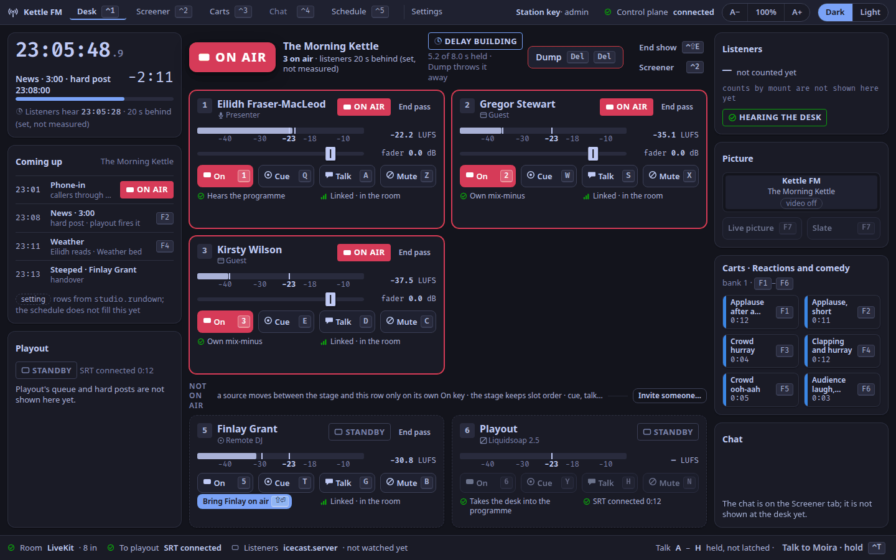
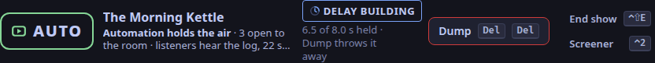
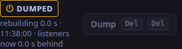
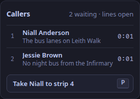

The desk is the studio app's first tab (`⌃1`); its layout is the one the design called desk B, the focus (ADR-0061).
Time is on the left, what is on air in the middle, the station on the right, and the station's health along the foot.
In plain words: the **top bar** (the station's name, the step, the tabs, who you are), the **left panel** (the clock, Coming up, playout), the **stage** in the middle (the lamp and the people), the **right panel** (listeners, the picture, carts, the chat) and the **status bar** along the foot.

The show's step decides which of these panels are drawn ([Choose how much of the studio a show uses](/docs/how-to/choose-a-step/#the-desk-at-each-step), ADR-0271): a panel says below when it belongs to a step.
The picture is the desk at Full.

Each heading below is a panel's name, as it is on screen (ADR-0070).
Hover over a panel's header, or focus it with the keyboard, to see its name and one line on what it is; a bug report asks for the name.
The name never covers a live control and never takes a key.

## `desk.clock`

The studio clock: room time with tenths of a second, and back-timing to the next hard post in the rundown, with a bar that fills as it nears.

Under it, the time listeners are hearing, as an estimate: *about 23 s behind (an estimate)* (ADR-0103, ADR-0165, ADR-0272).
No honest end-to-end measurement exists: a marker cannot travel in the listener stream (a metadata change chains the Ogg stream and drops the mount), and a listener's own player buffers on top of what the station sends.
So the line is made of parts, and says which it reads:

- **the profanity delay**, read live from the desk (8 s when full, by default, 0 just after a dump);
- **what the listener process holds of playout's feed**, read live from it every five seconds (about 0.5 s; it grows on a loaded host, which is how to see a backlog);
- **the rest**, the setting `studio.listener_delay_ms` (15 s by default, less the 0.5 s the live reading replaces): the stream's own hold and each listener's player.

Under the line, a small note spells it out, for example *Read now: 8.0 s profanity delay, 0.5 s in the listener process; about 14.5 s more is set, not read*.
If the listener process does not answer, only the desk's part is read.
The rehearsals measured about 22.5 s on loopback and 11.8 to 18.4 s over the internet; set `studio.listener_delay_ms` from such a measurement for your own station.
A number that was read in full would drop the word *estimate*; nothing reads the whole path yet.

## `desk.rundown`

Coming up: the next rows of the show, with their times, which is a hard post, and the cart key each needs.
The rows come from the setting `studio.rundown` (ADR-0102, [Set the show](/docs/how-to/set-the-show/)); the [Schedule tab](/docs/reference/surfaces/calendar/) does not fill them, and rows from the schedule are [planned](/docs/reference/release-one-status/#not-in-release-one).

## `desk.playout`

Playout (Liquidsoap): whether it is connected to the desk, and for how long.
While listeners hear the default loop WeaveSignal ships, because the station has no fallback files of its own, a **Default loop** chip and a line say so; adding fallback files takes it away ([Playout](/docs/reference/playout/#the-default-loop)).
While playout is down the panel offers **Restart playout** (`⌃R`), which only shows a note in 1.0.0: restart Liquidsoap on the server ([When the lamp says PLAYOUT DOWN](/docs/how-to/playout-down/)).
Playout's queue and hard posts are not shown ([planned](/docs/reference/release-one-status/#not-in-release-one)).

## `desk.stage`

The stage: the show's title, the master lamp and the delay above, **End show** (`⌃⇧E`, built for 1.0.2: [End the show](/docs/how-to/end-the-show/)) and **Screener** (`⌃2`), and every source the room has on air, as tiles.
A source moves onto the stage only on its own On key, and the stage keeps slot order (ADR-0061).
While playout is down the stage says *Room alive*, with how many sources are open to the room; in auto mode it says *Automation holds the air*, and the open sources say OPEN.

## `desk.air` and `desk.end-show`

The small button under the lamp hands the air to automation (**Hand to automation**) or takes it back (**Take the air back**); it sets the station's mode, which is the playout setting `mode` (`live` or `auto`, ADR-0045), and nothing else.
It asks first when someone is open, because they would be cut off or put on air.
It is greyed out on a station without the playout layer, with the reason beside it.
`desk.end-show` is the dialog it shares with **End show** (`⌃⇧E`): `⏎` confirms, `Esc` keeps going ([End the show](/docs/how-to/end-the-show/)).

## `desk.lamp`

The master lamp: ON AIR when listeners can hear the room, or what they hear instead: STANDBY, PLAYOUT DOWN, or FAULT.
In auto mode, when automation holds the air and the desk never reaches listeners, it says AUTO instead: a hollow lamp in its own mint colour with a play mark (ADR-0183).
Hover over the word, or reach it with `Tab`, for one sentence on what it means and what to do.
See [The state vocabulary](/docs/reference/states/) for every state word drawn in both themes, and [the rules for the master lamp](/docs/reference/states/#the-master-lamp-desklamp).

## `desk.delay`

The profanity delay, its length and the two-press dump (`Del Del`).
The dump throws away whatever the delay holds, even while it is still building back up, so some protection is never refused; the ring shows how many seconds are held (ADR-0166).
Only a delay that holds nothing, such as the moment after a dump or a desk start, cannot be dumped.
The panel says *Delay off* when the desk runs with no delay.

## `desk.tile.1`

Source 1 as a tile: the person's name and role, their state word, an R128 loudness meter with its scale and the −23 LUFS target, a fader drawn at 0.0 dB, and the four keyed buttons, On, Cue, Talk and Mute, with their keys printed on them.
Under them, what the person hears and whether their link reaches the desk (LINK DEGRADED when it does not).
A presenter's, DJ's or guest's tile has **End pass** (two presses, ADR-0119); a caller's has **Drop** (`⌃D ⌃D`).
Slot 1 is the presenter's.
Not in 1.0.0 ([planned](/docs/reference/release-one-status/#not-in-release-one)): a working fader (the drawn one does not move), link loss and jitter figures, and a camera picture in the tile (the cameras' pictures are in `desk.picture`).

## `desk.tile.2`

Source 2: a guest.

## `desk.tile.3`

Source 3: a guest.

## `desk.tile.4`

Source 4: a caller, once the screener sends one.
A caller sent to the desk shows READY, and a toast offers *Cue* with the slot's cue key (`R` in slot 4) or *Not now* (`Esc`).
If slot 4 is taken, a caller takes the first free slot of 3, 2, 5 and 1, and their keys are that slot's.

## `desk.tile.5`

Source 5: a DJ.

## `desk.tile.6`

Source 6: playout, with its SRT link to the desk.
Playout as a desk source with its own switch is [planned](/docs/reference/release-one-status/#not-in-release-one); its On, Cue and Mute keys show a note.

## `desk.step-note`

At Solo only: the guest's empty seat, beside your tile.
It says once why the desk is quiet (*Just you on this show*: guests, callers and the screener's seat are switched off, so nobody can arrive unannounced) and offers **Move up a step…**, which opens the step dialog.
Before anyone holds the presenter's seat, the stage reads *You are not in the room yet*, with **Join with my microphone…**: at Solo, and above it to an admin, a producer or the show's presenter.

## `desk.waiting`

Not on air: the sources in the room that are cued or standing by, and playout's tile (slot 6), with the move rule.
A source here keeps its slot and its keys (ADR-0096).
It arrives at the Guests step, with **Invite someone…** at its head; at Solo there is one tile, and it stays on the stage on air or off.

## `desk.invite`

The invitation dialog: a name and a role, then the link to send, **Copy link** and how long it lasts.
A DJ joins off air; a guest or a presenter is on air the moment they join.
The roles follow the show's step: a guest and a presenter from Guests, the next show's DJ at Full.
At Solo it is your own microphone link instead, from **Join with my microphone…**, with **Open in browser**.

## `desk.callers`

At the Callers step only: who is waiting on the phone lines, what about and for how long, the longest wait first; three rows at most, then a count.
**Take … to strip 4** (`P`) brings the caller who has waited longest to strip 4, off air.
The strip holds one caller, so the button waits while it is taken.
At Full the queue is the Screener tab's, and this panel is not drawn.

## `desk.audience`

Listeners now: the number connected to the station's listener process, counted every five seconds (ADR-0272).
Under it, the count by mount, such as *programme.opus 140 · programme.mp3 12*; the figure is every mount together.
When it cannot be counted, the panel says why in words (*Not counted: the listener process does not answer on its status address*), and it says so whether or not the station has the playout layer.
With edges or a CDN set up, the figure is the origin's: each edge counts as one listener, and the listeners on an edge are not added.
Under the figure, a chip says what listeners hear: HEARING THE DESK, PLAYOUT DOWN, or ON AUTOMATION while the station is in auto mode ([The state vocabulary](/docs/reference/states/)).
When video is on, more than about 500 are connected and the station has no CDN or edges configured (no steering edges, and `join.hls_url` on the station itself), the panel also warns that video needs a CDN ([Put Bunny in front of the station](/docs/how-to/use-bunny/), ADR-0017).

## `desk.picture`

The programme picture: the live picture or the slate, switched with `F7`.
Under the switch are a small picture of each camera the desk sees, the one on air marked (refreshed every two seconds), and the slate's picture: **Choose a slate picture** takes a PNG or JPEG for the slate to show above its words, **Remove** takes it away ([Video in the desk](/docs/reference/desk-video/#the-slates-picture)).
With video off the panel says so and the switch is disabled.

## `desk.carts`

The glance: the top row of the show's cart bank, fired with `F1` to `F6` from any tab.
The cart wall is the Carts tab (`⌃3`): see [Cart wall](/docs/reference/surfaces/carts/) (ADR-0020).

## `desk.chat`

The chat to read, at every step: the room's last messages, newest at the foot.
When held messages or reports wait for a moderator, one line says so (*1 report, 2 held messages need a moderator*), and where to go: the Screener tab, behind **Show everything** below Full.
The chat's own rules keep acting at every step (ADR-0274).
Until 1.0.2 the panel only said the chat was on the [Screener tab](/docs/reference/surfaces/screener/); writing in the chat and moderating it are still there.

## `desk.toast`

The reserved slot a toast takes, in place of the chat glance, so nothing moves and no control is covered.
One toast at a time, most urgent first:

1. a note you asked for, such as a key that is not in 1.0.0;
2. *Playout down · room alive*, with how long the link has been down;
3. a caller ready for you, with *Cue* and *Not now*;
4. a source on air whose link is degraded or who left the room, with *Mute* and *Keep them on*;
5. the latest notice for the desk, for 20 s.

## `desk.status`

The station's health in one line: the room and how many people are in it, the link to playout (with **Restart** `⌃R`, a note only, while it is down), the listener server, a degraded link if any, the talk rule (talk keys `A` to `H` are held, not latched), and **Talk to** the screener, held, as `⌃T` is.
The listener server is shown as not watched; its health and the logger on the desk are [planned](/docs/reference/release-one-status/#not-in-release-one).
