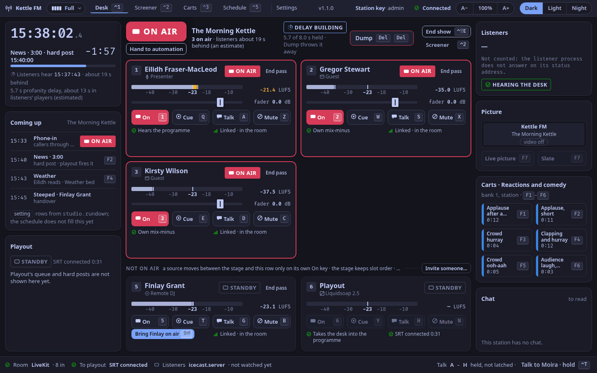
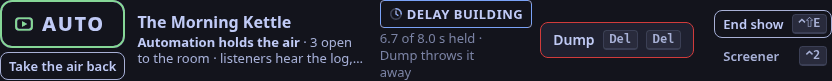
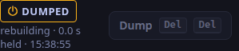
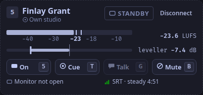
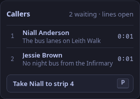

The desk is the studio app's first tab (`⌃1`); its layout is the one the design called desk B, the focus (ADR-0061).
Time is on the left, what is on air in the middle, the station on the right, and the station's health along the foot.
In plain words: the **top bar** (the station's name, the step, the tabs, who you are), the **left panel** (the clock, Coming up, playout), the **stage** in the middle (the lamp and the people), the **right panel** (listeners, the picture, carts, the chat) and the **status bar** along the foot.

The show's step decides which of these panels are drawn ([Choose how much of the studio a show uses](/docs/how-to/choose-a-step/#the-desk-at-each-step), ADR-0271): a panel says below when it belongs to a step.
The picture is the desk at Full.

Each heading below is a panel's name, as it is on screen (ADR-0070).
Hover over a panel's header, or focus it with the keyboard, to see its name and one line on what it is; a bug report asks for the name.
The name never covers a live control and never takes a key.

## `desk.clock`

The studio clock: room time with tenths of a second, and back-timing to the next hard post in the rundown, with a bar that fills as it nears.

Under it, the time listeners are hearing and how far behind that is, as an estimate: *Listeners hear 16:00:55 · about 23 s behind* (ADR-0103, ADR-0165, ADR-0272; issue 17, built for 1.1).
Each panel of the desk states the figure once. The stage's line above says *listeners about 23 s behind (an estimate)*, and the delay panel beside it says what the profanity delay holds, not where listeners are ([`desk.delay`](#deskdelay)).
No honest end-to-end measurement exists: a marker cannot travel in the listener stream (a metadata change chains the Ogg stream and drops the mount), and a listener's own player buffers on top of what the station sends.
So the figure is made of parts, and one line under it names them, in one place only: *8.0 s profanity delay, 0.5 s buffer, about 14.5 s in listeners' players (estimated)*.

- **The profanity delay** is the station's own reading, live from the desk (8 s when full, by default, 0 just after a dump).
- **The buffer** is what the listener process holds of playout's feed, its own reading every five seconds (about 0.5 s; it grows on a loaded host, which is how to see a backlog).
- **In listeners' players** is the rest, the setting `studio.listener_delay_ms` (13 s by default, less the 0.5 s the buffer's reading replaces): the stream's own hold (the listener process holds the stream about 12 s before it serves it) and each listener's player. Nothing reads this part, so it alone is called *estimated*.

The two readings have one decimal (the station reads them to 0.1 s); the estimated part has none when it is whole (*about 13 s*).
If the listener process does not answer, its buffer is not named: *8.0 s profanity delay, about 13 s in listeners' players (estimated)*.
The rehearsals measured about 22.5 s on loopback and 11.8 to 18.4 s over the internet; set `studio.listener_delay_ms` from such a measurement for your own station.
A figure measured end to end would drop *about* and *(estimated)*: *21 s behind*; nothing measures the whole path yet.
A station before 1.1 does not send the parts, so the line itself keeps the label, *about 15 s behind (an estimate)*, as it did.

The API says the same in fields (`listener_delay` in `GET /api/v1/studio`): `basis` is `estimate` or `measured`, `read_ms` is what the station reads now (the profanity delay and the buffer), `set_ms` is what is only a setting, and they add up to `ms`. *Read* and *set* are the API's words; the desk does not use them.
Likewise the Listeners panel's `audience` carries `scope`, `origin` today: the listeners on this station's own listener process, every mount together.
Listeners on an edge or a CDN are not added (an edge's relay counts as one connection), and neither are video viewers on HLS.

### The schedule's line

When the next show has a host to bring on (ADR-0280), the line under the clock is the schedule's, and says what the station's rule at the post is doing:

- **Before the post:** *Steeped · the post 14:00:00*, counted down. A hard post in the rundown keeps the line while it is the nearer.
- **In the grace**, with a DJ on air and the next host standing by: *Kettle Drive takes the air*, the count, a bar in the warning colour, and *by the schedule 16:02:00*. The count turns amber in its last 30 seconds and red in its last 10, as every count on the desk does (below).
  An admin or a producer has **Hold**, a button with no key: the count stops for this handover, which is then by a press only.
- **Held:** *Handover held by shona · a press only*, with **Let it run** for an admin or a producer. The station names who holds it by their username; your own hold says *you*.
- **The next host has not connected:** *Heather has not connected. You keep the air.*
- **A late host**, with automation holding the air: *Steeped takes the air*, counted to the second the station puts them on air.
- **Standing by with nothing counted** (the grace is Off, or the count was stopped): *Finlay is standing by · a press only*.

### A count's last seconds

Every count on the desk turns **amber in its last 30 seconds and red in its last 10**: the clock's (the grace, the late count, the run-up to a post, a hard post), the late count on the tile and in the next show's card, the grace's and the late count's toasts, and a lost link's place, which then says what is left (*4:40 · place kept until 14:46 · 0:20 left*).
The colour is never the only sign. A small clock glyph, the count's mark, stands directly before the figure, on the figure's own line; the figure is heavier; and a screen reader is told *Last 30 seconds* or *Last 10 seconds*.
The mark is one shape at both levels and takes the level's colour, amber and then red. It is never the triangle: that shape means FAULT ([The state vocabulary](/docs/reference/states/)), and a count that runs out is the show going to plan.
A toast with a count keeps its own glyph, which is the same clock: the glyph takes the level's colour, and the toast's stripe goes amber and stays amber, so the toast never looks like a critical alert.
On the clock the figure itself takes the colour (large text, 3:1 or better in Dark, Light and Night); in the smaller places it stays in the ink, which meets 4.5:1 everywhere, and the mark and an edge on the strip carry the colour.
The figure's own digit decides: `0:30` is the first amber and `0:10` the first red. The colours are the status tokens the rest of the desk uses; nothing is added.

## `desk.rundown`

Coming up: the next rows of the show, with their times, which is a hard post, and the cart key each needs.
The rows come from the setting `studio.rundown` (ADR-0102, [Set the show](/docs/how-to/set-the-show/)); the [Schedule tab](/docs/reference/surfaces/calendar/) does not fill them, and rows from the schedule are [planned](/docs/reference/release-one-status/#not-in-release-one).

One row is the schedule's: the show whose post it is, when its host comes from a studio of their own (ADR-0280).
It says where the show comes from and how its source stands: *Steeped · Finlay Grant · own studio* with STANDBY, LINK LOST, or, once the post has come, NOT CONNECTED.
It carries the handover's button while there is a press to make for that source.

## `desk.playout`

Playout (Liquidsoap): whether it is connected to the desk, and for how long.
While listeners hear the default loop WeaveSignal ships, because the station has no fallback files of its own, a **Default loop** chip and a line say so; adding fallback files takes it away ([Playout](/docs/reference/playout/#the-default-loop)).
While playout is down the panel offers **Restart playout** (`⌃R` twice), which from 1.1 asks the station to restart it; in 1.0.0 it only showed a note ([When the lamp says PLAYOUT DOWN](/docs/how-to/playout-down/)).
Playout's queue and hard posts are not shown ([planned](/docs/reference/release-one-status/#not-in-release-one)).

## `desk.stage`

The stage: the show's title, the master lamp and the delay above, **End show** (`⌃⇧E`, built for 1.0.2: [End the show](/docs/how-to/end-the-show/)) and **Screener** (`⌃2`), and every source the room has on air, as tiles.
A source moves onto the stage only on its own On key, and the stage keeps slot order (ADR-0061).
While playout is down the stage says *Room alive*, with how many sources are open to the room; in auto mode it says *Automation holds the air*, and the open sources say OPEN.

## `desk.air` and `desk.end-show`

The button under the lamp (from 1.1 as wide as the lamp and as tall as **End show**'s button, with a tooltip, on hover and on the keyboard's focus, that says what the press does and [what automation is](/docs/how-to/end-the-show/#what-automation-is); before that a small 12 px one) hands the air to automation (**Hand to automation**) or takes it back (**Take the air back**); it sets the station's mode, which is the playout setting `mode` (`live` or `auto`, ADR-0045), and nothing else.
It asks first when someone is open, because they would be cut off or put on air.
Hand to automation is for a break and End show for the end of the slot: [When to use which](/docs/how-to/end-the-show/#when-to-use-which).
From 1.1 **End show**, at the right of the stage's head, is drawn as the same outlined button, with its key cap: of the two ways off the air, the proper way to end a show does not look the quieter. **Screener** beside it only changes the tab, and stays plain words.
It is greyed out on a station without the playout layer, with the reason beside it.
`desk.end-show` is the dialog it shares with **End show** (`⌃⇧E`): `⏎` confirms, `Esc` keeps going ([End the show](/docs/how-to/end-the-show/)).
Where the press gives automation the air, the dialog says under its list what automation is and plays, in the tooltip's words; the AUTO lamp's tooltip adds the same sentence to its own.
The lamp's tooltip opens under the button, not on it, so the button stays in reach.

## `desk.lamp`

The master lamp: ON AIR when listeners can hear the room, or what they hear instead: STANDBY, PLAYOUT DOWN, or FAULT.
In auto mode, when automation holds the air and the desk never reaches listeners, it says AUTO instead: a hollow lamp in its own mint colour with a play mark (ADR-0183).
Hover over the word, or reach it with `Tab`, for one sentence on what it means and what to do.
See [The state vocabulary](/docs/reference/states/) for every state word drawn in both themes, and [the rules for the master lamp](/docs/reference/states/#the-master-lamp-desklamp).

## `desk.delay`

The profanity delay, its length and the two-press dump (`Del Del`).
The dump throws away whatever the delay holds, even while it is still building back up, so some protection is never refused; the ring shows how many seconds are held (ADR-0166).
Only a delay that holds nothing, such as the moment after a dump or a desk start, cannot be dumped.
The panel says *Delay off* when the desk runs with no delay.
The line under the word says what the delay holds: *full · 8.0 s held*, *3.2 of 8.0 s held* while it builds, and *rebuilding · 3.2 s held* after a dump. How far behind listeners are is the stage's line and the clock's to say ([`desk.clock`](#deskclock)).

## `desk.tile.1`

Source 1 as a tile: the person's name and role, their state word, an R128 loudness meter with its scale and the −23 LUFS target, a fader drawn at 0.0 dB, and the four keyed buttons, On, Cue, Talk and Mute, with their keys printed on them.
Under them, what the person hears and whether their link reaches the desk (LINK DEGRADED when it does not).
A presenter's, DJ's or guest's tile has **End pass** (two presses, ADR-0119); a caller's has **Drop** (`⌃D ⌃D`).
On your own tile, as the presenter in the room through your own microphone link (**Join with my microphone…**), the tile says *You're in the room · linked* and the button is **Leave** (1.1): the same two presses, and the same as End pass for yourself. It takes you off air, takes you out of the room and closes your microphone link; the toast then says where the air is (who keeps it, automation, or on a station without the playout layer the fallback). A presenter who joined by someone else's invitation link, or a window on the station key, still has **End pass** on their tile.
Slot 1 is the presenter's.
Not in 1.0.0 ([planned](/docs/reference/release-one-status/#not-in-release-one)): a working fader (the drawn one does not move), link loss and jitter figures, and a camera picture in the tile (the cameras' pictures are in `desk.picture`).

## `desk.tile.2`

Source 2: a guest.

## `desk.tile.3`

Source 3: a guest.

## `desk.tile.4`

Source 4: a caller, once the screener sends one.
A caller sent to the desk shows READY, and a toast offers *Cue* with the slot's cue key (`R` in slot 4) or *Not now* (`Esc`).
If slot 4 is taken, a caller takes the first free slot of 3, 2, 5 and 1, and their keys are that slot's.

## `desk.tile.5`

Source 5: a DJ.

### A host's own studio as a tile

A host who presents from a studio of their own (ADR-0280) is a tile like any other, in slot 5 when it is free, else the first free of 1, 2 and 3, with that slot's four keys.
It arrives STANDBY under **Not on air**. Five things differ from a person's tile:

- **The role line** says **Own studio**; in a wide window the way in and the show follow (*Own studio · SRT · Steeped*), and its tooltip has them at every size, with the format.
- **The head's quiet button** is **Disconnect**, two presses and no key. It closes the connection and turns that key away for the rest of today's show; **Let back in** is on the key's row in Settings (`settings.hosts`).
- **The second readout** is the station's **leveller** (*leveller −7.4 dB*), on the fader's track with nothing at the middle and 12 dB either way. Nobody moves it. At either end the tile says the source is too quiet, or too loud, for the station to reach.
- **The lines** say whether their monitor link is open (*Monitor open* or *Monitor not open*; what their software sends is in the tooltip) and how long the link has held (*SRT · steady 4:51*, or *Icecast · steady 12:40 · about 2 s behind*).
- **Talk**, held, goes into the host's [monitor link](/docs/reference/public-pages/), as the voice of the presenter in the room. With the monitor link not open it is drawn off: *Finlay's monitor link is not open, so they would not hear you.*

**On**, **Cue** and **Mute** work as for a person.
An Icecast source on a show at Callers or Full carries a note: *Callers will hear Finlay about 2 s late. Use SRT for a show with callers.*

**A late host.** When the show's post has come, automation holds the air and the host's source is standing by, the station counts them on air (20 seconds by default) and the tile counts with it: *On air in 0:20 · by the schedule*.
**Not yet** stops the count, a button with no key. At Full the tile's handover button is **Go on air now** on `⇧⏎`: one press, and the source takes the air from automation.
Once the count was stopped the same button reads **Bring Finlay on air**. Below Full the handover is off, so the count and **Not yet** are there and the press is not.

**A lost link.** When a source on air stops arriving, its tile stays on the stage, dashed in the serious colour, and says LINK LOST with how long and until when its place is kept: *0:07 · place kept until 14:46*.
Nothing on it sounds, so **Cue** and **Mute** are drawn off. Once automation covers, a line says what listeners hear.
When their software reconnects, the tile says *Back on air once steady* and the station puts them back by itself; with someone else on air it says *Reconnected · standing by*, and their own **On** key puts them back.
When the place's time is up the tile leaves.
The strip's own **On** key, lit while the place is kept, is **Off air**: one press lets the place go at once, and the desk says where the air is (*Automation has taken the air*, when the station gave it the air with the press). If the host reconnects after that they stand by.
**Disconnect** also lets the place go, and turns the key away as ever.

**The handover.** With someone on air and the next show's source standing by, `⇧⏎` picks that source before any DJ waiting: **Bring Heather on air** (both sound together, each at their own level), then **Hand over to Heather**, which takes off air everyone presenting but her. The talk keys never pass to a source: it has no microphone in the room.

Not built yet: a count for a returning source ([Set up a host in their own studio](/docs/how-to/set-up-a-host-in-their-own-studio/)).

## `desk.tile.6`

Source 6: playout, with its SRT link to the desk.
Playout as a desk source with its own switch is [planned](/docs/reference/release-one-status/#not-in-release-one); its On, Cue and Mute keys show a note.

## `desk.step-note`

At Solo only: the guest's empty seat, beside your tile.
It says once why the desk is quiet (*Just you on this show*: guests, callers and the screener's seat are switched off, so nobody can arrive unannounced) and offers **Move up a step…**, which opens the step dialog.
Before anyone holds the presenter's seat, the stage reads *You are not in the room yet*, with **Join with my microphone…**: at Solo, and above it to an admin, a producer or the show's presenter.

While a host in their own studio has the air, the stage does not say that: the show is theirs.
The offer is then one quiet line, with words for the case: *Join to talk to Finlay or to hear a cue. Joining puts you on air.*, and a quiet **Join with my microphone…**.
It sits at the head of **Not on air**, beside **Invite someone…**; at Solo, which has no such row, it takes this seat.
The line says only what will happen. While automation holds the air (the lamp says AUTO), whoever joins is open to the room and is not heard, so the line ends *You join open to the room.* and not *on air*.
While the host's link is lost and their place is kept there is nobody to talk to. Once automation covers, the line reads *You join open to the room, and are on air when Finlay is back.*: the station brings a returning host back by itself and takes the air back with them, which puts you on air beside them.
In the seconds before that, and on a station without the playout layer, the desk still holds the air, and the line reads *Joining puts you on air. If Finlay reconnects, they then stand by.*

## `desk.next`

At Solo only, in the guest's empty seat: the next show's source from a host's own studio (ADR-0280).
Solo has no **Not on air** row and that host is no part of this show's step, so their source is one card and not a tile: **Next**, the show and its host, how it stands (STANDBY, or CUE), the way in and how long the link has held, its meter, and when the schedule brings it on.
It has **Cue**, on its strip's own key, and no **On**: at Solo the air passes by **End show** or by the schedule, and the strip's number says so.
A late host is counted in the card (*On air in 0:20 · by the schedule*), with **Not yet**.
With everything shown, or above Solo, the source is a tile.

## `desk.waiting`

Not on air: the sources in the room that are cued or standing by, and playout's tile (slot 6), with the move rule.
A source here keeps its slot and its keys (ADR-0096).
It arrives at the Guests step, with **Invite someone…** at its head; at Solo there is one tile, and it stays on the stage on air or off.
While a host in their own studio has the air and you are not in the room (1.1), **Join with my microphone…** is offered here too, quietly, with one line that says what joining is for and that it puts you on air ([`desk.step-note`](#deskstep-note)); the row's note on how sources move steps aside for it.

## `desk.invite`

The invitation dialog: a name and a role, then the link to send, **Copy link** and how long it lasts.
A DJ joins off air; a guest or a presenter is on air the moment they join.
The roles follow the show's step: a guest and a presenter from Guests, the next show's DJ at Full.
At Solo it is your own microphone link instead, from **Join with my microphone…**, with **Open in browser**.

## `desk.callers`

At the Callers step only: who is waiting on the phone lines, what about and for how long, the longest wait first; three rows at most, then a count.
**Take … to strip 4** (`P`) brings the caller who has waited longest to strip 4, off air.
The strip holds one caller, so the button waits while it is taken.
At Full the queue is the Screener tab's, and this panel is not drawn.

## `desk.audience`

Listeners now: the number connected to the station's listener process, counted every five seconds (ADR-0272).
Under it, the count by mount (`audience.by_mount`), such as *programme.opus 140 · programme.mp3 12*; the figure is every mount together (`audience.scope` is `origin`).
When it cannot be counted, the figure is a dash and the panel says why in words (`audience.error`: *Not counted: the listener process does not answer on its status address*), and it says so whether or not the station has the playout layer; before the first answer it says *Waiting for the first answer from the listener process.*
With edges or a CDN set up (`audience.edges`), the panel says the figure is this station's own stream only: each edge counts as one listener, and the listeners on an edge are not added.
Video viewers on HLS are not counted either.
Under the figure, a chip says what listeners hear: HEARING THE DESK, PLAYOUT DOWN, or ON AUTOMATION while the station is in auto mode ([The state vocabulary](/docs/reference/states/)).
When video is on, more than about 500 are connected and the station has no CDN or edges configured (no steering edges, and `join.hls_url` on the station itself), the panel also warns that video needs a CDN ([Put Bunny in front of the station](/docs/how-to/use-bunny/), ADR-0017).

## `desk.picture`

The programme picture: the live picture or the slate, switched with `F7`.
Under the switch are a small picture of each camera the desk sees, the one on air marked (refreshed every two seconds), and the slate's picture: **Choose a slate picture** takes a PNG or JPEG for the slate to show above its words, **Remove** takes it away ([Video in the desk](/docs/reference/desk-video/#the-slates-picture)).
With video off the panel says so and the switch is disabled.

## `desk.carts`

The glance: the top row of the show's cart bank, fired with `F1` to `F6` from any tab.
The cart wall is the Carts tab (`⌃3`): see [Cart wall](/docs/reference/surfaces/carts/) (ADR-0020).

## `desk.chat`

The chat to read, at every step: the room's last messages, newest at the foot.
When held messages or reports wait for a moderator, one line says so (*1 report, 2 held messages need a moderator*), and where to go: the Screener tab, behind **Show everything** below Full.
The chat's own rules keep acting at every step (ADR-0274).
Until 1.0.2 the panel only said the chat was on the [Screener tab](/docs/reference/surfaces/screener/); writing in the chat and moderating it are still there.

## `desk.toast`

The reserved slot a toast takes, in place of the chat glance, so nothing moves and no control is covered.
One toast at a time, most urgent first:

1. a note you asked for, such as a key that is not in 1.0.0;
2. *Playout down · room alive*, with how long the link has been down;
3. a host's own studio whose link is lost, once automation covers (*Finlay's link is lost · Automation covers. Their place is kept until 14:46.*), with *Off air* on the strip's own key, which lets the place go at once, and *Dismiss* on `Esc`, which keeps it;
4. a caller ready for you, with *Cue* and *Not now*;
5. a source on air whose link is degraded or who left the room, with *Mute* and *Keep them on*;
6. a grace running (*Heather goes on air in 0:42 · By the schedule, at 16:02:00*), with *On air* on `⇧⏎` at Full, which brings the next host on now as the handover does, and *Not now* on `Esc`, which only puts the offer away: the grace runs on;
7. a late host's count (*Finlay goes on air in 0:20*), with *On air* on `⇧⏎` at Full and *Not yet* on `Esc`, which stops the count;
8. a host's own studio that has just connected in its slot (*Finlay is standing by*), with *Cue* on the tile's own key and *Dismiss*;
9. the latest notice for the desk, for 20 s.

`Esc` answers the toast that is showing, never one behind it.
A source that is back on air after a lost link is said once, as a note (*Finlay is back on air*).

## `desk.status`

The station's health in one line: the room and how many people are in it, hosts' own studios when any is connected (*Own studios 1 on air · 1 standing by*, or *1 link lost* in the serious colour), the link to playout (with **Restart** `⌃R` twice, while it is down), the listener server, a degraded link if any, the talk rule (talk keys `A` to `H` are held, not latched), and **Talk to** the screener, held, as `⌃T` is.
The listener server is shown as not watched; its health and the logger on the desk are [planned](/docs/reference/release-one-status/#not-in-release-one).
