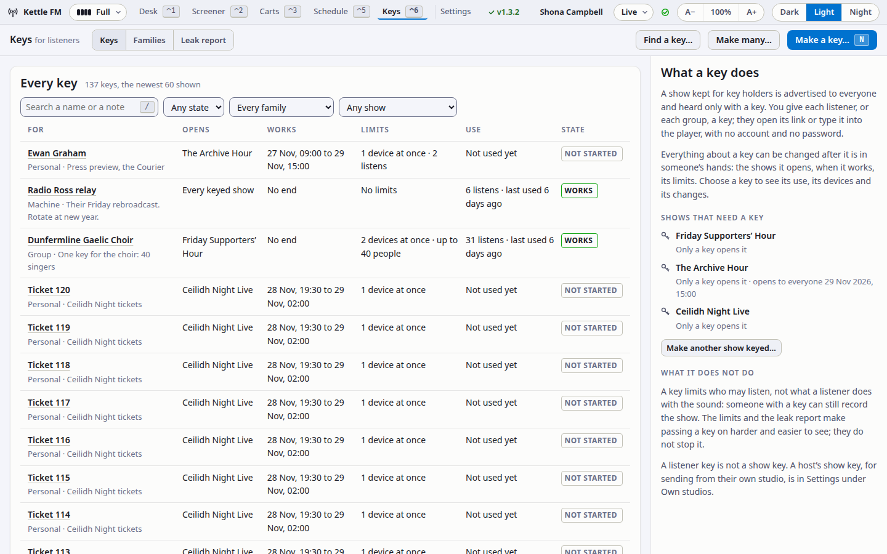
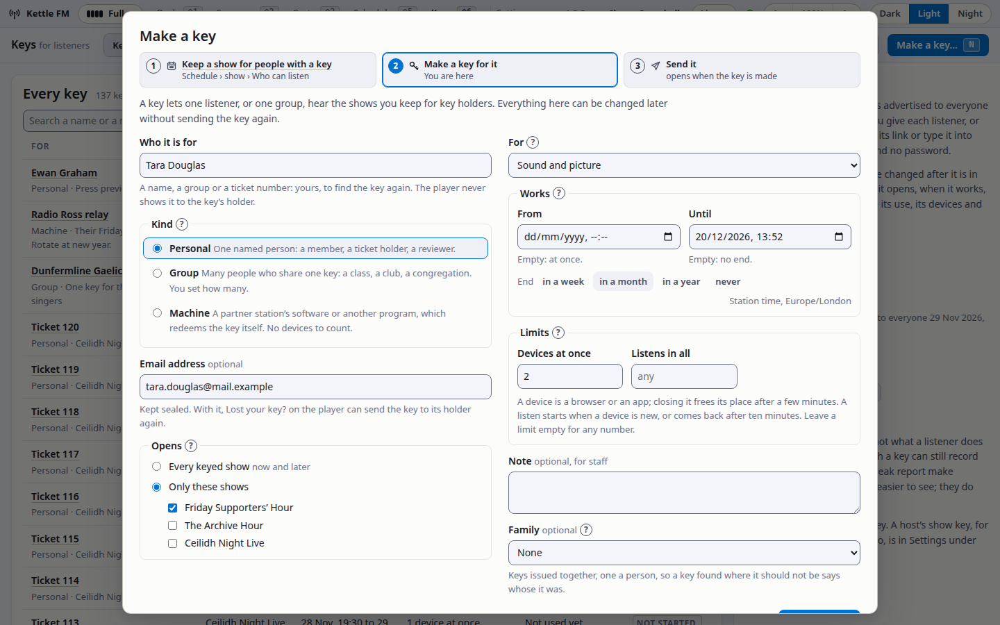
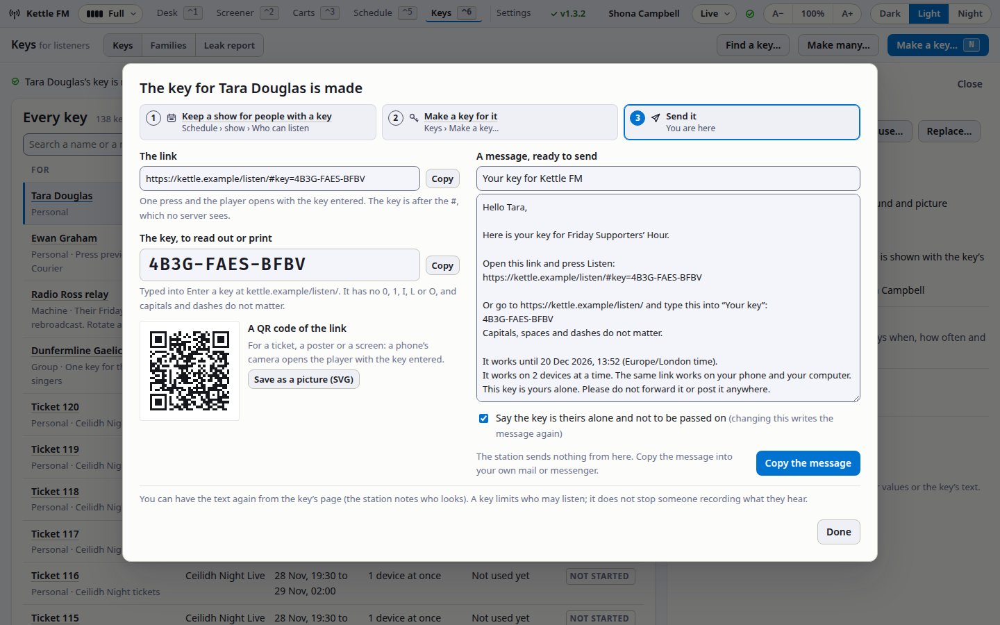
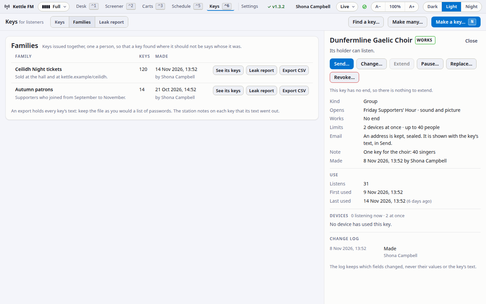
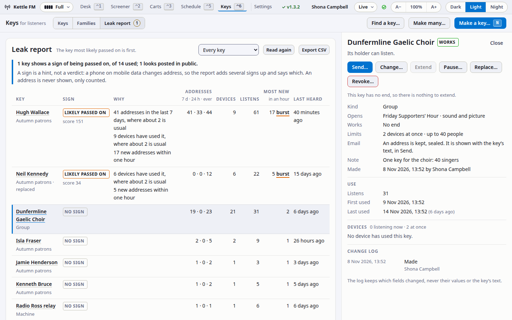
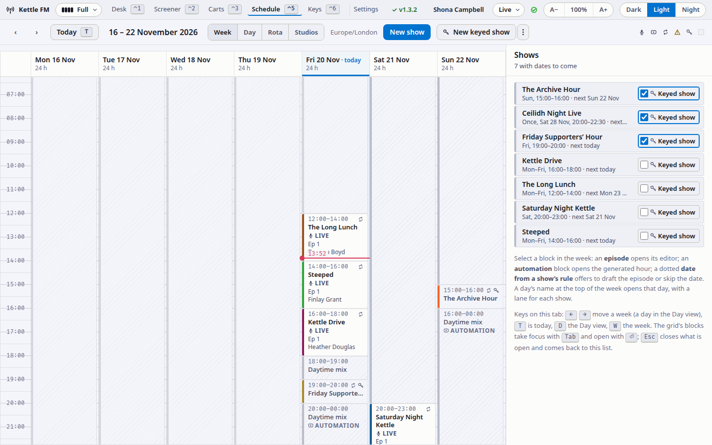
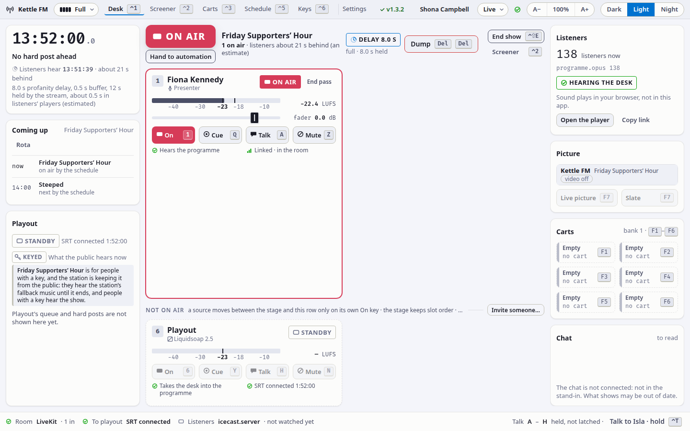
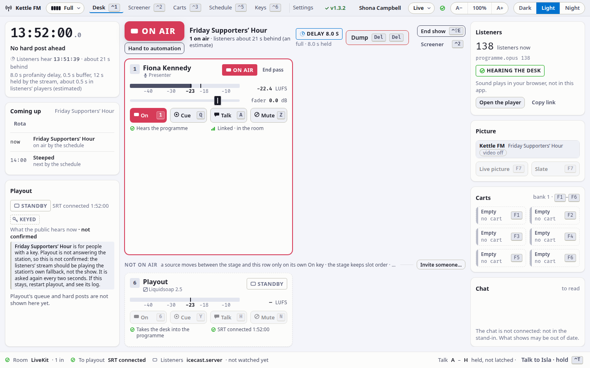
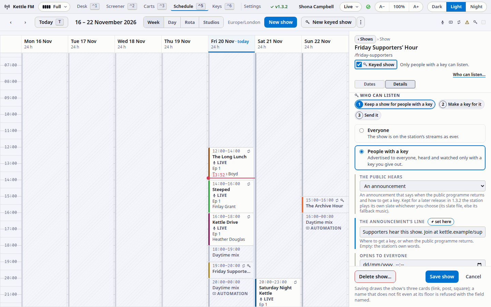

The Keys tab (`⌃6`, from 1.3.2): listener keys for the shows kept for people with a key.
It is a producer's and an admin's: a presenter's or a screener's window has no Keys tab, and nor has the website's sandbox.
The tab was driven in Chromium, and tried by hand in the desktop app's own window on Linux (WebKitGTK).

> The tab makes, changes and ends keys, and the player takes them ([Listen with a key](/docs/how-to/listen-with-a-key/)).
> What keeps a keyed show from everyone else, and what is not covered yet, is in [Keyed shows](/docs/reference/keyed-shows/#how-a-keyed-show-is-kept-from-the-public).

A **listener key** lets a listener hear a keyed show.
It is not a **show key**, which lets a host's own software send to the station and lives in Settings under Own studios ([Hosts in their own studios](/docs/how-to/set-up-a-host-in-their-own-studio/)).
Each panel is a heading below, named as it is on screen (ADR-0070).
Times are the station's.

## `keys.toolbar`

The three views of the same keys: **Keys**, **Families** and **Leak report** (with a count, once the report has been read, of the keys that show a sign).
**Find a key…**, **Make many…** and **Make a key…** (`N`) are on every view.

## `keys.list`

Every key, newest first, sixty at a time with **Show more**.
A name opens the key's page beside the list; pressing it again closes the page.
The search (`/`) looks in names and notes; the three boxes beside it narrow by state, family and a show the key opens, and **Clear the filter** undoes them.
The list never shows a key's text.

| Column | Says |
|---|---|
| For | who the key is for, then its kind, its family and its note |
| Opens | the shows by name, or *Every keyed show* |
| Works | *Until 30 Nov, 22:00*, *28 Nov, 19:30 to 29 Nov, 02:00*, *Ended 15 Nov, 22:00*, *No end* |
| Limits | devices at once, listens in all, and a group's people |
| Use | listens, and when it was last used; *Not used yet* |
| State | one of the words below |

### A key's state

The station keeps three states (on, paused, revoked); the tab reads the key's window and limits into them, so the word says whether its holder can listen now.

| Word | Means |
|---|---|
| **Works** | its holder can listen |
| **Ends soon** | it works, and ends within the station's `keys.ends_soon_days`, seven unless set otherwise (the tab and the player count the same) |
| **Not started** | its window has not opened; the player tells its holder when it does |
| **Ended** | its window is over; **Extend** makes it work again |
| **Used up** | its listens are used; raising the limit makes it work again |
| **Paused** | switched off for now and kept; **Resume** brings it back |
| **Replaced** | ended, with a new key issued to the same person |
| **Revoked** | ended for good |

None is a lamp, and none is red or filled: a key is never on air.

With no keys the panel says so and offers **Make a key…** and **Make many…**.
With no keyed show a line above it says that a key made now opens nothing yet, and **Open the Schedule** leads to where a show is set.

## `keys.key`

One key's own page.

| Button | Does |
|---|---|
| **Send…** | [`keys.send`](#keyssend) |
| **Change…** | [`keys.change`](#keyschange) |
| **Extend** | *+1 week*, *+1 month*, or *To a date…* (`keys.extend`); added to the end, or to now if it has ended. A key with no end has nothing to extend |
| **Pause…**, **Resume** | switch it off for now, and back on |
| **Replace…** | end this key and issue a new one, with a new text, to the same person; Send then opens with the new one |
| **Revoke…** | end it for good |
| **Erase…** | an admin's: delete the key and everything kept about it |

Pause, Replace, Revoke and Erase ask first ([`keys.ask`](#keysask)).
A revoked or replaced key is kept for its record and offers nothing that would change it.

**Use** says how often it has been listened with and when; *Not used yet* until its holder listens.
**Devices** lists the browsers and apps that have used it, the ones listening now first (seen within six minutes, the station's default hold), each with **Sign out** (its place is free at once, and that device is refused at its next renewal).
**Change log** says who did what and when: made, changed (which fields, never their values), extended, paused, resumed, revoked, replaced, its text shown or exported, its holder asking for it again, a device signed out.
While the leak report shows a sign for the key, its page says which.

**Lost your key?** follows whether the station has outgoing mail (1.3.2). With mail, the station emails the key's link to its holder and the log says *the station emailed it*. Without it nothing is sent: the log says *nothing was sent*, and the page shows a note, *Its holder asked for it again*, with **Send…**, until the key's text has been shown or the key replaced. The **Email** line says the same: at a station without mail an address only lets a request be noted on the key, for you to send it yourself. On the player the words change with it: *Send my key again* becomes *Ask for my key again*, and the answer says that a person at the station sends the key, never that an email is on its way.

## `keys.about`

With no key chosen: what a key does and does not do, and the shows that need a key, each with what the public hears meanwhile and when it opens to everyone.
Under them, **Make a show keyed…** (**Make another show keyed…** once one is) opens `keys.keep-show`.

## `keys.keep-show`

**Make a show keyed…**, also in the line that says *No show needs a key yet* and as step 1 of the three steps.
It lists the station's shows, each with who can listen to it now, **Who can listen…** (the show's editor, for what the public hears meanwhile and a time it opens to everyone) and the tick **Keyed show**.

- Ticking a show keeps it for people with a key from that moment; the row says so, and that its podcast feed and episode files are held back meanwhile, earlier episodes included (1.3.3). The rule the show had before is kept (what the public hears, and a time it opens to everyone that is still to come).
- A show that has opened to everyone by itself is not ticked (1.3.3): its row says *Opened to everyone* with the date and time, and ticking it keeps it again from that moment.
- Unticking a keyed show asks first (*Open … to everyone again? Its keys are kept, and its episodes return to the podcast feed.*).
- A refusal puts the tick back with the reason under the row: playout has keyed shows off, playout is not answering, or keys are not set up.
- **New keyed show…** opens New show on the Schedule tab with **Keyed show** ticked.
- **Next: make a key…** is offered once a show is keyed. Opened from step 1 of Make a key, the dialog lies over it, and **Done** comes back to what was typed there.

## The three steps

Make a show keyed, Make a key, Make many and Send carry one numbered line at their top: **1 Keep a show for people with a key** (*Schedule › show › Who can listen*), **2 Make a key for it** (*Keys › Make a key…*), **3 Send it**.
The step the dialog stands at is marked, in words too (*You are here*); the others are buttons that go there, except **Send it** before a key exists, which says that Send opens by itself the moment the key is made.
The show editor's **Who can listen** carries the same line in short, and its step 2 goes to Make a key once the show is keyed.

## Hints

In Make a key, Change and Make many, a **?** stands beside **Kind**, **Opens**, **For**, **Works**, **Limits** and **Family**. It shows a tooltip on hover, on a press and on the keyboard's focus; `Esc` hides it without closing the dialog.

## `keys.make`

**Make a key…** (`N`).
The common case is already chosen: a personal key for every keyed show, sound and picture, two devices at a time, no end.

| Field | Is |
|---|---|
| Who it is for | a name, a group or a ticket number, up to 120 characters. It is yours, to find the key again: the player never shows it to the key's holder, whom it greets with *Welcome* alone |
| Kind | **Personal** (one named person), **Group** (many who share one key, up to a number of people) or **Machine** (a partner station's software or another program, which redeems the key itself, with no ready-made relay yet in 1.3.2; no devices to count) |
| Email address | optional, kept sealed; with it **Lost your key?** on the player can send the key to its holder again. At a station with no outgoing mail (1.3.2) the hint says instead that a request is noted on the key, for staff to send it |
| Opens | every keyed show, now and later, or the shows ticked (up to 32) |
| For | **Sound and picture** or **Sound only**. Until 1.3.3 there was a third, **Picture, with its sound**, which opened what **Sound and picture** does (a key for the picture always carries the show's sound). A key made with it goes on working: its page says *picture, with its sound*, and in **Change…** the choice stays in that key's own list, with a line that says what it opens, until the key is changed to another. The API still takes `video` |
| Works | from and until, in station time; empty is at once and no end. **in a week**, **in a month**, **in a year** and **never** set the end |
| Limits | devices at once, listens in all and, for a group, people; empty is any number |
| Note | for staff, up to 500 characters |
| Family | optional: issue it in a family that exists |

A slip is said under its field before the station is asked, and the station's own sentence is shown as given if it still refuses.
Made, the key's text comes back once and Send opens with it.

## `keys.make-many`, `keys.made-many`

**Make many…** makes a family: one key a recipient, all alike.
Paste a list (a name a line, then an email address and a note if there are any, with commas, semicolons or a spreadsheet's columns between; a first line of column names is left out), or ask for a number of keys without names with a word in front (*Ticket 001*, *Ticket 002*), up to 1,000 in one go.
Every line that cannot be a key is said, with its number, and nothing is sent until the list is clean.
What every key in the family is has the same fields as one key.

Made, the dialog lists the first keys and offers **Save as CSV** and **Copy as CSV**: `name,email,note,key,link,state`, a row a key, for a mail merge or a ticket platform.
A save in the desktop app (from 1.3.2; the buttons there end in an ellipsis, **Save as CSV…**) opens the system's own save dialog, starting in the Downloads folder with the file named, and the screen then says where the file went. Closing the dialog saves nothing, and the screen says that too. The page hands the app the file's name and text and never a path: the app writes only where the dialog said. A browser saves to its downloads, with no dialog of its own.

## `keys.send`

Four ways to hand one key over: its **link** (the player opens with the key entered; the key is after the `#`, which no server sees), **the key itself** to read out or print, a **QR code** of the link (dark on paper in every theme; **Save as a picture** saves it as an SVG, through the save dialog in the desktop app), and **a message ready to send**, which can be changed before it is copied.
Unticking *Say the key is theirs alone* writes the message again without that line.
The email address kept with the key, if there is one, is shown with **Copy**.
The station sends nothing from here: the message is copied into your own mail or messenger.

Opening Send for a key that exists asks the station for its text, and the station notes on the key who looked.
A key just made or replaced brings its text with it and is not asked for again.
If the station's token key changed after the key was made, its text can no longer be read: Send says so and offers **Replace the key…**.

## `keys.change`

The same fields as making a key, apart from its kind.
Only what changed is sent, and a window or a limit that was emptied is taken away.
The key's text stays the same, so nothing needs sending again; a change reaches someone who is listening at their player's next renewal, which the dialog says (within a minute unless the station set another pace).
A pause, a revoke or a replace cuts them off at once instead.
An email address is never read back: the choice is to keep the one the station has, use another, or remove it.

## `keys.ask`

Asked before a key is paused, revoked, replaced or erased: what it does, and what its holder will see.
Pausing and revoking take a reason for the log (up to 200 characters).

## `keys.families`

Keys issued together, one a person.
**See its keys** narrows the list to the family, **Leak report** opens the report for it, and **Export CSV** gives every key of the family with its link as the station writes it (in the desktop app **Export CSV…**, which asks where the file goes). The station notes on each key that its text went out when the export is read, so closing the save dialog does not undo the note, and the screen says so.
An export holds every key's text, so the station notes on each key that its text went out: keep the file as you would a list of passwords.

## `keys.leaks`

Every key, or one family's, the key most likely passed on first.

| Sign | Means |
|---|---|
| **Likely passed on** | a burst: three or more new addresses within an hour, which is what a key posted in public looks like |
| **Worth a look** | more addresses or devices than is usual for the key, without a burst |
| **No sign** | within what is usual |
| **Not used yet** | nothing to compare |

The reasons are the station's own words, and the score is its sum ([how it is counted](/docs/reference/keyed-shows/#key-families-and-the-leak-report)).
It is a hint, not a verdict: a phone on mobile data changes address.
An address is never shown, only counted.
**Export CSV** gives the counts and the signs, never a key's text.
To act on a key, open it and use **Replace…**.

## `keys.find`

**Find a key…**: paste a key found where it should not be, or the link that carries it, and the station says whose it was and which family issued it; **Open the key** goes to its page.

## `keys.unready`

In place of the tab when the keys cannot be shown.

| It says | When |
|---|---|
| *Sign in to see the keys* | the sign-in has ended |
| *Keys are a producer's or an admin's* | the station refuses the account |
| *This station has no keys yet* | the station is older than 1.3.2 |
| *Keys are not set up at this station* | the station has no database, or no station key to seal keys under; its own sentence is shown |
| *The keys could not be read* | anything else, with the station's sentence |

## The key beside a show

A show kept for people with a key carries a key glyph wherever the app draws it.
The padlock elsewhere in the app marks what is read-only or has aired; the key marks who may listen.

- **`calendar.show-access`**, in the show editor, right under the show's name: **Who can listen**. *Everyone*, or *People with a key*; for a keyed show, what the public is to hear meanwhile (an announcement with its own line, the fallback music, or a teaser; kept for a later release, since in 1.3.2 the station plays its one slate, its slate file, else its fallback music, else the loop WeaveSignal ships, whichever is chosen) and when it opens to everyone by itself. A station whose playout has keyed shows off, or does not answer, refuses *People with a key*, and the editor says why. **Save who can listen** saves it apart from **Save show**, and **Its keys…** opens the Keys tab narrowed to the show. A producer and an admin change it; a presenter reads it.
- **Keyed show**, the tick: one control wherever a show is in sight (the Schedule's list of shows, a show's pane, an episode and a date not drafted yet, `keys.keep-show`, New show). A producer's and an admin's; anyone else sees the word **Keyed** with the key on a keyed show, and no control.
  From 1.3.3 the tick means one thing, that a key is needed to listen now:

  | The show | The tick | Beside it |
  |---|---|---|
  | kept for people with a key | ticked | *Only people with a key can listen*, and when it opens to everyone if a time is set |
  | open to everyone, never keyed or opened again by hand | not ticked | *Everyone can listen* |
  | kept until a time that has passed, so it opened to everyone by itself | not ticked | *Opened to everyone* with the date and time, *no key is needed now*, and *Tick to keep it for people with a key again*. A presenter or a screener sees no **Keyed** mark on it |

  In 1.3.2 the third stayed ticked. Its rule is still stored: ticking it keeps the show again from that moment, without the past time, and what the public hears is as it was. The app reads the station's list again at the moment a show opens by itself, so the tick, the key on its blocks and the legend change with it. In the show's editor such a show still has **People with a key** chosen with its past time in **Opens to everyone**, so a line above the choice says first that it opened, that no key is needed now, and how to keep it again (clear the time or give a later one, and save).
  The tick's tooltip says what its state means and what a press does, and wherever a show is made keyed the words say what becomes of its podcast feed and episode files: held back while it is keyed, earlier episodes included, back when it is open to everyone, and that copies already downloaded cannot be called back. At a station of 1.3.2, which holds no file back, they say that instead.
- **The Schedule**: a keyed show's blocks carry the key beside their time, with the word **Keyed** beside it where the line has the room (the Day view, a wide column) and otherwise on a line of its own under the kind, which a block of an hour or less has no room for; the tooltip says *Keyed: advertised to everyone, heard and watched only with a key you give out*. The legend gains *Keyed: for people with a key* while any show is keyed.

  

- **`desk.keyed`**, in the desk's Playout panel while a keyed show's window is open: *What the public hears now*, as playout says it (the station's slate, its fallback music, the loop WeaveSignal ships), and that the station is keeping the show from the public while people with a key hear it. When playout does not shut its public gate (keyed shows off, an older script, a refusal), the line turns to an alarm: *playout is not keeping it from the public: everyone hears the show*, with what to do. It reads the control plane's last look at playout, every two seconds. It is not a lamp: the lamp says what is on air, this says who may hear it.

  

  From 1.3.2 there is a third state, **not confirmed**, while playout does not answer the station: the chip is drawn dashed (the shape of *not connected*), the heading reads *What the public hears now · not confirmed*, and the sentence says that playout is not answering, what should be so (the listeners' stream playing the station's own fallback, not the show), that it is asked again every two seconds, and to restart playout if it stays. It is a status, not an alarm: the alarm is kept for what playout itself said.

  

