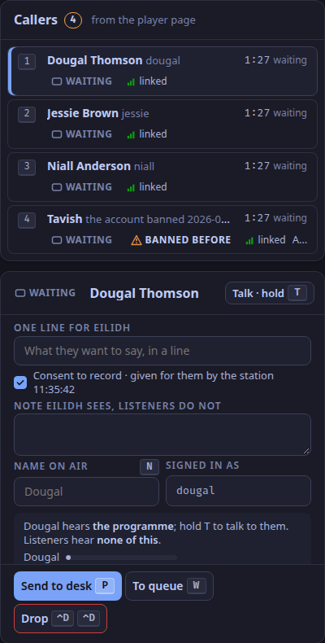

The screener is the studio app's second tab (`⌃2`): callers on the left, what needs the screener in the middle, the room's chat on the right.
The caller lane works the real desk through the control plane ([Screen callers](/docs/how-to/screen-callers/)), and the chat lanes work the chat service ([Moderate the chat](/docs/how-to/moderate-the-chat/)).

Each heading below is a panel's name, as it is on screen (ADR-0070).
Hover over a panel's header, or focus it with the keyboard, to see its name.

## `screener.status`

The verdict first, then the show: the lamp's word, the show and its presenter, whether the desk is taking callers, the studio clock and the time listeners hear, the screener's own name, and *Talk to* the presenter, held (`⌃T`).
The desk is "not taking callers" while any caller sent to it carries DESK BUSY.
*Listeners* shows a dash: the listener count is [not in WeaveSignal 1.0](/docs/reference/release-one-status/).

## `screener.queue`

Callers in the order they arrived, with an ordinal key (`1` to `9`), their name, their state, their link, how long they have waited, and their line; a caller at the desk shows its strip (*strip 4*), and one without consent to record a *no consent* tag.
A caller whose link dropped stays in their place, marked with when it dropped, for 5 minutes.
A caller is anyone with the `caller` role, each in a booth room of their own ([Roles](/docs/reference/roles/#rooms)), which includes a listener who calls in from the player page (ADR-0006).
The queue shows the name they gave and the line they typed about the call; the form has no field for a town.

## `screener.screening`

The selected caller:

- whether they hear you, and what listeners hear ("none of this"), with their level;
- *One line for* the presenter, and a *Note* the presenter sees and listeners do not;
- *Name on air* (`N`);
- BANNED BEFORE, with the date and reason, when it applies (from the station's `studio.banned` setting);
- *Send to desk* (`P`), or *Send again* after a decline; *To queue* (`W`); *Drop* (`⌃D ⌃D`);
- DESK BUSY, when the presenter declined them, with the time and the reason (*Desk busy: ⟨presenter⟩ is not taking callers*);
- the consent to record, accepted on the player page or given for them by the station; a caller without it cannot be sent to the desk, and *Send to desk* is disabled until it is on file.

## `screener.needs`

Needs you: the chat's modes, slow (`S`), hold new accounts (`K`), links for trusted chatters only (`L`), and influx (`G G`).
Under them, everything that needs a person, oldest first: reports, held messages with their countdown, notices from people without an account, and requests for a review, each with its keyed actions ([Keymap](/docs/reference/keymap/)).

## `screener.studio`

To the studio: private messages only the screener and the presenter see (D40).
The screener can reply to the sender, invite them to call, or pass the message to the presenter.

## `screener.statement`

The statement of reasons: the action, the reason, the log note, and the words the user receives (D31).
It opens when the screener hides a message or hides all the held ones.

## `screener.room`

The room: the chat in real time with the audience's lag stated, the selected message's actions, and the staff composer.

## `screener.toast`

The reserved toast slot under the room's head, in flow, so a toast moves the feed down and covers nothing.
Built: the screener's notices, such as a caller declined by the desk or taken by the presenter.
