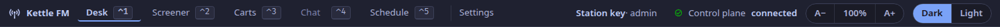
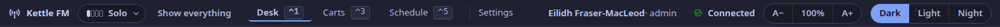
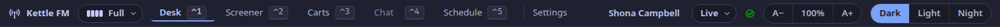

The top bar runs along the top of every tab of the studio app.
Its heading below is its name on screen (ADR-0070, ADR-0097).

## `studio.frame`

The station's name, the show's step, the tabs with their keys, Settings, who is signed in, whether the window is Live or Preparing, the link to the station, the text size and the theme.

- **The tabs**: Desk `⌃1`, Screener `⌃2`, Carts `⌃3`, Chat `⌃4`, Schedule `⌃5`.
  Below the Full step the Screener and Chat tabs are not drawn, and each tab keeps its number ([`studio.step`](#studiostep)).
  Desk, Screener, Carts and Schedule are built.
  Chat is not a tab yet (**[planned](/docs/reference/release-one-status/)**): it says it is not in this build, and the chat is on the Screener tab.
- **Settings**: retention, holds, the time zone, staff, API tokens, updates and, for a member of staff signed in as themselves, **Your show**. While Settings is open only the `⌃` chords reach the keymap; a tab's key leaves Settings for that tab.
- **Update … available**: shown in the packaged app when its update feed offers a newer version; it opens Settings, and nothing installs without a yes there.
- **Who is signed in**: the member of staff, or the station key ([Add staff and sign in](/docs/how-to/add-staff/)).
  Beside the Live or Preparing control, in a window at most 1,600 px wide, the name stands without the role, which is in its tooltip and its dialog.
- **Live or Preparing**: for a member of staff signed in as themselves ([`studio.prepare`](#studioprepare)).
- **The link**: **Connected** while the app's live link to the station is up (one word, to make room for the step at 1,440 px); *Control plane connecting* or *Control plane not connected* when it is not. Hover over it for the reason.
  Beside the Live or Preparing control, in a window at most 1,600 px wide, only the tick is drawn while the link is up; the words return whenever it is not.
- **Text size**: `A−`, the level (select it to reset) and `A+`; or `Ctrl+−`, `Ctrl+0` and `Ctrl++`. The whole interface scales, and the level is remembered on this machine.
- **Theme**: Dark, Light or Night.
  The app starts dark and never follows the system's setting (ADR-0065); the choice is remembered on this machine.
  Night is for presenting late: warm near-black grounds, warm off-white text and an amber accent, with no blue or cyan anywhere (ADR-0270). The state words keep their meaning and their contrast (WCAG AA): ON AIR stays red, OPEN stays the white lamp in a warm white, CUE becomes a plum and TALK a green.

The desktop app signs in as a member of staff, or with the station key, and keeps either in the keychain ([Add staff and sign in](/docs/how-to/add-staff/)).
The browser build is still given the station key once (as `?token=` in its address, kept for that session) or served behind a proxy that adds it.

## `studio.show-setup`

The presenter's show setup (ADR-0218, ADR-0219), a dialog over the surface: **About you** (the on-air name and the takedown contact), **Your show** (its name, links to the presenter's channels, the usual day and time, whether it plays commercial music) and **Done**.
It opens by itself for a presenter signed in as themselves with no show of their own, and again from Settings; **Skip for now** keeps it away on that computer.
A dialog owns the keyboard: only the `⌃` chords reach the keymap while it is open.
The answers become the show's own fields, tied to the account ([Set up your show](/docs/how-to/set-up-your-show/)).

## `settings.my-show`

**Your show**, in Settings, for a member of staff signed in as themselves: the show tied to their account as the setup left it (name, on-air name, takedown contact, links, usual time, commercial music) with **Change…**, or **Set up your show…** when there is none.
The station key has no account to tie a show to, so it has no such panel.

The picture above is from 1.0.1: it lacks the step control, and says *Control plane connected*.
The top bar from 1.0.2, at Solo:

That picture was made before Prepare mode: a member of staff signed in as themselves now has **Live** or **Preparing** after their name, and the link shows its tick alone ([`studio.prepare`](#studioprepare)).

## `studio.step`

The show's step as four pips and a word, the way to change it, and **Show everything** (ADR-0271).
It sits beside the station's name, before the tabs it governs, and never changes place: tabs open to its right.
The pips are equal in height, filled up to the step; it is not a state chip and takes no live or status colour.
Its tooltip names the show the step is of; between shows its edge is dashed and the tooltip names the show the step is kept from.
**Show everything** is drawn at Solo, Guests and Callers; at Full nothing is hidden.

## `studio.step.menu`

The step dialog, under the top bar at its left: the four steps for the show named, the one in force marked **now**, and, once another is picked, what will change at once and the button that names the move.
`↑` `↓` move between the steps, `⏎` confirms the move, `Esc` keeps the step.
An account that may not change the step sees the list to read, with who can change it.
With no show ever on air it says the studio shows everything, and offers **Set up your show…**.

## `studio.step.banner`

A row under the top bar while everything is shown (ADR-0274): *Showing everything for now.*, the step that still holds, and **Back to** the step.
How the steps work: [Choose how much of the studio a show uses](/docs/how-to/choose-a-step/).

## `studio.prepare`

Whether this window is **Live** or **Preparing** (ADR-0276), as one word in a pill after who is signed in, and the way to switch.
A live window drives the desk; a preparing window shows the live desk and cannot change what is on air.
It is drawn for a member of staff signed in as themselves, on a station that has Prepare mode; the station key is always live and has no control.
It is not a state chip and takes no live or status colour: *Live* here is the window's, never the red of ON AIR.
While preparing, the pill takes the ground of the band below it.

## `studio.prepare.menu`

The dialog under the top bar at its right: the two choices, the one in force marked **now**, and, once the other is picked, what the switch changes and the button that names it (**Switch to Preparing**, **Switch to Live**).
`↑` `↓` move between the two, `⏎` confirms, `Esc` keeps what is.
It is also the one ask before taking the desk: while someone else's show is on air it names the show and says that this window's keys and buttons will act on it at once.

## `studio.prepare.banner`

A row under the top bar while this window is preparing, on the Desk, Screener and Carts tabs: *This window is preparing.*, what is on air, and **Switch to Live** (with `…` when it asks first; the primary button once the account's own show is on air).
On those tabs every control that changes the air is disabled, with *Off while this window is preparing. Switch it to Live first.* in its tooltip, and its key does nothing; the row deepens for a moment to answer the press.
How to use it: [Prepare your show while another is on air](/docs/how-to/prepare-your-show/).
