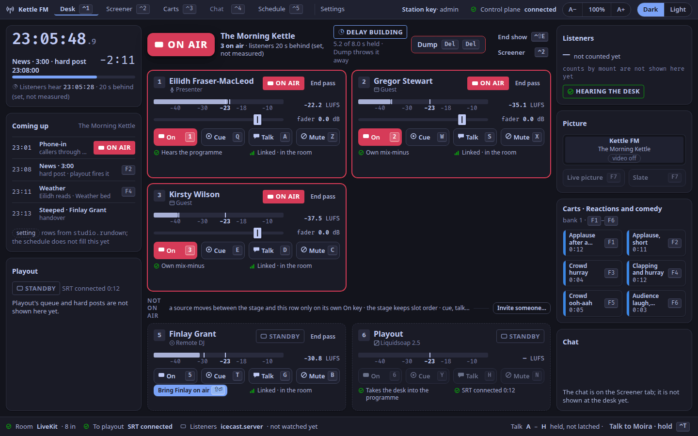
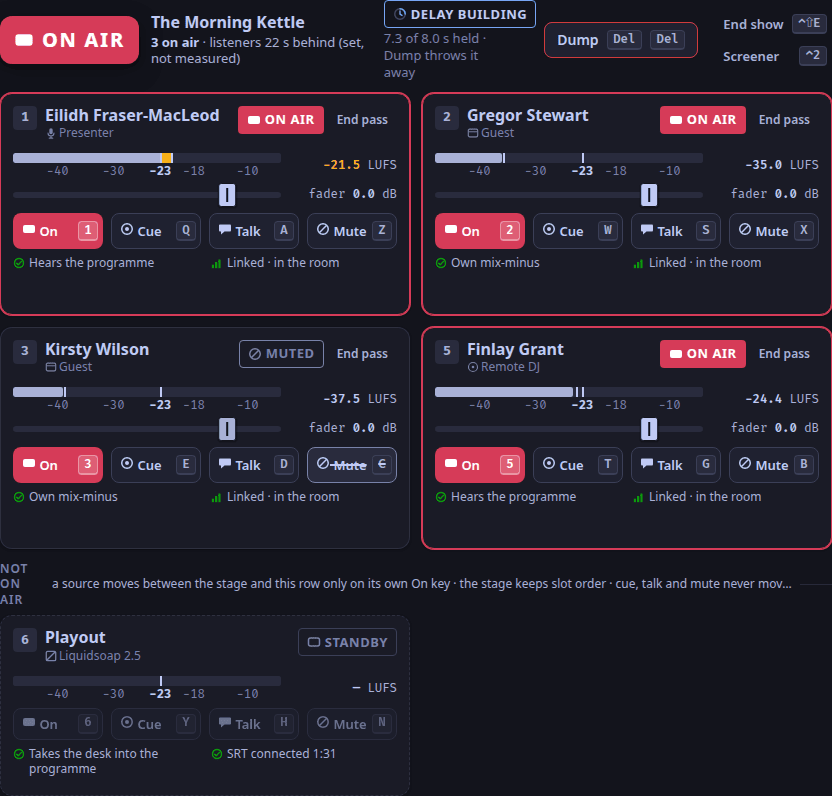
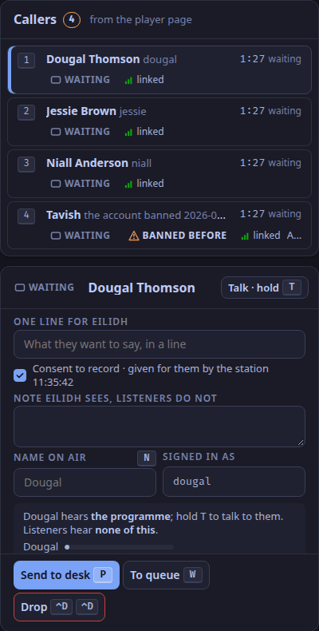
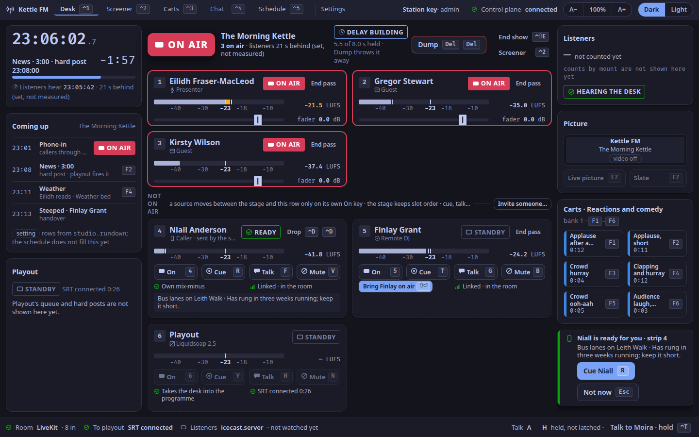
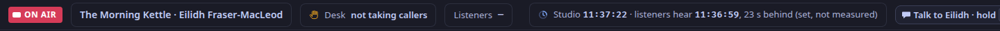
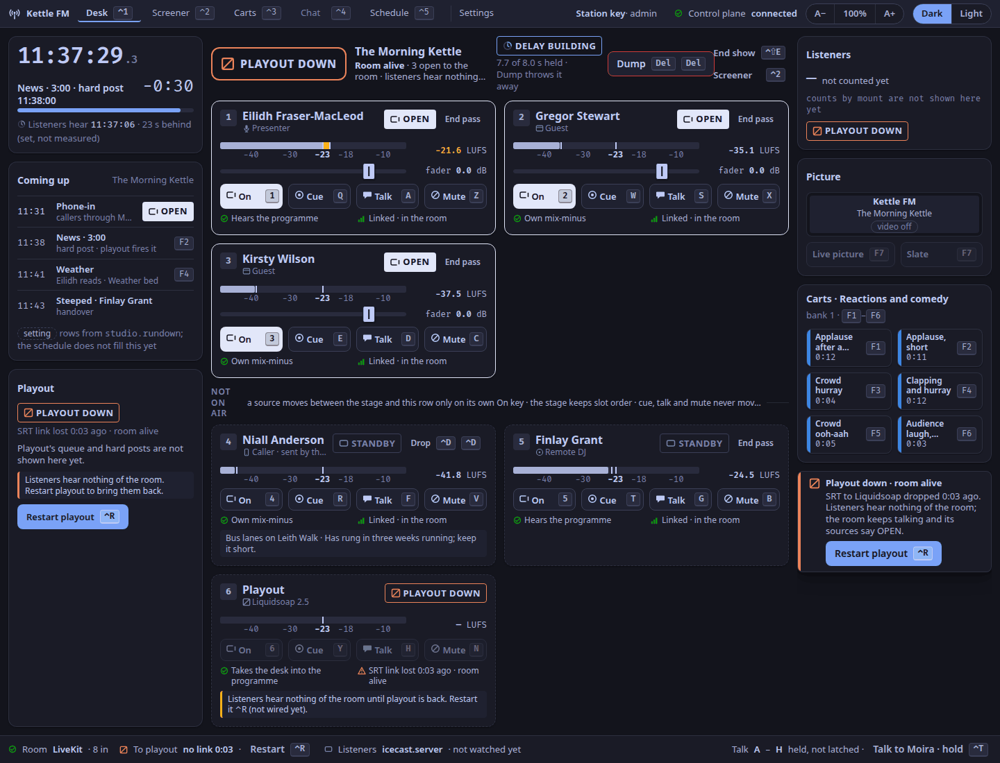

In this tutorial you run the studio app against the real desk on your own machine, with a room already full of people: Eilidh presenting *The Morning Kettle*, two guests, a remote DJ, the screener Moira and four callers.
You put people on air, take a caller from the screener, and watch the desk tell you the truth when playout stops.

It takes about twenty minutes once the images are built.

> **What this stack is.** It is a test stack, built from the repository, not a station.
> The people are synthetic: each sends a quiet noise at its own level, so their meters move but there is nothing to listen to.
> The studio app runs as a web page in your browser; it shows the desk and sends your keys, and carries no audio itself.
> A show with real voices joins through the invite page or the player's call-in ([The public pages](/docs/reference/public-pages/)); this stack does not serve them.
> To run a real station, install the published server image with [`weavesignal.sh`](/docs/how-to/install-with-weavesignal-sh/) and the published studio app ([on Linux](/docs/how-to/install-studio-linux/), [on Windows](/docs/how-to/install-studio-windows/)) instead.

## Before you start

You need a Linux machine with Podman, `just`, Rust 1.98 or later, pnpm 10, `curl` and Python 3, and the repository checked out.
The stack uses TCP ports 27310, 27420, 27432, 27812, 27815 and 27880, and UDP ports 27882 and 27913, all clear of a station's defaults; the script stops if one is taken.

Build the desk's images and the desk, once, from the repository's root:

```sh
podman build -t localhost/weavesignal-desk-spike:dev spike/desk-image
just desk-image
just desk-build
cd apps/studio && pnpm install && cd ../..
```

## 1. Start the studio

```sh
tests/m2/run-studio.sh
```

It starts LiveKit, PostgreSQL, Liquidsoap (playout and the listener process), the desk, the control plane, nine synthetic people and the interface, then prints:

```text
up: the studio app at http://127.0.0.1:27420/ (LiveKit :27880, control :27310, SRT :27913)
```

The first start builds the control plane, which takes a few minutes; the demo carts then load in about a minute.
Leave it running, and open that address in your browser.

## 2. Read the desk

You are on the Desk tab.
At the top of the stage the lamp says **ON AIR**: playout is connected and people are on air.

On the stage are three tiles, in slot order: Eilidh in slot 1, Gregor Stewart in slot 2, Kirsty Wilson in slot 3.
Presenters and guests are on air from the moment they join.
Under the stage, in *Not on air*, is Finlay Grant, the remote DJ, in slot 5: DJs join off air.



Hover over the header of any panel: its name appears, such as `desk.stage` or `desk.tile.2`.
Those names are the headings of the [Desk reference](/docs/reference/surfaces/desk/).

## 3. Put Finlay on air, and off

Press `5`.
Finlay's tile moves onto the stage and says ON AIR.
Press `5` again: he goes back to *Not on air*.

Now press `T`, slot 5's cue key.
Finlay says CUE: he would be in your headphones, not on air.
Press `T` again to stop.

## 4. Mute a guest, and talk to another

Press `C`, slot 3's mute key.
Kirsty stays on the stage and says MUTED.
Press `C` again.

Hold `S`, slot 2's talk key.
While you hold it, only Gregor would hear you, and you are off the programme.
Let go.



## 5. Screen a caller

Press `⌃2` for the Screener tab.
Four callers wait in `screener.queue`: Niall, Dougal, Jessie and Tavish.
Tavish carries BANNED BEFORE, with the date and the reason, from the control plane's settings file.



1. Press the number beside Niall to select him.
2. Hold `T`: he becomes SCREENING, and you are talking to him off air.
   Let go.
3. Click *One line for* Eilidh and type `Bus lanes on Leith Walk`.
   Press `Esc` to leave the field.
4. Press `P` to send him to the desk.

## 6. Take the caller to air

Press `⌃1` for the Desk.
The toast says *Niall is ready for you · strip 4*, with your line.



1. Press `R` to accept him: he is cued.
2. Press `4`: Niall is on air.
3. Press `4` again to take him off, then `⌃D` twice to drop him.

Send Dougal from the screener the same way, and this time press `Esc` on the desk.
Back on the screener, Dougal says DESK BUSY, and the status line says the desk is *not taking callers*.



## 7. Stop playout

In a second terminal, from the repository's root:

```sh
tests/m2/run-studio.sh down
```

Within a moment the lamp says **PLAYOUT DOWN**, and every tile on the stage says **OPEN**: the room still hears them, listeners do not.
The toast says *Playout down · room alive*.



```sh
tests/m2/run-studio.sh up
```

The lamp says ON AIR again by itself; in the driven test of this stack it took 714 ms.

## 8. Finish

Press `Ctrl+C` in the first terminal.
The script stops everything and keeps each part's log in `tests/m2/run/`.

## What you learned

- The lamp says ON AIR only when listeners can hear ([What ON AIR promises](/docs/explanation/on-air/)).
- Each person keeps their slot and their keys; the four rows of keys are on air, cue, talk and mute ([Keymap](/docs/reference/keymap/)).
- A caller goes from the screener's queue to READY on the desk, and the presenter accepts with Cue or declines with `Esc`.

Next: [Get ready to present](/docs/how-to/get-ready/), or [Who hears whom](/docs/reference/who-hears-whom/).

The same stack is driven from the keyboard alone by `tests/m2/drive.mjs`, which covers these steps; it passed 20 of 20 checks on 2026-10-25.
The steps on this page were checked against the code for 1.0.0, not walked by hand again.
