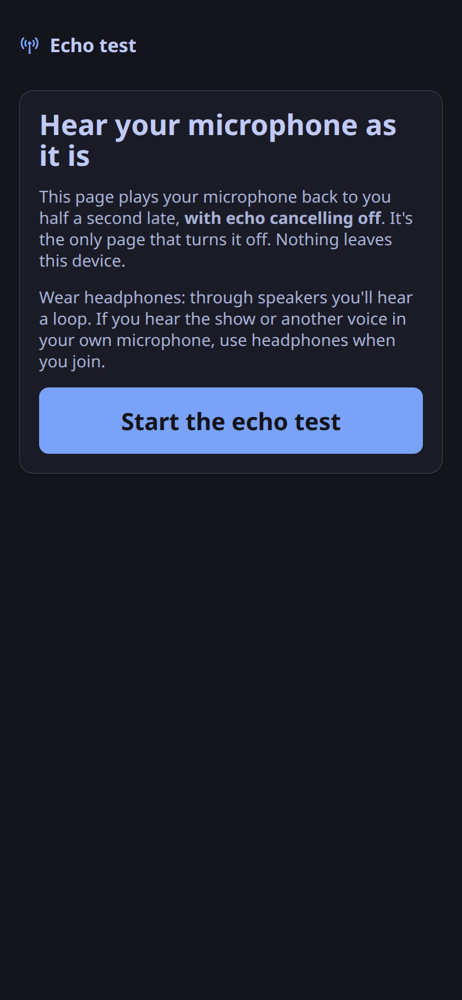
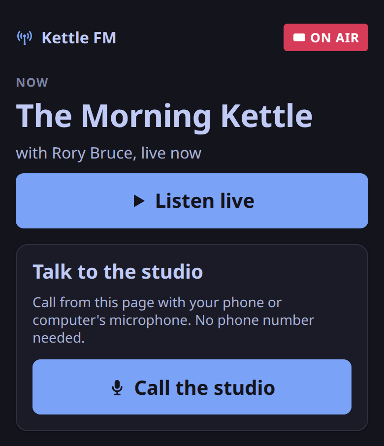
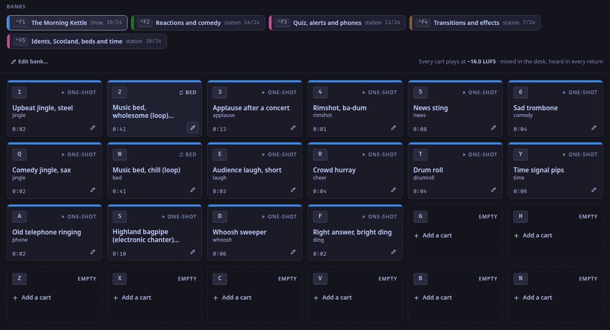
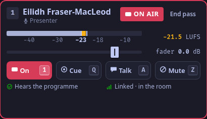

You have installed the studio app, signed in to your station, and you hear nothing: no sound, from the speakers or the headphones.
That is expected, and this tutorial gets your first sound out in about ten minutes.
You will check your microphone and headphones, hear your station as a listener does, play a sound from the cart wall, and speak into the studio.

> **The studio app makes no sound of its own.**
> It shows the desk and sends your keys; it does not play the station and it does not carry your voice.
> Sound goes in and out through pages in a web browser on the same computer: the **player** to listen, the **echo test** to try your microphone and headphones, and your **microphone link** to speak and to hear the studio.
> So there is nothing to choose in the studio app for your microphone or speakers: the microphone is chosen on your microphone link's page, the speakers in the browser and in Windows ([Choose your microphone and speakers](/docs/how-to/choose-your-microphone-and-speakers/)).

**No station yet?** The studio app on its own is not a station: it needs one to sign in to.
To hear what a station sounds like first, open [Try the desk](/try/) in a browser and press **Start**: the sandbox plays its show in the browser tab, and nothing you press reaches a real station.

## Before you start

You need:

- the studio app installed and signed in to your station ([on Windows](/docs/how-to/install-studio-windows/), [on Linux](/docs/how-to/install-studio-linux/));
- **your own staff account**, as an admin or a producer (or the presenter of the show on air), not the station key: the desk offers your microphone link only to a signed-in person who may run the show. To make the first one, sign in with the station key, open **Settings**, **Staff**, **Add someone…** (the first account is an **Admin**: the role starts at Producer), then choose your name at the top right and sign out, and sign in again with the username and password ([Add staff and sign in](/docs/how-to/add-staff/));
- headphones, plugged in or paired before you open the browser;
- a browser on the same computer: Firefox, Chrome, Edge or Brave;
- your station's **public address**, the one listeners use: on Cloudron the public pages' domain (`https://station.example`), on the Compose bundle the address `weavesignal.sh` printed. Ask whoever installed the station if you do not know it.

## 1. Check your microphone and headphones

1. Put your headphones on.
2. In the browser, open the public address followed by `/echo-test/`: `https://station.example/echo-test/`.
3. Press **Start the echo test**, and allow the microphone when the browser asks.
4. Speak. You hear your own voice in the headphones half a second late, and the level bar moves.

<!-- picture wanted: the echo test page on a computer, with the level bar moving (reference-public-pages-echo-test.png shows it on a phone, before Start) -->

This page joins nothing and sends nothing: it only proves that the browser has a microphone and that its sound reaches your headphones.
If you hear nothing, or the bar stays still, the browser or Windows is using another device: [Choose your microphone and speakers](/docs/how-to/choose-your-microphone-and-speakers/) puts it right.
Then stop the echo test and close the tab.

## 2. Hear your station as a listener

1. Open the player: the public address itself, `https://station.example/`, or, on a Compose station that is not public, the control plane's address that the installer printed (`http://127.0.0.1:7310/`).
2. Press **Listen live**.

A new station that nobody has put music into plays a short, soft loop: a synthesised pad with a few quiet bells, which WeaveSignal ships so that a new station is never silent.
If the station has fallback music or a schedule of its own, you hear that instead.
In the studio app, the Desk tab's playout panel says **Default loop** while the loop is what listeners hear.

To hear it on a phone or another computer at home, see [Listen on a phone or another computer](/docs/how-to/listen-on-another-device/).
Keep this tab playing.
It is exactly what listeners hear, some seconds behind the studio: the desk's clock says how far, as *about 24 s behind* (an estimate; measured at the stream on a Compose station: 23 to 24 seconds; the desk said about 21 s before 1.3.1).

## 3. Play a sound from the cart wall

A cart is a sound on a key: a jingle, a sting, a music bed.
A new station has the sounds WeaveSignal ships on its cart wall.

1. In the studio app, press `⌃1` for the Desk tab and look at the lamp at the top.
   If it says **AUTO**, press **Take the air back** under it: in auto mode the desk does not reach listeners.
   If the window says **Preparing**, it fires nothing: use a window that is not preparing a show ([Prepare your show](/docs/how-to/prepare-your-show/)).
2. Press `⌃3` for the Carts tab.
   If the wall is empty, press **Default pack…**, choose all of its banks, and press the button that says what it loads (**Load 14 sounds**, say).
3. Find a cart that says **bed**: a bed plays until you stop it, so you have time to hear it. In the default pack the beds are in bank 4 (`⌃F4`), such as *Music bed, lo-fi (loop)*.
   Press its key on the keyboard, or press the pad.
   It starts at once at the desk, and the pad counts it.
4. Listen to the player tab. After the delay on the desk's clock, the bed plays there, where the loop was.
   The lamp on the Desk tab keeps saying **STANDBY** while the cart plays: the lamp says ON AIR only while a person is on air, and a cart alone is heard by listeners without it. The playout panel under it shows an **ON AIR** chip with *a cart is playing* beside it while the cart sounds (from 1.3.1; before, it kept saying *Default loop*).
5. Press the cart's key again: it fades out.
   When a cart ends on its own, listeners hear nothing for about nine seconds before the loop comes back (measured after a two-second and an 85-second cart; not timed after a fade-out): that is the dead-air wait before the loop returns ([Playout](/docs/reference/playout/)), and it is normal.

To play your own MP3 the same way, drop it on an empty slot ([Add your own cart](/docs/how-to/add-your-own-cart/)).

## 4. Speak into the studio

Your voice reaches the desk from a browser tab, not from the studio app.

1. Pause the player tab, so that you do not hear the station twice.
2. Press `⌃1` for the Desk tab. On the empty stage, press **Join with my microphone…**, then **Open in browser**.
3. In the browser tab that opens, press **Join the studio**, and allow the microphone.
   You join the desk in slot 1, standing by: not on air yet.
4. Fire the bed again from the Carts tab. You hear it in your headphones at once, from your microphone link's tab: that tab is the studio in your ears.
5. Press `⌃1`, then `1`: you are on air. Your tile says **ON AIR**, and its meter moves when you speak.
6. Play the player tab again for a moment: after the delay you hear yourself over the bed, as listeners do.
7. Press `1` again to go off air, fade the bed, and close the microphone link's tab.

## What you have done

You have heard the station as a listener, played a cart to the air, and spoken on air with the studio in your headphones.
Every show works the same way: the studio app drives the desk, and the browser tab carries your voice.

## If it does not work

- **The address says *This station is not set up yet*.** The station has no name yet, and shows that page in place of the player. Its admin finishes [Set up the station](/docs/how-to/set-up-the-station/); on Cloudron, the public pages' domain has the player meanwhile.
- **There is no Join with my microphone… button.** You signed in with the station key, a presenter is already in the room (or a DJ is on air), or the show is above Solo and your account is neither an admin's, a producer's nor the show presenter's. Sign in with your own admin or producer account.
- **The player is silent.** See [No sound?](/guides/no-sound/).
- **Your microphone or headphones are the wrong ones.** See [Choose your microphone and speakers](/docs/how-to/choose-your-microphone-and-speakers/).

## Next

- [Play a sound file while you test](/docs/how-to/play-a-sound-file/): your own MP3 on a key.
- [Put a sound file in the schedule](/docs/how-to/put-a-file-in-the-schedule/): music between shows.
- [Your first show](/guides/your-first-show/): guests, cue, mute and ending the show.
