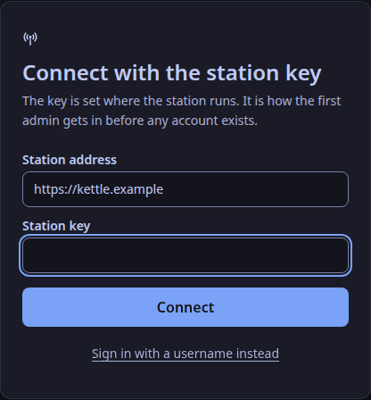
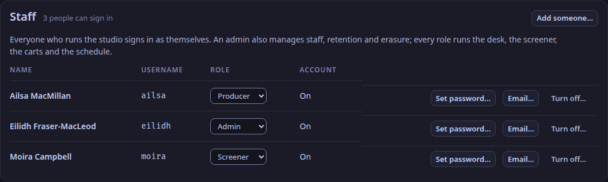
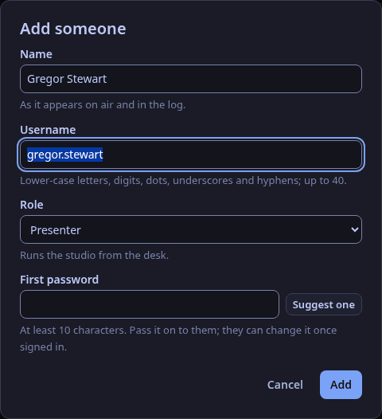
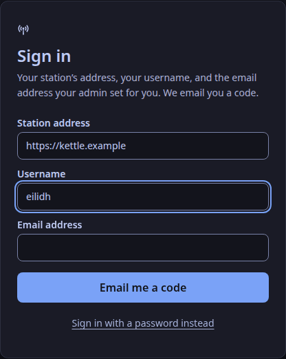
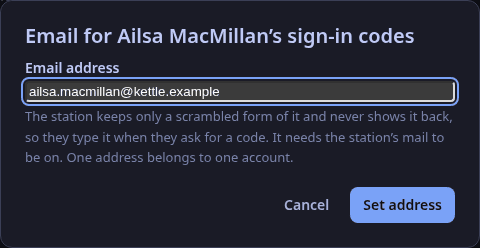

Each member of staff signs in as themselves, with a username and a password (ADR-0127).
A password works on every deployment, including a station with no internet and no mail.
Where the station has mail, a person can instead ask for a code by email ([below](#sign-in-with-an-emailed-code)).
The chat's moderation log then names who acted, the control plane's log names who signed in and who changed an account, and one person can be removed without changing anything for the rest.

## Roles

Every account has one role for the whole station: `admin`, `producer`, `presenter` or `screener`.

| Who | Can do |
|---|---|
| any role | run the studio: the desk, the screener, the carts, the chat's modes and moderation, the schedule, shows and cards, invites |
| `admin` only | retention, holds and erasure; the people list; the chat's settings, exports and holds; playout's settings; listener monitors; the staff list; API tokens and webhooks |

WeaveSignal 1.0 enforces those two tiers.
The role is recorded either way, so a finer split can follow without changing anyone's account.

## The first admin

A new station has no accounts.
Its **station key** (`WEAVESIGNAL_CONTROL_ADMIN_TOKEN`, made at install) makes the first one.
The station key stays the station's own credential with an admin's powers, so a station is never locked out of its staff list.
Keep it where the deployment keeps its secrets, and use it only for this and for emergencies.

In the studio app, choose **Use the station key instead** on the sign-in screen, then add yourself under **Settings → Staff** as an `admin`.



Sign out, and sign in again as yourself.

Without the app, with `curl`:

```sh
curl -sS -X POST https://station.example/api/v1/staff \
  -H "Authorization: Bearer $WEAVESIGNAL_CONTROL_ADMIN_TOKEN" \
  -H "Content-Type: application/json" \
  -d '{"username": "eilidh", "name": "Eilidh Fraser-MacLeod", "role": "admin", "password": "a phrase of ten or more characters"}'
```

On Cloudron the station key is `CONTROL_ADMIN_TOKEN` in the app's `secrets.env` ([Install on Cloudron](/how-to/install-on-cloudron/)); with `weavesignal.sh` it is `CONTROL_ADMIN_TOKEN` in `deploy/compose/.env`.

## Add someone



1. Sign in as an admin, and open **Settings → Staff**.
2. Choose **Add someone…**: their name as the logs and the chat show it, their username (the form offers one from the name), their role, and a first password (**Suggest one** makes one).
3. Choose **Add**, and give them the username and password by a route you trust.
   They can change the password once signed in (**Change your password…**).

A username is up to 40 lower-case letters, digits, dots, dashes or underscores, starting with a letter or a digit.
A password is 10 to 256 characters, and it may not be the username.



There are no other rules: a long phrase is better than a short tangle.

## Sign in

The studio app asks for the station's address, a username and a password.
The sign-in is kept in the computer's keychain, as a station key is (ADR-0121); the window never holds it.

A sign-in lasts while it is used: it ends 12 hours after it was last used, and never more than 7 days after signing in.
When it ends, the app says so and asks you to sign in again.

After five wrong passwords for one username within 15 minutes, that username is refused for the rest of the 15 minutes, even with the right password; so is an address after twenty.
An admin who sets a new password (**Set password…**) lifts the refusal.

## Sign in with an emailed code

A station with mail can email a six-digit code, as another way in beside the password (ADR-0127).
It is not a second step after the password, and it never replaces it: the password stays for everyone, and a station whose mail is down is never locked out.



**Turn it on** (the person who runs the station):

- **The Compose bundle and the Quadlets:** set `MAIL_MODE` (and `MAIL_FROM`) in the station's settings file and run `weavesignal.sh` again (for the Quadlets, then `generate.sh` again); `weavesignal.sh` makes `CONTROL_EMAIL_KEY` on its first run and keeps it after, and the same setting turns on the chat's codes. The Cloudron package makes its key at start.
- **By hand:**

1. In `control.toml` set `[mail]`: `mode = "command"` and the sendmail-compatible program to pipe each email to (`command = ["/usr/sbin/sendmail", "-t", "-i"]`, or `msmtp`), and the sender in `from`.
   `mode = "outbox"` writes each email to a file instead, for trying it out; those files hold the addresses and the codes.
2. Set `WEAVESIGNAL_CONTROL_EMAIL_KEY` in the control plane's environment: at least 32 characters, for example `openssl rand -hex 32`.
   The control plane will not start with mail on and no key.
   The Compose bundle and the Cloudron package set it for you.
   Keep it with the database's backups: with a different key every address must be set again.
3. Restart the control plane.

**Give a person an address** (an admin): choose **Email…** on their row under **Settings → Staff**.
The station keeps only a scrambled form of the address (an HMAC under the key above) and never shows it back, so the person types it each time they ask for a code.
That is also why a code goes only to an address that belongs to the username given: a stranger who knows a username cannot make the station send mail anywhere.
One address belongs to one account.
**Take it away** in the same place to turn the person's code sign-in off.
Without the app, `PUT /api/v1/staff/{id}/email` with `{"email": "…"}` or `{"email": null}`; a person can also set their own with `PUT /api/v1/sessions/me/email`, which needs their password ([The control API](/reference/control-api/#staff-and-sign-in)).



**Sign in with it:** on the sign-in screen choose **Email me a code instead**, enter the station's address, your username and your email address, then the six digits from the email.
The screen says the same whether or not the details matched an account, so look in your junk folder before asking again.
A code works for ten minutes, five tries and once, and asking again makes the older codes useless.
An account may have three codes made in ten minutes, and one address may ask ten times.
Five wrong codes for a username within 15 minutes refuse that username's code sign-in for the rest of the window; they are counted apart from wrong passwords, so someone guessing passwords cannot stop you using the code.
Setting a new address or a new password, or turning the account off, makes any code already sent useless.

The codes and the addresses are never written to the log.

## When someone leaves, or changes role

- **Turn the account off** (**Turn off…** on their row under Settings → Staff): every session it has ends at once, in the studio and in the chat, and it cannot sign in.
  The account is kept, so the logs still say who did what; **Turn on** restores it.
- **Change the role** (the role list on their row): it applies to their next action, without signing in again.
- **Set a new password** (**Set password…**): every session the account has ends.

An admin cannot turn off their own account or take away their own admin role; another admin, or the station key, can.

## Not in WeaveSignal 1.0

- **The platform's own sign-in** (Cloudron's OpenID Connect), which ADR-0127 adds where a deployment offers it.
- **A setting for which ways in a station offers**: today the password is always on, and the emailed code is on when `[mail]` is.
- **A person setting their own sign-in address in the app**: they ask an admin (the route for it exists).
- **Retention holds and erasure named by the sign-in**: a hold still records the name typed in its *By* field (filled in from your account).
- **Roles limited to one show or a time window.**
- The browser build of the studio is still given the station key (`?token=`), as before.

For the routes themselves, see [The control API](/reference/control-api/#staff-and-sign-in).
