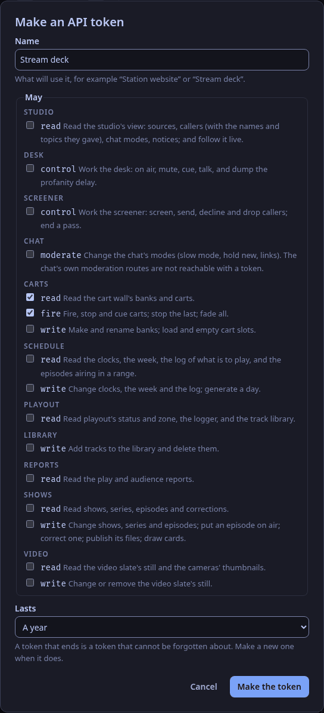
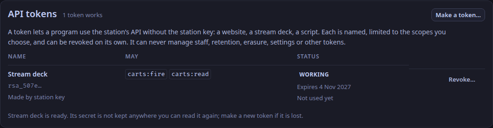

WeaveSignal has three ways for other programs to use a station (ADR-0195), and you pick by what the program needs:

| The program needs | Use |
|---|---|
| to show what is playing, the coming week or the latest episodes, on a website | the [open routes](#show-whats-on-on-a-website): nothing to set up |
| to do something: fire a cart, read the schedule, change a show | an [API token](#give-a-program-a-token) with just the scopes it needs |
| to be told when something happens | a [webhook](#be-told-when-something-happens) |

Never give a program the station key.
It can do everything, including erasure and staff accounts, and it cannot be taken back without changing it everywhere.
The reference for everything below is [Integrations](/reference/integrations/).

## Show what's on, on a website

No sign-in and no setup.
These routes allow any website to read them:

```js
const base = 'https://station.example';

// What is playing now.
const np = await (await fetch(`${base}/api/v1/now-playing`)).json();
console.log(np.on_air, np.now?.title, np.now?.artist);

// The coming week, and the latest episodes.
const week = await (await fetch(`${base}/api/v1/public/schedule`)).json();
const latest = await (await fetch(`${base}/api/v1/public/episodes?limit=5`)).json();

// Follow it live instead of asking again and again.
const live = new EventSource(`${base}/api/v1/now-playing/events`);
live.addEventListener('now_playing', (e) => show(JSON.parse(e.data)));
```

Keep the page to a polite rate: each address may ask the open routes 120 times a minute and hold four streams open.
Past that the answer is 429 with `Retry-After`.
The stream is the better choice for "now playing": one connection, and an event only when something changes.

What the routes show is what the station's own pages show.
They never name callers, chat accounts or staff, and someone erased at their request is gone from them.
An episode appears in the schedule as soon as it has an air time, so set the time when you are ready for it to be public.

## Give a program a token



You need to be an admin.

1. In the studio app, open **Settings → API tokens** and choose **Make a token…**.
2. Name it after what will use it, such as "Stream deck".
3. Choose only the scopes it needs.
   A stream deck that fires carts needs `carts:read` (to list them) and `carts:fire`.
   A script that reads the schedule needs `schedule:read`.
4. Choose how long it lasts (**Lasts**: 30 days, 90 days, a year or never).
   A year, the default, is sensible; a token that ends cannot be forgotten about.
5. Choose **Make the token**.
   The secret is shown **once**.
6. Copy it somewhere the program can read it, then choose **I have copied it**.
   The station keeps only a scrambled form and cannot show it again; if it is lost, make a new token and revoke the old one.

The program sends it as its bearer:



```sh
curl -sS https://station.example/api/v1/carts \
  -H "Authorization: Bearer rsa_…"

curl -sS -X POST https://station.example/api/v1/carts/commands \
  -H "Authorization: Bearer rsa_…" -H "Content-Type: application/json" \
  -d '{"op": "fire", "cart": "0b3a…"}'
```

Without the app, an admin can make one with the station key or their own session:

```sh
curl -sS -X POST https://station.example/api/v1/tokens \
  -H "Authorization: Bearer $SESSION_OR_STATION_KEY" -H "Content-Type: application/json" \
  -d '{"name": "Stream deck", "scopes": ["carts:read", "carts:fire"], "expires_in_days": 365}'
```

A refusal says why:

| Answer | Means |
|---|---|
| 403 "This API token does not hold the `carts:fire` scope." | The token needs that scope: make a new token with it (a token's scopes do not change). |
| 403 "An API token cannot do that: …" | No token can reach the route: an admin's route, or one no scope opens. |
| 401 "That API token is not valid: it is unknown, revoked or expired." | Make a new one. |
| 429 with `Retry-After` | More than 600 requests in a minute from one token (`api.token_per_minute`). |

To stop a token, open **Settings → API tokens**, choose **Revoke…** beside it, then **Revoke**.
It stops working at once, and stays in the list marked *Revoked*.
The list also shows when each token was last used, so a token nobody uses can go.

## Be told when something happens

A webhook is an address on another system that WeaveSignal calls when something happens.
You need to be an admin.

```sh
curl -sS -X POST https://station.example/api/v1/webhooks \
  -H "Authorization: Bearer $SESSION_OR_STATION_KEY" -H "Content-Type: application/json" \
  -d '{"name": "Discord", "url": "https://hooks.example.net/weavesignal", "events": ["episode.started", "caller.queued"]}'
```

The answer has a `secret` (shown once).
The five events are `now_playing.changed`, `on_air.changed`, `episode.started`, `episode.ended` and `caller.queued`; the [reference](/reference/integrations/#events-out) has what each carries.

**Check the signature** before trusting a delivery.
Each carries `X-WeaveSignal-Timestamp` (Unix seconds) and `X-WeaveSignal-Signature: sha256=<hex>`, the HMAC-SHA-256, keyed with the secret, of the timestamp, a full stop and the exact bytes of the body.
Refuse one whose timestamp is more than five minutes from now, so an old delivery cannot be replayed:

```js
import { createHmac, timingSafeEqual } from 'node:crypto';

function genuine(rawBody, timestamp, header, secret) {
  if (!/^\d+$/.test(timestamp) || Math.abs(Date.now() / 1000 - Number(timestamp)) > 300) return false;
  const want = 'sha256=' + createHmac('sha256', secret).update(timestamp + '.').update(rawBody).digest('hex');
  return header.length === want.length && timingSafeEqual(Buffer.from(header), Buffer.from(want));
}
```

Answer with any `2xx` once you have it.
A failure is tried again after 5 s, 30 s, 2 min and 10 min, with the same `X-WeaveSignal-Delivery` id each time, so a receiver that has handled an id skips it.
**Settings** does not list webhooks yet; `GET /api/v1/webhooks` shows how each is doing (`last_status`, `last_error`, `failures`).

If a secret leaks, `POST /api/v1/webhooks/{id}/secret` makes a new one and the old one stops signing at once.

A webhook's address must be `https` and must be on a public address.
To call something on the station's own network, set `api.webhooks_allow_private = true` in the control plane's settings and restart it.

## Before you rely on it

- **The key.**
  Tokens and webhook secrets depend on a key.
  Every install route makes one (`CONTROL_TOKEN_KEY` in the settings file, or the Cloudron package's `secrets.env`); keep it with the database's backups, because a different key revokes every token and ends every webhook's signatures.
  A station installed before that runs on a key derived from the station key until its installer runs again, and adding the key then revokes the tokens made until now.
- **Behind a proxy**, set `join.forwarded_for = true`, or the per-address limits cannot tell visitors apart and are off.
- **Callers' names** are not in `caller.queued`: it says a call is waiting, not who.
  A token with `studio:read` can read the studio's view, names and topics included; give it only to systems that may hold them.
