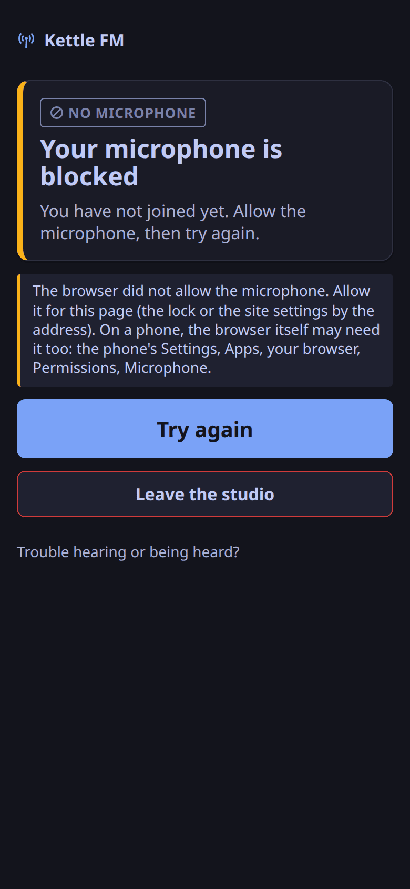
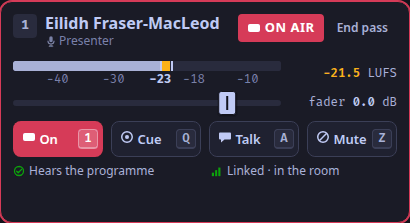

This is for a presenter before a show.
It takes five minutes, and most of it is the headphones.

## Join the room

1. Open the invite link the station sent you, in a browser ([The public pages](/reference/public-pages/)).
   With another LiveKit client, join instead with a room token from the station, which carries your role, `presenter` ([Give someone a room token](/how-to/issue-room-tokens/)); a token can be used to join for 10 minutes by default, so ask for it shortly before the show.
2. Press **Join the studio**, and allow the microphone when the browser asks.
   If the page says **Your microphone is blocked**, allow it for the page (the lock or the site settings by the address) and press **Try again**.
   On a phone the browser itself may need the permission too: in Firefox for Android, allow its microphone in Android's settings (Apps, Firefox, Permissions, Microphone).
3. Open the studio app on the Desk tab (`⌃1`) to see the desk and use its keys.

   

The studio app does not carry your voice: it shows the desk and sends your keys, and your voice reaches the room from the browser.
The studio app joining the room itself, so you present from one window (ADR-0013), is [planned](/reference/release-one-status/#not-in-release-one).

As a presenter you are on air from the moment you join, in slot 1 of the desk.

## Wear headphones

1. Use headphones, never speakers.
   Closed-back headphones leak least.
2. Set them to a comfortable level, not a loud one.
   Sound that leaks from them into your microphone goes back on air a quarter of a second late ([why](/explanation/echo-and-headphones/)).
3. Keep the microphone close to your mouth and away from the headphones' ear cups.

## Set the microphone

Any page that sends your voice into the room should capture it with:

| Browser setting | Value |
|---|---|
| Echo cancelling | on |
| Noise suppression | on |
| Automatic gain control | **off** |

These are the station's defaults for its own join pages.
Leave gain control off even if your voice sounds quiet to you: the desk levels your voice toward the guests' level by itself, slowly, and lifted a raw microphone by 14 to 16 dB in the rehearsals.

## Check before the show

- Ask a guest or the producer to speak while you are silent: you should hear them, and the producer's ear (or a listener) should hear them once, never twice.
- Look at your tile on the desk (`desk.tile.1`): its meter moves when you speak, and its word is ON AIR, or OPEN if playout is down or the station is in auto mode.

Next: [Present from the keyboard at desk B](/how-to/present-at-desk-b/).
