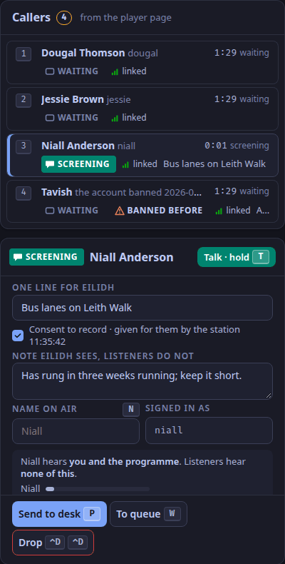
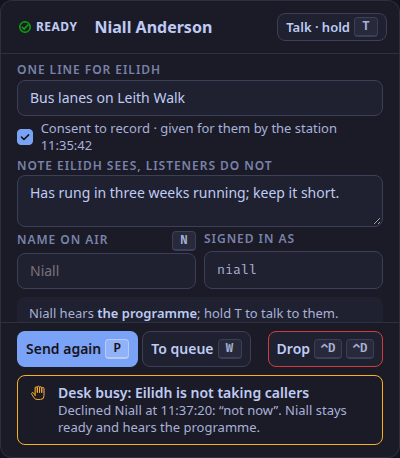

This is for the screener, on the studio app's second tab (`⌃2`).
You join the room with the `screener` role.
You hear every caller, waiting or on air; a caller hears you only while you hold `T` (ADR-0095).
Listeners never hear you.

## Pick a caller

Callers wait in `screener.queue` in the order they arrived, each with a number.
Press `↑` or `↓` to move, or `1` to `9` to jump to a caller.
A caller marked BANNED BEFORE carries the date and reason; nothing of theirs is on air, so screen them or drop them.
The list behind it is the station's `studio.banned` setting; it does not yet come from the chat's moderation log ([What release one does](/reference/release-one-status/)).
A caller who rang in from the player page shows the line they typed about the call, and a *no consent* tag if they did not agree to be recorded.

## Talk to them

Hold `T`.
The first `T` on a waiting caller starts screening: their state becomes SCREENING (ADR-0100).
While you hold it, the caller hears you and the programme; let go, and they hear only the programme.

## Write for the presenter

In `screener.screening`:

- *One line for* the presenter: what the call is about.
- *Note*: what the presenter should know and listeners should not.
- *Name on air*: press `N` to type it, and `Esc` to leave the field.

While you type, the screener's letter keys do nothing, so a `P` in a note sends nobody.

## Send them to the desk

Press `P` (*Send to desk*).
A caller with no consent to record on file cannot be sent, and *Send to desk* stays disabled: drop them, and they can call again from the player page.
The caller becomes READY and takes slot 4 on the desk; the presenter sees your line and note.
Press `W` (*To queue*) instead to put them back in the queue (not while they are on air).

If the presenter declines, the caller stays ready with DESK BUSY and hears the programme, and `screener.status` says the desk is *not taking callers*.
Press `P` (*Send again*) when the desk is free.
When the presenter takes them, your toast says so.

## Talk to the presenter

Hold `⌃T`: your voice is in the presenter's headphones only.

## Drop a caller, or let a place go

- `⌃D ⌃D` drops the selected caller: off air, out of the room, out of the queue.
- A caller whose link was lost keeps their place for 5 minutes, marked DROPPED; `⇧C` lets that place go sooner (ADR-0101).

## The chat's modes

`S` slow mode, `K` hold new accounts, `L` links for trusted chatters only, and `G G` influx, which sets five things at once and undoes them with the same key (ADR-0068).
The chat's reports, held messages, statement of reasons and the room itself are in [Moderate the chat](/how-to/moderate-the-chat/).

Verified by a keyboard-only run of the studio app against the real desk on a loopback stack (2026-10-25) and by the control plane's tests; checked against the code on 2026-11-04.
