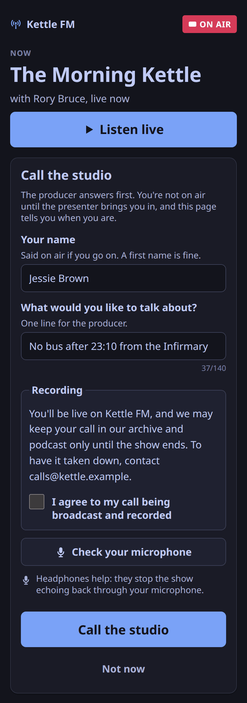
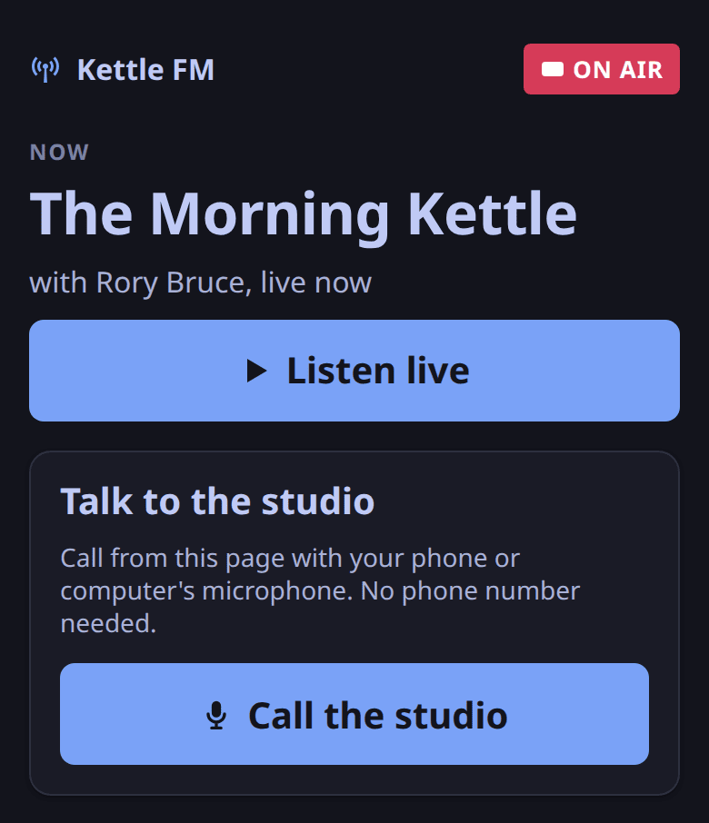
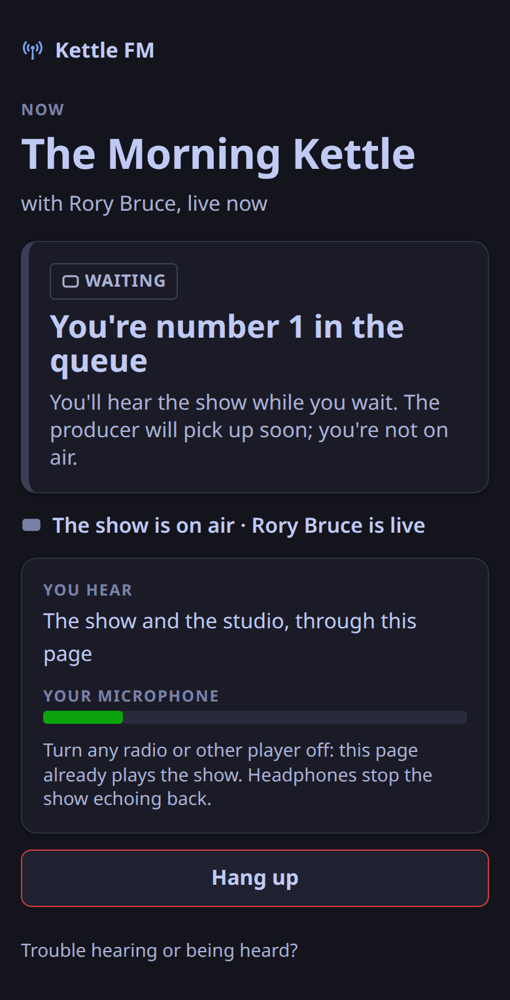
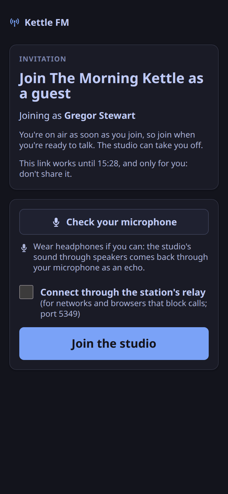
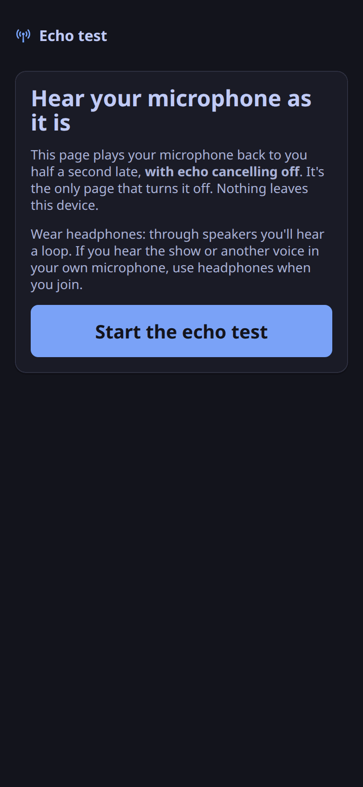
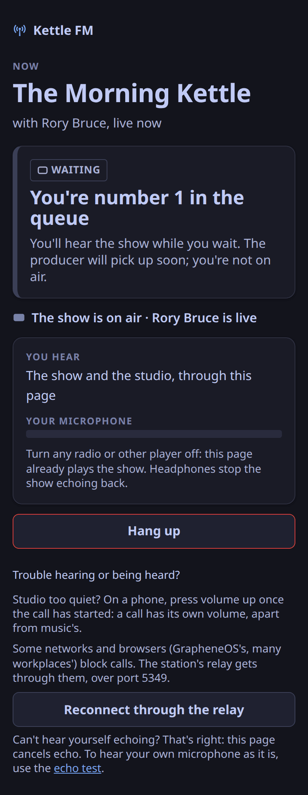
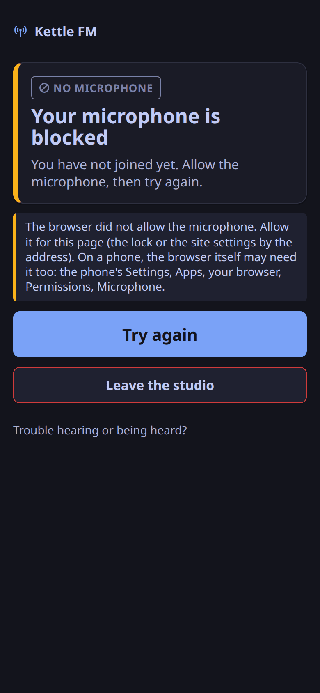

The listener's player with call-in (`/`), the invite page for guests, remote DJs and presenters (`/join/#<pass>`) and the echo test (`/echo-test/`) are one static build, `apps/web/dist`.
The control plane serves it when `web.dir` names that directory; the server image has it at `/opt/weavesignal/web`, and the Compose bundle sets it.
Unset, the control plane serves the API only.

## The pages

The listener's player, with the call-in panel open for a caller to fill in:

The player before anyone calls, and the page a caller sees while they wait in the queue:

The invite page for a guest, and the echo test:

## Serving

| What | How |
|---|---|
| Where | the router's fallback: every `/api/...` route answers first; an unknown `/api/...` path is a JSON 404, never a page |
| Files | read into memory at start, a fixed map from path to file: no request can name a file outside the build; a new build needs a restart |
| Methods | `GET` and `HEAD`; anything else is 405 |
| Pages | `Cache-Control: no-cache`, with an `ETag` (304 when it matches), so a new release reaches a phone on its next load |
| `/assets/*` | `Cache-Control: public, max-age=31536000, immutable`: Vite names them by their content |
| Compression | gzip, made once at start, where it is smaller (`Vary: Accept-Encoding`); the room client's chunk goes from about 537 kB to about 140 kB |

## Headers on every page

| Header | Value |
|---|---|
| `Content-Security-Policy` | `default-src 'none'; script-src 'self'; style-src 'self'; style-src-attr 'unsafe-inline'; img-src 'self' data:; font-src 'self'; connect-src 'self' <HLS> <LiveKit>; media-src 'self' blob: <stream>; worker-src 'self'; manifest-src 'self'; base-uri 'none'; form-action 'self'; frame-ancestors 'none'; object-src 'none'` |
| `X-Content-Type-Options` | `nosniff` |
| `Referrer-Policy` | `no-referrer` |
| `X-Frame-Options` | `DENY` |
| `Cross-Origin-Opener-Policy`, `Cross-Origin-Resource-Policy` | `same-origin` |
| `Permissions-Policy` | `microphone=(self)` and `camera=(self)`; geolocation, payment, USB and `interest-cohort` off |

Every answer the pages give carries these, a 404 or a 405 included; the API's routes do not.
`<LiveKit>` is the origin of `room.public_url` (its `wss://` form and the matching `https://`, which the room client checks when a connection fails); `<stream>` is the origin of `join.stream_url`; `<HLS>` is the origin of `join.hls_url` when the video is on an edge or a CDN (left out for the default `/hls`).
`blob:` is the video player's media, played through Media Source Extensions.
No inline script and no `eval` are allowed.
Inline style attributes are: the shared glyph sprite carries one, and a style attribute cannot run script.
`just test-m3` checks that no page breaks the policy.

The chat's routes (`/api/v1/chat/...`) are the chat service's: behind the station's proxy they reach it; from the control plane alone the chat panel finds no chat.

## Search engines

Search engines are told not to list a new station (ADR-0133).
Every response then carries `X-Robots-Tag: noindex, nofollow`, each page has `<meta name="robots" content="noindex, nofollow">`, and `/robots.txt` says `Disallow: /`.
Set `web.listed = true` when the station goes public and its player, feeds and cards may be found.
Even then the API, the invite page and the echo test stay `noindex`, and `/robots.txt` disallows them, apart from the open routes for a station's website (`/api/v1/public/…` and `/api/v1/now-playing`), which follow the setting and which `/robots.txt` then allows ([Integrations](/reference/integrations/#open-routes)).
A header already set by a proxy in front is left as it is.
The studio is an app, not an address, so there is nothing of it to list.
The listener stream is served by the listener process, which sends no robots header; whether a directory lists it is a separate setting ([Playout](/reference/playout/#directory-listing)).

## The consent words

Before a caller can call, they tick a box under the station's consent words. The default is two sentences:

> You'll be live on {station}, and we may keep your call in our archive and podcast {kept}. To have it taken down, contact {contact}.

| Fill-in | From |
|---|---|
| `{station}` | the station's name |
| `{kept}` | how long programme recordings are kept, from the Jurisdiction setting: "for two years", "for 42 days", "only until the show ends" |
| `{contact}` | `join.consent_contact`: an email address or a link (`CONSENT_CONTACT` in the Compose bundle and `weavesignal.sh`) |

With the default words, call-in stays closed until the station sets `join.consent_contact`.
A station can write its own words in `join.consent_text`; words that use `{contact}` need the contact too.
Any change to the words, a new retention period included, changes their version, and a caller who agreed to older words is asked again.

## Call-in's challenge

ADR-0006's call-in flow starts with "challenge and rate limit".
The challenge is a small proof of work the caller's own browser does, in place of a third-party CAPTCHA.

1. When the lobby opens, the page fetches `GET /api/v1/call-in/challenge`: a random salt, a difficulty in bits and an expiry, signed with a key the control plane makes at start.
2. A Web Worker finds a nonce such that `SHA-256(salt ":" nonce)` starts with that many zero bits, while the caller types their name and topic.
3. `POST /api/v1/call-in` carries the answer; the control plane checks the signature, the expiry and the hash, then spends the salt, so one answer places one call.
   It checks the challenge after the consent and before the rate limit, so requests without the work count against nobody.
4. A refused answer (expired, or from before a restart) is answered beside the `challenge` field; the page fetches a new challenge and tries once more by itself.

| Setting (`[join]`) | Default | Meaning |
|---|---|---|
| `challenge_bits` | `18` | the difficulty: about 262,000 hashes on average; each bit doubles it; `0` turns the challenge off |
| `challenge_bits_busy` | `21` | the difficulty while the station's minute is at least half used (`calls_per_minute`), so a flood slows while one caller still gets through |
| `challenge_ttl_s` | `1800` | how long a challenge can be answered; a lobby left open longer fetches another |

What it costs a caller, measured in headless Chromium (Playwright 1.59.1) on 2026-10-26 (five lobbies each):

| Where | Hashes a second | Time at 18 bits |
|---|---|---|
| A desktop CPU, in the worker | about 1 million | 30–330 ms |
| The CPU slowed six times (a phone, roughly), on the page's main thread | about 180,000 | 0.06–4.5 s; about 1.5 s on average |

The caller sees nothing of it.
There is nothing to look at, listen to, tick or solve, so a screen-reader user, a switch user and a caller with a cognitive disability call in exactly as anyone else does (WCAG 2.2 success criterion 3.3.8).
If the work is still running when they press **Call the studio**, the button says *Getting ready…* and a status line says the browser is doing a quick check; nothing is disabled.
Where Web Workers are missing, the work runs on the page in short slices.
Nothing about the caller leaves the station.

It does not stop a determined attacker with fast hardware: 18 bits is a fraction of a second of native code.
It raises the cost of a cheap scripted flood; the per-address and station-wide limits and the screener remain the defences behind it.

## TURN over TLS

GrapheneOS's browser blocks WebRTC's UDP unless it is proxied (Vanadium patch 0102), so a guest there joins only through TURN over TLS (ADR-0059, ADR-0080, ADR-0106).
`just test-m3` proves it on loopback: Chromium with `--force-webrtc-ip-handling-policy=disable_non_proxied_udp` (what Vanadium sets), at 390 px with touch, calls in through LiveKit's own TURN on TLS with a self-signed certificate.
The first join and a forced relay (`iceTransportPolicy: 'relay'`) both select a local relay candidate over TLS, the caller is heard in the listener stream, and the same browser without TURN cannot connect at all.

What a station needs, found on the way (LiveKit 1.13.10):

- **LiveKit advertises TURN over TLS on port 443, whatever `turn.tls_port` is**: it assumes a load balancer on 443.
  The pages put the station's real port (`ports.turn_tls`, which the player and pass routes report) into the URL before the browser sees it, so 5349, 15349 on Cloudron, or any other port works.
- **LiveKit's TURN refuses to relay to private and loopback addresses, its own included.**
  A station whose LiveKit `node_ip` is private (behind NAT, or a container network) needs that address in `turn.allow_restricted_peer_cidrs`.
- **LiveKit's TURN refuses a client that reaches it over IPv6** (an allocation error, 508; LiveKit issue 5131): give the TURN name an A record and no AAAA record.
  A Cloudron app domain gets an AAAA record whenever the server has IPv6, so a phone that can reach TURN only over IPv6 cannot join a Cloudron station through it ([Known limits](/reference/release-one-status/#known-limits)).
- **The relay port range** (`turn.relay_range_start`, `turn.relay_range_end`) is a setting; the test pins it to 39600–39699.

Beyond loopback, a LineageOS phone has called in over LTE and Wi-Fi, and a real caller has called a public station with a certificate from a public CA through `weavesignal.sh --public`.
A join from a GrapheneOS phone over a real network is not proved in WeaveSignal 1.0 ([What release one does](/reference/release-one-status/)).

## When a call does not work

| What the caller sees | Why | What to do |
|---|---|---|
| *Your microphone is blocked* (chip: No microphone), with *Try again* | The browser, or the phone, refused the microphone, so the page never joined. Firefox for Android needs its microphone permission allowed in Android's own settings as well as on the page | The page says how: "Allow it for this page (the lock or the site settings by the address). On a phone, the browser itself may need it too: the phone's Settings, Apps, your browser, Permissions, Microphone." Then *Try again* |
| *A direct connection did not work, so this page is trying the station’s relay.* | The network or the browser blocks WebRTC's UDP | Nothing: the page tries TURN over TLS by itself. A caller can also choose *Reconnect through the relay* under *Trouble hearing or being heard?* |
| *This page could not reach the studio.* | Neither a direct connection nor the relay worked. A phone that reaches TURN only over IPv6 is refused ([above](#turn-over-tls)) | Check the TURN name has an A record and no AAAA record, and that `ports.turn_tls` is open |
| The studio is too quiet | A call's return is about −23 LUFS, against the stream's −16 (ADR-0205), and a phone's call volume is its own | The call page says: "Studio too quiet? On a phone, press volume up once the call has started: a call has its own volume, apart from music's." |
| The studio breaks up | The desk times each return block from its place in the mix (0.0 % concealed by the receiver, measured with WebRTC `getStats`), so gaps come from the caller's network; the desk sends without congestion control, a known limit | Ask the caller to try another network |

The presenter's side of a call is in [Take a caller to air](/how-to/take-a-caller/).
