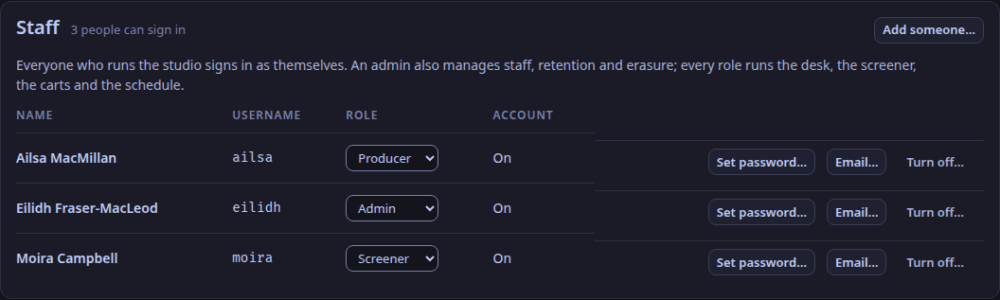

A person's role is signed into their room token by the control plane, as the LiveKit attribute `weavesignal.role` (ADR-0084).
Tokens grant no right to change one's own attributes, so the desk trusts the role it reads.
The desk ignores anyone in the room without a role.
Roles are written in lowercase everywhere: in tokens, in the API and on the command line.

| Role | Who | On air when they join | Can reach the programme | Hears talkback | At the desk | Token can publish |
|---|---|---|---|---|---|---|
| `presenter` | presents the show from the studio | yes | yes | yes | yes | yes |
| `dj` | a remote DJ | no; put on air at the desk | yes | yes | yes | yes |
| `guest` | a guest in the room | yes | yes | no | yes | yes |
| `caller` | a listener calling in | no; sent by the screener, taken by the presenter | yes | no | yes | yes |
| `screener` | screens callers | never | no | no | yes | yes |
| `producer` | produces the show; counts the presenter in | never | no | no | yes | yes |
| `listener` | a monitor, a recorder, a test's ear | never | no | no | no | no |

"At the desk" means the desk mixes the person's voice and makes them a mix-minus.
A `listener` is left out: it has no voice and no mix-minus, and it subscribes to the one track it needs, such as `desk-mm-eilidh` for what Eilidh hears.

For what each role hears, see [Who hears whom](/reference/who-hears-whom/).

## Seats in the studio app

The studio app has two seats, the presenter's and the screener's.
Each is the first person at the desk with that role; for the presenter, the one in the lowest slot.
The presenter's seat is who the desk's talk keys speak as; the screener's seat is who `T` and `⌃T` speak as on the screener tab.
There is no producer seat in the app.

## Identities

An identity is 1 to 64 characters of `a`–`z`, `A`–`Z`, `0`–`9`, `-` or `_`.
It may not be `desk` or begin with `desk-`: the desk joins the room under that prefix, as `desk-in-…` for each voice it subscribes to and `desk-mm-…` for each mix-minus it publishes.
The prefix is the setting `room.desk_identity`.

## Rooms

Each caller is in a LiveKit room of their own, a *booth*: the studio room's name, `-booth-`, and their identity, such as `studio-booth-c7f3` (ADR-0193).
The desk is the only other participant in a booth: its hidden connection that listens to the caller, and the mix-minus it publishes for them.
A caller never sees anyone else, and nobody in the studio room sees a caller.
Everyone else (presenters, DJs, guests, the producer, the screener and monitors) is in the studio room.
Nobody moves between rooms: sending, screening, putting on air and dropping a caller change only the desk's routing.

## Room roles and staff roles

Staff sign in to the studio app as themselves, with a staff role of their own: `admin`, `producer`, `presenter` or `screener` ([Add staff and sign in](/how-to/add-staff/)).
That staff role is not tied to the room role a token carries: any member of staff may issue a room token with any role but `listener`, which needs an admin, because a monitor hears every return (ADR-0118).

Not in WeaveSignal 1.0: roles scoped to one show or a time window (asked beside ADR-0074 and not decided).
