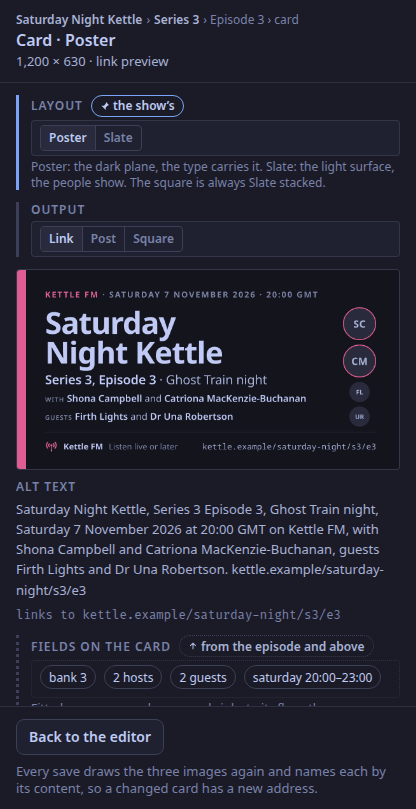
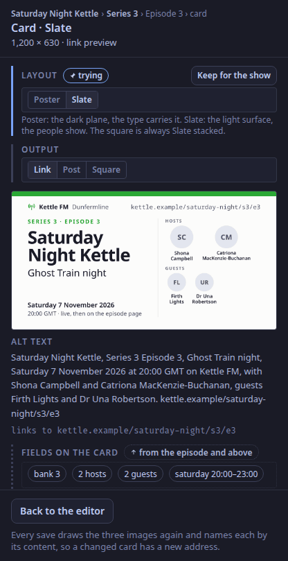

Show cards for link previews, posts and podcast art, in two layouts, Poster and Slate (ADR-0053 to ADR-0057, ADR-0066, ADR-0067); the studio app's editor for them is `calendar.card-editor` on the [Schedule tab](/reference/surfaces/calendar/).

## How a card is made

- A show picks Poster or Slate and its colour is its bank's slot (ADR-0066): the dark value on Poster, the light value on Slate.
- The control plane fills an SVG template from the show's, the series' or the episode's fields, every field escaped, and draws it with resvg in its own process, in the bundled Noto Sans, Noto Sans Arabic and Noto Sans Mono (OFL-1.1).
- Each save draws three images: the 1,200 × 630 link card, the 1,600 × 900 post image, and the 3,000 square for the feed, which is also the art written into the episode's files. The square follows the show's layout (ADR-0179): a Slate show's is the Slate card stacked, with the text above and the people in a row at the foot; a Poster show's is the Poster square, described below. All three are PNG.
- Text is fitted, never cropped: a name shrinks to its floor, then wraps, then a list ends "and 2 more". Every image is checked before it is kept: if any word or disc lies outside the centred 1,200 × 600 safe area less its 40 px margin, the card is refused. A show name that does not fit even at its floor refuses the save, with the field named.
- The Poster layout keeps its text and its discs apart: on the link card and the post image the show name, the level line and the people lines are fitted to the column left of the discs, so a long show name shrinks, then wraps, and never runs under a disc.
- A hyphenated surname never breaks at its hyphen, and a right-to-left name is isolated so the commas and "and" stay in order.
- Each image is named by its content's hash, so a changed card has a new address; X keeps a fetched card for days.
- Every card carries its alternative text, in a fixed order: show, level, title, date and time with the zone, station, hosts, guests, address.

## Seasons that fill in their own episodes

A series' fields left empty follow the show, and an episode's follow its series, until someone sets them (ADR-0055).
Drafting the next episode, or a whole season at once, fills in each number and air time from the series' weekly rule; putting an episode on air freezes it, and its cards are drawn once more from what was broadcast.

## The podcast feed

`/feeds/<show>.xml` lists the show's aired episodes that have files: RSS 2.0 with the iTunes and Podcasting 2.0 tags, an MP3 or AAC enclosure for Apple and Spotify, and the Ogg Opus copy as `podcast:alternateEnclosure` (ADR-0018). The tags and the card are written into each file as the last step (ADR-0019).
An episode's files are attached through the API (`PUT /api/v1/shows/{show}/series/{n}/episodes/{e}/files`, from `publishing.episodes_dir`); publishing an episode from the studio app is **[planned](/reference/release-one-status/)**.

## The specimens

Each heading below is a specimen's name in the design system's registry (ADR-0070), so a review can cite one; each is also a golden image in the cards' tests (`crates/cards/tests/golden/<name>.png`), except `cards.rules`, which is the rules themselves.

## `cards.poster.show`

Specimen: the Poster layout at the show level.

## `cards.poster.series`

Specimen: Poster, series level.

## `cards.poster.episode`

Specimen: Poster, episode level.

## `cards.slate.show`

Specimen: the Slate layout at the show level.

## `cards.slate.series`

Specimen: Slate, series level.

## `cards.slate.episode`

Specimen: Slate, episode level.

## `cards.stress.long-name`

Stress case: a 78-character show name at the 48 px floor.

## `cards.stress.five-guests`

Stress case: five guests at the 64 px floor, one of them the right-to-left test name.

## `cards.stress.rtl-list`

Stress case: five guests as a text list with the right-to-left name in a bidi isolate.

## `cards.post`

Specimen: the 1,600 × 900 post image, scaled.

## `cards.square`

Specimen: the 3,000-square podcast art, scaled.

## The Poster square

The podcast art of a show that chose Poster (ADR-0179). It is drawn on a 1,200 × 1,200 template and rendered at 3,000 pixels. The dark plane has a 40-unit band in the show's colour at the left; the station and the date hang from the top; the show name takes the full 1,000-unit measure, from 136 units down to 64, over up to three lines (four at 64); then, standing on a line near the foot, the level line, the people lines (WITH, GUESTS) and, on a show card, the description, and under them the people as discs in one row, hosts ringed in the show's colour at 160 units and guests plain at 128, then 96 when seven or more people need the room. Below a rule, the foot: the station's mark (WeaveSignal's broadcast glyph), the station, a short line, and the address at the right.
The fitting is the Poster link card's, with its own sizes. A name too long for three lines shrinks to 64; if it still does not fit, the save is refused with the show name named. People shrink through seven tiers before any becomes "and N more"; if the row is still too wide, the guests leave the row (they stay in the text line), and then hosts are cut to what fits. The foot gives up its short line and then shrinks the address before it falls back to the show's address. Every word and disc stays inside the 40-unit margin.

## `cards.square.show`

Specimen: the Poster square at the show level.

## `cards.square.series`

Specimen: the Poster square at the series level.

## `cards.square.episode`

Specimen: the Poster square at the episode level, two hosts and two guests.

## `cards.square.long-name`

Stress case: the 78-character show name on the Poster square, at the 64-unit floor.

## `cards.square.seven-people`

Stress case: two hosts and five guests on the Poster square, seven discs in one row, one of them the right-to-left test name.

## `cards.square.rtl`

Stress case: the right-to-left test name first in a list of two guests, isolated, with its disc.

## `cards.rules`

The fitting rules, the alt text order, right to left, the cache rule.
