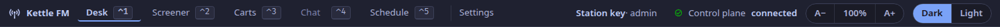

The frame runs along the top of every tab of the studio app.
Its heading below is its name on screen (ADR-0070, ADR-0097).

## `studio.frame`

The station's name, the tabs with their keys, Settings, who is signed in, the link to the control plane, the text size and the theme.

- **The tabs**: Desk `⌃1`, Screener `⌃2`, Carts `⌃3`, Chat `⌃4`, Schedule `⌃5`.
  Desk, Screener, Carts and Schedule are built.
  Chat is not a tab yet (**[planned](/reference/release-one-status/)**): it says it is not in this build, and the chat is on the Screener tab.
- **Settings**: retention, holds, the time zone, staff, API tokens and updates. While Settings is open only the `⌃` chords reach the keymap; a tab's key leaves Settings for that tab.
- **Update … available**: shown in the packaged app when its update feed offers a newer version; it opens Settings, and nothing installs without a yes there.
- **Who is signed in**: the member of staff, or the station key ([Add staff and sign in](/how-to/add-staff/)).
- **Control plane**: *connected*, *connecting* or *not connected*: whether the app's live link to the station is up; hover over it for the reason when it is not.
- **Text size**: `A−`, the level (select it to reset) and `A+`; or `Ctrl+−`, `Ctrl+0` and `Ctrl++`. The whole interface scales, and the level is remembered on this machine.
- **Theme**: Dark or Light.
  The app starts dark and never follows the system's setting (ADR-0065); the choice is remembered on this machine.

The desktop app signs in as a member of staff, or with the station key, and keeps either in the keychain ([Add staff and sign in](/how-to/add-staff/)).
The browser build is still given the station key once (as `?token=` in its address, kept for that session) or served behind a proxy that adds it.
